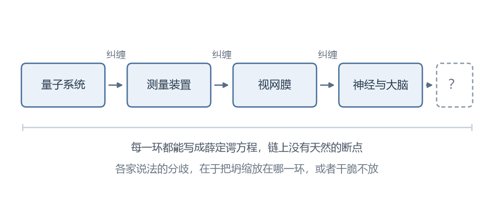
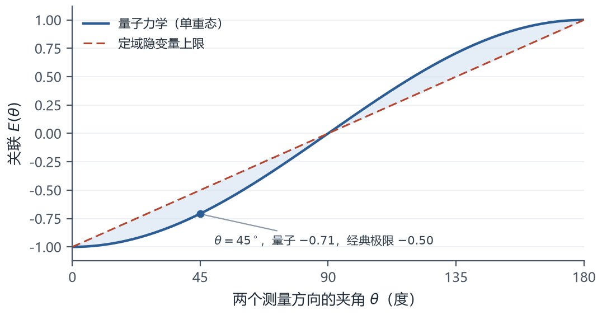

# 第 13 章　测量问题与几种解释

第 6 章讲过测量的规则，也讲过退相干。那一章留了一个尾巴，退相干把叠加变成了混合，可混合态仍然不告诉你这一次会得到哪个结果。从“可能”到“实际”的那一步，没有一个方程管。

这一步有多要紧，取决于你怎么看量子力学。把它当成一台预测概率的机器，这一步根本不需要解释。想知道世界到底怎么运转，这一步就是全部麻烦的来源。这一章把麻烦摊开，看一百年来有哪些说法，实验又排除了什么。

## 13.1 测量公设是一条外加的规则

量子力学有两条演化规则，形式很不一样。

一条是薛定谔方程，连续、确定、可逆。给定一个态，它告诉你这个态在下一时刻是什么，中间没有任何随机。把时间倒过来，同样成立。

另一条是测量公设，突变、随机、不可逆。测量一个物理量，结果只能是它的某个本征值，概率由态在该本征态上的投影决定。测量之后，态跳到测到的那个本征态。

两条规则各自都很清楚，放在一起就别扭。一个系统什么时候按第一条走，什么时候按第二条走，取决于有没有“测量”。可测量是什么，公设没有定义，它把最难的部分留在了括号里。

冯·诺依曼在 1932 年把这个结构写清楚了。系统与仪器通过相互作用纠缠起来，这一步完全确定，没有任何随机。

## 13.2 冯·诺依曼链

把这件事一步步展开。

一个自旋处在 $|{\uparrow}\rangle$ 和 $|{\downarrow}\rangle$ 的叠加，仪器初始处在 $|A_0\rangle$。两者作用之后，整个系统的态变成

$$
\frac{1}{\sqrt{2}}\left(|{\uparrow}\rangle|A_{\uparrow}\rangle+|{\downarrow}\rangle|A_{\downarrow}\rangle\right)
$$

仪器的指针和自旋建立了关联。这一步完全是幺正的，没有坍缩。

现在让第二台仪器去读第一台的指针，再把第二台接到第三台。每一环都可以用量子力学写，每一环都只是把纠缠延长一段。眼睛、视神经、大脑的神经元，也都是原子组成的，原则上都能写进这个波函数。

链条可以无限延长，找不到一个数学上特殊的断点。这就是冯·诺依曼链。

图 13-1　从量子系统到测量装置，再到观察者的链条。每一环都只增加一段纠缠，薛定谔方程本身不给链条设断点

于是有三条路可走。第一条，在某一环引入一个不服从量子力学的经典世界，坍缩发生在那条界线上。第二条，承认没有断点，所有分支都真实存在。第三条，修改薛定谔方程，让它在系统足够大时自己坍缩。

三条路对应三种解释，后面会一一说到。维格纳在 1961 年提出一个更尖锐的版本，让朋友在实验室里完成测量，问实验室外的他看到的是什么。这个问题至今仍在讨论。

## 13.3 退相干做到了什么

在讲各种解释之前，先把退相干的位置摆正。它解决了一部分问题，而且是很重要的一部分。

第一个贡献是选基。希尔伯特空间里可以选无穷多组基，可实际测到的确定状态总是位置、电荷、能量这一类。原因在于系统与环境的相互作用有偏好，通常偏好位置或电荷这种局域的量。环境相当于在做一次持续的、粗粒化的测量，把某些基选出来，这叫环境诱导的超选择。

第二个贡献是让干涉消失。环境把路径信息带走，约化密度矩阵的非对角项指数衰减，这段第 6 章算过。衰减速率跟系统的大小、温度、耦合强度有关，宏观物体上是 $10^{-20}$ 秒量级。

这两条加起来，解释了宏观世界为什么看起来是经典的，这部分是实打实的物理。

退相干做不到的是另一件事。它给出的是对角化的密度矩阵，形式上可以读成“以概率 $p$ 处于这个态，以概率 $1-p$ 处于那个态”。可这是一个经典混合，描述的是我们的无知，不是世界的不确定。它没有说“这一次是哪一个”。

有人反驳说，退相干之后各个分支已经无法干涉，所以“等于”只有一个分支实现了。这个推理不成立。无法干涉只说明分支之间不再有相位关系，不说明只有一个分支存在。多世界解释正是在这一点上把话说完，它说所有分支都实现了。

## 13.4 几种说法

哥本哈根解释是最早成型的，也是教科书里默认的。玻尔的想法是，量子力学只描述测量结果之间的统计关系，不描述测量背后的过程。测量装置必须用经典语言描述，量子世界和经典世界之间有一条界线，这条界线的位置可以移动，但不能取消。

优点是实用，不追问也不出错，所有计算照做。缺点是它把问题挡在门外。界线凭什么存在，为什么宏观物体自动站在经典那一边，它没有给机制。

多世界解释由埃弗雷特在 1957 年提出。它说坍缩根本不存在，薛定谔方程永远成立，测量只是让观察者与系统纠缠，宇宙在每一次测量处分叉。所有结果都在某个分支里实现了，我们之所以看到这一个，是因为我们在这个分支里。

这个说法的数学最干净，一条方程管到底，不需要额外公设。代价是要接受一个不断分叉的宇宙，还要解释概率从哪里来。如果所有分支都实现，说“这个结果概率是 0.3”是什么意思，到今天仍有争论，没有定论。

玻姆力学保留粒子的确定位置，另外加一个“导引波”。初始分布按 $|\psi|^2$ 抽样，之后所有预测跟标准量子力学完全一致。代价是显式的非定域性，一个粒子的速度依赖全空间的波函数。

玻姆力学在历史上很重要。贝尔正是因为看到它，才明白被排除的只是定域隐变量。

自发定域理论走第三条路，直接改方程。GRW 在 1986 年提出，给薛定谔方程加一个随机的、非线性的坍缩项，平均每个粒子每秒 $10^{-16}$ 次，坍缩把波函数局域到 100 纳米的范围。对单个粒子，这个效应小到测不出；对一个包含 $10^{23}$ 个粒子的宏观物体，每秒坍缩 $10^7$ 次，叠加瞬间消失。

这类理论可以检验，它在“介于两者之间”的尺度上会偏离标准量子力学。大分子干涉、低温微振子、地下低本底实验，把参数空间压得越来越小，还没有关闭，但余地不多了。

再往边上还有两种。关系性量子力学认为态不是系统的属性，而是系统相对于另一个系统的属性，不同观察者可以给出不同的态。QBism 把量子态当成观察者信念的编码，概率是个人赌注的合理化。两者争议很大，对实验的预言却跟标准量子力学一样。

## 13.5 贝尔实验判决了什么

上面这些说法有个共同点，它们对同一个实验给出同样的预言。这意味着实验没法在它们之间做判决。但实验可以判决另一件事，定域隐变量。

1935 年，爱因斯坦、波多尔斯基和罗森提出一个论证。两个粒子纠缠之后分开，测一个就知道另一个。如果测量不影响远处的粒子，那么另一个粒子的值在测量之前就已经确定。量子力学算不出这个值，所以它不完备。

1964 年，贝尔把这个问题变成了一个不等式。假设存在隐变量，假设测量是局域的，那么两个方向上的关联必须满足某个界限。对单重态，量子力学给出

$$
E(\theta) = -\cos\theta
$$

而定域隐变量给出的极限是一条直线，$|E|\le 1-2\theta/\pi$。取四个方向做组合，得到 CHSH 不等式 $|S|\le 2$，量子力学给出 $S=2\sqrt{2}\approx 2.83$。

图 13-2　单重态的关联随两个测量方向夹角的变化，按 $E(\theta)=-\cos\theta$ 计算。虚线是定域隐变量允许的上限，阴影部分是量子力学超出它的区域

从 1972 年的第一代实验到 1982 年阿斯佩的实验，结果一直站在量子力学这一边。可早期实验有漏洞，探测效率不够高，或者两台分析器距离太近，排除不了光速以下的信号。

2015 年，三个小组几乎同时关闭了主要漏洞，代尔夫特那一组用相距 1.3 公里的金刚石色心，另外两组用光子。测到的 $S$ 都明显超过 2，跟 $2\sqrt{2}$ 相容。2022 年的诺贝尔物理学奖给了克劳泽、阿斯佩和蔡林格。

判决很明确，定域隐变量不存在。世界要么非定域，要么不满足实在性，要么每次测量真的产生多个分支，剩下的几条路各有各的代价。

它没有判决的，是坍缩是否真实，是多世界还是哥本哈根。这些说法对贝尔实验的预言完全一样。

## 13.6 量子擦除到底擦掉了什么

第 6 章末尾提到过量子擦除，那里只说了现象。这里补上机制，因为它常被误读成“未来改变过去”。

实验用一对纠缠光子。信号光子走双缝，惰闲光子留在手里。因为两个光子纠缠，只要测惰闲光子的偏振，就能知道信号光子走了哪条缝。知道了路径，屏幕上就没有条纹。

关键的一步在后面。用分束器把两条路径的惰闲光子混起来，让“哪条路”的信息不可分辨。这时只看信号光子的计数，屏幕上仍是一片均匀分布。可如果把信号光子按惰闲光子的探测结果分组，每一组单独看，都出现清晰的条纹，两组的条纹相位正好错开半个周期。把两组加起来，条纹又抵消了。

所以条纹一直在，只是藏在关联里。要挖出来，必须知道每个信号光子对应哪个惰闲光子，这个信息只能走经典通道。没有超光速，也没有因果倒置。

正确的说法是，干涉是否出现，取决于路径信息在整个实验装置里是否原则上可得。信息一旦被原则上擦除，干涉就恢复。惠勒把这个思路推到极致，让擦除的选择在光子已经通过双缝之后再做，结果不变。

这个结论对量子技术很实用。相干性和信息在哪里是绑在一起的，量子纠错、量子中继的设计都要用这套语言。

## 13.7 做技术的人该怎么看

这一章讲的东西，对算门操作的保真度没有帮助。所有解释给出同一套规则和同一套实验预言，工程上按公设办不会出错。

但有三种场合，解释的差别会影响做法。

一是设计实验。想验证坍缩是不是真的，就得做自发定域理论预言的那种偏离，或者造更大质量的叠加态，方向由解释决定。

二是理解测量的角色。量子纠错里测一个校验算符并不会让逻辑态坍缩，因为信息编码在多个物理比特的联合态里。这件事用“坍缩”来想会想歪，用“信息更新”来想就顺。

三是心态。计算时按公设办，概念上承认这是未决问题。两件事可以同时做，不需要选边。物理学史上有很多这样的阶段，一套规则用得极顺，背后的图像还没定下来，用着用着，图像自己就长出来了。
