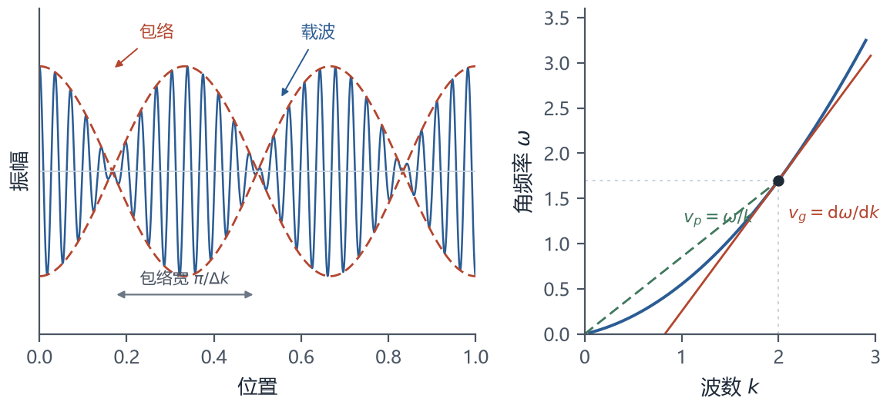
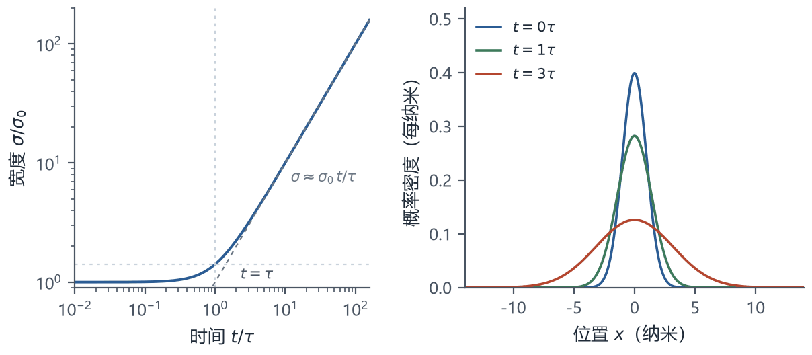

# 第 15 章　波包、群速度与色散

往池塘里丢一块石头，涟漪一圈圈荡开。盯着其中一个波峰，它离岸的距离在不断变大，可以给它量出一个速度。可如果往水里投的是一块大石头，激起的是好几圈波挤成的一串，整串波往外走的速度，和单个波峰往外走的速度，未必是一回事。

量子力学里的粒子也是这样一串波。第 5 章用高斯波包描述过一个位置大致确定的电子，那时只关心它长什么样，没管它怎么动。这一章把这个缺口补上。一个波包跑起来，会牵出两个速度、一个扩散时间，还有一条曲线，那条曲线决定了它全部的行为。

## 15.1 一个包，两个速度

最简单的波包由两列波叠成。取两列振幅相同、频率挨得很近的波

$$
\cos(\omega_1 t-k_1x)+\cos(\omega_2 t-k_2x)
=2\cos\!\left(\frac{\Delta\omega\, t-\Delta k\, x}{2}\right)\cos(\bar\omega t-\bar k x)
$$

右边第一个余弦变得很慢，它不振荡，只负责给振幅划出一个包络；第二个余弦振荡得很快，是包络里填的“载波”。整条式子说的是，高频振动被一个缓慢的鼓包套住了。

这两样东西各走各的。载波的相位 $\bar\omega t-\bar kx$ 保持不变时，$x=(\bar\omega/\bar k)t$，这是波纹本身移动的速度，叫相速度

$$
v_p=\frac{\omega}{k}
$$

包络的相位 $\Delta\omega\, t-\Delta k\,x$ 保持不变时，$x=(\Delta\omega/\Delta k)t$，这是鼓包移动的速度，叫群速度

$$
v_g=\frac{d\omega}{dk}
$$

两列波的情形里 $v_g$ 是两个频率与波数的差之比。频率成分再多一些，差商就变成导数。一个真正的波包由连续的一片频率叠成，群速度就是那条色散曲线在中心波数处的斜率。

哪一个是粒子在跑，答案清楚。你在探测器上看到的是一整块概率密度，不是某一条相位线。波包的中心跑到哪里，粒子最可能出现在哪里，所以 $v_g$ 才是那个能跟实验对上的速度。

这件事可以算得更硬一些。自由粒子的波包，位置期望值满足 $d\langle x\rangle/dt=\langle p\rangle/m$，严格等于 $v_g$。相速度则完全不进这个式子。换句话说，一条相位线的移动速度是个记账用的量，包中心的移动速度才是可观测的。实验上测电子飞行时间、测原子落点分布，得到的都是 $v_g$。

## 15.2 相速度可以超过光速

真空中，光波的 $\omega=ck$，两个速度相等，都等于 $c$。这个特例太干净，容易让人以为它们永远相等。

拿一根矩形金属波导，X 波段常用的那种，宽 22.86 毫米，截止频率 6.56 GHz。频率低于它，波进不去；高于它，波能走，但色散关系不再是 $\omega=ck$，而是

$$
\omega^2=c^2k^2+\omega_c^2
$$

把它代进相速度的定义，得到

$$
v_p=\frac{c}{\sqrt{1-(\omega_c/\omega)^2}}
$$

分母小于一，所以 $v_p$ 大于 $c$。取 10 GHz，$\omega_c/\omega=0.656$，分母是 0.755，相速度算出来是 $3.97\times10^{8}$ 米每秒，比光速快三成。

这不违反相对论。相速度描述的是“相位相同的点”怎么移动，它不是任何东西的移动。想象一排人依次起立又坐下，起立的时刻沿着队伍传过去，这个“起立的位置”可以跑得比人快，因为根本没有东西在跑。真要送一个信号，得让波形出现一个从无到有的变化，那个变化的速度是群速度。同一个波导里

$$
v_p v_g=c^2
$$

群速度算出来是 $2.26\times10^{8}$ 米每秒，规规矩矩地小于 $c$。大于 $c$ 的相速度，配上一个小于 $c$ 的群速度，乘积正好是 $c^2$。

物质波把这件事推得更远。自由电子的 $\omega=\hbar k^2/2m$，于是

$$
v_p=\frac{\omega}{k}=\frac{\hbar k}{2m},\qquad v_g=\frac{d\omega}{dk}=\frac{\hbar k}{m}
$$

群速度正好是经典速度 $p/m$，相速度只有它的一半。一个 100 电子伏特的电子，群速度 $5.9\times10^{6}$ 米每秒，相速度 $3.0\times10^{6}$ 米每秒。波峰的移动比电子本身的移动慢一半，这个差距在实验上没有任何矛盾，因为实验测的从来都是 $v_g$。

水波给出另一个比例。深水表面波的色散关系是 $\omega=\sqrt{gk}$，代入得 $v_p=\sqrt{g/k}$，$v_g=v_p/2$。波长为 10 米的涌浪，相速度接近 4 米每秒，群速度只有 2 米每秒。站在海边看浪，浪峰扑过来的速度是群速度的两倍，这也是为什么冲浪的人要等浪“追上来”，而不是迎着浪峰去追。

## 15.3 包会自己散开

自由空间里 $v_g$ 只跟 $k$ 有关，$k$ 又只跟动量有关。波包里不同的动量成分跑得不一样快，前面快的跑远了，后面慢的落在后头，包就摊开了。这叫色散，扩散只是它在实空间里的样子。

高斯波包可以算得很干净。宽度用标准差 $\sigma$ 表示，宽度随时间的演化是

$$
\sigma(t)=\sigma_0\sqrt{1+\left(\frac{t}{\tau}\right)^2},
\qquad \tau=\frac{2m\sigma_0^2}{\hbar}
$$

短时间里包几乎不变，$\sigma\approx\sigma_0$；过了 $\tau$ 这个坎，宽度开始线性增长，$\sigma\approx\sigma_0 t/\tau$。$\tau$ 是“什么时候开始散”的标尺，它跟质量成正比，跟初始宽度的平方成正比。

几个数字能说明这个标尺跨度有多大。电子，初始宽度 1 纳米，$\tau$ 是 $1.7\times10^{-14}$ 秒，十七飞秒。这种电子的动能已经上百电子伏特，跑起来像一颗子弹，可它的波包在 1 皮秒内就从 1 纳米摊到 58 纳米。初始宽度改成 10 纳米，$\tau$ 变成 1.7 皮秒，同样的 1 皮秒里只摊到 11.6 纳米。包越窄，价越贵。

一颗粒子质量大一些就完全不同。铷原子，初始宽度 1 微米，$\tau$ 是 2.7 毫秒。一团冷原子云在几十毫秒里才明显摊开，所以原子干涉仪的时间尺度是毫秒，不是飞秒。至于 1 克、1 毫米宽的小球，$\tau$ 是 $6\times10^{17}$ 年，比宇宙年龄长得多，它的波包永远来不及散开。宏观物体看起来守规矩，一部分原因就在这里。

这里很容易误会一件事。扩散不是“不确定性变大了”那么简单。自由空间里动量分布不变，$\sigma_p$ 一直是原来那个值，变大的只有 $\sigma_x$。乘积 $\sigma_x\sigma_p$ 一开始取最小值，之后一路上升。原因在于位置和动量之间长出了关联，靠前的成分动量偏大，靠后的成分动量偏小，位置知道了就能猜出动量。这种关联在量子光学里叫压缩，在自由波包里它自己就长出来，不需要谁去制备。

## 15.4 色散关系是一条曲线

把 $\omega$ 对 $k$ 画成一条曲线，整件事就一目了然。相速度是从原点连到曲线上某一点的割线斜率，群速度是那一点的切线斜率。两个斜率不一样，两个速度就不一样。

图 15-1　两列波叠加成的包，以及色散曲线上的相速度与群速度。左图按 $\omega=2\pi\times40$、$\Delta k=2\pi\times4$ 计算，虚线是包络；右图取一段下凹的曲线，割线斜率即 $v_p$，切线斜率即 $v_g$

曲线弯曲的程度，决定了包散得快还是慢。弯曲小的地方，一段范围内的斜率差不多，各种成分跑得差不多快，包能保持很久。弯曲大的地方，包很快就散。

晶体里的声波是另一个好例子。把原子看成用弹簧连起来的链，色散曲线分成两支。声学支在长波极限下是一条过原点的直线，斜率就是声速，硅的纵声速约 8430 米每秒；光学支在 $k=0$ 处就有 15.6 太赫兹的有限频率，对应两个子晶格相对振动。声学声子负责传热，光学声子负责跟光耦合，同一个晶格里两套波，走的是两条完全不同的曲线。

真实介质的色散关系很少有解析式。玻璃的折射率随波长变，蓝光比红光折射得更厉害，于是蓝光走得更慢，$\omega/k$ 随 $k$ 减小，曲线下凹。光纤通信里这个弯曲很要命。一束 100 飞秒的脉冲在普通单模光纤里走 1 米，二阶色散约 22 飞秒平方每毫米，出射时被拉到三百多飞秒，前后沿糊成一团。速率越高，脉冲越短，糊得越快，所以长距离链路上要专门加一段色散符号相反的补偿光纤，让它糊开的东西再收回去。

反过来，色散也能拿来干活。一束白光穿过棱镜散成彩色，靠的是相速度随频率变；超短脉冲被光栅压缩得更短，靠的是让低频先走、高频后走，出射时所有成分同时到达。色散不是坏事，它是一个可以被设计的量。

## 15.5 晶体里的电子有多重

固体里的电子不在自由空间里跑，它在原子核排成的周期结构中运动，色散关系完全变了样。能量不再是 $k$ 的抛物线，而是一条有周期、有上下界的曲线，形状由晶格决定。

曲线在某个 $k$ 附近仍然是光滑的。把极小值附近展开，二次项系数给出一个数，把它定义成有效质量

$$
\frac{1}{m^*}=\frac{1}{\hbar^2}\frac{d^2E}{dk^2}
$$

换成这个质量，电子的行为可以照抄自由粒子的公式，$E=\hbar^2k^2/2m^*$，$v=\hbar k/m^*$。晶格的复杂影响全部塞进 $m^*$ 里。

这个数可以跟自由电子差很远。砷化镓的导带底，$m^*$ 只有 $0.067\,m_e$，电子显得特别轻，稍微加个电场就跑到很快，迁移率因此很高，高频器件爱用它。硅有两个极值谷，纵向 $0.98\,m_e$，横向 $0.19\,m_e$，同一个晶体里方向不同，质量不同。有些材料的价带顶曲率是负的，$m^*$ 带负号，电子朝电场反方向加速，这种空缺用“空穴”来描写更省事，空穴的质量是正的。

有效质量还解释了另一件事。同一条能带上，$d^2E/dk^2$ 随着 $k$ 变化，靠近带顶时曲率变号。所以一个电子被电场推到能带顶附近，会发现自己在减速，这跟真空中电子被电场一直加速的图像完全不同。半导体里那些看似反常的输运现象，多数能从色散曲线的形状上读出来。

这个数还直接决定器件速度。迁移率 $\mu=e\tau/m^*$，$	au$ 是两次碰撞之间的平均时间。砷化镓的电子迁移率能到 8500 平方厘米每伏秒，硅只有 1400，差距主要来自那个 0.067。高电子迁移率晶体管、射频前端里的那些器件，选材料时先看的就是这个数。

有效质量不是万能的。它只在能带极值附近成立，电子被强电场加速到能带中段，曲线弯得厉害，单一的质量已经描述不了。这时得回到完整的 $E(k)$，一步一步算。工程师嘴上说的“有效质量”，其实是一段局部近似，能用，但不能当成本质。

## 15.6 探测器看到的是什么

回到测量。探测器不会记录整条波包，它记录的是一个点，某个时刻、某个位置的一次事件。波包描述的是这件事发生的概率，以及它随时间的漂移。

这就带来一个实际后果。波包越窄，位置越准，扩得越快，能用的时间窗越短。想同时要窄和久，就得让步。时间分辨的电子显微镜、泵浦探测实验里那些飞秒的时序安排，多半是在这个约束下凑出来的。

一个具体例子是时间分辨的光电子谱。一束飞秒激光打在晶体表面，把电子激发到真空中，这些电子的波包在离开表面时只有几个纳米的宽度，飞出去几十微米就摊得很开。探测器放在远处，收到的是一块被拉长了的分布，想从中还原出射时刻，就得把扩散算回去。实验里那些几十飞秒的时间分辨率，一半靠激光，一半靠这笔账算得准。

另一头，波包足够宽的时候，反而好办。冷原子云摊到几十微米，位置分辨率差，但它能活几十毫秒，足够让两束原子波重叠、干涉、再读出相位。原子钟、原子干涉仪、重力仪，全是拿时间换精度。

还有一个细节值得提一句。波包被测量一次，形状就变了，测量把它截短，也把它的动量成分搅乱。测完以后它又按新的形状重新扩散。这个反复截断与重新扩散的过程，正是下一章要处理的场景，把粒子关进一个小空间，看它的能级怎么被定下来。

图 15-2　自由高斯波包的扩散。左图按 $\sigma(t)=\sigma_0\sqrt{1+(t/\tau)^2}$ 计算，三条曲线分别是 1 纳米、10 纳米的电子波包和 1 微米的铷原子波包，虚线标出 $t=\tau$；右图是 1 纳米电子波包在三个时刻的形状，面积保持不变
