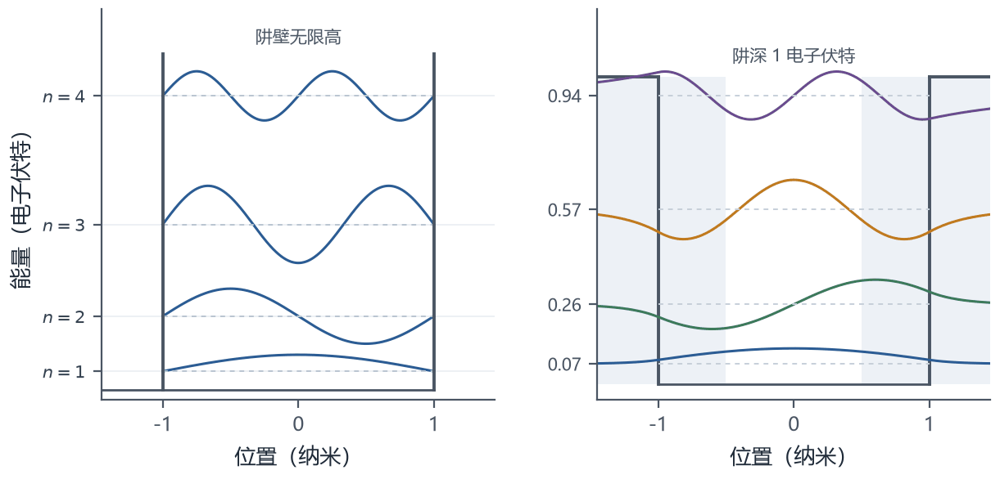
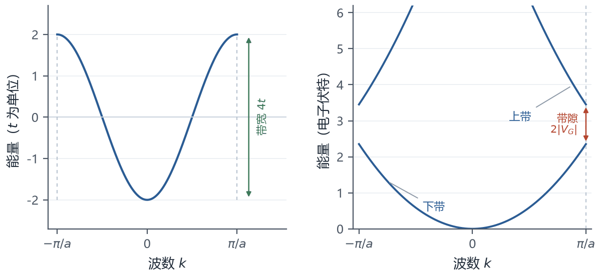

# 第 16 章　势阱、周期势与能带的起源

把一只弹珠放进碗里，它会滚到碗底停下。晃一晃碗，弹珠在碗壁上下来回滚动，滚多高取决于你晃的力气，能量可以取任意值，只要不超过碗口。

电子的情形不一样。把它放进一个很小的碗里，它能取的能量只有几个固定值，就像一把尺子上只有几道刻线。这个差别不是电子古怪，而是波的性质。碗壁把波关在里面，波要维持自己，只能长成一些特定的形状。

这一章从最简陋的碗讲起，一层一层往上加复杂度，最后落到半导体。能带这个概念是整本书后半段的枢纽，二极管、晶体管、太阳能电池、激光器，全部挂在它上面。

## 16.1 把电子关进一个盒子

最简单的模型叫无限深方势阱。势能在 $0<x<L$ 里为零，两头竖成无穷高的墙。阱内波函数满足自由粒子的方程，解是正弦

$$
\psi(x)=A\sin(kx),\qquad k=\frac{\sqrt{2mE}}{\hbar}
$$

两端是硬墙，波函数在墙上必须为零，于是 $\sin(kL)=0$，$kL=n\pi$。这一条限制把连续的 $k$ 切成了离散的几档

$$
E_n=\frac{n^2\pi^2\hbar^2}{2mL^2}=\frac{n^2h^2}{8mL^2}
$$

换个角度说，阱宽里正好装下半个波长的整数倍，$L=n\lambda/2$。波绕不过这个条件，就像吉他弦只能在特定频率上共振。

数字很有说服力。阱宽 1 纳米，电子基态 0.376 电子伏特，第二能级 1.50，第三能级 3.38，比例是 1 比 4 比 9。阱宽放到 10 纳米，基态降到 3.8 毫电子伏特，间隔挤在一起；再放到 100 纳米，基态只有 0.04 毫电子伏特，几乎连成一片。

这个规律是量子尺寸效应的全部内容。半导体里的量子点就是这样一个盒子，材料相同，尺寸不同，颜色就不同。硒化镉量子点直径 2 纳米时发蓝光，长到 6 纳米发红光，同一批化学反应做出来的东西，靠控制颗粒大小就能调出整个可见光谱。显示器里那种色纯度很高的量子点膜，用的就是这个原理。

图 16-1　宽度 2 纳米的势阱里的电子态。左图是无限深阱，能级按 $n^2$ 排开，波函数在壁上归零；右图把阱深降到 1 电子伏特，四个束缚态整体下移，越靠上压得越低，波函数在阱外多出一段指数尾巴。按有效质量近似数值解出

## 16.2 阱壁不是无限高

真实的阱没有无穷高的墙。半导体异质结里，两种材料导带底的能量差就是阱深，典型的取值在 0.2 到 1 电子伏特之间。有限深阱里，波函数在阱外不再立刻归零，而是拖出一条指数尾巴

$$
\psi(x)\propto e^{-\kappa|x|},\qquad \kappa=\frac{\sqrt{2m(V_0-E)}}{\hbar}
$$

尾巴的长度是 $1/\kappa$。阱深 1 电子伏特、电子能量 0.5 电子伏特时，$\kappa$ 约 5 每纳米，尾巴长约 0.2 纳米。这么短的一段，看起来无关紧要，实际影响很大。

第一，能级位置变了。墙不再是硬的，波可以稍微鼓出去一点，等效于阱变宽，能级因此下移。同是 2 纳米宽，无限深阱的前四级是 0.094、0.376、0.847、1.506 电子伏特，有限深阱（1 电子伏特）解出来是 0.066、0.259、0.568、0.939。四条全部往下掉，而且越往上掉得越多。最上面那个态离阱口只差 0.06 电子伏特，它的尾巴拖得最长，半个波函数都在阱外。

第二，束缚态的数目有限。无限深阱不管多浅多窄，总能装下无穷多条能级；有限深阱装不下这么多。阱深定在 1 电子伏特，第五个态已经越过阱口，不再束缚，跑到阱外变成一片连续谱。把阱深降到 0.3 电子伏特，只剩两个态；降到 0.1 电子伏特左右，一个都不剩，电子再也留不住。临界条件可以写成很干净的一条要求，阱的强度 $V_0a^2$ 要大于 $\pi^2\hbar^2/2m$ 才有至少一个束缚态。$a$ 是阱宽，所以又窄又浅的阱关不住东西。

第三，尾巴让相邻的阱能“说话”。这一点是下一节的全部内容。

## 16.3 两个阱挨在一起

把两个同样的阱并排放，中间隔一道不高的墙。左边一个阱有基态 $E_1$，右边一个阱也有基态 $E_1$，两个能量一样，态是简并的。

墙有限厚，两条尾巴在墙里相遇。这时不能再把两边当成独立的系统，得找整个双阱结构的本征态。对称性帮了大忙，本征态只有两种，一种两边同号，一种两边反号

$$
\psi_+=\frac{1}{\sqrt{2}}\left(\psi_L+\psi_R\right),\qquad
\psi_-=\frac{1}{\sqrt{2}}\left(\psi_L-\psi_R\right)
$$

同号的那个，波函数在中间墙里鼓起来，电荷堆在两阱之间，库仑排斥大，能量高一点。反号的那个，波函数在中间有个节点，电荷躲开中间，能量低一点。原来简并的一条能级，裂成了两条，间隔记作 $2t$。

这个 $t$ 叫耦合或者跃迁矩阵元，它随墙的厚度指数变化，跟第 11 章那个透射系数的指数是同一个来源。墙厚一倍，分裂可能小几个数量级。

化学里这个图像叫成键与反键。氢分子离子 $\mathrm{H}_2^+$ 的两个质子，共享一个电子，电子的两个态就是上面这两个组合，能量低的是成键态，高的是反键态。两个氢原子能结成分子，靠的就是这条分裂带来的能量降低。

氨分子是另一个漂亮的例子。三个氢原子排成三角形，氮原子在三角形平面的一侧，也可以翻到另一侧，两个位置对应两个阱。氮原子在两边之间来回穿，频率 23.87 吉赫兹，波长 1.25 厘米，正好落在微波波段。1940 年代第一台氨分子钟就是拿这条线做的，后来才换成铯原子。

双阱还成了量子比特的原型。把电荷放在左边还是右边，是两个态，中间的耦合 $t$ 可以调，调它就是调比特的频率。超导电荷比特、电荷量子比特，骨架都是这个双阱。

这里要跟第 11 章分清楚。第 11 章关心的是“粒子能不能过去”，算的是透射概率；这一节关心的是“两个阱的能级差多少”，算的是分裂。同一堵墙，两种问法，两个答案。

## 16.4 排成一条长链

两个阱给出两条能级，三个阱给三条，四个给四条。阱的数目往上加，能级越挤越密，$N$ 个阱就有 $N$ 条能级，均匀地铺在原来那条能级的上下。

加到 $10^{23}$ 个，能级密到无法分辨，连成一条连续的带。这就是能带。

一维链的模型可以严格解。只考虑最近邻的耦合，第 $n$ 个阱的基态振幅记作 $c_n$，薛定谔方程给出

$$
E\,c_n=E_0c_n-t\left(c_{n-1}+c_{n+1}\right)
$$

猜一个行波解 $c_n\propto e^{ikna}$，$a$ 是阱间距，代进去就得到

$$
E(k)=E_0-2t\cos(ka)
$$

这条曲线就是一个能带。它的最高点在 $k=0$，能量 $E_0-2t$，最低点在 $ka=\pi$，能量 $E_0+2t$，总宽度 $4t$。$k$ 只在一个周期内取值就够了，$-\pi/a<k\le\pi/a$，这段区间叫第一布里渊区，再往外是重复的。

能带里的电子，行为跟自由电子完全不同。自由电子的能量随 $k$ 一直往上走，能带的能量在 $k$ 上是有界的、周期的。电子的速度还是 $v=(1/\hbar)dE/dk$，在带底和带顶都是零，中间最大。有效质量 $m^*=\hbar^2/(2ta^2)$，取 $t=1$ 电子伏特、$a=0.3$ 纳米，得到 $0.42\,m_e$，量级跟真实半导体对得上。

这个模型背后的定理叫布洛赫定理。周期势里的本征态可以写成

$$
\psi_k(x)=u_k(x)\,e^{ikx}
$$

$u_k$ 有晶格的周期，$e^{ikx}$ 是一个平面波包着的信封。电子的概率密度 $|u_k|^2$ 是周期的，跟原子位置对齐，可它整体还能以一个确定的速度移动。这就是为什么晶体里的电子既被原子束缚，又能导电，两件事同时成立。

图 16-2　左图是紧束缚模型的能带 $E(k)=E_0-2t\cos(ka)$，取 $t=1$ eV、$a=0.3$ nm，带宽 $4t$ 标注在右侧；右图把自由电子的抛物线折叠进第一布里渊区，在 $k=\pm\pi/a$ 处劈开 $2|V_G|=1.1$ eV 的带隙，取 $a=0.4$ nm 计算

## 16.5 能带之间的缝

单一能带模型里，能量从 $E_0-2t$ 到 $E_0+2t$ 连续可填。可真实晶体里，带与带之间有缝，缝里一个态也没有，电子进不去。这个缝叫禁带。

缝的来源是布拉格反射。电子波在周期势里传播，波长合适的时候，被每一层原子反射回来的波会同步叠加。条件是 $2a=n\lambda$，最要紧的是 $\lambda=2a$，对应 $k=\pi/a$，正好在布里渊区边界。

在这一点上，往右走的波和往左走的波强度相等，叠加起来不再是行波，而是驻波。驻波有两种，一种把电子堆在原子位置上，一种堆在两个原子之间

$$
\psi_+\propto\cos(\pi x/a),\qquad \psi_-\propto\sin(\pi x/a)
$$

两种分布的静电能量不一样，差出一个 $2|V_G|$，$V_G$ 是周期势的傅里叶分量。行波在这个能量上待不住，被劈成上下两支，中间那段空出来，就是禁带。

近自由电子模型把这个想法算成了定量。它从自由电子的抛物线出发，把周期势当成微扰，在布里渊区边界处打开 $2|V_G|$ 的缝。结论跟实验吻合得不错，碱金属的带隙很小，几乎可以当自由电子处理；金刚石结构的材料缝很大。

几个实际的数字。硅 1.12 电子伏特，锗 0.66，砷化镓 1.42，氮化镓 3.4，金刚石 5.47。这串数字决定了材料能干什么。1.12 电子伏特对应波长 1.1 微米的红外光，硅太阳能电池刚好能吸收太阳光谱里的大部分；3.4 电子伏特对应紫外，氮化镓适合做蓝光和紫外发光；金刚石缝太宽，掺不进杂质，只能当绝缘体。

还有一件事叫直接带隙与间接带隙。砷化镓的导带底和价带顶在 $k$ 空间同一个位置，电子跳下去只发一个光子，效率高。硅的两个极值错开了，跳下去还得把动量交给晶格，发一个声子，概率低得多。所以硅做不了激光器，发光二极管也只能做很暗的红外。这不是工艺问题，是能带图画出来的结论。

## 16.6 三种材料的分界

有了能带和带隙，导体、绝缘体、半导体的区别就只是一件事，电子怎么填。

绝对零度，电子从最低的态往上填，每个态放两个，自旋相反。填到哪停，取决于总共有多少电子。

如果最上面那条带只填了一半，带里空着一半位置，加个电场，电子就能往上挪一点，占住空位，形成电流。这是金属。钠的 3s 带只有一个电子，填了一半，所以钠是良导体。镁的 3s 带刚好填满，按理该是绝缘体，可 3s 带和 3p 带重叠，实际还是导体。

如果最上面那条带刚好填满，下一条带空着，中间隔着一个大缝，电子没有地方去，这就是绝缘体。金刚石、石英、氧化铝都是这样。缝宽 5 电子伏特以上，室温下的热激发根本送不过去。

缝窄一些，1 到 3 电子伏特，室温下就有少量电子被热激发跨过去，电导率介于两者之间，而且随温度升高而上升。这是半导体。这个“随温度上升”是它最好认的标志，金属正好相反。

半导体的妙处在于可以调。往硅里掺一点磷，磷比硅多一个电子，那个电子在带隙里形成一个浅的施主能级，离导带只有 45 毫电子伏特，室温下一碰就电离，贡献一个自由电子。掺硼则相反，缺一个电子，形成受主能级，价带里的电子跳上来，留下一个空位，这个空位像带正电的粒子，叫空穴。

掺杂的量可以控制得很细。纯硅在室温下本征载流子密度约 $10^{10}$ 每立方厘米，硅原子本身有 $5\times10^{22}$ 每立方厘米，掺到 $10^{16}$ 就已经把导电性提高了六个数量级，而材料看起来还是硅。整个半导体工业建立在“能带结构不变、费米能级可调”这件事上。

## 16.7 能带图能读出什么

一张能带图，配上掺杂和结，就能读出器件的全部行为。

pn 结是把 p 型和 n 型接在一起，界面处电子和空穴互相扩散、复合，留下带电的离子，形成一个内建电场。能带在界面附近弯曲，弯出一个势垒。加正向电压，势垒降低，电流涌过去；加反向电压，势垒升高，几乎没有电流。二极管的单向导电，就是这条曲线的直接后果。

太阳能电池反过来用。光子打进结区，把电子从价带抬到导带，内建电场把电子和空穴往两边拉，接上负载就有电流。带隙决定能吸收哪些光子，1.1 电子伏特的硅刚好卡在太阳光谱最密集的地方，理论极限效率约 33%，实际单结硅电池做到 26% 已经很了不起。

量子阱激光器又是另一种用法。两层带隙不同的材料夹出一层薄阱，电子和空穴被关在阱里，复合发光。阱宽决定能级位置，也就决定了激光的波长，同一个材料体系，改几纳米厚度就能换颜色。通信用的 1310 纳米和 1550 纳米激光器，很多是这么调出来的。

走到这里，能带告诉我们电子能待在哪些能量上，为什么金属亮、玻璃透、硅能做芯片。可光怎么跟这些能级打交道，一个光子被吸收的概率有多大，谱线为什么有宽度，这些还没有答案。下一章从爱因斯坦的三个系数开始，把这笔账算清楚。
