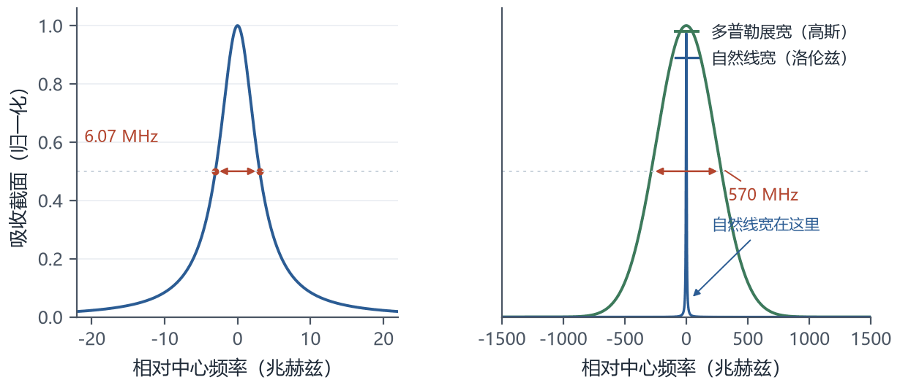

# 第 17 章　光与原子的相互作用

一束激光穿过一团钠蒸气，如果频率对得上，钠原子会挡住它。挡得有多厉害，取决于原子的密度、蒸气的长度、光的频率，还取决于光的强度。频率偏一点点，挡住的效果可能掉好几个数量级；光强加大一倍，挡住的比例未必加倍。

这些数字不是猜的，它们可以由三个系数推出来。这一章把光与原子之间的交易算成账，吸收有多强、发射有多快、谱线有多宽、光到多强原子就不再买账。算完以后，很多实验上的“常识”就变成了能估出来的数。

## 17.1 三个系数

爱因斯坦 1917 年把光与原子的作用归成三种过程，每种给一个系数。

吸收，原子在低能级 $1$，吃掉一个能量为 $\hbar\omega$ 的光子，跳到高能级 $2$。每秒发生的次数正比于原子数和辐射场能量密度

$$
R_{12}=B_{12}\,u(\omega)\,N_1
$$

受激辐射，原子已经在高能级，被路过的光子催一下，吐出一个一模一样的光子，回到低能级。频率、方向、相位都跟来的那个一致

$$
R_{21}^{\text{stim}}=B_{21}\,u(\omega)\,N_2
$$

自发辐射，原子在高能级待着，什么也不用碰，自己掉下来，发出一个光子，方向随机，相位随机

$$
R_{21}^{\text{spon}}=A_{21}N_2
$$

三个系数里，$B_{12}$ 和 $B_{21}$ 由偶极跃迁矩阵元决定，$A_{21}$ 不是独立的。

推导只用两行。把原子放进温度为 $T$ 的腔里，让它跟黑体辐射达到平衡，上下能级的布居数不再变化

$$
B_{12}u(\omega)N_1=B_{21}u(\omega)N_2+A_{21}N_2
$$

再由玻尔兹曼分布 $N_2/N_1=(g_2/g_1)e^{-\hbar\omega/k_BT}$，并且要求解出来的 $u(\omega)$ 正好是普朗克公式，两个式子一对比，就得到

$$
g_1B_{12}=g_2B_{21},\qquad
A_{21}=\frac{\hbar\omega^3}{\pi^2c^3}B_{21}
$$

$g_1$、$g_2$ 是能级的简并度。第一条说的是，从下面往上和从上往下，按每个态算，概率一样，光的吸收和受激辐射在微观上完全对称。第二条才是关键，自发辐射不是另一套机制，它就是受激辐射在“真空里也有零点涨落”时的样子。真空不空，这句话在这里变得具体，真空中每一个模式都有半个光子的涨落，它催着激发态的原子往下掉。

第二条式子还带着一个很重的 $\omega^3$。频率越高，自发辐射越猛。这一条能解释一大片现象。

三个系数里还藏着一条关于光的量子性的线索。受激辐射吐出的光子，与催它的那个光子同频率、同方向、同相位，两个光子的波函数叠在一起分不开。一束光穿过布居数反转的介质，光子数滚雪球一样涨，而每一步新增的光子都跟前一步对齐，这就是激光能相干的原因。第 8 章从装置和增益讲这件事，这里的系数则说明了那份“一模一样”是从哪里来的，它来自玻色统计给出的 $n+1$ 因子。

## 17.2 自发辐射有多快

把 $B_{21}$ 用偶极矩阵元写出来，自发辐射速率是

$$
A_{21}=\frac{\omega^3\left|d_{21}\right|^2}{3\pi\varepsilon_0\hbar c^3}
$$

$d_{21}$ 是偶极矩阵元，量级上等于电子电荷乘以波函数的重叠长度。原子跃迁的 $d$ 大约 $4\times10^{-29}$ 库仑米，相当于 $0.25$ 个电子电荷乘以一个玻尔半径。

代进 780 纳米，得到 $A\approx1.0\times10^{8}$ 每秒，寿命 10 纳秒。铷的 D2 线实测寿命 26 纳秒，跟这个估算同一个量级，差别来自具体的矩阵元和简并因子。可见光波段的允许跃迁，寿命基本都在几纳秒到几十纳秒之间，这个范围很稳。

频率一变，情况就完全不同。$A$ 正比于 $\omega^3$，也就是反比于波长的三次方。紫外跃迁快得来不及看，真空紫外更甚；而射电波段的跃迁慢得离谱。氢原子 21 厘米线，波长是可见光的五十万倍，$A=2.85\times10^{-15}$ 每秒，平均寿命一千一百万年。宇宙里那么多中性氢能被看见，靠的就是这条慢得不像话的线，原子来不及掉下去，才有机会被观测。

寿命还决定了“亚稳态”这个概念。有些能级到低能级的跃迁被选择定则禁掉，一阶矩阵元为零，只能靠二阶过程，寿命可以拉到秒甚至更长。钙的 $^{1}S_0$ 到 $^{3}P_1$ 就是这种，寿命几百微秒，原子钟和量子计算里的“存储能级”多半是这类。第 19 章那个电子 shelving 实验，用的也是一个寿命几十秒的亚稳态。

寿命可以直接量。用一束短脉冲把原子打到激发态，再用快探测器数荧光光子，光子到达的时刻分布是一条指数衰减曲线，衰减常数就是寿命。这套办法叫时间相关单光子计数，分辨率可以到皮秒。测出来的寿命跟算出来的 $A$ 对得上，这是量子电动力学最早的定量验证之一。

## 17.3 吸收截面

原子有多大，这个问题在光学里有自己的答案。

几何截面是 $\pi a_0^2$，约 $9\times10^{-21}$ 平方米。可共振光的吸收截面要大得多

$$
\sigma_0=\frac{3\lambda^2}{2\pi}
$$

780 纳米代进去，$\sigma_0=2.9\times10^{-13}$ 平方米，是几何截面的三千万倍。一个原子居然能挡住半径零点三微米的圆盘上来的光，这件事听起来不讲理，其实是波的性质，天线在共振时接收面积远大于它的物理尺寸，原子就是一个尺寸只有零点几纳米的偶极天线。

这个截面决定光学厚度。一束光穿过密度 $n$、长度 $L$ 的介质，透射强度按指数衰减，$\tau=\sigma nL$ 叫光学厚度。铷气室长 5 厘米，原子密度 $10^{18}$ 每立方米，$\tau$ 算出来是 $1.5\times10^4$，光根本透不过去，一层皮都不剩。实际实验要么把气室加热到原子密度低一些，要么让激光失谐，把截面降下来。

截面随频率变化，形状是一个洛伦兹

$$
\sigma(\omega)=\sigma_0\frac{\left(\Gamma/2\right)^2}{\left(\omega-\omega_0\right)^2+\left(\Gamma/2\right)^2}
$$

这里的 $\Gamma$ 是自然线宽，下一节讲。失谐一个线宽，截面掉一半；失谐十个线宽，掉到百分之一。光谱学能分辨不同的原子和不同的能级，靠的就是这条又高又窄的峰。

截面还随波长平方式增长。同样一个跃迁强度，长波长的吸收截面更大。到了微波波段，原子的吸收截面可以到平方厘米量级，这也是里德堡原子微波传感器为什么灵敏，原子像一根很长的天线，把微弱的场收进来。

吸收和折射是同一件事的两面。洛伦兹吸收峰附近，折射率不是常数，峰的中心附近它上升，两边它下降，这叫反常色散。克拉默斯和克罗尼希在 1927 年证明，只要知道吸收谱，折射率谱就唯一确定，反过来也一样。一块介质对某个频率吸收得厉害，它对这个频率的折射率一定在剧烈变化，两者绑在一起，分不开。

## 17.4 谱线不是一根针

原子跃迁的名义频率是一个数，实际谱线总有一定宽度。三种机制贡献了几乎全部的宽度。

自然线宽来自激发态的有限寿命。一个寿命 $\tau$ 的态，能量有一个不确定度 $\hbar/\tau$，谱线因此摊成洛伦兹形，半高全宽

$$
\Gamma=\frac{1}{\tau},\qquad \Delta\nu_{\text{nat}}=\frac{\Gamma}{2\pi}=\frac{1}{2\pi\tau}
$$

铷 D2 线，$\tau=26$ 纳秒，$\Delta\nu_{\text{nat}}=6.07$ 兆赫兹。这是个很小的数，在射电天文里算宽的，在光频上算极窄，因为光频本身是 384 太赫兹，$6$ 兆赫兹只有它的六千万分之一。

多普勒展宽来自原子的热运动。朝你飞来的原子，看到的频率高一点；背着你的，看到的低一点。热运动速度按麦克斯韦分布，谱线因此摊成高斯形，半高全宽

$$
\Delta\nu_D=\nu_0\sqrt{\frac{8k_BT\ln 2}{mc^2}}
$$

铷-87 在 100 摄氏度，$\Delta\nu_D$ 约 570 兆赫兹。这个数比自然线宽大两个数量级，气相光谱的分辨率基本被它卡住。想让谱线变窄，得让原子慢下来，激光冷却是唯一实用的办法。冷到多普勒极限 145 微开尔文，展宽降到跟自然线宽一个量级。

碰撞展宽来自原子之间的碰撞。碰撞把发射过程打断，波列变短，谱线变宽，形状又回到洛伦兹。展宽量正比于碰撞频率，也正比于气压。铷里加几十帕的缓冲气体，线宽就能从 6 兆赫兹展到几十兆赫兹。

三种机制叠在一起，实际的线型是洛伦兹和高斯的卷积，叫佛克特线型。中心部分由多普勒主导，两翼由洛伦兹主导。光谱拟合时得用这个函数，用错了，中心频率会偏。

量一条线有多宽，也就知道了能测多细的位移。原子钟把线宽压到 1 赫兹，就能分辨 $10^{-15}$ 量级的相对频移，相当于一秒钟里差一个飞秒。引力红移、时间膨胀这些效应，就是靠窄线宽量出来的。

图 17-1　同一条跃迁的两种展宽机制。按铷 D2 线计算，自然线宽 6.07 MHz，洛伦兹形；100 摄氏度下多普勒展宽 570 MHz，高斯形。两条曲线都归一化到峰值，横轴以中心频率为零点

## 17.5 光太强会怎样

弱光下，吸收的光子数正比于光强。光强加上去，原子来不及把激发态清空，吸收就跟不上了。

二能级原子的稳态解能把这笔账算清。设失谐 $\delta=\omega-\omega_0$，饱和参数 $s=I/I_{\text{sat}}$，激发态布居

$$
\rho_{22}=\frac{s/2}{1+s+4\delta^2/\Gamma^2}
$$

弱光时 $\rho_{22}\approx s/2$，随光强线性上升；强光时 $\rho_{22}\to1/2$，饱和在半。原子有一半时间在上能级，一半在下，再多加光也没用，受激辐射和吸收打平了。

饱和光强由三个参数定

$$
I_{\text{sat}}=\frac{2\pi^2\hbar c\,\Gamma}{3\lambda^3}
$$

铷 D2 线代进去是 $16.7$ 瓦每平方米，也就是 $1.7$ 毫瓦每平方厘米。一支普通激光笔聚焦到零点几毫米的光斑，强度就能到这个量级的几十倍，所以用激光笔照铷气室，饱和是很容易发生的。

饱和还会把线宽撑宽。强光让原子在上能级待得久，寿命看起来变短，线宽按

$$
\Gamma'=\Gamma\sqrt{1+s}
$$

增长。$s=100$ 时线宽宽十倍，从 6 兆赫兹变成 60 兆赫兹。这叫功率展宽，做精密光谱时要尽量避免，做饱和吸收光谱时又故意用它，因为宽出来的洞能衬出窄的反凸峰。

强光还会挪动能级。失谐的光场不与原子交换能量，却把能级推上推下，能移量

$$
\Delta E=\frac{\hbar\Omega^2}{4\delta}
$$

$\Omega$ 是拉比频率，正比于光场的电场强度，$\delta$ 是失谐。这叫光移，或者交流斯塔克效应。它有时是麻烦，原子钟里的探测光会把钟频推偏；有时是宝贝，光镊就是靠一个高度聚焦的强光场造出一个高斯形的阱，把中性原子抓住。镊里的阱深一般在毫开尔文量级，困住的原子位置不确定到几十纳米，这对原子阵列与量子模拟至关重要。

饱和吸收是个巧妙的用法。两束相向传播的光穿过气室，一束强，一束弱。强光把某一速度组的原子饱和掉，弱光就少了这部分吸收，测到的透射谱上出现一个很窄的凹陷，宽度由自然线宽决定，跟多普勒展宽无关。1980 年代以前，人们就是靠这一招把光谱分辨率提高上千倍。

## 17.6 从这些数能估什么

把上面的数凑起来，能估不少实验参数。

散射力。原子吸收一个光子，动量增加 $\hbar k$；自发辐射方向随机，平均下来不贡献动量。稳态散射率最多 $\Gamma/2$，所以辐射压力有一个上限

$$
F_{\max}=\frac{\hbar k\Gamma}{2}
$$

铷的 780 纳米，$F_{\max}=1.6\times10^{-20}$ 牛顿。听起来微不足道，可原子质量只有 $1.4\times10^{-25}$ 千克，加速度是 $1.1\times10^{4}$ 个重力加速度。一个原子在激光里能被打得比子弹还猛，磁光阱里减速、捕获、冷却，全靠这份力。

散射率。同样的原子，最强能每秒散射 $\Gamma/2$ 个光子，铷是 $1.9\times10^{7}$ 个。探测器每秒收几百万个光子很容易，所以单个离子的荧光清楚可见。第 19 章那些“一个亮点突然灭了”的观察，就是在这个信噪比上做出来的。

分辨率。多普勒宽度 570 兆赫兹对应的速度是 300 米每秒，自然线宽 6 兆赫兹对应 3 米每秒。一个测量能做到多细，先看物理上的线宽有多窄。

浓度。吸收截面给定，透射率就变成一个浓度计。比尔-朗伯定律说，$I=I_0e^{-\sigma nL}$，测透射光强就能反推 $n$。若气体分了对准 1650 纳米的一条甲烷吸收线，1 ppm 的浓度在 1 米光程上给出的光学厚度约 $10^{-3}$，对应的吸收只有千分之一，用一台稳定光源和差分探测就能测出来。城市里那些测燃气泄漏、测温室气体排放的设备，原理就是这一条。

谱线宽度和饱和光强这两个数，几乎决定了所有激光光谱实验的设计参数。激光的功率、光斑大小、气室的温度、频率扫描的范围，都要围着它们转。下一章把这套办法推到极致，用两台干涉仪去量比原子还小的位移。
