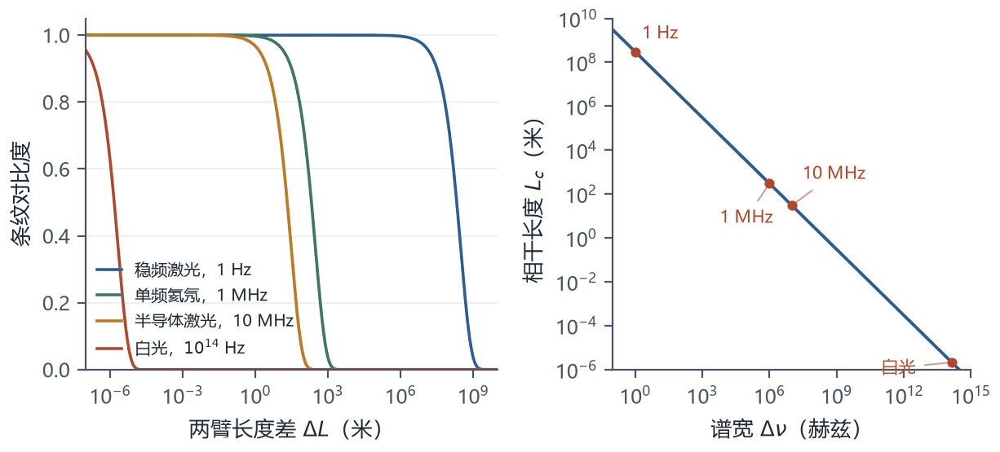
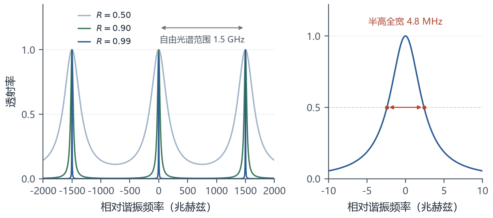

# 第 18 章　相干性与干涉仪

第 1 章讲双缝，说条纹的明暗由相位差决定。这个说法隐含了一个前提，两束光得能“记住”自己的相位，一直记到屏幕前。如果光源每发出一个波峰就换一次相位，条纹早就糊掉了。

能记住多久，是一个可以量的数，叫相干时间。它把光源分成三六九等，也决定了哪一种实验做得成。这一章从这盏灯有多“纯”讲起，一路讲到十亿瓦的激光在四公里长的管子里来回跑，最后量出一段比质子还小两百倍的长度变化。

## 18.1 一支激光有多纯

单色性说的是频率有多集中。任何真实光源的谱线都有宽度 $\Delta\nu$，宽度越小，相位记忆越久

$$
\tau_c\approx\frac{1}{\Delta\nu}
$$

这段时间里，波列还保持着确定的相位关系，过了这段就重新掷骰子。乘上光速，得到相干长度

$$
L_c=c\,\tau_c=\frac{c}{\Delta\nu}
$$

这条式子很简单，用处极大。典型的氦氖激光器，单模运行，线宽 1 兆赫兹，相干长度 300 米。分布反馈半导体激光器，线宽十兆赫兹，30 米。日光灯或白光 LED，谱宽差不多是可见光的整个宽度，$1.4\times10^{14}$ 赫兹，相干长度只有 2 微米。

差距是八个数量级。用白光做迈克尔逊干涉仪，两臂长度差必须控制在微米以内才看得到条纹，手一抖就没了。用氦氖激光，差几米都还是清楚的。这不是仪器的精度问题，是光本身的性质。

再往上走，稳频激光能把线宽压到 1 赫兹。碘稳频的氦氖激光、锁定在超稳腔上的半导体激光，都能做到。相干长度 30 万公里，能绕地球七圈半。引力波探测器用的就是这种光，因为它要比较的两条臂路，等效长度上千公里。

## 18.2 相干长度怎么量

迈克尔逊干涉仪把一束光分成两束，走不同长度的路，再合回来。合回来的光强跟两臂的相位差有关

$$
I=\frac{I_0}{2}\left(1+\cos\Delta\varphi\right),\qquad
\Delta\varphi=\frac{4\pi\,\Delta L}{\lambda}
$$

$\Delta L$ 是两臂的长度差。移动一面镜子，条纹就会周期性地明暗变化，每移动半个波长，一个条纹周期。

关键是条纹的对比度。两臂长度差从小到大增加，条纹从清楚变模糊，最后完全消失。对比度随 $\Delta L$ 的衰减曲线，直接就是光源的相干函数

$$
V(\Delta L)=\left|g^{(1)}(\Delta L/c)\right|
$$

对比度随长度差指数衰减，衰减常数就是相干长度，$V(\Delta L)=e^{-|\Delta L|/L_c}$。严格写出来还有一个量级为一的系数，取决于线型的精确形状，洛伦兹线型和高斯线型的差别就在这里，可数量级不变。

反过来也成立。测出对比度曲线，做一次傅里叶变换，就得到光源的谱。这个办法叫傅里叶变换光谱，在红外波段特别好用，因为那里没有好的分束器和探测器，直接测谱困难，用干涉仪测对比度再变换反而简单。傅里叶变换红外光谱仪到现在还是化学分析的常规设备，它的核心就是一个迈克尔逊干涉仪加一个移动镜。

相干这件事还有个容易忽略的方面，空间相干。同一时刻，光在不同位置上的相位是否相关，决定了它能不能形成清楚的干涉。点光源的空间相干性好，扩展光源差。杨氏双缝里，缝越远、源越大，条纹越模糊，这是同一条规律。

图 18-1　左图是几种光源的条纹对比度随臂长差的变化，按 $V=e^{-|\Delta L|/L_c}$、$L_c=c/\Delta\nu$ 计算；右图是相干长度与谱宽的对应关系，几个典型光源标在曲线上

## 18.3 相位怎么变成信号

马赫-曾德尔干涉仪比迈克尔逊更适合讲测量。一束光在第一个分束器分成两路，各走一段，在第二个分束器合起来，两个输出口各接一个探测器。

两个输出的光强是互补的

$$
I_\pm=\frac{I_0}{2}\left(1\pm\cos\Delta\varphi\right)
$$

一路亮，另一路就暗，两路相减，直流部分抵消，只剩下余弦项。这个差分探测的招数很有用，光源的强度抖动被抵消掉，剩下的只有相位信息。

相位差怎么来的，取决于两臂之间放了什么。放一段待测气体，相位差随折射率变；放一面随引力波抖动的镜子，相位差随长度变。把 $\Delta\varphi=2\pi\,\Delta L/\lambda$ 代进去，一段位移就翻译成一个相位。

翻译系数很大。波长 633 纳米，位移 1 纳米对应相位变化 0.01 弧度，看着不大，可相位是可以用干涉测到千分之一弧度的量。1 纳米的位移对应的条纹移动是百分之一的周期，仔细读是能读出来的。

真正的极限在哪。光由光子组成，$N$ 个光子到达探测器，计数有泊松涨落，标准差 $\sqrt{N}$。相位的不确定度

$$
\delta\varphi\approx\frac{1}{\sqrt{N}}
$$

这是散粒噪声极限，也叫标准量子极限。1 毫瓦的氦氖激光照 1 秒，$N\approx3\times10^{15}$，$\delta\varphi\approx2\times10^{-8}$ 弧度，换成位移是 2 飞米。这个数字已经比原子核小了。

实际做不到这么细。激光本身的相位抖动、镜子的热振动、地面的震动，都会把这个数推上去。散粒噪声是地板，其他噪声是地板上的家具。

想突破散粒噪声，得用非经典光。压缩真空态把某一个正交分量的噪声压到散粒噪声以下，代价是另一个分量变大。LIGO 从 2019 年起就在探测器里注入压缩光，把高频段的灵敏度提高了几个分贝。这也是第 9 章那些单光子技术第一次在工程里派上大用场。

慢信号还可以靠外差把相位搬走。让一臂的光先被声光调制器频移 几十兆赫兹，两束光拍频，相位差就变成一个射频信号的相位。射频信号可以用电子学办法放大、滤波、正交解调，比直接测直流光强稳得多。绝大多数商用干涉仪都这么做，因为低频的电子学漂移实在太难缠。

## 18.4 让光来回跑很多次

法布里-珀罗干涉仪是另一种思路。两块高反射镜面对面，光在中间来回反射，只有特定频率能透过去。

透射率是

$$
T=\frac{1}{1+F\sin^2\left(\delta/2\right)},\qquad
F=\frac{4R}{(1-R)^2},\qquad
\delta=\frac{4\pi L\nu}{c}
$$

$R$ 是镜子的反射率，$L$ 是腔长。透射峰等间距排列，间隔叫自由光谱范围

$$
\Delta\nu_{\text{FSR}}=\frac{c}{2L}
$$

腔长 10 厘米，间隔 1.5 吉赫兹。峰的宽度由精细度决定

$$
\mathcal{F}=\frac{\pi\sqrt{R}}{1-R},\qquad
\Delta\nu_{\text{FWHM}}=\frac{\Delta\nu_{\text{FSR}}}{\mathcal{F}}
$$

$R=0.99$ 时精细度 312，线宽 4.8 兆赫兹；$R=0.999$ 时精细度 3140，线宽 0.48 兆赫兹。

这个装置干了三件事。第一，当滤波器用，从一堆频率里挑出一条。第二，当频谱分析仪用，扫描腔长，看透射峰出现在哪里，就能量出激光的频率。第三，当长度标准用，腔长变了，峰的位置就移动，反过来可以从峰的位置读出腔长的变化。

法布里-珀罗腔还有个身份，光在里面的存储时间变长了。有效往返次数约等于精细度，光在腔里待的时间是

$$
\tau_{\text{store}}\approx\frac{\mathcal{F}L}{\pi c}
$$

精细度 312、腔长 10 厘米，存储 33 纳秒。这个时间不长，但腔里循环的功率被放大了同样的倍数。输入 1 瓦，腔内能有好几百瓦。引力波探测器就是靠这个把 100 千瓦的激光变成几十万瓦的腔内功率，因为辐射压跟功率成正比，信号也跟着放大。

图 18-2　法布里-珀罗腔的透射谱，腔长 10 厘米，自由光谱范围 1.5 GHz。三条曲线对应反射率 0.5、0.9、0.99，按艾里公式计算，右侧标出 $R=0.99$ 时的线宽 4.8 MHz

## 18.5 锁定与噪声

到这里，一个麻烦显出来。腔的透射峰只有几兆赫兹宽，激光的频率也会漂，漂几十兆赫兹是常事。不锁的话，峰一飘就没了。

锁定的办法是给系统一个误差信号，再用反馈把它推回零点。这个信号不能是透射光强本身，因为光强在峰顶是极大值，两侧对称，看不出往哪边偏。要找一个在峰顶过零、两侧反号的量。

庞德-德雷弗-霍尔的办法是在激光上加一个几十兆赫兹的相位调制，产生两个边带。边带和载波在腔里的反射率不同，混频解调以后就得到一个色散形的误差信号，在共振点过零，斜率很大。把这个信号送进 PID 控制器，控制激光器的频率或者腔长，就能把系统钉在峰上。

锁定以后，能压到多稳，取决于噪声。噪声谱一般分三段。低频段是 $1/f$ 噪声，来自温度漂移、电子器件的漂移、地面的缓慢起伏，越往低频越大。中频段是技术噪声，机械振动、声波、电源干扰，往往有尖锐的峰。高频段才轮到散粒噪声，白噪声，平坦。

不同的实验关心不同频段。原子钟关心低频，要稳；引力波关心 10 赫兹到几千赫兹，正好夹在技术噪声和散粒噪声之间，两头都得压。

压噪声的办法无非几种。把镜子挂成单摆，隔掉地震；把腔放进真空，隔掉声波；把镜片做成熔融石英，让热噪声小一些；把整台仪器锁在一个更慢的参考上，做多级锁定。每一层都是一个数量级的改善，攒起来才有 2015 年那一次探测。

还有一种最古老的办法，平均。噪声是随机的，平均 $M$ 次测量，标准差降为 $\sqrt{M}$ 分之一。拿时间换精度，跟第 15 章里冷原子拿空间换时间是一个道理。代价是慢，所以探测器会捡到短促的脉冲，却很难测一个频率缓慢变化的连续源，后者得靠长期的符合分析。

## 18.6 引力波探测为什么需要这些

引力波经过时，空间在两个方向上交替拉伸和压缩。应变 $h=\Delta L/L$，量级极小。

LIGO 的两条臂各长 4 公里。2015 年 9 月 14 日探测到的第一个事件，峰值应变 $1\times10^{-21}$，对应臂长变化

$$
\Delta L=hL=4\times10^{-18}\ \text{米}
$$

四阿米。质子半径是 0.84 飞米，这个长度变化是质子半径的两百分之一。用一根 4 公里的尺子量出两百分之一质子半径的变化，这就是整件事的难度所在。

为什么必须用上一节那些东西。第一，激光要极纯，否则相位噪声比信号大得多。第二，臂里要装法布里-珀罗腔，让光来回跑约三百次，等效光程 1120 公里，把相位积累放大。第三，要功率循环，把腔内功率抬到几十万瓦，让散粒噪声降下来。第四，整套系统要锁，激光锁腔、腔锁臂、臂锁臂，一层套一层，否则镜子自己就在抖。

频率窗口也解释得通。4 公里的臂，对 100 赫兹的引力波，波长是 3000 公里，臂长只有波长的七百分之一，天线效率不高。频率再低，波更长，效率更差，而且地面震动和重力梯度噪声会淹没信号。频率再高，散粒噪声占上风。所以地面探测器的窗口大概在 10 到 10000 赫兹之间，正好覆盖恒星级黑洞并合的最后几声。

那次事件的两个黑洞分别是 36 和 29 个太阳质量，并合成 62 个，中间差出的 3 个太阳质量全部变成了引力波，峰值功率超过全宇宙所有恒星发光的总和。信号在探测器里持续 0.2 秒，频率从 35 赫兹一路升到 250 赫兹，听起来像一声短促的啁啾。要在 0.2 秒里看出这个频率在爬，采样率和相位稳定性都得到位。

探测器要放在两个相距 3000 公里的站点，是为了排除本地扰动。同一次振动不可能同时以正确的方式打在两个站点上，而引力波会。这种符合探测的办法，跟第 9 章讲的两个探测器同时计数是一个思路，只不过尺度从厘米变成了大陆。

2017 年 8 月，两个探测器又收到一个信号，持续了一百秒，频率扫得很慢，最后停在一千赫兹附近。紧接着，费米卫星在 1.7 秒后看到了伽马射线，全世界几十台望远镜把镜头对准了同一个方向，找到了一个正在发光的千新星。两个中子星并合，引力波先到，光随后到，两套观测对上了号。那一次之后，“引力波天文学”才算真正开了张。

下一章把镜头推到另一端，不再看宏观的干涉条纹，而是盯着一个离子，看它什么时候发光，什么时候不发光。
