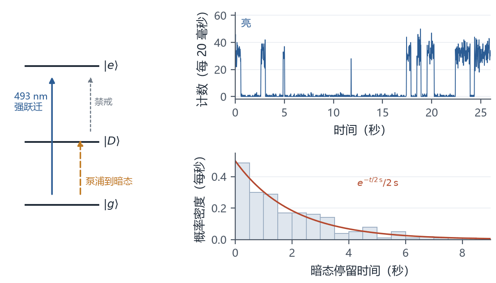
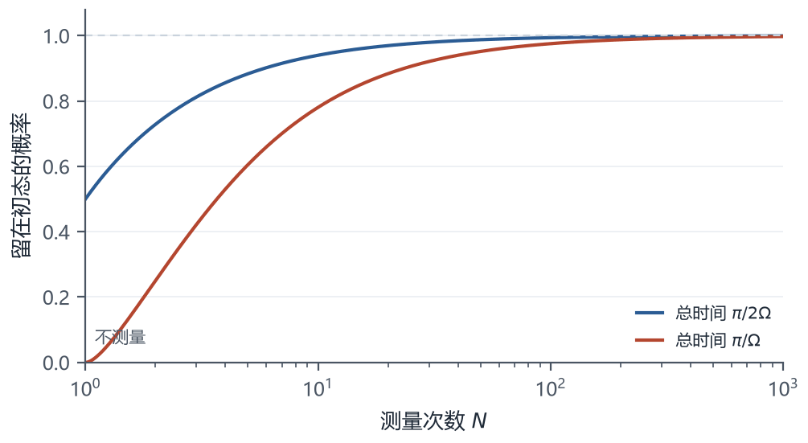

# 第 19 章　量子跳跃与单系统观测

前面十八章讲的实验，多数是在一群原子、一批光子上做出来的。谱线是许多原子的平均，条纹是许多光子的累计，统计规律藏在平均里。

到了 1970 年代，事情开始变。物理学家学会把单个离子关在电磁场里，用激光照它，用透镜把它发的那点光收进探测器。屏幕上就是一个亮点，一直亮着，背景干净得像真空。这样的一个点，可以连着看好几天。

亮着的一个点能看出什么。它会在某个随机的时刻突然变暗，过一会儿又亮起来，没有任何预兆。这不是仪器故障，是一个电子换了能级。这一章讲的就是这类观察，一个一个的量子事件，以及“一直盯着看”这件事在量子力学里意味着什么。

## 19.1 一个离子，一直盯着看

囚禁靠的是电场。单靠静电场抓不住离子，因为恩绍定理说静电势没有三维的极小值，离子总要往某个方向跑。办法是加一个射频场，让势阱快速翻转，离子跟不上翻转，平均下来就被推回中心。这个装置叫保罗阱，沃尔夫冈·保罗在 1950 年代做出来，1989 年拿了诺贝尔奖。

被抓住的离子几乎不动，温度低到毫开尔文量级，位置稳定在几十纳米内。激光照上去，只要频率对得上，它每秒能散射上亿个光子。这些光子被透镜收集一部分，送进光电倍增管，计数率几十万每秒。

铷原子气体里做不了这件事，因为原子在跑，一跑就离开焦点。离子阱里的离子是钉住的，可以反复看同一个。1986 年前后，三个小组几乎同时用这个办法做出了单离子实验，汉堡的托舍克组用钡离子，西雅图的戴默尔特组用钡离子，博尔德的国家标准局组用汞离子。

戴默尔特在 1975 年就写过一篇短文，提出“单个电子或离子能做什么”。他后来把这个想法总结成一句话，大意是，一个被关住、能被反复观测的粒子，会变成一个几乎理想的对象。这句话在当时听着像愿景，十年后成了现实。

## 19.2 荧光只有两种亮度

单离子实验里最漂亮的一个设计叫电子 shelving，中文常译成“搁置”或者“搁架”。

做法是用三个能级。两个低能级，一个叫基态，一个叫亚稳态，中间隔着一个激发态。基态到激发态是一条允许跃迁，寿命纳秒，激光一直开着，离子在这条线上来回跳，不停吐光子，看上去就是个亮点。亚稳态到激发态是一条禁戒跃迁，概率极低，激光照上去几乎没反应。

现在再拿一束频率不同的激光，专门把基态搬到亚稳态。离子一旦到了亚稳态，就掉不进那条亮的循环，光子突然不发了。屏幕上那个点从亮变黑。

于是亮度变成了一个二值信号。亮，说明电子在基态；暗，说明电子在亚稳态。中间没有过渡，因为电子只能待在这两个地方之一。数万倍的信噪比放在一个二值判断上，判断几乎不会错。

图 19-1　电子 shelving 的三能级结构与荧光记录。左图是能级和两束激光，粗箭头是强跃迁，虚线是禁戒跃迁；右上是一段模拟的荧光计数，亮暗交替，右下是停留时间的分布与指数拟合，时间常数取 2 秒

亮多久、暗多久，是随机的。统计大量的亮段和暗段，长度分布是指数衰减，平均长度等于该能级寿命的倒数。铍、镁、钙、钡、锶这些离子，亚稳态寿命从几秒到几十秒，暗段的平均长度也就这么长。一条荧光轨迹上，能看到几秒钟的亮，几秒钟的暗，再几秒钟的亮。

这个实验第一次把“量子态”这个词展示成了肉眼可见的东西。一个态不亮，另一个态亮，态的改变是一个瞬间的事件，没有中间过程。教科书里那个抽象的“跃迁”，在屏幕上就是一个点的熄灭。

## 19.3 跳跃为什么是随机的

一个孤立的原子，处在两个态的叠加里，按理说应该连续演化，相位慢慢积累，布居数平滑地转移。可观测到的却是突然的一跳。

原因在于观测。每隔很短的时间，环境或者探测器就从原子里取走一点信息，取走的信息足够判定它在哪个态，波函数就被重新设定，相位关系归零，演化从头开始。所以看到的不是平滑的振荡，而是一连串的重新开始，每次开始的位置由上一次的判定决定。

这套图像有一个严整的数学形式，叫量子轨迹或者量子跳跃。把系统与探测场耦合，让它们一起演化，然后对探测器的记录做条件平均。结果为一条随机微分方程，连续的部分是相位演化，随机的部分是一个个跳跃算符，跳跃的概率正比于跃迁速率乘时间步长。

计算机模拟时有现成的办法，叫蒙特卡洛波函数。每一步掷一次骰子，绝大多数时候不发生跳跃，波函数按非厄米的哈密顿量平滑演化，范数一点点减少；一旦掷中，就按跳跃算符把态投到一个新位置，再归一化。把许多条这样的轨迹平均起来，正好复现主方程给出的密度矩阵。

这里要澄清一个流传很广的误解。跳跃不是说原子“原来在激发态，某一刻决定跳下来”。跳跃是记录的一个事件，它标记的是我们关于原子的知识发生了一次更新。更新之前，原子处在叠加态，没有“在哪个态”这个事实；更新之后有了。第 13 章那些解释之间的分歧，在这一点上最尖锐，可所有解释对荧光轨迹的预言完全一样。

对做实验的人来说，这套形式不是哲学，是工具。它给出了一套算法，知道每一步该以多大概率跳，跳到哪，于是能算出探测器会看到什么样的计数分布，也能反过来从计数反推系统参数。

## 19.4 看轻一点

量子跳跃是一种极限情形，测量强到足以完全确定态。把测量调弱，能做的事就更多。

弱测量指的是让系统和测量装置之间的耦合非常小，小到一次测量只取走一点点信息，几乎不改变态。代价是每次结果都很模糊，得重复很多次才能平均出一个值。听起来不划算，可在某些情形下，弱测量能给出强测量给不出的东西。

1988 年，阿哈罗诺夫、阿尔伯特和瓦伊德曼指出一种奇怪的现象。用弱测量去测一个几乎不被扰动的系统，再把结果按后选择筛一遍，得到的平均值可以远远超出该量在通常意义上的取值范围。这个值叫弱值。它不代表任何一次测量的读数，可它确实出现在指针的偏移里，实验上测得到。

弱测量后来被用来追踪单系统的轨迹。2012 年，有人用弱测量逐点测一个光子在双缝后的平均路径，得到一条连续的平均轨迹，从缝口一直走到屏幕，中间平滑地弯。这条轨迹不是哪一个光子的路径，它是很多次弱测量平均出来的统计路径。问“光子到底走了哪条路”，答案仍然是“没有确定的路”，可平均之后，那个模糊的中间过程就有了形状。

连续测量是另一条线。不追求一次读出全部信息，而是一直轻微地测，让信息一点点渗出来。这样做可以得到系统的实时状态估计，再把这个估计送进反馈回路，实时纠正它的演化。冷原子被连续监测位置，再用反馈把它的运动压下去，这叫反馈冷却；超导比特被连续监测，一旦探测到跳跃就立刻纠正，这叫实时纠错。这些技术都以“测量不必一锤定音”为前提。

## 19.5 越看越不动

量子芝诺效应是这套逻辑走到极端的产物。一个系统本来会从态 $A$ 演化到态 $B$，如果每隔很短时间就测一次“还在 $A$ 吗”，测到的几乎总是“在”，系统就永远走不到 $B$。

算一下就很清楚。设演化是拉比振荡，角频率 $\Omega$，总时间 $t$ 分成 $N$ 段，每段 $t/N$。一段之内跑到 $B$ 的振幅是 $\sin(\Omega t/2N)$，很小。测一次，波函数被投回 $A$，振幅重新从零开始长。$N$ 次之后，仍然留在 $A$ 的概率

$$
P_A(N)=\left[\cos\left(\frac{\Omega t}{2N}\right)\right]^{2N}
$$

$N=1$ 时它等于 $\cos^2(\Omega t/2)$，就是自然演化的结果；$N$ 越来越大，$P_A$ 趋近 1。测无穷多次，系统被冻住。

这不是比喻。1990 年，Itano 和同事在博尔德的离子阱里做了这个实验。用铍离子的基态两个超精细能级，先施加一个让布居数完全转移的脉冲，然后在脉冲中间插入若干次测量，看最后还剩多少布居在初态。测量次数从 1 加到 32，剩下的布居数一路涨回去，曲线跟上面的公式吻合。

需要说清楚的是，芝诺效应不是“观测让时间停住”。每一次测量都是一次真实的投影，把系统按回起点，相位归零。系统并没有被冻结在某个瞬间，它是被反复地重启。真要看到“停顿”，得保证测量之间的间隔远小于系统的特征时间。

这个效应有一个对偶，叫反芝诺效应。测量如果不够强，或者间隔选得不巧，反而会加速跃迁。两种情况的分界取决于测量强度与系统耦合的比值，实验上两种都做到了。

图 19-2　量子芝诺效应。按 $P_A(N)=\cos^{2N}(\Omega t/2N)$ 计算，横轴是测量次数，两条曲线对应总演化时间取 $\pi/2\Omega$ 和 $\pi/\Omega$。不测量时前者剩 0.5，后者剩 0，测得越勤，留在初态的概率越接近 1

## 19.6 单系统观测改变了什么

把这几件事放在一起看，量子力学的面貌有一点变化。

以前它是一门统计的科学。波函数给出概率，实验靠大量重复来验证。单个事件被视为不可预测的噪声，只有平均才有意义。单离子实验把这个界限推开了，概率仍然在，可事件的序列本身成了可观测量。你能看到一次跳跃发生在第几秒，也能看到两次跳跃之间的间隔分布。

技术上，这条线通向今天所有的量子硬件。离子阱里的态读出、超导比特的色散读出、量子点的自旋读出，原理都是“让一个态对应亮、另一个态对应暗”。量子纠错要不断测量稳定子，测量的强弱、快慢、反作用，都要算清楚。芝诺效应从教科书里的一个悖论，变成了限制测量速率的一个工程参数。

还有一个更微妙的收获。测量的反作用不再被当成麻烦，而是一种资源。弱测量拿到部分信息，反馈把它用掉，系统被推向想要的方向。这条思路在冷原子、光机械、超导电路里都开了花，本质上都是同一件事，把“看”变成“调”。

再往前走一步，问题就变成，能不能让一个宏观物体也处在这样的叠加里，然后看它怎么塌。这个问题的答案，一部分藏在超导和超流里。下一章就去看那些几十亿个粒子一起做同一件事的体系。
