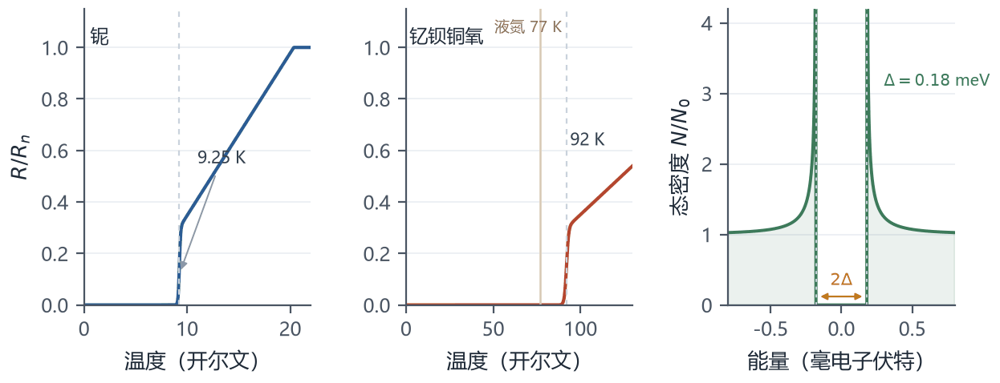
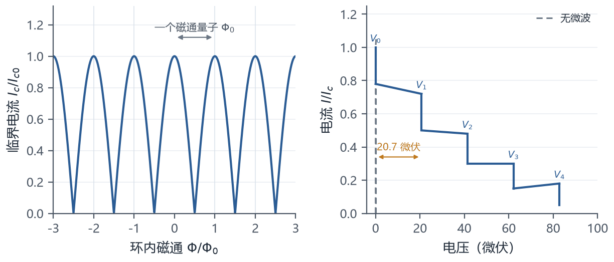

# 第 20 章　宏观量子现象

一块磁铁放在液氮里，磁铁上方的另一块小磁铁会悬浮起来。这个现象叫迈斯纳效应，超导体把磁场排到体外，磁力线被挤得绕道走，两块磁铁之间就多出一层排斥。

悬浮这件事本身不稀奇，抗磁材料都能做到一点。稀奇的是它的干净程度。超导体对磁场的排斥是彻底的，不是部分，不是渐进的，一跨过临界温度就全有或全无。这种“全有或全无”，量子力学里最典型的样子，居然出现在一块能用手指捏住的金属上。

量子效应通常藏在小尺度里。原子、电子、光子，尺度到了纳米，量子规律就摆在明面上；到了毫米、厘米，退相干把叠加抹平，世界看起来是经典的。可超导、超流、玻色-爱因斯坦凝聚这三类体系，偏偏在宏观尺度上保留了量子相干。这一章讲它们是怎么做到的，也讲“宏观量子”这四个字到底指什么。

## 20.1 一个波函数能有多大

普通物体的量子态，描述的是组成它的每一个粒子，自由度有 $10^{23}$ 个，写不下来，也维持不住。宏观量子体系的关键，是把这 $10^{23}$ 个自由度压成很少的几个。

玻色-爱因斯坦凝聚是最直白的例子。把原子气体冷到纳开尔文，热德布罗意波长大到超过原子间距，原子之间再也分不出彼此，全都落进同一个单粒子态。整个凝聚体由一个波函数描述，相位处处相同。1995 年在铷-87 上做出来时，凝聚体有两千个原子，后来能做到上百万个。

超导更彻底。金属里的电子配对成库珀对，这些对儿也落进同一个量子态，配对的数量是 $10^{23}$ 量级。所有对儿共享一个相位，这个相位是宏观变量，可以在电路里被测量、被控制、被耦合。

超流是同一个故事的另一种讲法。液氦-4 冷到 2.176 开尔文以下，一部分原子进入零动量的基态，这一部分的比例随温度下降而增长，到绝对零度趋于 1。零黏性、爬壁、喷泉，都是这个宏观波函数的直接后果。

三者共同的结构是，一个复数的宏观波函数

$$
\Psi(\mathbf{r})=\sqrt{n_s}\,e^{i\theta(\mathbf{r})}
$$

$n_s$ 是凝聚的密度，$\theta$ 是相位。幅度给出“有多少”，相位给出“在哪一步”。经典物理里没有这个相位，量子力学里它是核心，而在这三类体系里，它大到了可以被工程使用。

## 20.2 电阻为什么突然消失

1911 年，昂内斯把汞冷到 4.2 开尔文，发现电阻突然掉到零，掉得比仪器能测的下限还低。后来知道，这不是“很小”，是真的零，超导环里的电流能连着流几年，衰减时间超过十万年。

零电阻只是一半。1933 年，迈斯纳和奥克森菲尔德发现，超导体不只是理想导体，它还会主动把体内的磁场排出去。一个理想导体降温时会把原有的磁通冻在里面，超导体不会，它把磁通全赶走。这一条把超导和“完美导体”区分开，说明它是一种新的热力学相。

1957 年，巴丁、库珀和施里弗给出解释。电子之间本来互相排斥，可它们在晶格里走的时候会扰动正离子，把周围拉出一点正电荷的畸变，另一个电子被这点畸变吸引。这个吸引很弱，被库仑排斥压着，可只要净效应是吸引，两个动量和自旋相反的电子就会绑成一对，叫库珀对。

库珀对是玻色子，可以全部落进同一个态。要拆开一对，得付出能量 $2\Delta$，这个能量在能谱上开出一个缺口。缺口的存在意味着，单个电子没法用很小的能量被激发，散射通道被堵死，电阻就消失了。

$\Delta$ 跟临界温度挂钩，BCS 理论给出

$$
2\Delta\approx3.53\,k_BT_c
$$

铝的 $T_c$ 是 1.18 开尔文，$\Delta$ 约 0.18 毫电子伏特；铌的 $T_c$ 是 9.25 开尔文，$\Delta$ 约 1.5 毫电子伏特。这个能隙小得可怜，比室温的热能 $k_BT$ 小两个数量级，所以超导只能活在液氦温度。

1986 年以后，铜氧化物把 $T_c$ 抬到了 90 开尔文以上，钇钡铜氧是 92 开尔文，液氮（77 开尔文）就能维持。这一突破让超导从实验室的稀罕物变成了可以工程化的东西。三十多年过去，高温超导的机制还没有定论，可材料已经用在电缆、限流器、磁体上。

图 20-1　超导转变与能隙。左图是铌的电阻随温度变化，中图是钇钡铜氧，纵轴都归一化到正常态电阻，转变点分别标在 9.25 K 与 92 K；右图是 BCS 态密度 $N(E)/N_0=|E|/\sqrt{E^2-\Delta^2}$，取 $\Delta=0.18$ meV，能隙里一个态也没有

## 20.3 超流与涡旋

液氦-4 在 2.176 开尔文有一个转变点，比热曲线在那里拐出一个尖，形状像希腊字母 λ，所以叫 λ 点。上面是普通液体，下面是超流。

超流的性质很怪。它没有黏性，能从杯子里自己爬出来，沿着杯壁形成一层膜，翻过杯沿滴到外面。它能穿过直径只有几十纳米的细缝，而普通液氦过不去。它导热极快，因为热被一种叫第二声的波带走，那是温度和熵的波动，不是压力的波动。

这些行为的共同根源还是那个宏观波函数。液体的流动速度正比于相位的梯度

$$
\mathbf{v}_s=\frac{\hbar}{m}\nabla\theta
$$

相位是个标量，绕着任何闭合回路走一圈，相位只能变化 $2\pi$ 的整数倍，否则波函数接不上自己。这一条直接给出环量的量子化

$$
\oint\mathbf{v}_s\cdot d\mathbf{l}=\frac{h}{m}n
$$

$m$ 是氦原子的质量。环量的最小单位是 $h/m=9.97\times10^{-8}$ 平方米每秒，很小，但在实验里能测出来。

旋转一桶超流氦，它不会像普通液体那样整体转成一个抛物面，而是生出一根根涡旋线，每根涡旋的环量正好是一个量子。涡旋的核只有零点几纳米粗，核外是环流。转得越快，涡旋越密，密密麻麻排成三角格子，用肉眼透过窗口就能看见，一团细丝钉在液体里。

氦-3 是另一回事。它的原子是费米子，得先两两配对才能超流，配对还带自旋和轨道角动量，结构复杂得多。它的转变温度是 2.5 毫开尔文，需要稀释制冷机。三个相（A 相、B 相、A1 相）的相图是凝聚态物理里最复杂的几张图之一。

## 20.4 两个弱连接之间的相位

把两块超导体用一层很薄的绝缘层隔开，就得到一个约瑟夫森结。绝缘层厚一两纳米，电子过不去，库珀对能隧穿过去。

库珀对过结的时候，两边的相位差 $\delta$ 决定了一切。电流和相位的关系简单得出奇

$$
I=I_c\sin\delta
$$

$I_c$ 是临界电流。更奇怪的是另一端，如果结上有电压 $V$，相位差会一直转

$$
\frac{d\delta}{dt}=\frac{2eV}{\hbar}
$$

把两式合起来看，加一个恒定电压，电流会以频率 $f=2eV/h$ 振荡。每微伏对应 483.6 兆赫兹，这个比例是精确的，只由基本常数决定。反过来，用一束频率为 $f$ 的微波照结，电流-电压曲线上会出现一系列电压台阶，$V_n=nhf/2e$，台阶平得像刀切。约瑟夫森结因此成了电压标准，全世界的高精度电压都追溯到这条关系上。

这套关系还把磁场变成了可数的东西。一个超导环里，磁通只能取

$$
\Phi=n\Phi_0,\qquad \Phi_0=\frac{h}{2e}=2.07\times10^{-15}\ \text{韦伯}
$$

的分立值，因为绕环一圈相位要接上自己。$\Phi_0$ 叫磁通量子，系数里的 $2e$ 是库珀对的电荷，这个 2 是超导配对最直接的证据之一。

SQUID 是这套东西的极致用法。两个约瑟夫森结并联成一个环，临界电流随环内磁通周期变化

$$
I_c(\Phi)=2I_c\left|\cos\frac{\pi\Phi}{\Phi_0}\right|
$$

一个磁通量子对应一个完整周期。$\Phi_0$ 只有 $2\times10^{-15}$ 韦伯，所以 SQUID 能分辨百万分之一甚至更小的磁通变化，等效磁场灵敏度到飞特斯拉量级。脑磁图、地质勘探、材料磁性的测量，都用它。它也是约瑟夫森结计算机的祖先，今天的超导量子比特，本质上还是把这几个元件拼起来。

图 20-2　SQUID 的临界电流随环内磁通的变化，按 $I_c(\Phi)=2I_c|\cos(\pi\Phi/\Phi_0)|$ 计算，横轴以磁通量子为单位；插图是理想化的约瑟夫森结电流-电压曲线，零压超流段终止于 $I_c$，微波照射下出现等间隔电压台阶

## 20.5 相位成了电路里的变量

把超导电路当成量子系统来用，是 1990 年代之后的事。关键的一步是承认，相位 $\delta$ 不是一个经典参数，它是一个算符，跟电荷 $Q$ 不对易

$$
[\delta,Q]=2ei
$$

于是 $\delta$ 和 $Q$ 就像位置和动量，不能同时确定。一个超导结加一个电容，构成一个非线性振子，能级不等间距，最低两个能级可以单独拿出来当量子比特。这种比特叫相位比特或者传输子，今天主流的超导量子计算机用的就是它。

电路的好处是可设计。结的电感、结的电容、外接的磁通，都能在版图上定下来，能级间距做到几个吉赫兹，正好落在微波波段，用同轴线就能操控和读出。比特之间的耦合用一个电容或者一个耦合器，耦合强度也可以设计。

代价是相干时间短。超导比特的相干时间从早期的纳秒，一路做到今天的几百微秒，最好的能到毫秒量级。跟离子阱的秒、原子的十几秒比，差了三四个数量级。原因还是那个老问题，固体里的比特跟环境耦合太强，材料里的二能级缺陷、准粒子、磁通噪声，都是退相干的通道。

## 20.6 宏观叠加难在哪里

宏观量子现象有两个层次，得分开看。

第一个层次是宏观数量的粒子处在同一个量子态。超导、超流、BEC 都是这一类。它们的波函数很大，相位是宏观的，可态本身在“哪个位置”“哪个相位”上通常没有叠加，相位是一个确定的数。这类体系已经把量子力学推到了毫米尺度，干涉、隧穿、相位锁定都做得到。

第二个层次是宏观物体处在两个可区分状态的叠加，比如一个毫米大小的振子同时振动和静止，或者一个超导环里的电流同时顺时针和逆时针。这才是真正难的。

难在退相干速率随尺度增长。环境会不断“测量”物体，散射的光子、周围的气体分子、支撑的声子，都在泄露信息。位置越宏观，泄露得越快。一个微米大小的振子，处在两个相距零点一纳米的位置的叠加，退相干时间可能只有微秒；换成毫米大小，时间短到无法测量。

这条限制是工程上的，不是原理上的。把系统冷到毫开尔文、放进真空、用电磁悬浮隔离振动，退相干时间就能拉长。2010 年代以来，微波腔里的振子、悬浮的纳米颗粒、超导电路的相位，都被推到了宏观叠加的门口。到 2020 年代，一个微米级振子的量子基态已经被制备出来，叠加态还在路上。

为什么值得折腾。因为这里有一个悬而未决的问题，量子力学在什么尺度上失效。如果引力真的会导致坍缩，那么质量越大、叠加越分离，退相干就越快，快到某个点会偏离标准量子力学的预言。这个偏差小得可怕，可它是能被实验判决的，只要相干时间做得足够长。

第 13 章那几种解释在这里又碰头了。坍缩是真实的还是表象，宏观叠加能不能存在，退相干之外还有没有别的机制，这些问题在原子层面问不出答案，只能往大里做。技术推着问题往前走，问题又推着技术往前走，这大概是量子力学一百年来最稳定的一种节奏。
