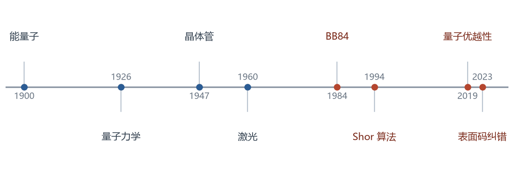

# 第 1 章　量子技术从哪里来

1947 年冬天，贝尔实验室的三位物理学家把一块锗晶体、两根金触点和一片塑料楔子拼在一起，做出了人类第一个晶体管。它只有指甲盖大，却能替代一只手掌大的真空管。四十年后，一块芯片上集成了一千万个晶体管。今天，一颗手机处理器里有上百亿个。

这条曲线叫摩尔定律，它描述的是晶体管数量每两年翻一番。翻了几十年，器件尺寸从微米降到几纳米。到了这个尺度，电子的行为不再像小球在管道里滚动，它开始表现出波动性，开始隧穿，开始受不确定性关系支配。工程师原本把量子效应当成麻烦，想尽办法压住它。后来有人换了个思路，既然压不住，那就拿来用。

量子技术就是从这个转弯处开始的。

## 1.1 三次浪潮

回头看，量子技术已经走过三波。

第一波在二十世纪上半叶。普朗克、爱因斯坦、玻尔、海森堡、薛定谔这些人把量子力学建起来，随后它直接催生了三样东西，原子弹、半导体、激光。这一波的成果今天还在用，晶体管、激光器、核磁共振、原子钟，都是它的后代。它们的共同点是，利用量子规律做出宏观器件，但不需要精确控制单个量子态。

第二波从 1980 年代开始。费曼提出用量子系统模拟量子系统，贝内特和布拉萨德提出量子密钥分发，肖尔提出量子因式分解算法。这一波的核心想法变了，不再只是利用量子效应，而是把量子态本身当成信息来操纵。量子比特、量子门、量子纠缠这些概念，都是这一波建立起来的。

第三波正在发生。2010 年代以来，超导比特的相干时间从纳秒提升到百微秒，比特数从几个做到上千个，量子纠错第一次在实验上越过阈值。技术从“能演示”走向“能工程”。这一波的标志不是某个新原理，而是一批指标同时跨过门槛。

图 1-1　量子技术发展的关键节点，横轴为年份

## 1.2 为什么是现在

量子计算的概念提出于 1980 年代，为什么到最近十年才真正热起来。

原因有三个，缺一不可。

第一是相干时间。量子态很脆弱，环境一扰动，叠加就散了。早期超导比特的相干时间只有纳秒，做一个门就损失殆尽。现在最好的一批比特能做到几百微秒，一个门只要几十纳秒，相干时间内可以做几千次操作。这个比例决定了能跑多复杂的算法。

第二是规模。量子算法的优势随比特数指数增长，几个比特什么都做不了。2019 年谷歌的处理器有 53 个比特，2023 年 IBM 做到 1121 个，2024 年谷歌的 Willow 是 105 个但质量更高。规模不是唯一指标，可没有规模什么都谈不上。

第三是纠错。物理比特总会出错，错误率再低也不够用。量子纠错把多个物理比特编码成一个逻辑比特，只要物理错误率低于阈值，逻辑错误率就能随规模指数下降。2023 年以来，几个小组先后在实验上跨过了这道门槛。

三个条件同时具备，量子技术才从论文走进工程。

## 1.3 一个容易混淆的地方

“量子”这个词在日常语境里被用得很滥。量子水杯、量子鞋垫、量子保健仪，这些跟量子力学没有任何关系。判断标准很简单，真正的量子技术一定在做三件事之一，制备一个量子态，操纵它，或者测量它，而且这些操作的效果能被独立的实验重复出来。

另一个常见的混淆是把量子计算等同于“更快的计算机”。它不是。量子计算机在分解大数、模拟分子、搜索无序数据库这些问题上有优势，在文字处理、数据库查询、视频解码这些日常任务上没有任何优势，甚至更慢。它是一台专用机器，不是通用加速器。

这两点会在后面的章节里反复出现。先记住一句话，量子技术的力量来自对单个量子态的控制，不来自“量子”这两个字本身。

## 1.4 这一册怎么读

这一册不讲推导，目标是让人对整张地图有个印象。

前四章从实验讲起，黑体辐射、光电效应、双缝、单光子，把量子世界的几条基本规矩摆出来。中间五章讲技术，量子比特、量子计算、量子通信、量子测量、硬件平台，每一样都说清楚它能做什么、代价是什么。最后三章讲工程与产业，纠错、路线图、怎么判断一条新闻的真假。

读的时候不必强记公式。这一册里的公式都只用来支撑一个结论，看不懂可以跳过，结论看懂就够了。真正需要动手算的内容这里不展开，想深究的时候再去找教材。

如果某一章读完觉得太浅，可以直接翻到后面几章看看技术细节；如果觉得太快，就回到前四章，把实验再看一遍。量子技术的很多困惑，根源都在实验没看明白。
