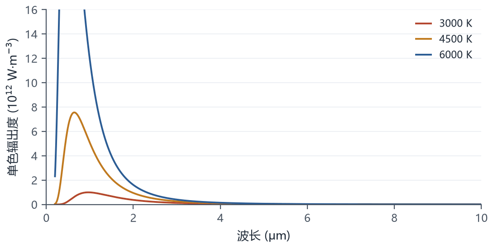

# 第 2 章　旧物理学的三道裂缝

十九世纪末的物理学界很自信。力学有牛顿，电磁学有麦克斯韦，热学有统计力学，三套理论各管一摊，算什么都准。开尔文在一次演讲里说，物理学的天空基本晴朗，只剩两朵小小的乌云。

那两朵乌云，一朵是迈克尔逊-莫雷实验测不到以太，后来长成了相对论；另一朵是黑体辐射的曲线算不对，后来长成了量子力学。真实的裂缝比两朵多，至少有三道。

## 2.1 一道算不出的曲线

任何有温度的物体都在向外辐射电磁波。铁烧红了发红光，烧白了发白光，温度越高，颜色越偏蓝。把这个辐射按波长铺开，画成一条曲线，就是黑体辐射谱。

实验测出来的曲线有一个峰，峰的位置随温度移动，温度越高峰越靠短波。十九世纪末的物理学家想用经典理论把这条曲线算出来，结果两头都不对。

长波方向还能凑合，短波方向彻底失败。按经典的能量均分定理，短波模式的数目随波长减小而急剧增加，每个模式都分到一份能量，加起来就发散。波长趋于零时，辐射强度趋于无穷。这个结论意味着任何有温度的物体都会瞬间放出无穷能量，显然荒谬。

这个失败后来被称为紫外灾难。

1900 年，普朗克用一个大胆的假设解决了它，能量不是连续变化的，而是一份一份的，每份的大小是 $h\nu$。用这个假设重新统计，曲线立刻跟实验吻合。普朗克自己并不喜欢这个假设，觉得它是权宜之计，可这个“权宜之计”就是量子概念的起点。

图 2-1　不同温度下的黑体辐射谱，曲线按普朗克公式计算。温度越高，峰值越靠短波

## 2.2 打得出来的电子

第二道裂缝来自光电效应。

把一块金属放在真空里，用光照射，金属表面会飞出电子。按经典波动理论，光的强度越大，电场越强，电子获得的能量越多，飞得越快。光的频率只影响颜色，不该影响电子的能量。

实验的结果正好相反。光的强度只影响飞出电子的数目，不影响单个电子的能量；电子的能量由频率决定，频率越高，电子越快；每种金属都有一个红限频率，低于它，光再强也没有电子出来；而且电子几乎是立刻飞出的，不需要等待。

1905 年，爱因斯坦给出解释。光本身就是由一份一份的能量组成的，每份 $h\nu$。一个电子吸收一个光子，一次性拿到全部能量，扣除逸出功，剩下的变成动能。这个图像把四条反常一次说清。

这个解释在当时被视为离经叛道，因为光的干涉和衍射早就证明光是波。一直到 1916 年密立根用精密实验验证了公式，光电效应的量子解释才被广泛接受。

## 2.3 原子为什么不塌

第三道裂缝在原子内部。

卢瑟福在 1911 年用 alpha 粒子轰击金箔，发现大部分粒子直接穿过，少数偏转很大，极少数弹回来。他由此推断，原子的正电荷集中在一个极小的核里，电子在外面绕。

这个模型有一个致命问题。绕核运动的电子在做加速运动，按麦克斯韦方程，加速电荷会辐射能量。能量一辐射，电子就螺旋着掉进核里。算下来，一个氢原子只能活十万分之一秒。可原子稳定得很，一块铁放一千年还是铁。

另一个问题是光谱。原子受激发光，光谱是一条条孤立的亮线，位置固定，每种元素都不一样。经典理论给不出分立的谱线，因为轨道半径可以连续变化，辐射频率也应该连续。

1913 年，玻尔把量子假设搬进原子，规定电子只能待在若干条特定轨道上，轨道之间跳跃时吸收或放出光子，光子能量等于能级差。这套规定算出了氢原子的光谱线，跟实验对得极准。

玻尔的模型有局限，它只能处理氢，解释不了多电子原子，也解释不了谱线的强度。可它第一次说明，量子化不只是辐射的性质，也是物质结构的性质。

## 2.4 三道裂缝的共同点

三道裂缝看起来互不相干，其实指向同一件事，能量在微观尺度上不是连续的。

黑体辐射的曲线要求振子的能量量子化，光电效应要求光的能量量子化，原子光谱要求电子的能量量子化。三个不同的系统，同一种补救办法。这不太可能是巧合。

1925 年到 1926 年，海森堡和薛定谔各自给出了一套完整的理论，把量子化从零散的假设变成了统一的框架。此后一百年，这套框架没有在任何一次实验里失败过。

下一章讲这套框架最奇怪的地方，一个东西怎么会同时像波又像粒子。
