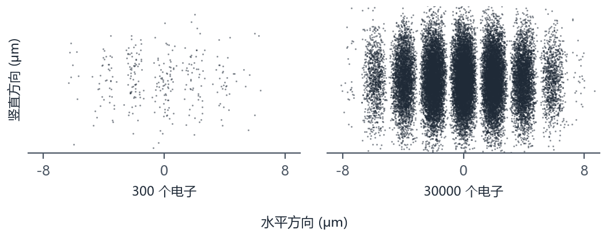

# 第 3 章　波与粒子

1801 年，托马斯·杨让一束光穿过两条窄缝，在屏幕上看到了明暗相间的条纹。这个实验判决了光是波，因为只有波才会在两条缝之后叠加出条纹。

一百多年后，人们用电子做同样的实验，屏幕上也出现了条纹。电子是粒子，这一点毫无疑问，它能被电场偏转，能打在探测器上留下一个点。可它穿过双缝时，行为跟光一模一样。

## 3.1 一个电子，两条缝

实验的做法是把电子束的强度降到极低，低到一次只有一个电子通过装置，然后让它落在能记录位置的探测器上。

单个电子的落点是一个点，跟粒子没有区别。可把几万个点叠在一起，条纹出现了。电子少的时候只是散乱的点，电子多了，明暗条纹越来越清楚，最后跟强电子束一次照出来的图样没有区别。

这件事很难用日常语言说清楚。每个电子都是独自通过装置的，没有同伴可以“干涉”。如果它是粒子，它只能走一条缝，屏幕上应该只有两条亮带。如果它是波，它会同时通过两条缝，自己跟自己干涉，可为什么最后只在一个点被探测到。

量子力学的回答分成两半。电子在通过装置时，处在一个由两条缝共同决定的波函数里，这个波函数分布在屏幕上，给出各处的概率。测量的时候，波函数按这个概率“实现”为一个具体位置。

图 3-1　按双缝干涉的强度分布抽样得到的单电子落点，从 20 个累积到两万个，条纹逐渐显现

## 3.2 德布罗意的猜想

电子为什么会像波，德布罗意在 1924 年给出了一个简单的关系。

光子的能量是 $h\nu$，动量是 $h/\lambda$，两者由 $c = \lambda\nu$ 联系。德布罗意假设，任何有动量的物体都对应一个波长

$$
\lambda = \frac{h}{p}
$$

对宏观物体，这个波长小得无法观测。一个七十公斤的人走路，波长是 $10^{-36}$ 米量级，比原子核还小二十个数量级。对电子，一百伏加速电压下波长约 0.12 纳米，正好跟原子间距同量级，所以能在晶体上衍射。

这个预言在 1927 年被两个实验证实。戴维孙和革末让电子打在镍单晶上，测到了衍射峰；汤姆孙让电子穿过金箔，拍到了同心圆环。圆环的半径随加速电压变化，关系跟公式吻合。

## 3.3 波函数是什么

为了把这件事写成可以计算的形式，量子力学引入了一个函数，叫波函数，记作 $\psi(x)$。

波函数不是电子本身，也不是电子的密度。它是一个复数函数，分布在空间里。它的模平方给出概率密度

$$
\rho(x) = |\psi(x)|^2
$$

意思是，在 $x$ 附近找到电子的概率。把概率密度在一个区间上积分，就是这个区间里找到电子的概率。全空间积分等于一，因为电子总要在某处被找到。

双缝实验里，两条缝各产生一个波函数，到达屏幕某点时叠加成 $\psi_1 + \psi_2$。概率是

$$
|\psi_1+\psi_2|^2 = |\psi_1|^2 + |\psi_2|^2 + 2\,\mathrm{Re}(\psi_1^*\psi_2)
$$

前两项是“走左缝”和“走右缝”各自的概率，最后一项是干涉项。干涉项可正可负，所以有的地方概率变大，有的地方变小，条纹就是这么来的。

## 3.4 为什么桌子不衍射

如果电子是波，原子是波，桌子为什么不是。

答案在波长。波长跟动量成反比，桌子的质量大，热运动的速度就有几百米每秒，动量巨大，波长小到 $10^{-35}$ 米。要观察到这个尺度的衍射，需要同样尺度的缝，没有任何材料能做出这样的缝。

所以宏观物体的波动性不是不存在，只是被压缩到了无法观测的尺度。量子力学的规则对桌子同样适用，只是效应小到可以忽略。

还有一个前提，就是物体跟环境足够隔离。桌子放在房间里，空气分子不停地撞它，光子不停地照它，每一次相互作用都在“探测”它的位置，把叠加破坏掉。这个现象叫退相干，是宏观世界看起来如此确定的关键。

下一章把量子世界的规矩归纳成六条，作为后面所有内容的底座。
