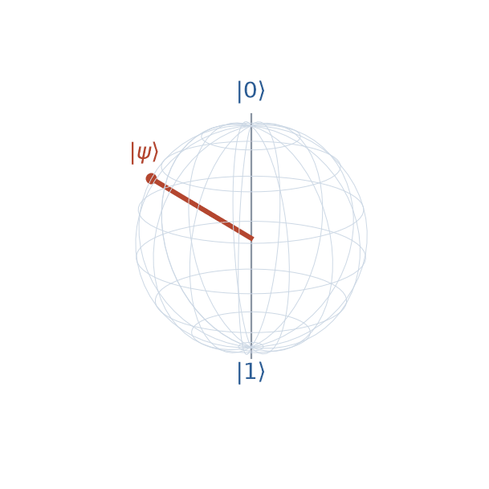

# 第 4 章　量子世界的六条规矩

前面三章讲的都是实验，实验看多了会发现一些反复出现的模式。把它们归纳一下，大致是六条规矩。

这六条不是公理，也不是什么哲学信条，它们是从实验里总结出来的工作规则。后面所有技术，无论是量子计算、量子通信还是量子测量，都建立在这六条上。

## 4.1 第一条，状态可以是叠加的

一个量子系统可以处在两个基准状态的任意组合里

$$
|\psi\rangle = \alpha|0\rangle + \beta|1\rangle,\qquad |\alpha|^2+|\beta|^2=1
$$

这里的 $\alpha$ 和 $\beta$ 是复数，叫概率幅。$\alpha$ 和 $\beta$ 都不是零的时候，系统就处在叠加态。

叠加不是“既在 A 又在 B”，也不是“要么在 A 要么在 B 但我不知道”。它是第三种状态，只有在测量时才会落到某一个结果上。这个区别很关键，后面讲测量时还会碰到。

## 4.2 第二条，测量给出概率

对处在叠加态的系统测量，得到 0 的概率是 $|\alpha|^2$，得到 1 的概率是 $|\beta|^2$。测量之后，状态变成所得到的那个结果。

这条规矩有两个后果。第一，量子力学的预言本质上是统计的，单次实验无法预测，只能预言大量重复实验的分布。第二，测量会改变状态，测完之后原来的叠加没有了。

“测量为什么会改变状态”这个问题，至今没有公认的答案。有人说是波函数坍缩，有人说是宇宙分叉，有人说是信息更新。所有解释给出的实验预言都一样，区别在于怎么讲故事。

## 4.3 第三条，位置和动量不能同时确定

位置和动量的不确定度满足

$$
\Delta x\,\Delta p \geq \frac{\hbar}{2}
$$

一个量测得越准，另一个量就越模糊，这不是仪器的问题，是状态本身的性质。

把电子限制在 0.1 纳米的范围里，它的动量不确定度至少是 $5\times 10^{-25}$ 千克米每秒，对应每秒几十万米的速度不确定度。这个效应撑起了原子的体积，也让金属里的电子即使在绝对零度也跑得飞快。

图 4-1　单比特态的布洛赫球表示。球面上每一点对应一个纯态，极角决定测量概率，方位角是相对相位

## 4.4 第四条，两个系统可以纠缠

两个量子比特放在一起，可以处在这样的状态

$$
|\Phi^+\rangle = \frac{1}{\sqrt2}\left(|00\rangle+|11\rangle\right)
$$

这个态写不成两个单比特态的乘积。单独看每一个比特，结果都是随机的；可一旦测了其中一个，另一个的结果立刻确定。

这种关联强到无法用“事先约好”解释。贝尔在 1964 年给出了一个不等式，局域隐变量理论必须满足它，量子力学不满足。此后五十年，实验一次次站到量子力学这边。2015 年的无漏洞实验和 2017 年的千公里卫星实验，把这个结论钉死了。

纠缠不能用来超光速通信，因为单看任何一端都是随机的，要把两端的结果对起来才能看出关联，而对比需要经典通信。

## 4.5 第五条，未知的量子态不能复制

不存在一个操作，能把任意未知的量子态复制成两份。这叫不可克隆定理。

证明很短。假设存在这样的操作，它对两个不同的态都成立，取内积会发现要求两个态要么相同要么正交，而一般的态两者都不是。

这条规矩让量子密钥分发有了安全性基础。窃听者想复制光子留一份，做不到；想测量，必然扰动状态，留下误码。

## 4.6 第六条，环境会抹掉量子性

一个量子系统不可能完全孤立。它总在跟环境打交道，每次相互作用都会把信息带走一点。信息走了，干涉就做不成了。

这个过程叫退相干。它不需要任何新假设，只是系统与环境纠缠之后，只看系统时的自然结果。

退相干的尺度在宏观物体上短得惊人。一个微米的尘埃在空气里，位置叠加只能维持 $10^{-20}$ 秒量级。这就是为什么我们从没见过椅子同时出现在两个地方。

## 4.7 六条规矩合起来

六条规矩，其实指向一件事，量子系统是一个用概率幅描述、与环境保护脆弱相干、测量时给出随机结果的对象。

这个图像不直观，但它极其精确。电子的磁矩、原子的光谱、半导体的能带、激光的频率，用这套规则算出来，跟实验的偏差常常在小数点后十位以下。物理学里没有第二套理论有这么好的记录。

后面几章讲技术，每一样都能对应到这六条上。量子计算靠叠加和纠缠，量子通信靠测量和不可克隆，量子测量靠不确定性和纠缠，量子纠错靠退相干的反向操作。看电影之前先认人物，读技术之前先认规矩。
