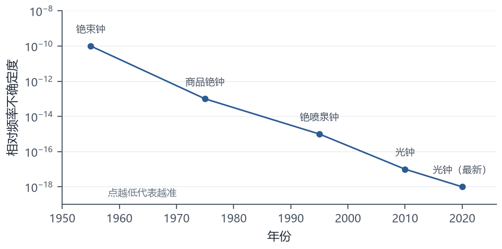

# 第 5 章　第一代量子技术

量子力学在一百年前就改变了世界，改变的方式比多数人想的低调。

它没有先造出量子计算机，而是先改好了几样日常东西。医院里的核磁共振、实验室里的激光器、手机里的芯片、导航卫星上的原子钟，背后都是量子力学。这一代技术有一个共同点，它们利用量子规律做出宏观器件，但不需要精确控制单个量子态。

## 5.1 原子钟

时间测量的精度，取决于能否找到一个频率极其稳定的振荡器。

石英晶体能振荡，但频率会随温度、老化漂移。原子的跃迁频率不会，它由物理常数决定，同样的原子在任何地方、任何时间，跃迁频率都一样。

1955 年，英国国家物理实验室做出了第一台铯束原子钟。铯 133 原子在两个超精细能级之间的跃迁频率是 9192631770 赫兹，把这个频率锁定在电子电路上，就得到一台误差极小的钟。1967 年，国际计量大会干脆把秒定义为这个跃迁周期的 9192631770 倍。

此后精度一路提升。铯束钟的日误差在 $10^{-13}$ 量级，喷泉钟做到 $10^{-16}$，光钟做到 $10^{-18}$。$10^{-18}$ 的意思是，走三百亿年误差一秒。

原子钟不只是计时工具。GPS 卫星上的钟如果差一微秒，定位就差三百米。光钟的精度足以测出厘米级的高度差，可以用来测重力、找矿、监测火山。

图 5-1　原子钟频率稳定度的提升，纵轴为相对不确定度，数据取自各时期公开发表的代表性结果

## 5.2 激光

激光的原理可以追到爱因斯坦 1917 年提出的受激辐射。

原子处在激发态时，如果遇到一个能量正好等于能级差的光子，会被“诱导”放出第二个一模一样的光子。同频率、同方向、同相位。一个变两个，两个变四个，光就被放大了。

要让这个过程持续，需要粒子数反转，让高能级的原子多于低能级。还需要一个光学谐振腔，让光在两面镜子之间来回走，反复放大。

1960 年，梅曼用红宝石做出了第一台激光器。此后激光器的种类爆炸式增长，气体、半导体、光纤、自由电子，波长从红外到 X 射线。今天它出现在光纤通信、激光切割、视力矫正、超市扫码、引力波探测里。

## 5.3 半导体

晶体管的原理是能带工程。

半导体里，电子的能量只能落在能带内，价带和导带之间有一个禁带。掺入杂质可以改变载流子的浓度和类型，pn 结就是这样形成的。在 pn 结上加电压，可以控制电流的通断，这就是开关。

这个开关不需要移动任何机械部件，速度快、寿命长、功耗低，很快取代了真空管。集成电路把几百万个这样的开关刻在一块硅片上，摩尔定律由此开始。

半导体器件的工作依赖于量子力学的能带理论，但它不需要维持量子相干。电子在芯片里四处碰撞，相位早就乱了，可这不妨碍晶体管工作。这是第一代量子技术的典型特征，用量子规律，不用量子相干。

## 5.4 核磁共振

原子核有自旋，自旋在磁场中会进动，进动频率跟磁场强度成正比。

把样品放进强磁场，用射频脉冲激发，原子核吸收能量后再释放出来，释放的频率带着周围化学环境的信息。分析这个信号，可以推断分子结构。医院里的核磁共振成像，用的是同一个原理，只是加了梯度磁场来定位。

核磁共振后来被用来做量子计算的早期演示。2001 年，IBM 用七个核自旋的分子实现了 15 的因式分解。这套系统的工作温度是室温，但信号来自大量分子的统计平均，不是单个量子态的操控。

## 5.5 这一代技术的边界

第一代量子技术有一个天花板，它依赖的是量子规律的统计后果，不依赖单个量子态。

原子钟锁定的是一群原子的平均频率，激光器输出的是大量光子的相干态，晶体管处理的是大量电子的集体行为。这些系统里，量子相干在宏观上早就消失了，剩下的是系综平均。

这带来两个限制。第一，无法利用纠缠，因为纠缠是单个量子态之间的关联。第二，无法做真正的量子计算，因为计算需要精确控制每个量子比特的相位。

要突破这个天花板，必须把单个量子态保护好、操纵好、读出来。这就是第二代量子技术的任务，从下一章开始。
