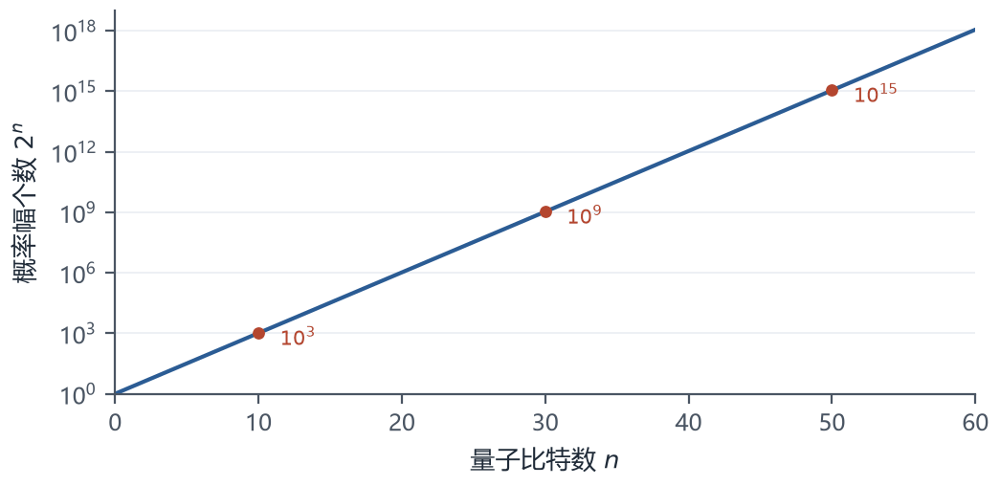

# 第 6 章　量子比特与量子信息

信息论是二十世纪中叶建立的。香农把信息定义成不确定性的减少，用比特来度量。一个比特是两种可能之一，是或否，零或一。

量子力学给这个框架加了两样东西，叠加和纠缠。加完之后，信息的存储、传输、处理的规则都变了。

## 6.1 从比特到量子比特

经典比特只有两个状态。量子比特也有两个基准状态，写作 $|0\rangle$ 和 $|1\rangle$，但它还可以处在两者的叠加里

$$
|\psi\rangle = \alpha|0\rangle + \beta|1\rangle
$$

$\alpha$ 和 $\beta$ 是复数，模平方分别是测到 0 和 1 的概率。

两个数的差别看起来不大，可当比特数变多，差别会指数放大。$n$ 个经典比特只能表示一个 $n$ 位二进制数，$n$ 个量子比特的状态由 $2^n$ 个概率幅描述。

这个指数增长是量子计算的力量来源，也是它难以模拟的原因。三十个量子比特就有十亿个概率幅，经典计算机存不下；五十个比特超过一千万亿。

## 6.2 用球表示一个比特

单比特的状态可以用一个球面上的点表示，这个球叫布洛赫球。

北极是 $|0\rangle$，南极是 $|1\rangle$，赤道上是各种相位的等权叠加。球面上任何一点都对应一个纯态，球内的点对应混合态。

球面上有两个角，极角 $\theta$ 和方位角 $\varphi$

$$
|\psi\rangle = \cos\frac{\theta}{2}|0\rangle + e^{i\varphi}\sin\frac{\theta}{2}|1\rangle
$$

极角决定测量概率，方位角是相对相位。相对相位在单比特测量里看不见，可在干涉和后续的门操作里起决定作用。量子算法的核心技巧，就是让相位差变成概率差。

## 6.3 纠缠是一种资源

两个量子比特可以处在纠缠态

$$
|\Phi^+\rangle = \frac{1}{\sqrt2}(|00\rangle+|11\rangle)
$$

这个态没法拆成两个单比特态的乘积。它的信息不在任何一个比特里，而在两者的关联里。

纠缠在量子信息里被当成一种可以量化、可以分配、可以消耗的资源。量化用熵，一个贝尔态的纠缠量是一比特。分配靠光纤或者自由空间传播，距离越远越难。消耗的例子很多，量子隐形传态消耗一个贝尔态，传过去一个量子比特；密集编码消耗一个贝尔态，传过去两个经典比特。

纠缠不能用来超光速通信。单看任何一端的结果都是随机的，要把两端的数据对起来才能看出关联，而对比需要经典通信。

## 6.4 量子信息不能随便复制

经典信息可以随便复制，复制一份文件不花什么代价。量子信息不行，这叫不可克隆定理。

原因在于，复制操作要是一个与态无关的幺正变换，而这样的变换对两个非正交的态不可能同时成立。实验上也没人做到过，这不是技术限制，是原理限制。

不可克隆带来两个后果。好消息是，窃听者无法复制量子信号留作后用，任何窃取都会留下痕迹。坏消息是，量子信息不能像经典数据那样做备份，传输过程中的损耗没法靠重发解决，只能靠纠错和纠缠纯化。

## 6.5 量子优势从哪来

“量子计算机比经典计算机快”这句话不准确，准确的说法是，在某些特定问题上，已知最好的量子算法的复杂度比已知最好的经典算法低。

这个优势来自干涉。量子算法把所有可能的答案编码进一个叠加态，然后用一系列门操作让错误答案的振幅互相抵消，正确答案的振幅被放大。测量的时候，正确答案的概率就高。

这个过程不是“同时试所有可能”，因为测量只能得到一个结果。它是“设计一套操作，让所有错误的分量在测量前消失”。设计这套操作，是量子算法研究的全部内容。

到目前为止，有确定优势的问题不多，主要是因式分解、无序搜索、量子系统模拟、部分线性代数问题。对一般的优化、机器学习、数据库查询，量子优势还在研究中，有些宣称的加速在仔细分析后消失了。

图 6-1　量子比特数与状态空间维度的关系，$n$ 个比特对应 $2^n$ 个概率幅

## 6.6 三个基本量

评估一个量子比特的好坏，主要看三个数字。

相干时间 $T_2$，叠加态能维持多久。超导比特在几十到几百微秒，离子阱可以到秒级。

门时间，做一次基本操作要多久。超导门在几十纳秒，离子阱在微秒级。

保真度，操作做得多准。现在的单比特门保真度在 99.9% 以上，两比特门稍差一些。

相干时间除以门时间，得到相干时间内能做的门数，这个数字决定了能跑多深的线路。保真度决定了跑这么长的线路之后，结果还可不可信。量子纠错的任务，就是把保真度不够的问题用冗余补上。
