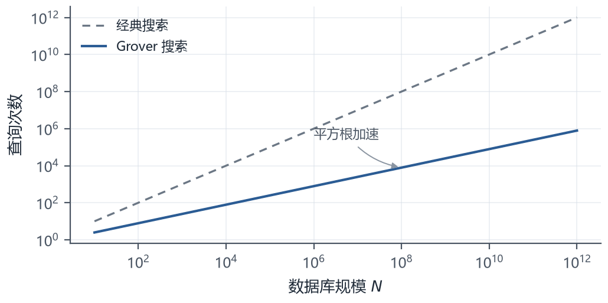

# 第 7 章　量子计算能做什么

量子计算是最容易被夸大的部分。宣传里说它能解决一切难题，现实里它能解决的问题清单短得可怜。

这一章把这份清单摊开，说清楚哪些是真优势，哪些是还在研究，哪些是根本不行。

## 7.1 线路模型

量子计算的标准模型是线路。

准备 $n$ 个量子比特，初始状态是全零。然后施加一系列量子门，每个门是一个幺正变换，作用在少数几个比特上。最后测量，得到一个 $n$ 位二进制串。

一个门对单个比特做旋转，比如把 $|0\rangle$ 变成等权叠加。两比特门让两个比特产生关联，最常用的是受控非门，控制比特为 1 时翻转目标比特。

门序列排在一起就是线路。线路深度表示有多少层门，深度越大，受噪声影响越大。量子算法的工程设计，很大程度上是在压缩深度。

## 7.2 三类有确定优势的问题

第一类是因式分解和离散对数。1994 年，肖尔给出了多项式时间的量子算法，把大数分解的复杂度从指数降到多项式。这个结果直接威胁 RSA 和椭圆曲线密码，也直接催生了后量子密码的研究。

第二类是无序搜索。格罗弗在 1996 年给出算法，把 $N$ 次查找降到约 $\sqrt{N}$ 次。平方加速听起来不惊人，但它适用于任何可以用黑箱判定的搜索问题，包括暴力破解对称密钥。一个 128 位的密钥，经典要试 $2^{128}$ 次，量子只要 $2^{64}$ 次。

第三类是量子系统模拟。用量子计算机模拟分子、材料、量子场，是费曼最初的想法。经典计算机模拟 $n$ 个量子比特需要 $2^n$ 个复数，二十个比特就吃不消。量子计算机本身就是量子系统，模拟同类问题有天然优势。这也是目前最被看好的应用方向，药物设计和材料发现都在这条路上。

图 7-1　无序搜索所需查询次数，横轴为数据库规模，量子算法约为平方根关系

## 7.3 近期路线

不是所有量子算法都需要容错。

有一类算法叫变分算法，用一个浅线路制备参数化的量子态，测量期望值，用经典优化器调整参数。线路浅，对相干时间要求低，适合当前的含噪声设备。变分量子特征求解器用来算分子基态能量，量子近似优化算法用来解组合优化。

这类算法的前景有争议。支持者认为它能在中等规模设备上先做出有用的事，反对者指出它的优化地形有贫瘠高原问题，参数一多就训练不动。目前还没有决定性的实验证据，这也是这个方向仍然值得研究的原因。

## 7.4 不适合量子计算的问题

有些问题不适合。

日常的数据处理不适合。文字处理、数据库查询、图像渲染，这些任务的结构不适合编码成量子线路，量子计算机做起来更慢。

需要精确确定性结果的问题不适合。量子测量是概率性的，要压低头部概率就得重复很多次，重复次数抵消了加速。

大规模输入的问题也不适合。把 $N$ 个数据读进量子内存需要 $N$ 次操作，读入本身就吃掉了加速。量子机器学习里的“量子线性代数加速”，很多就卡在这一步。

## 7.5 量子优势的门槛

“量子优势”这个词有严格定义，指在某个明确的任务上，量子设备比最好的经典计算机更快，而且这个比较要公平，允许经典计算机用最好的算法和最大的机器。

2019 年谷歌用 53 个比特的处理器完成了一个随机线路采样任务，宣称用经典计算机需要一万年。后来 IBM 指出，用更好的经典算法和外存技术，时间可以缩短到几天。这个争论没有否定实验的价值，但说明“优势”是一个会随经典算法进步而移动的目标。

2020 年，中国的光量子计算机九章在玻色采样任务上给出类似的结果。2023 年以后，关注点逐渐从“采样任务”转向“有用的计算”，比如量子模拟和纠错演示。

## 7.6 一个务实的判断

对普通人来说，判断一条量子计算新闻，可以看三个点。

第一，它跑的是什么任务。如果是一个专门构造的采样问题，那是原理演示；如果是一个化学或者材料问题，那离实用更近。

第二，它用的是物理比特还是逻辑比特。物理比特数量容易堆，逻辑比特才代表可用的算力。

第三，错误率是多少。一个百万门的演示，如果错误率是百分之一，结果没有意义。

这三条不能保证判断准确，但能过滤掉大部分夸大。
