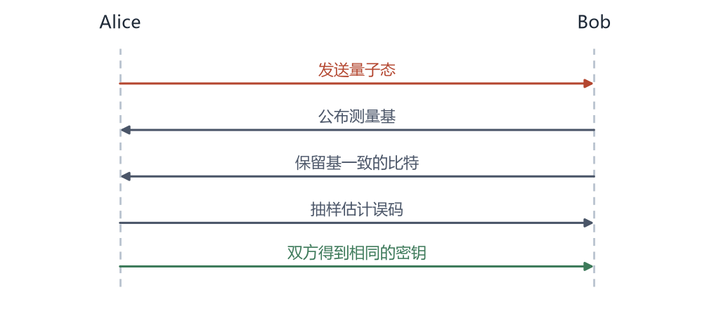

# 第 8 章　量子通信与量子网络

量子通信是目前唯一大规模落地的量子信息技术。

它的核心产品是密钥分发，解决的问题很古老，两个人要在一条可能被监听的线路上商定一串只有他们知道的随机数。经典密码学靠数学难题解决，量子方案靠物理规律解决。

## 8.1 为什么需要新办法

经典密钥交换依赖计算难度。RSA 假设大数分解很难，Diffie-Hellman 假设离散对数很难。这些假设在经典计算机面前成立，在量子计算机面前不一定成立。

肖尔算法一旦有足够大的机器，RSA 和椭圆曲线都会被攻破。更麻烦的是“先存后解”，攻击者可以现在把加密流量存下来，等量子计算机成熟再解密。这对需要长期保密的数据是实际威胁。

量子密钥分发给出另一条路。它的安全性不依赖计算难度，而依赖物理规律，窃听必然留下痕迹。

## 8.2 BB84 协议

1984 年，贝内特和布拉萨德提出第一个方案。

Alice 随机生成一串比特，每个比特随机选一个基，编码到光子的偏振或者相位上，发给 Bob。Bob 收到后随机选基测量，记录结果。

发完以后，Bob 通过公开信道告诉 Alice 他用了哪些基，Alice 告诉他哪些对上了。基对上的那些比特保留，其余丢掉，这一步叫筛选，通常剩下一半。

然后双方抽样比对一部分比特，算误码率。误码率低于阈值，说明没有窃听，剩下的比特做隐私放大，得到最终密钥；误码率异常，放弃这次通信。

窃听者为什么藏不住。她想复制光子，不可克隆定理不允许；她想测量，选错基就会改变状态，引入误码。测量得越狠，误码越高，越容易被发现。

图 8-1　BB84 协议的交互流程，量子态只传一次，基的比对走公开信道

## 8.3 现实系统的修补

理想协议用单光子，现实里用的是衰减激光，有时一次发出两个光子。窃听者可以把多余的光子截获，等基公布后再测量，这叫光子数分离攻击。

2005 年提出的诱骗态方案解决了这个问题。Alice 随机改变脉冲强度，在信号态和诱骗态之间切换。窃听者分不清两者，攻击会在不同强度的脉冲上留下不同的统计特征。

探测器也有漏洞。攻击者可以用强光让探测器致盲，再控制它的响应。测量设备无关协议把测量交给第三方，即使第三方被控制，只要不能同时拿到两端的信息，安全性仍然成立。

## 8.4 距离的墙

光子在光纤里会丢。标准光纤每公里损耗 0.2 分贝，一百公里剩百分之一，四百公里剩一亿分之一。成码率随距离指数下降。

突破距离有两条路。

一条是可信中继，中间设节点，密钥一段一段传，每段在机房里解密再加密。京沪干线两千公里就是这么做的。缺点是节点必须可信。

另一条是量子中继，用纠缠交换把多段纠缠连起来，中间不需要解密。原理上可以突破距离限制，工程上很难，需要量子存储器、纠缠纯化、频率转换一整套技术。

卫星是第三条路。大气层的等效厚度只有几公里，损耗小。2016 年发射的墨子号实现了千公里级的星地密钥分发和纠缠分发。地面站与卫星之间的密钥，再通过地面光纤延伸到用户。

## 8.5 量子网络

把点对点的链路连起来，就是网络。

量子网络的基本功能是分发纠缠。两个节点之间建立纠缠，再通过纠缠交换把相邻链路的纠缠连成远距离纠缠，中间需要量子存储把状态留住。

网络之上可以跑很多应用，量子密钥分发、分布式量子计算、分布式量子传感、时钟同步。协议栈的分层还在研究中，目前没有统一标准。

工程上的难点是接口。不同的物理平台工作在不同波长，超导比特在微波波段，光纤传输在 1550 纳米，中间需要频率转换，转换效率和噪声都是问题。

## 8.6 现状

量子密钥分发已经商用。中国的京沪干线、合肥城域网、欧洲的 OpenQKD 测试床、韩国的 SK 电信网络，都在运行。设备厂商有几家，成码率和距离在持续改进。

量子网络还在实验阶段。荷兰、美国、欧盟都有建设计划，目标是在城市范围内连接几个节点，演示纠缠分发和分布式应用。

后量子密码是另一条并行的路线。它不依赖量子设备，用经典计算机实现抗量子的算法。2024 年，美国国家标准与技术研究院发布了首批标准。两条路线不是竞争关系，实际部署里常常混合使用。
