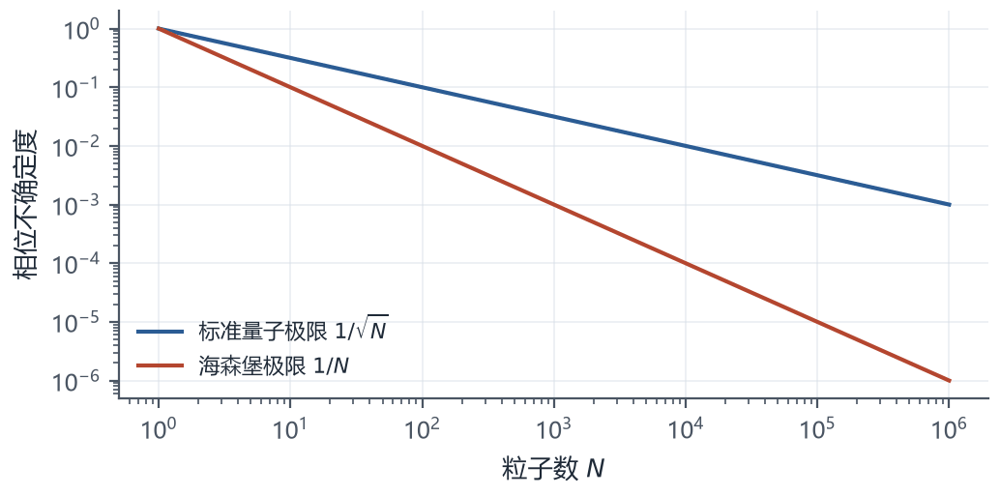

# 第 9 章　量子精密测量

有些测量比计算更早需要量子技术。

测量精度受噪声限制，噪声有两个来源，技术噪声和量子噪声。技术噪声可以靠更好的器件压制，量子噪声不行，它来自物理规律本身。量子精密测量做的事情，就是在量子噪声的限制下榨出更高的精度，或者用巧妙的方法绕开这个限制。

## 9.1 标准量子极限

用 $N$ 个粒子做测量，每个粒子独立工作，平均之后噪声按 $1/\sqrt{N}$ 下降，精度按 $\sqrt{N}$ 提升。这个标度叫标准量子极限。

举例。用 $N$ 个光子测相位，相位的不确定度正比于 $1/\sqrt{N}$。想提高十倍精度，要把光子数增加一百倍。激光干涉仪就是这么工作的，LIGO 用了上千亿个光子，才把长度变化测到 $10^{-19}$ 米。

## 9.2 突破极限的两种办法

第一种是压缩。量子噪声有下限，但可以把一个方向的噪声压小，代价是另一个方向变大。压缩光就是把真空涨落的某一个正交分量压下去。

LIGO 从 2019 年起常规注入压缩真空，把探测灵敏度提高了几个分贝。这是量子技术在最宏大的实验里的直接应用。

第二种是纠缠。把 $N$ 个粒子制备成纠缠态，测量精度可以按 $1/N$ 提升，这叫海森堡极限。这个提升比标准量子极限快一个根号，对精密测量非常有吸引力。

难点在制备和保持。纠缠态脆弱，损耗会迅速破坏它。目前能做到的纠缠增强，粒子数在几十到几百的量级，离大规模应用还有距离。

图 9-1　测量精度随粒子数的变化，两条曲线的斜率不同

## 9.3 原子钟

原子钟是最成熟的量子测量设备。

原理是把激光或者微波的频率锁定在原子跃迁上，用原子的跃迁频率定义时间单位。铯钟定义了秒，光钟正在推动下一代定义。

光钟的精度已经到了 $10^{-18}$ 量级。这个精度可以测出相对论效应，一厘米的高度差对应的时间流速差就能测出来。用光钟测重力，可以找矿、监测火山、探测地下水位。

原子钟也是导航的基础。GPS、北斗、伽利略，每颗卫星上都带着原子钟，定位精度直接取决于授时精度。

## 9.4 原子干涉仪

把原子冷却到微开尔文，它的德布罗意波长变得很长，可以做干涉。

用激光把原子分成两束，让它们走不同的路径，再合起来。路径上的重力、转动、加速度会让两束原子的相位产生差异，测出相位差就能算出这些量。

原子干涉仪的灵敏度很高。重力仪可以测到 $10^{-9}$ 的重力加速度变化，相当于一米高度差带来的变化。惯性导航用的原子陀螺，漂移比机械陀螺小几个数量级。

这类设备已经在测绘、资源勘探、地震监测中使用，体积从一间屋子缩到了行李箱大小。

## 9.5 磁与电的测量

超导量子干涉仪是灵敏度最高的磁强计。它用一个超导环加两个约瑟夫森结，把磁通的变化转换成电压。灵敏度可以到 $10^{-15}$ 特斯拉，能测到脑神经活动产生的微弱磁场。

金刚石里的氮空位色心是另一种探针。它在室温下工作，可以放在纳米尺度上，测单个分子的磁共振信号。生物、材料、地质都在用。

这些测量的共同点是，把待测的物理量转换成一个相位或者频率，再用量子手段读出。

## 9.6 应用与边界

量子测量的应用比量子计算实在得多。原子钟、重力仪、磁力计、陀螺，都有明确的客户和收入。

边界也很清楚。量子测量不能突破物理规律，它只是把噪声压到极限。测量的精度最终受限于粒子数、测量时间和系统的相干时间。想再提高，要么增加资源，要么改变测量方案。

还有一个常被忽略的问题，测量越精确，越容易受到系统误差的干扰。一个 $10^{-18}$ 的钟，如果温度控制不好，热膨胀带来的误差可能比量子噪声大得多。工程上，系统误差往往比量子极限更难对付。
