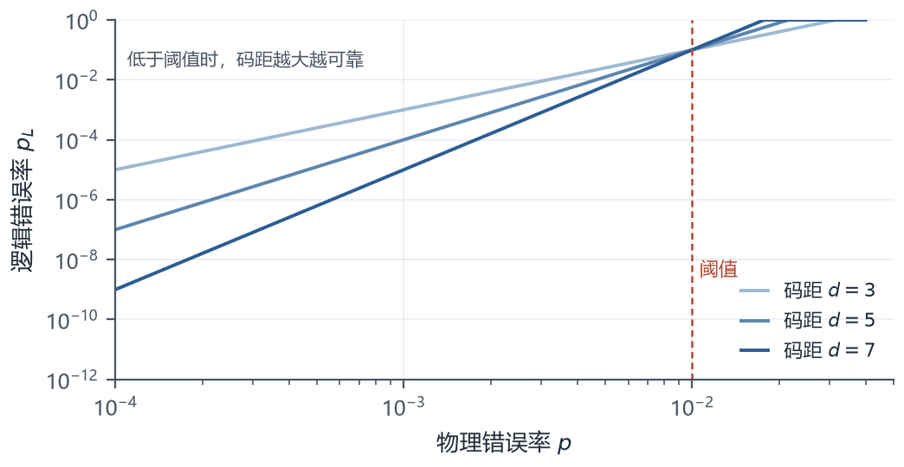

# 第 11 章　纠错与容错

量子计算最硬的墙不是比特数，是错误率。

一个门操作的错误率在千分之一，跑一千个门，结果基本不可信。要跑肖尔算法，需要几百万个门，靠提高单个门的质量解决不了，必须换一种思路，用冗余把错误容忍下来。

## 11.1 为什么不能简单复制

经典纠错最简单的办法是复制三份，取多数。量子世界不行，因为不可克隆定理。

不能复制，那就换一种办法，把一个逻辑比特的信息分散到多个物理比特的纠缠里。信息不在任何单个比特上，错误作用在某个比特上时，可以通过测量比特之间的关联发现它，再纠正。

这个思路的关键是，测量关联不会破坏编码的信息。只要测量的是“两个比特是否相同”这类问题，答案与编码的具体内容无关。

## 11.2 三比特码

最简单的例子是三比特比特翻转码。

编码把 $\alpha|0\rangle+\beta|1\rangle$ 变成 $\alpha|000\rangle+\beta|111\rangle$。如果其中一个比特被翻转，三个比特不再一致，通过比较可以找出是哪一个，再翻回来。

这个码只能纠正比特翻转，不能纠正相位翻转。要同时纠正两种，需要更复杂的编码，比如七个比特的 Steane 码，或者九个比特的 Shor 码。

## 11.3 表面码

目前最有希望的是表面码。

把物理比特排成二维方格，数据比特在格点上，测量比特在格子的面上。每个面测量四个数据比特的乘积，交替使用两种类型。错误会在格子上留下“缺陷”，通过匹配缺陷对，可以推断出最可能的错误位置并纠正。

表面码的好处是只需要近邻相互作用，适合超导和半导体这类只有局部耦合的硬件。阈值也比较高，理论上约百分之一，考虑实际噪声后约千分之五。

代价是开销大。码距 7 的表面码需要近百个物理比特编码一个逻辑比特。要跑有用的算法，需要几千个逻辑比特，也就是几十万个物理比特。

图 11-1　物理错误率低于阈值时，码距越大逻辑错误率越低；高于阈值时反过来

## 11.4 阈值定理

阈值定理说，只要物理错误率低于某个阈值，增加码距就能把逻辑错误率指数压低，任意精度都能达到。

这个定理把“造一台容错量子计算机”从不可能变成了一个工程问题，把错误率降到阈值以下，剩下的就是规模。

阈值不是一个固定的数，取决于错误模型、测量方案、解码算法。表面码在理想测量下阈值约百分之一，考虑测量错误后约千分之五。

## 11.5 实验进展

2023 年，谷歌用 49 个比特和 17 个比特的两组实验，演示了码距 3 和码距 5 的表面码，逻辑错误率随码距增加而下降，第一次在实验上跨过阈值。

2024 年底，谷歌发布 Willow 芯片，105 个比特，码距 7 的表面码，逻辑错误率比码距 5 低一半，逻辑比特的寿命超过了所有组成它的物理比特。

Quantinuum 在离子阱平台上用 13 个离子编码一个逻辑比特，逻辑门的错误率低于物理门。IBM、Atom Computing 也公布了类似的结果。

这些结果的意义在于，容错量子计算第一次有了实验支撑。之前所有的演示都是“比特数增加但质量不够”，现在有了“增加比特能换来更低错误率”的证据。

## 11.6 差距在哪

从码距 7 到能跑肖尔算法，还差几个数量级。

一是规模。几百万物理比特的控制线不可能都从室温拉进制冷机，必须换架构，把控制电路搬到冷端，或者用光子互联把多个模块连起来。

二是效率。表面码的开销在千倍量级，如果能把开销降到百倍，所需的物理比特就少一个数量级。改进编码、改进解码、改进硬件错误率，都能降低开销。

三是工程。良率、一致性、长期稳定性，这些在实验室里不是问题，在产品里是。

量子纠错是从“能演示”到“能用”的门槛。跨过这道门槛的团队，才真正进入了容错时代。
