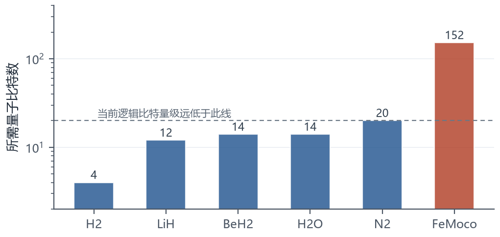

# 第 12 章　量子模拟与量子化学

前面讲的计算、通信、测量，都要跟经典技术抢地盘。量子模拟不太一样，它做的事情经典计算机原则上做不好，不是慢一点，而是根本算不动。

这一章讲这件事为什么难，现在做到哪一步，离实用还有多远。

## 12.1 一个分子有多少信息

一个水分子的电子结构，用最粗略的模型也要十几个量子态来描述。要用经典计算机精确求解，得把电子所有可能的位置组合都存下来，存储量随电子数指数增长。

这不是算法不够聪明，是量子系统的状态空间本身就是指数的。$n$ 个电子自旋，状态空间是 $2^n$ 维。二十个电子是一百万维，五十个电子是一千万亿维。再好的压缩算法也救不回来。

化学家早就知道这一点，所以他们用近似。密度泛函理论把问题化成电子密度，计算量降下来，精度也跟着降。耦合簇方法一层层加修正，精度上去了，计算量也上去了，能处理的体系停在十几个原子。

药物分子动辄几十个原子，含过渡金属的催化剂更麻烦，电子强关联，近似方法经常失灵。这就是量子模拟想插进去的地方。

## 12.2 把分子搬到量子比特上

做法分三步。

第一步，选基组。把分子的电子轨道用一组基函数展开，通常用高斯型轨道，取最小基组或者加极化函数。基组越大越准，需要的量子比特越多。

第二步，映射。把电子的产生湮灭算符映射成量子比特上的泡利算符。最常用的是 Jordan-Wigner 变换，一个空间轨道对应两个量子比特，分别放自旋向上和向下的电子。另一种是 Bravyi-Kitaev 变换，把非局域性降低，线路更浅。

第三步，求基态。用变分法或者相位估计，找到哈密顿量的最低本征值。这个值就是分子的电子能量，加上核排斥能，就是总能量。

图 12-1　常见分子在最小基组下所需的量子比特数，一个空间轨道对应两个量子比特

## 12.3 为什么现在还算不了

数字很直接。

氢分子，4 个量子比特，任何平台都能算。氢化锂，12 个比特，也能算。水分子，14 个比特，需要纠错。氮气，20 个比特，需要逻辑比特。铁钼辅基，一个固氮酶里的活性中心，估算下来要上百个逻辑比特，几百万次门操作。

而现在的设备，逻辑比特还是个位数，门数在几千的量级。差距在两三个数量级。

还有一个常被忽略的问题，精度。化学上有意义的精度是每摩尔一个千卡，换算成能量是 1.6 毫哈特里。要达到这个精度，量子相位估计需要重复很多次，门数再翻几倍。

## 12.4 变分方法能先做一点

等不到容错机器，就先用量子-经典混合的办法。

变分量子特征求解器把分子的哈密顿量拆成若干项，每一项在量子设备上测期望值，加起来得到总能量，再用经典优化器调参数。线路很浅，适合当前的设备。

问题是，浅线路的表达能力有限，优化地形也不好。小分子能算，稍大一点就卡住。2020 年代以来，一批实验演示了 H2、LiH、BeH2 的能量计算，结果跟经典方法吻合，但没有一个超越了经典方法。

这类工作的价值在于验证流程，不在于算力。把基组选择、映射、线路设计、误差缓解这一整套走通，等硬件上来就能直接用。

## 12.5 材料与物理

量子模拟不只做化学。

凝聚态物理里的强关联系统，高温超导、量子自旋液体、拓扑序，经典方法都吃力。用量子模拟器直接构造一个同样的晶格，让它在受控条件下演化，测量关联函数，就能验证理论预言。

中性原子阵列在这方面特别合适。原子可以排成任意几何形状，相互作用强度可调，一次能排几百上千个。2020 年代以来，一批实验用这种方法研究了量子相变、多体局域化、格点规范理论。

超导电路适合模拟格点模型，光子平台适合模拟玻色子体系。不同平台模拟不同的问题，这跟通用量子计算需要统一的架构不一样。

## 12.6 一个现实的判断

量子模拟是最可能先落地的应用方向，这一点在领域内有共识。

原因有三个。第一，问题明确，哈密顿量写出来就知道要算什么。第二，不需要通用性，专用机器也能做。第三，经典方法确实有天花板，价值的空间是实的。

但“最可能先落地”不等于“很快落地”。要算一个对药物研发有用的分子，需要的逻辑比特数和门数都还差得远。乐观的估计是十年，保守的估计更久。

如果你关心这个方向，值得盯的不是比特数，而是“算出的能量跟实验值差多少”。这个差距是唯一有意义的指标。
