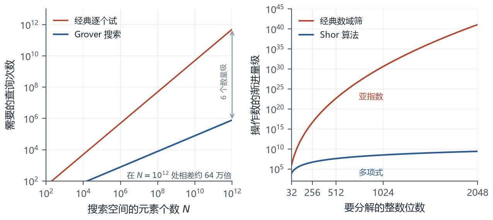
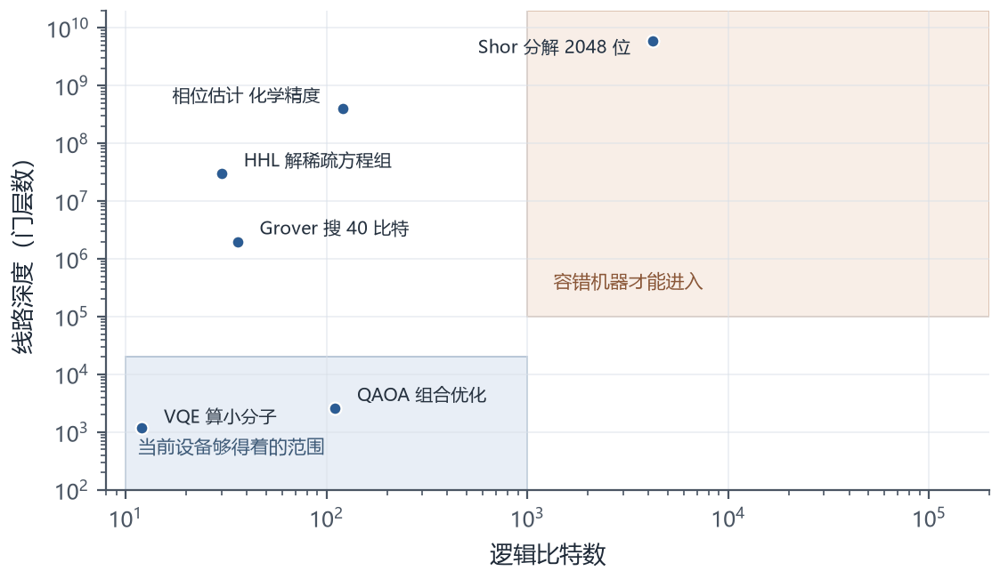

# 第 15 章　量子算法速览

第 7 章列过一张清单，说量子计算机能算什么。那张清单回答的是“算什么”，没回答“凭什么快”。同样是加速，快十倍和快一亿倍，机制完全不同，对硬件的要求也差着几个数量级。

这一章把五个常被提起的算法放在一起看。每个说三件事，快在哪里，要多少资源，什么时候用不上。不推导，只算账。

## 15.1 先把账记清楚

比较两个算法，要比总代价。一次运行的时间只是其中一项，还要乘上需要重复多少次，再除以成功的概率。量子测量的结果是概率性的，跑一趟拿到正确答案的可能只有几个百分点，要重复几百次才能把置信度堆上去。这些重复都得算进成本。

账本上有四栏。输入规模，通常写成 $n$ 或 $N$。比特数。线路深度，也就是门的层数。重复次数。前三栏决定硬件要多大规模，第四栏决定一次计算要占用机器多久。

经典算法记在同一本账上。所以“量子快多少”这个问题，答案永远是两条曲线的比值，不是某一次实验的秒表读数。

这里有个常见的误解，以为量子并行就是同时把所有答案都算完了。量子线路确实能一次作用在 $2^n$ 个基态上，可测量只能取出一个结果，其余全部作废。要让并行变成加速，必须让错误的答案互相抵消，正确的答案互相加强。这一手叫干涉。下面五个算法，各用各的干涉方式。

## 15.2 Deutsch-Jozsa 一次问出全局性质

1992 年，Deutsch 和 Jozsa 提出一个刻意构造的问题。给一个函数 $f$，输入是 $n$ 位二进制串，输出一位，0 或者 1。已知它要么是常数，所有输入给同一个输出，要么是平衡的，一半输入给 0，一半给 1。问它属于哪一种。

经典计算机最坏要问 $2^{n-1}+1$ 次。设想运气极差，前 $2^{n-1}$ 次都拿到 0，这时还判断不了，必须再问一次。$n=50$ 时这个数字是五百万亿。

量子计算机问一次就够。

做法不复杂。准备 $n$ 个输入比特和一个辅助比特，全部置零，给每个输入比特加一个哈达玛门，得到所有输入的等权叠加。辅助比特制备成 $|-\rangle$，也就是 $(|0\rangle-|1\rangle)/\sqrt{2}$。再把 $f$ 做成一个量子门，作用在这 $n+1$ 个比特上。

关键在于，$f(x)$ 的值不会写进任何一个比特，而是写进相位

$$
|x\rangle|-\rangle \;\longrightarrow\; (-1)^{f(x)}|x\rangle|-\rangle
$$

这叫相位回踢。函数算出 0 还是 1，变成了叠加态里每一项前面是正号还是负号。接下来再给 $n$ 个输入比特加一层哈达玛门，让这些项重新干涉。如果 $f$ 是常数，所有项同号，它们全部加回 $|0\cdots0\rangle$；如果 $f$ 是平衡的，一半正一半负，恰好抵消，$|0\cdots0\rangle$ 的振幅归零。此时测量这 $n$ 个比特，全零说明常数，不全零说明平衡。

快的原因不是“同时算了很多个 $f(x)$”，而是“把 $2^n$ 个函数值压成了一个符号模式，再用干涉把这个模式读出来”。量子计算机并不比经典多知道任何单个 $f(x)$，它知道的是整体。

资源账很小。$n+1$ 个比特，$O(n)$ 个门，跑一次。$n=100$ 时也就一百多个比特，深度两百层上下。

边界也很清楚。这是个判决性问题，答案只有两种，真实计算里的问题很少这么干净。函数必须是量子门能实现的，如果 $f$ 是一张存在硬盘上的表，把它读进量子内存就要 $2^n$ 次操作，加速立刻归零。它今天没有直接用处，价值在历史上，它是第一个被证明有指数加速的算法，把“量子计算机能不能比经典快”从猜想变成了定理。

## 15.3 Grover 搜索与平方根的天花板

N 个格子里有一个满足条件，要把它找出来。经典办法只能一个接一个试，平均 $N/2$ 次。Grover 算法把这件工作降到约 $\frac{\pi}{4}\sqrt{N}$ 次。

机制分两步，每轮重复一遍。

第一步，用黑箱把“是不是目标”翻成相位，目标项的振幅变号，其余的项不变。第二步，做一个关于平均振幅的翻转，所有振幅都朝平均值折叠一次。这两次翻转合起来，相当于把状态向量在二维平面里转了一个小角度 $2\theta$，其中 $\sin\theta=\sqrt{1/N}$。每转一次，目标的振幅就大一点，其余所有项一起变小。转够约 $\frac{\pi}{4\theta}$ 次，目标的概率接近 1。

这个图像值得记住。概率不是一次被抬到 1 的，它像荡秋千，一次加一点，加了 $\sqrt{N}$ 次才到顶。而每一次加的那点幅度，来自所有非目标项的集体让步。

资源上，需要 $\log_2 N$ 个比特存索引，加上黑箱自己要用的辅助比特。黑箱调用 $\sqrt{N}$ 次，每次调用的内部线路还要另算。取 $N=10^{12}$，量子约一百万次，经典五千亿次，差了六个数量级，这就是图上那条竖线标出的距离。

代价有三重。

平方加速不可再改。1997 年 Bennett、Bernstein、Brassard 和 Vazirani 证明，任何量子算法搜这个黑箱都至少要 $\Omega(\sqrt{N})$ 次调用，Grover 已经顶到了理论极限。所以指望它把指数问题变成多项式，没有可能。

第二重代价是数据的入口。黑箱在纸上是一个门，在硬件上要么是把数据编进线路（编一次是 $N$ 次操作），要么依赖一种叫 QRAM 的量子存储。两者都不便宜，一旦读入成本是 $N$，加速就被吃干净了。

第三重是迭代次数要算准。目标个数 $M$ 未知时，转多了概率反而下降，实际做法是先用一小部分预算估计 $M$，或者用指数增长的试探策略，这又添了一层开销。

图 15-1　两类加速的量级。左图为无序搜索，纵轴是查询次数，量子算法按 $\frac{\pi}{4}\sqrt{N}$ 计算；右图为整数分解，经典曲线按数域筛的渐进复杂度 $L=\exp\left(1.923\,n^{1/3}(\ln n)^{2/3}\right)$ 计算，量子曲线按 $0.3n^3$ 次门操作估算，两者均未计常数因子

## 15.4 Shor 把周期塞进相位

Shor 算法的名气最大，机制反而最像一门手艺。

要分解一个 $n$ 位整数 $N$，先随便挑一个与 $N$ 互素的 $a$，看序列 $a^1, a^2, a^3,\dots$ 除以 $N$ 的余数。这个序列一定循环，循环长度叫 $a$ 模 $N$ 的阶，记作 $r$。只要 $r$ 是偶数，并且 $a^{r/2}\neq -1 \pmod N$，那么 $\gcd(a^{r/2}-1,N)$ 就是一个非平凡因子。分解问题于是变成了求阶问题。

求阶交给量子线路。构造一个幺正算符 $U|y\rangle=|ay \bmod N\rangle$，它的本征值形如 $e^{2\pi i k/r}$，相位里带着 $r$。用量子相位估计把这几个相位读出来，精度够了，再用连分数展开反推出 $r$。经典后处理只有几行代码。

快在哪里，全在相位估计这一步。它的核心是量子傅里叶变换，作用是让“周期”变成“频率”。一个长度为 $r$ 的周期信号，在变换之后只在 $r$ 的整数倍位置上有峰。经典计算机要发现这个周期，得把序列一项项算出来比较；量子线路让所有项同时参与干涉，峰的位置一次测量就能定位。这不是把 $N$ 次试除并行化，而是换了一个能把周期直接暴露出来的坐标系。

资源账要分两笔。算法本身需要约 $2n+3$ 个逻辑比特，门数在 $O(n^3)$ 量级，因为模乘要用加法器和取模电路搭出来。另一笔是纠错。2019 年 Gidney 和 Ekerå 估算，分解一个 2048 位的 RSA 模数需要约四千个逻辑比特、几十亿次 Toffoli 门，在有物理错误率千分之一的前提下，折合两千万个物理比特，跑八小时。这个数字后来被反复引用，因为它把“威胁”换成了具体的工程量。

边界同样明显。位数小的时候，经典算法本来就快，Shor 没有优势。它需要容错机器，因为在几十亿次门操作里，不纠错的结果是一堆噪声。它对 RSA 的冲击是真的，但时间取决于机器什么时候造出来，这也是后量子密码要在今天开始迁移的原因。

## 15.5 HHL 解方程组的三个前提

HHL 指 2009 年 Harrow、Hassidim 和 Lloyd 给出的量子线性方程算法。问题是解 $Ax=b$，$A$ 是 $N\times N$ 的稀疏矩阵，条件数 $\kappa$。

经典的最好办法是共轭梯度法，代价约 $O(N\sqrt{\kappa})$。HHL 的代价是 $O(\log N\cdot\kappa^2/\varepsilon)$，对 $N$ 是指数的改善。这个结果一出来就引起了轰动，因为它意味着量子计算机能碰一大类科学计算问题。

做法分三步。把 $|b\rangle$ 作为初态，用相位估计把 $A$ 的本征值 $\lambda_j$ 写进辅助比特的相位。做一次受控旋转，把对应分量的振幅按本征值的倒数缩放，这一步把矩阵求逆变成了对相位的条件操作。再把辅助比特逆变换回原基，得到 $|x\rangle\propto A^{-1}|b\rangle$。

三个前提决定了它能不能用。

结果是一个量子态，不是一个数组。要把 $x$ 的 $N$ 个分量读出来，得做 $N$ 次测量，加速全部赔进去。所以 HHL 只在“下一步还要拿这个态继续算”的场合有意义，比如把它喂给另一个量子算法求某个标量。单独拿出来当求解器，是没有用的。

$|b\rangle$ 要能高效制备。任意一个 $N$ 维向量的量子态制备，代价一般也是 $O(N)$。只有结构化的 $b$，比如均匀分布或者高斯分布，才有便宜的制备方法。

矩阵要稀疏、条件数要小、精度要求不能太苛刻。$\kappa^2$ 这个因子很凶，条件数一千就让代价涨一百万倍。数值计算里的矩阵，条件数动辄上万。

这三个前提经常被忽略。看到“量子机器学习有指数加速”的说法时，先问一句，加速的是哪一步，结果怎么读出来。多数时候，加速在论文的公式里成立，在流程里不成立。

## 15.6 变分算法 把难题推给经典

2014 年以后，另一类算法成了主流，因为它不需要容错。

做法是这样。设计一条含参数的浅线路，参数是一串角度。在量子设备上跑这条线路，测量一组算符的期望值，加起来得到目标函数的值。把这个值交给经典优化器，优化器调整参数，再跑一遍。来回几百上千次，直到能量收敛。

变分量子特征求解器用它算分子基态能量，量子近似优化算法用它解组合优化。名字不同，骨架一样，都是量子设备负责制备态和测量，经典计算机负责搜索参数。

它省的是深度。一条几十个比特、深度几千层的线路，今天的设备勉强跑得动，而相位估计需要的深度是它的上万倍。这就是变分算法存在的全部理由。

问题是它没有加速的证明。经典优化器面对的是一个高维、非凸、带噪声的目标函数，能不能找到全局最优，没有保证。参数一多，梯度的方差指数衰减，优化器在原地打转，这个现象叫贫瘠高原。噪声还会把精细的结构抹平，让最优参数漂移。

所以这一类算法的定位是探索，不是产品。它把基组选择、映射、线路设计、误差缓解这一整套流程走通了，等硬件变好可以直接搬过去用。到目前为止，还没有一个变分实验给出了超越经典方法的结果。

图 15-2　五类算法在逻辑比特数与线路深度平面上的位置，数据按各算法公开的资源估算取量级。阴影范围表示当前设备的能力与容错机器所需的范围

## 15.7 三条经验

把五个算法放在一张表里，差别一目了然。

| 算法 | 加速来源 | 逻辑比特 | 线路深度 | 主要前提 |
|---|---|---|---|---|
| Deutsch-Jozsa | 相位回踢加干涉 | $n+1$ | $O(n)$ | 函数可做成量子门 |
| Grover | 振幅放大 | $\log_2 N$ | $\sqrt{N}$ 次调用 | 数据可量子查询 |
| Shor | 相位估计求周期 | $2n+3$ | $O(n^3)$ | 容错，模乘电路 |
| HHL | 本征值求逆 | $\log N$ | $\mathrm{poly}(\kappa)\log N$ | 稀疏，低条件数，态可制备 |
| 变分算法 | 无证明，靠浅线路 | 几十到几百 | $10^3$ 量级 | 经典优化能收敛 |

三条经验可以带走。

加速来自结构。周期、稀疏、可标记、可模拟，这些结构让干涉有东西可以对齐。没有结构的暴力问题，量子计算机也只能给出平方根级别的改善。

代价常藏在入口和出口。数据怎么进去，结果怎么出来，这两头往往决定了加速是真是假。纸上算的是中间那一段。

规模决定资格。一个算法在十个比特上跑通，和在四千个逻辑比特上跑通，中间隔的是纠错、布线和成本，不是同一件事的放大。
