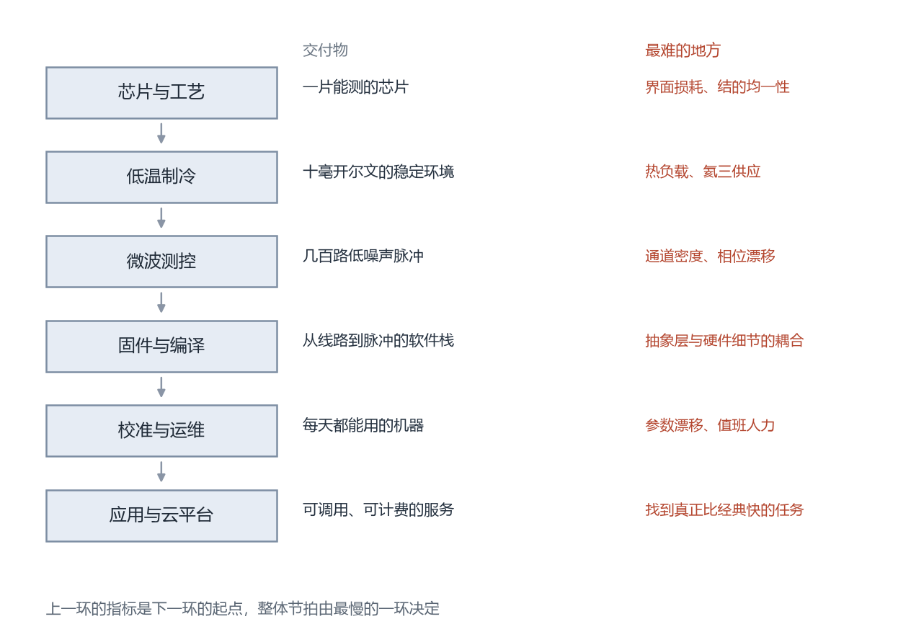
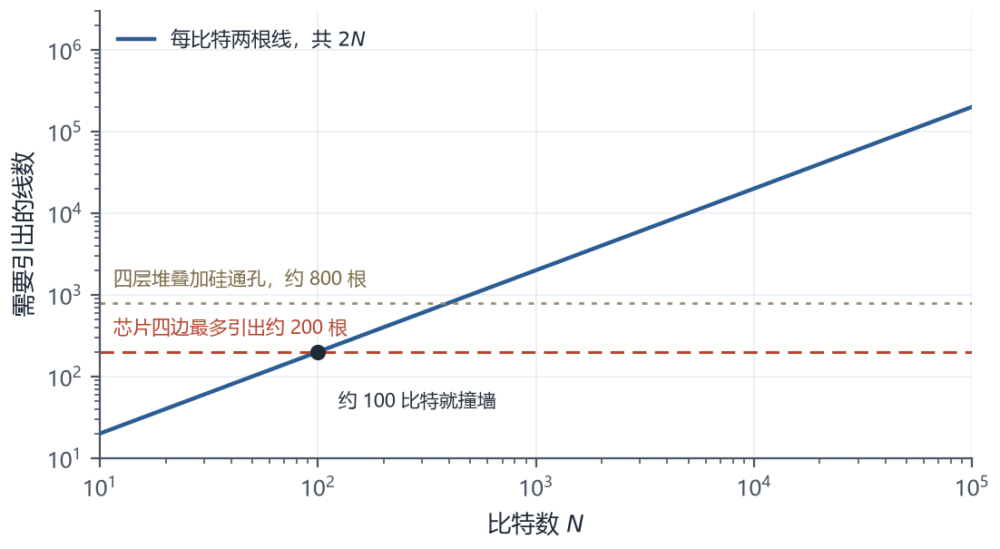

# 第 16 章　造一台量子计算机需要什么

实验室里的一篇文章，通常只展示一台机器最好的那一刻。某个比特的相干时间，某一组门的保真度，某条线路跑出来的结果。这些东西加在一起，还不是一台机器。

一台能天天开机、对外提供服务的量子计算机，是六段工程链串起来的产物。芯片、制冷、测控、软件、校准、应用，每一段都有自己的交付物和最难的地方。任何一段掉链子，整机就停在那里。

这一章按顺序走一遍这条链。目的是让人知道，一个比特数从 100 涨到 1000，中间要动多少东西。

图 16-1　六段工程链及其交付物与主要难点

## 16.1 芯片与洁净室

第一段把设计变成一片可以测量的硅片。

超导量子芯片的工艺跟集成电路很像，用的是薄膜沉积、光刻、刻蚀、封装这一套。区别在材料和精度。电路用铝或者铌，超导转变温度分别是一点二开和九开。约瑟夫森结靠两层铝中间夹一层氧化铝，厚度一到两纳米。这层氧化层的厚度决定了结的临界电流，也就决定了比特的频率。

交付物是一片封装好的芯片，能直接装进制冷机的样品盒。它要满足的不只是电学指标，还有机械和热学指标。芯片要能承受从室温到十毫开尔文的反复冷热循环，焊点不能裂，超导互连不能退化和引入损耗。

最难的地方有两处。

一处是界面损耗。量子比特的能量主要存在电容的电场里，电场会渗进衬底表面和金属与衬底的界面。这些界面上哪怕有单层的水分子或者氧化物，都会吸走能量，把相干时间压下来。同样设计的两个芯片，只因为表面处理差一道工序，$T_1$ 可以差三倍。这是超导路线十几年来最顽固的敌人，工艺上的很多讲究，比如氢氟酸清洗、原位沉积、避免电子束胶残留，都是为了这个。

另一处是均一性。结的面积只有零点零几平方微米，氧化时间差一秒，频率就差几十兆赫兹。一片晶圆上几百个比特，频率分布通常有几个百分点的宽度。而两比特门要在固定频率下工作，频率错开了就换不了。业界的对策是设计上留出可调范围，工艺上把均匀性做上去，再配合激光修调，把偏得多的比特拉回来。

这几件事都发生在洁净室里。百级到千级的洁净度，金属污染控制到十亿分之一量级，设备投资以亿元计。全球能做超导量子芯片的产线不超过十几条，这也是这条路线扩产的隐性门槛。

## 16.2 稀释制冷

芯片要在十毫开尔文工作，比宇宙微波背景还冷。

这个温度只有稀释制冷机能提供。原理是把氦三和氦四的混合物冷却到零点八开以下，混合物会自发分成两相，氦三从浓相穿过界面进入稀相，这个过程吸热，能把温度一路拉到十毫开尔文以下。

交付物不只是一台制冷机，而是一整套低温环境。里面要装样品盒、微波线缆、滤波器、隔离器、放大器和磁屏蔽。线缆从室温一路接到最冷端，每一层冷板都要用铜夹和铟箔做热锚，还要装衰减器，把室温传来的热噪声一级级压下去。一个千比特级的系统，这样的线要几百根。

最难的地方是热负载预算。每一级冷板的制冷能力都是有限的，五十开能提供几十瓦，四开只有一瓦半，一百毫开四百微瓦，十毫开四微瓦。一根设计良好的同轴线，在十毫开端的漏热也要几十纳瓦到几百纳瓦，几百根加起来就是一个不可忽略的份额。放大器更耗冷量，一只工作在四开的低噪声放大器，功耗在毫瓦级，装十只就把四开级的余量吃掉一截。

这就带来一个硬约束。想加比特，就要加线；加线就要加冷量；加冷量只能换更大的机器。而稀释制冷机不是货架商品，定制周期一年到一年半，价格几百万到上千万元。实验室里常见的做法是先把线布好，只接一部分，把余量留给下一轮。这就是为什么工程界看路线图，第一眼看的不是比特数，是冷量和布线。

## 16.3 微波测控

芯片和制冷机就位之后，还需要有人对它说话。

超导比特的能级差在四到八吉赫兹，正好是微波波段。控制一个比特，就是给它送一个频率对准、相位可控、包络经过整形的脉冲。脉冲宽度二三十纳秒，幅度要精确到千分之一，相位要跟其他所有通道保持相干。

交付物是一整套电子学，包括任意波形发生器、上变频的 IQ 混频器、本振分配网络、以及冷端的放大与滤波。读出方向反过来，用一个小信号打进读取腔，从反射信号的相位里判断比特处于哪个态，信号要经过低噪声放大、下变频、采样，再进 FPGA 做解调。

最难的地方有三个。

通道密度。一百个比特就要两百路以上的射频通道，每路都要独立的幅度和相位控制。商用仪器一台只能管几个通道，一个机架塞几十台，成本和体积都受不了。所以这个行业在过去几年里拼命做的事情，是把测控做成高密度的板卡和专用芯片，把每通道的成本从几万元压到几千元。

相位稳定。所有通道要共享同一个时基，本振的相位漂移、线缆的热胀冷缩、混频器的非线性，都会让两比特门的相位出错。两比特门对相位的要求是零点几度，这已经接近模拟电路的能力边界。

噪声。读出链路的第一个放大器决定了信噪比，而它必须装在四开温区，因为再往下的冷量不够。这个放大器的噪声温度在几开，比量子极限高一个量级，读出的保真度就卡在这里。

还有一条隐性的要求，实时反馈。纠错要求根据测量结果在几百纳秒内决定下一步做什么，这个延迟预算把大部分工作压到了 FPGA 上，软件栈必须能编译出实时逻辑。

图 16-2　每比特需要两根控制线，而芯片四边能引出的线数有限，两条曲线的交点大约在一百比特处。布线密度按每毫米十根、芯片边长五毫米估算

## 16.4 固件与编译

从用户写的几行代码，到机架上真正发出的波形，中间隔着一整层软件。

这层软件叫编译栈，负责把量子线路翻译成脉冲。翻译不是一对一的。一条高层线路先要做逻辑优化，消掉恒等门，合并相邻旋转。然后做映射，因为芯片上的比特不是全连接的，隔得远的两个比特要交换位置，一个交换等于三个两比特门。再往后是调度，把能并行的门排在一起，把不能并行的错开。再往后是脉冲级编译，把每个门展开成具体的包络参数，还要加一个叫 DRAG 的修正，压掉泄漏到高能级的成分。

交付物是一套工具链，加上一份校准数据库。编译器的每个决定都要查询这份数据库，因为这个比特的 $\pi$ 脉冲是二十四纳秒还是三十二纳秒，那个耦合器的偏置电压是多少，全都写在里面。

最难的地方是抽象会漏。教科书里的量子门是理想的幺正矩阵，硬件上的门是带误差的、有串扰的、随时间漂移的操作。编译器如果只按拓扑结构工作，出来的线路门数可能放大三到十倍，错误率跟着放大。好的编译器要把错误率当作代价函数的一部分，在保真度和深度之间做取舍。这个取舍没有标准答案，不同机器、不同任务、不同日子都不一样。

## 16.5 校准与运维

一台量子计算机每天的状态都不一样。

要让它可用，得有一整套校准流程。测每个比特的频率，标定读出的判别阈值，扫 $\pi$ 脉冲的幅度找最优值，测 $T_1$ 和 $T_2$，标定两比特门的相位，测串扰矩阵，检查有没有比特漏到高能级。一百个比特，每项几分钟，全流程几个小时。

交付物是一条自动化的校准流水线，加上一份记录每次校准结果的数据库。没有这两样，机器只能算实验装置，不能算产品。

最难的地方是漂移。超导比特的频率会随环境磁场、温度、介质缺陷的重新分布而缓慢变化，时间尺度从分钟到小时。校准完半小时，参数已经偏了一点。两比特门的相位更敏感，一次热循环之后要重新标定。业界的做法是分层校准，粗调一天一次，精调每次任务前做一次，中间靠监控报警。这套东西听起来不高级，却是把机器从“能跑”变成“能天天跑”的关键。

运维还包括液氦补充、压缩机维护、磁屏蔽检查、线缆接头的老化更换。这些工作没有论文可写，但一台机器一年要停机多少次，取决于这些细节做得好不好。

## 16.6 应用与云平台

链条的尽头是把机器接到用户手上。

交付物是一个服务，包括任务队列、编译服务、计费系统、结果返回和文档。用户提交一条线路，平台负责排队、编译、执行、读出校正、误差缓解，再把一组计数返回。这一层看起来是软件工程，实际上决定了机器的实际算力。

最难的地方在两头。

一头是让结果可信。硬件读出的错误率在百分之一到百分之几，必须做读出校正，用一批标定过的样本反解真实分布。误差缓解能把期望值的偏差压下去，代价是采样次数翻几倍。这些处理要透明地做在平台里，同时把不确定性如实报给用户。

另一头是找到任务。今天的机器能跑的东西，绝大多数经典计算机也能跑，而且更快。真正需要量子硬件的任务还很窄，集中在量子模拟和一部分组合优化。平台的价值是把门槛降下来，让化学家、材料学家不用懂微波工程就能试一次，试的人多了，才可能撞上那个真正合适的任务。

## 16.7 一条链的节拍

把六段放在一起看，会发现它们的迭代周期差得很远。

芯片流片一次三到六个月，制冷机交货一年到一年半，测控板卡从设计到量产一年，软件按周迭代，校准每天做一次。整机的进步速度，由最慢的那一环决定。

所以“明年比特数翻倍”这样的承诺，实际要过五道门。芯片要重新设计并流片，制冷机要增加线缆甚至换机器，测控要加机架并解决散热，软件要适配新的耦合图，校准时间要控制住不翻倍。五道门里任何一道没过，翻倍就变成延期。

这也是理解这个行业的一个角度。看一台机器，不要只看它有多少比特，要看这条链上哪一环是瓶颈。瓶颈在制冷，说明布线受限；瓶颈在测控，说明成本下不来；瓶颈在校准，说明良率和一致性还不够好。瓶颈的位置，比指标的数字更能说明这台机器离产品还有多远。
