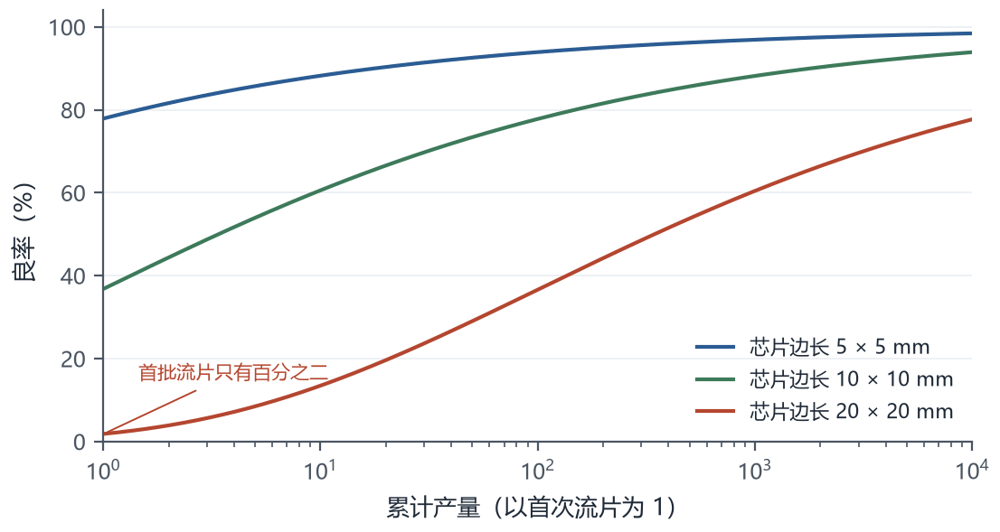
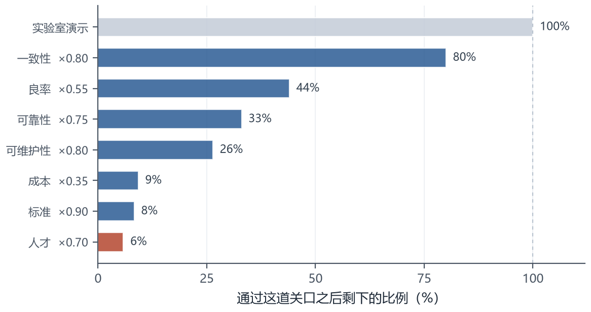

# 第 17 章　工程化的七道关口

实验室里最好的那个数字，和产品说明书上印着的数字，往往差着一大截。

差在哪里，不是一句“工程化”能说清的。它是一串具体的关口，每一道都在削掉一部分。半导体和光通信都走过这条路，它们的经历可以借来看。

## 17.1 一致性

第一个关口是让一万个器件长得一样。

实验室的样品通常只有几个比特，每一个都经过手工挑选和单独调校。产品要的是同一批里随便抽一个，指标都落在规格内。

半导体工业的解法是设计规则。给定一套工艺窗口，设计者只能在允许的尺寸、间距、掺杂范围内画版图，代工厂保证这个范围内做出来的器件参数落在分布里。这套规矩让“设计”和“制造”可以分开，也让良率可以预测。光通信的解法更直接，国际标准把激光器的波长钉在一条栅格上，间隔一百吉赫兹，偏差不许超过十分之一纳米，这样不同厂商的器件才能插进同一个系统。

量子比特还没有这样的规矩。

超导比特的频率由约瑟夫森结的面积和氧化层厚度决定，一片晶圆上的分布宽度通常有一两个百分点。意思是设计在五千兆赫兹的比特，实际可能落在四千九到五千一之间。两比特门要在固定频率附近工作，频率错开就得靠可调耦合器去补，补不回来的只能弃用。离子阱的一致性靠激光和电场调，个体差异小，但一次能装的离子数量有限。半导体自旋比特的一致性最差，不同量子点之间的参数差别可以到几十个百分点，这是它最难的一关。

一致性还有个更尖锐的版本。量子线路里一个坏比特能拖垮整条线路，因为它参与的每个门都带着高错误率。表面码里如果有一个比特的测量错误率比别人高十倍，整个码块的逻辑错误率就由它决定。这意味着“平均指标”没有意义，要看的是分布的尾部。工业界讲六西格玛，讲的正是尾部。

## 17.2 良率

第二个关口是让做出来的东西大部分能用。

良率的算法很朴素。芯片面积越大，碰上致命缺陷的概率越高，良率随面积指数下降。这一条在半导体行业被写成泊松模型，良率约等于 $e^{-AD}$，$A$ 是芯片面积，$D$ 是单位面积的缺陷密度。

量子芯片的处境不利。超导量子处理器的面积远大于普通逻辑芯片，一个几十比特的芯片就有几十平方毫米，而且对缺陷的容忍度极低。一个针孔、一粒灰尘、一处界面污染，就能让某个比特的相干时间掉到十分之一。按 $D=0.1$ 每平方厘米、面积四平方厘米算，首批良率不到百分之二。这不是夸张，早期超导多比特芯片的实测数据就在这个量级。

图 17-1　良率随累计产量的爬坡，按泊松模型 $e^{-AD}$ 计算，缺陷密度随累计产量按幂律下降，三种芯片尺寸对应不同的起点

光通信的历史可以给出时间尺度。1970 年代，第一批发光二极管和激光器的寿命只有几千小时，良率个位数。行业花了十五年，把生长工艺、封装、老化筛选一道道做扎实，才把良率做到八成以上，寿命做到十万小时。这条曲线不是靠一个突破，是靠产量堆出来的经验。

量子芯片眼下正处在这条曲线的起点。区别是它的产量还很低，每年流片的批次有限，学习的速度也就慢。这是“多流片”这件事在战略上重要的原因，不是为了发文章，是为了把良率曲线往右推。

## 17.3 可靠性

第三个关口是让它一直能用。

实验室的机器，做实验的那几个小时是好的，其余时间在修。产品要在无人值守的情况下连续运行几年。电信设备的行业标准是每年停机不超过五分钟，折合可用性五个九。这个标准背后是一整套浴盆曲线的管理，早期失效靠老化筛选剔除，中期靠冗余和降额使用，晚期靠更换周期。

量子机器的可靠性问题更麻烦，因为它的失效模式是渐变的。一个比特的相干时间慢慢变短，一个耦合器的频率慢慢漂移，读出腔的品质因数慢慢下降。没有明确的坏点，只有整体性能的滑坡。这种失效没法靠“换掉坏的”解决，只能靠持续监控和定期重校准。

还有机械寿命。稀释制冷机每年要经历几次热循环，从三百开降到十毫开再升回来。每次循环，几百个接头都要承受一次热应力。焊点开裂、线缆断裂、密封圈老化，这些都是工程上的常态。一台机器能连续跑多久不修，是运维水平的直接体现，也是成本模型里最不确定的一项。

## 17.4 可维护性

第四个关口是坏了以后能修。

这一条常常被低估。实验室的机器坏了，博士生花两周排查，没问题。数据中心的机器坏了，要求两小时内换上备件恢复服务，否则合同违约。

可维护性的核心是模块化。整机要拆成若干可独立更换的单元，每个单元有明确的接口和自检程序，更换之后不需要重新设计整个系统。光通信产业在这件事上做得很彻底，可插拔光模块的尺寸、引脚、协议都有标准，运维人员不需要懂光路，拔下来换一个就行。这一步把维护成本从“厂家工程师上门”降到了“机房值班员动手”。

量子机器的模块化才刚开始。稀释制冷机一开就是几天，换一个比特要整机升温，重新布线和校准。所以业界的思路是把“可更换”的粒度做大，做成一整个比特模块或者一整个微波板卡，换下来整块返厂。另一条路是把不同温区的部件彻底分开，让室温的电子学可以热插拔，冷端的部分尽量少动。

平均修复时间是一个诚实的指标。今天一台超导量子计算机从故障到恢复，通常以天计。要做到以小时计，需要的不是更好的物理，是更好的结构设计。

## 17.5 成本

第五个关口是算得过账。

成本要按“每件事”来算，不是按“每台”来算。一台机器一千万美元，如果能每天跑一千个有用的任务，每个任务的成本是一万美元。如果一天只能跑十个，成本是一百万美元。同样的机器，商业意义完全不同。

拆开看，成本分四块。设备折旧，稀释制冷机和测控电子学占大头。运行能耗，一台机器的功耗在几十千瓦，其中制冷机压缩机占一半，电子学机架占另一半。人力，一个团队十来个人，包括低温工程师、微波工程师、软件工程师和值班人员。耗材，液氦、备件、校准用的标准件。

对照一下超算。一台顶级超算造价几亿美元，功耗十几兆瓦，电费是运行成本的主要部分。量子机器的购置成本相对低，人力和维护占比高，这是“还没规模化”的典型特征。等机器数量上来，成本结构会向电子行业靠拢，那时决定胜负的是芯片良率和封装成本，不是实验室里的保真度纪录。

## 17.6 标准

第六个关口是让别人能比较、能互换。

标准的作用常常被误解，以为它是为了限制。实际上标准是为了降低交易成本。有了统一的测试方法，买方才敢下单，卖方才敢承诺，第三方才能验证。半导体有 SEMI 的一整套设备和材料标准，光通信有 ITU-T 的波长栅格和多源协议，这两套东西是那两个产业能做大的前提。

量子计算的指标现在很乱。量子体积、层保真度、量子体积之外的各类定制指标，各家公司各说各话。同一台机器，用不同的基准测出来的“性能”可以差一个数量级。这给采购带来了实际困难，也给宣传留下了空间。

已经有人在推动。IEEE 有量子计算性能指标的工作组，几个国家的计量院在做比特参数的标准化测量，几家大公司在联合定义基准线路集。这些工作枯燥，进度慢，但它决定了五年后这个行业能不能像买服务器一样买量子计算机。

标准还有一层作用，是让供应链形成。今天做稀释制冷机的只有几家，做微波控制板卡的只有几家，原因之一是没有统一接口，每家的系统都是定制的。接口一旦标准化，专做某一环的公司就能活，整条链的成本才会下来。

## 17.7 人才

第七个关口是人。

量子硬件需要的人，横跨好几个专业。微纳加工、低温物理、微波工程、电子学、控制理论、计算机体系结构、算法。一个团队里缺任何一类，都会在某个环节卡住。缺低温工程师，机器天天出故障；缺微波工程师，通道调不出来；缺做工艺的，芯片良率上不去。

半导体早期也是这个状态。1940 年代做晶体管的是物理学家，1950 年代工艺慢慢分化出来，1960 年代出现了专门的工艺工程师和设备工程师。分化之后，产业才可能规模化，因为培养一个工艺工程师比培养一个物理学家快得多。

量子技术正处在分化的前夜。多数岗位还要求博士，因为要做的事情没有现成方法论，得自己摸索。这是阶段性的现象，不是永久的门槛。等到某一天，大学里出现“量子设备工程”这样的本科方向，培训班能教出合格的校准技师，这个行业才算真正落地。

人才的稀缺还有一个副作用，它让所有公司挤在同一个池子里抢人，人力成本被推高，间接抬高了每台机器的运行成本。这一关过不去，前面六关的成果都会被摊薄。

## 17.8 七个关口串起来

七道关口是串联的，不是并联的。

一致性决定了良率的上限，良率决定了成本，成本决定了能不能规模化，规模化才有钱做可靠性，可靠性又反过来影响维护成本。任何一环的通过率低，整条链的产出就被它卡住。

图 17-2　七道关口串联之后的剩余比例，各关口通过率按行业常见量级假设，仅用于示意数量级

按图上这组假设的通过率算下来，一百个实验室演示，能走到产品的不到六个。这个数字不是精确估计，但它解释了一个现象，为什么这个领域的新闻很多，产品很少。新闻统计的是第一道关口之前的数量，产品统计的是第七道关口之后的。

对学习者来说，这张图的意思是，判断一家公司不要只看它发过什么文章，要看它过了几道关口。有没有一致性的数据，有没有良率的曲线，有没有连续运行记录，有没有标准接口，有没有能招到人的岗位描述。这些不起眼的东西，比一个漂亮的保真度数字更能说明问题。
