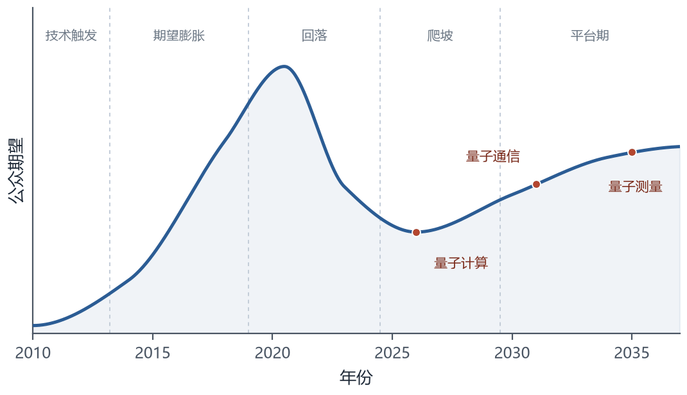
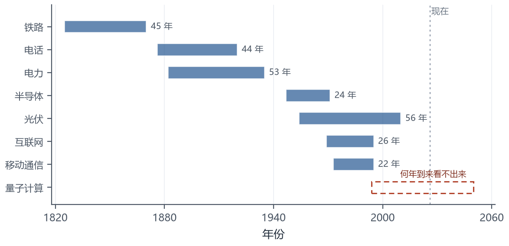

# 第 18 章　结语与耐心

前面十七章走了一条很长的线，从黑体辐射到稀释制冷机，从双缝到表面码。走完之后，有一个问题还是悬着，这些技术到底走到哪一步了。

这个问题没有精确答案，但可以有方法。这一章讲三件事，这个领域在期望曲线上的位置，基础设施回报的时间尺度，以及怎么用一套自己的指标长期跟踪它。

## 18.1 一条曲线上的位置

新技术被公众接受的过程，通常不是一条直线。

先是某个原理验证引起注意，期望开始上升。然后媒体、资本、创业公司一起涌入，期望冲到远高于实际能力的位置。接着承诺开始延期，第一批产品不如预期，期望迅速回落。回落到某个低点之后，真正做事的人还在，指标一点点变好，期望缓慢回升，停在一个跟实际价值相符的平台。

这条曲线被总结过很多次，名字不重要，形状值得记住。它描述的不是技术的进展，是期望的进展。两者经常反着走。

量子计算在 2018 到 2021 年走完了上升段。量子优越性的演示、密集的融资、上市、各国法案，把期望推到了顶点。2022 年之后进入回落段，几家公司的路线图延期，一些“三年商用”的承诺没有兑现，质疑的声音变大。2026 年的位置大致在谷底附近，正在缓慢回升。

三条子技术的位置不一样。量子通信已经在爬坡，因为它有确定的产品，密钥分发设备卖了很多年，指标稳定，客户清楚自己要什么。量子测量也在爬坡，原子钟、重力仪、磁力计都有实际用户。量子计算还在谷底，因为它的价值需要一个还没造出来的机器才能兑现。

图 18-1　三类量子技术在期望曲线上的相对位置，曲线按常见的期望演化形状绘制，仅表示阶段而非精确数值

位置本身不说明好坏。谷底往往是最好的进入时机，因为噪音少了，做事的人还在，资源便宜。真正危险的是顶点，那时所有人都相信明年就能用上。

## 18.2 基础设施的回报周期

量子计算常被拿来跟互联网、芯片、电力相比。这个类比有用，但要看清它说的是哪一部分。

基础设施的共同特征是，先投入，后回报，中间隔很久。

电厂从 1882 年纽约珍珠街的第一座中央电站，到普通家庭用上电，花了五十多年。中间要建电网、定电价、造电表、培训电工、说服用户换掉煤气灯。铁路从第一条营业线路到形成全国网络，四十多年。电话从发明到半数家庭装上门，四十多年。半导体快一些，从晶体管到微处理器商业化，二十四年。互联网从阿帕网到万维网普及，二十六年。移动通信从第一部手机到数字网普及，二十二年。光伏从第一块硅电池到平价上网，五十六年。

图 18-2　几种基础设施从首次演示到规模化应用的时间跨度，起止年份取通行的历史分期

这些数字有共同点。第一，都在二十到五十年之间，没有例外地比当时的乐观预测慢。第二，都经历过一次“这东西没用”的低谷。第三，一旦跨过成本门槛，回报持续很久，而且会渗透到别的行业。

量子计算从 1994 年 Shor 算法算起，到现在三十二年。按同样的尺度，它还在前半程。这个判断不需要预测技术细节，只需要承认一件事，把一个实验室现象变成基础设施，历史上从来没有快过。

还有一层区别容易被忽略。电力、铁路、互联网的回报是普惠的，用户直接感受到。量子计算的回报可能是间接的，它先改变材料设计和药物研发，再通过那些行业影响到普通人。间接的回报更难感知，也更容易被高估或者低估。

投入和回报的形状也值得看清。基础设施的累计投入曲线是先陡后平，回报曲线是先平后陡，两条线交叉的位置，就是这门生意开始自洽的年份。交叉之前，每一年的账都是亏的，靠的是长期资本和公共投入。交叉之后，回报会持续很多年，因为基础设施一旦建成，边际成本很低。

量子计算现在还在交叉点左边。它每年要吃掉大量投入，产出的东西主要是论文和原型。这段路最难熬，因为账面上看不到进展，只有指标在慢慢变好。能熬过这段的组织，通常有一个共同点，它们不看年度回报，看里程碑。

## 18.3 一套自己的指标

长期跟踪一个领域，靠读新闻不行。新闻是按事件组织的，事件之间没有连续性。要靠自己建一套指标，按固定节奏记下来。

指标分三层。

器件层看的是单个比特和单个门。相干时间、两比特门保真度、读出保真度、串扰。这一层最成熟，各家的测量方法虽然不完全一致，但趋势可比。看这一层要注意条件，保真度是在多少比特的芯片上、用哪种门、跑多少次测出来的。

系统层看的是整机。逻辑比特数，逻辑错误率，每个逻辑比特花掉多少物理比特，校准一次要多久，一个月能开机多少小时。这一层最容易被忽略，也最能说明问题。一台机器如果校准要三天，它的有效算力就不是标称值。

应用层看的是任务。能算多大的分子，算出来的能量跟实验差多少，跟经典方法比快多少，有没有付费的用户在重复使用。这一层最难量化，但它决定了这个技术有没有出口。

节奏上，器件层三个月看一次，系统层半年一次，应用层一年一次。每次只记几个数字，写在一张表里。三年之后回看，这张表比任何一篇综述都有用，因为它是你自己测出来的趋势。

信息源也要收紧。几家主要实验室的预印本，两个行业会议的论文集，主要供应商的产品手册，加上监管机构的出口管制清单。这些来源枯燥，但它们变化慢，造假成本高。社交媒体的消息可以看，不要记。

表格的形式可以很简陋。一列日期，几列数字，每个数字后面注明出处和测量条件。比如二〇二六年第一季度，某平台的两比特门保真度百分之九十九点五，芯片二十比特，校准用时四小时。三个数字放在一起，比一句“性能提升”有信息量。等到第四年，你会看到保真度涨得很快而校准时间没变，或者保真度不动而校准时间砍了一半，两种情况的含义完全不同。

## 18.4 什么信号值得当真

有些信号是真的，值得调整判断。

纠错起作用的信号。逻辑错误率低于物理错误率，说明码在干活。码距加倍时逻辑错误率指数下降，说明在阈值以下，这是最硬的一条。2023 年以后，几个平台给出了这个曲线的第一段，这是这个领域过去十年最重要的进展。

规模化的信号。逻辑比特数从个位数到几十个，同时逻辑错误率没有变差。这比物理比特数翻十倍有意义得多。

可复现的信号。同一个实验被两个独立团队做出来，数据和方法公开，第三方能复算。量子领域里，这一点比别的领域更重要，因为结果很难直觉判断对错。

商业的信号。有客户为一次计算付钱，而且第二年还来。有供应商开始按“逻辑比特小时”报价，说明这一层已经被当成资源在卖。有保险和审计介入，说明有人愿意为它的可靠性背书。

工程的信号。招聘启事里出现“量子设备校准工程师”“低温系统运维”这样的岗位，而且招不止一个。这说明机器已经多到需要专人照看，是落地的可靠迹象。

价格的信号。每逻辑比特小时的报价一年降一半，而且是在指标不降的前提下。规模化的本质就是单位成本下降，这条曲线比任何演示都更能说明产业在往前走。

## 18.5 什么信号可以放过

有些信号很响，但不必当真。

比特数的新闻。物理比特数是最容易堆的指标，堆上去不代表能用。看到“突破一千比特”，先问逻辑比特多少，错误率多少。

融资额和估值。资本市场的节奏跟技术节奏无关，一家公司融资十亿，说明投资人相信故事，不说明机器能算东西。

奖项和榜单。它们奖励的是过去，不是未来。

“量子加某行业”的组合词。量子人工智能、量子金融、量子医疗，多数是把经典方法换个说法。判断标准很简单，看它有没有用到相干性或者纠缠，没有就不是量子技术。

专为演示构造的任务。随机线路采样、玻色采样这类任务，除了证明硬件在进步，没有别的用途。它们是有价值的里程碑，但不是产品。

股价。它反映的是预期差，不是技术差。

把这些过滤掉之后，每年真正值得记的新信息，可能只有五六条。这很正常。一个成熟的领域，一年也就这么多真消息。

## 18.6 耐心是一种方法

说回人。

面对一个还在生长的领域，最容易犯的错是站队。要么相信它三年改变世界，要么断言它永远是骗局。这两种判断都很省事，也都没用。

更有用的姿态是把它当成一件要花二十年的事，然后问自己在这二十年里能做什么。

如果做研究，选一个具体的问题，把它做到底。比特的损耗机制、封装的热应力、校准的自动化，这些问题不耀眼，但每一个都卡着整条链。

如果做工程，把注意力放在“稳定”上。让一台机器连续跑一个月不掉指标，比多发一篇论文难，也更有价值。

如果只是好奇，学一点基础，读几篇原始论文，亲手跑一次模拟器上的线路。知道叠加不是并行，知道测量会坍缩，知道纠错要用很多物理比特换一个逻辑比特，这三件事足以让你不被大多数宣传带走。

技术史的规律大概是这样，真正的变革比宣传的慢，比悲观者想的快。电力、铁路、互联网都验证过这句话。量子技术大概率也一样，它会在某一年安静地跨过某个门槛，然后被当成理所当然的东西，就像今天的卫星导航和医院里的核磁共振。

在那之前，需要的是耐心。不是消极的等待，是有指标的、有节奏的、能持续二十年的关注。
