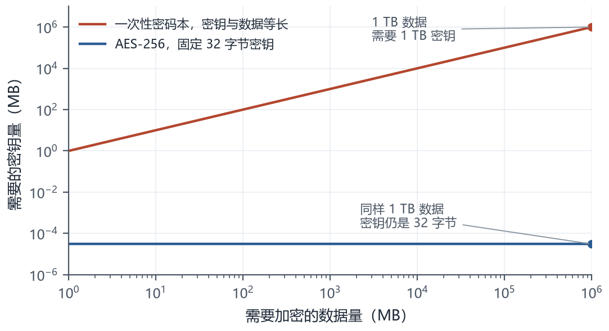
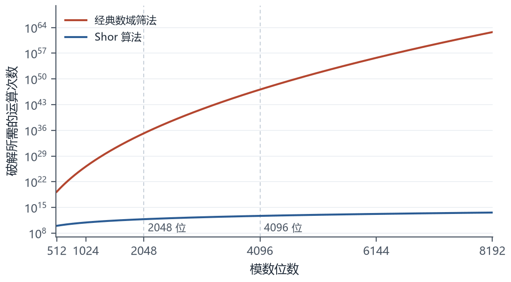

# 第 1 章　密钥为什么难分发

两个人想密谈，中间隔着一座城。

办法从古到今没怎么变过。把要说的话换成一段乱码，交给信使送出去，对方收到后用同样的办法还原。凯撒把每个字母往后挪三位，这套做法在两千年前够用，今天连一个中学生都拦不住。乱码要真的管用，得让它在没有钥匙的前提下几乎无法还原。

加密本身早就不是难题。难的是加密之前那一步，钥匙从哪来，怎么送到对方手上。这一章讲的就是这一步，以及它在经典世界里为什么没有完美的解法。

## 1.1 一次性密码本

1917 年，美国电话电报公司的工程师维尔南提出一种方案。把明文写成一串二进制，另外准备一串等长的随机比特当密钥，逐位异或，得到密文。解密是同一个动作，再异或一次就还原了，因为

$$
a \oplus k \oplus k = a
$$

这个方案的好处可以用一句话说清，密文里没有明文的任何信息。给定一段密文，任何一段等长的明文都可能是原文，只要配上对应的密钥就能得到它，而每一把密钥出现的概率都相同。1949 年香农在《保密系统的通信理论》里把这件事证明成定理。密钥真正随机，与消息等长，并且只用一次，密文与明文在统计上就完全独立。这种保密性叫完善保密，它不依赖任何关于敌人算力的假设，敌人有无限的计算能力也破不开。

代价落在密钥上。密钥必须和消息一样长，而且只能用一次。一天要传一太字节的数据，就得预先备好一太字节的密钥，两边各存一份，用过的部分立刻销毁。图 1-1 把这件事画得很直白，数据量涨多少，密钥量就涨多少。对称加密没有这个问题，AES-256 的密钥永远是三十二个字节，加密多少数据都用它。

问题于是从一个变成了两个。密钥怎么安全地送到对方手上，以及怎么让这个量级变得可以接受。

图 1-1　一次性密码本与固定密钥的消耗对比。前者需要的密钥随数据量线性增长，后者与数据量无关

## 1.2 密钥本身成了负担

现实里的通信大多用对称加密，密钥短，换得快，靠一把短密钥保护大量数据。这把短密钥怎么发出去，才是真正的麻烦。

最笨的办法是见面。两个人当面交换一张纸条，或者把密钥装进保险箱派专人送。银行之间曾经真的这么干，两地的数据中心各自保管一份主密钥，靠武装押运送新的。这套流程慢，贵，而且人是最不可靠的一环。

规模一大，麻烦就变成组合爆炸。$n$ 个人两两之间都要能密谈，需要 $n(n-1)/2$ 把密钥。一百个人要将近五千把，一千个人要五十万把。每个人手里攥着一本厚厚的密钥簿，丢一本，一条线上的通信全完。

所以二十世纪的密码学一直在找一个绕开的办法，让两个从没见过面的人，在一条所有人都能偷听的线路上，商量出一把只有他们知道的密钥。

## 1.3 公钥密码的绕行

1976 年，迪菲和赫尔曼提出一个想法。既然交换密钥这么难，那就把锁公开，钥匙留在自己手里。

这个想法的数学基础是单向函数。正向算容易，反向算极难。模幂运算就是一个例子，取一个大素数 $p$ 和一个底数 $g$，计算

$$
y = g^x \bmod p
$$

给定 $x$ 求 $y$，几千位的大数也只要毫秒级的计算。反过来给定 $y$ 求 $x$，就是离散对数问题，目前没有已知的快速算法。

一年后，里维斯特、沙米尔和阿德尔曼给出 RSA。取两个大素数 $p$ 和 $q$，令 $N = pq$，公钥是 $(N, e)$，私钥是 $d$。加密用 $c = m^e \bmod N$，解密用 $m = c^d \bmod N$。任何人想从公钥推出私钥，都得先把 $N$ 分解成 $p$ 乘 $q$。这一步对大数来说极其困难。今天互联网上的绝大多数加密流量，根子上都是这一类方案，或者它在椭圆曲线上的变体。

## 1.4 一个算法把假设掀开

这些方案有一个共同的软肋。它们的安全性不是被证明的，而是建立在“没人算得出来”这个经验判断上。几十年来这句话一直成立，可它成立的理由，只是没人找到方法。

1994 年，贝尔实验室的肖尔找到一个方法。

他把大数分解和离散对数都归约成同一个问题，求一个周期函数的周期。量子计算机能用量子傅里叶变换快速找到这个周期，于是一个在经典计算机上需要指数时间的任务，在量子计算机上掉到了多项式时间。分解一个 $n$ 位的合数，所需门数大约是 $n^3$ 的量级。

差距有多大，看图 1-2。分解一个 2048 位的模数，经典数域筛法需要大约 $10^{35}$ 次运算。全球最快的超级计算机每秒能做完一亿亿次运算，跑完这个任务也要 $10^{17}$ 秒，大约三十亿年。同一个数，肖尔算法只要 $10^{12}$ 次门操作。剩下的问题只是造出一台足够大、足够准的量子计算机，属于工程问题，不再是原理问题。

图 1-2　破解 RSA 所需的运算次数随模数位数的变化，经典曲线按数域筛法的启发式复杂度估算，量子曲线按 Shor 算法的门数估算

工程进度不乐观，可它有一个要命的时间差。今天截获的密文可以先存起来，等十年二十年之后机器造好了再解。病历、身份证号、设计图纸、外交电报，需要保密的时间往往比机器的成熟时间更长。这种威胁有个专门的名字，先存后解。它意味着危险不是等到量子计算机问世那天才开始，而是从数据被截获那天就开始了。

## 1.5 量子方案从哪里下手

面对这个局面，有一条路是换锁，也就是造出量子计算机也破不开的新数学难题，这是第 6 章的内容。另一条路是换思路，既然密钥分发这么难，能不能让物理定律来担保。

担保的支点是两个量子力学的基本结论。

一条是不可克隆定理。1982 年，乌特斯和楚雷克，以及迪克斯，各自独立地指出，一个未知的量子态无法被精确复制。原因不复杂。要复制就得先知道它是什么，而要知道它是什么就得测量，测量非正交的量子态一定会改变它。想复制一个光子，就做不到不惊动它。

另一条是测量带来的扰动。两个非正交的量子态无法可靠区分，硬要区分，就会有一半的概率猜错，猜错之后状态已经被改变。

这两条合起来，给窃听者设了一个无法绕过的障碍。她想获取密钥的信息，就得碰那些光子。碰了就会留下痕迹，痕迹体现为误码。合法双方只要测一下误码率，就知道线路上有没有人。

## 1.6 它不解决认证

量子密钥分发常被说成“无条件安全”，这句话需要一个限定。

协议本身能保证，任何窃听都会被发现，最终生成的那串密钥在信息论意义上是保密的。但它假设双方之间已经有一条经过认证的经典信道，用来比对基、公布误码率、确认身份。如果没有认证，中间人可以冒充双方，各建一条量子链路，两端都以为自己跟对方在说话。这是经典的中间人攻击，量子力学管不了。

第一次见面时的身份认证，还得靠公钥签名，或者靠预先共享的秘密，或者靠一台可信的第三方。量子密钥分发把“密钥分发”这个环节做到了极致，却没有把“你是谁”这个问题一并解决。这一点在后面讲实际系统和网络的时候会反复出现。

## 1.7 从协议到网络

下一章从一个具体的协议讲起。1984 年，贝内特和布拉萨德提出一个用四种偏振态分发密钥的方案，后来被称作 BB84。它简单到用一台激光器、一块分束器和两个探测器就能搭起来，却是整个领域的起点。围绕它的安全性证明、实际系统的漏洞、以及把链路拉长的种种办法，构成了后面几章的主线。
