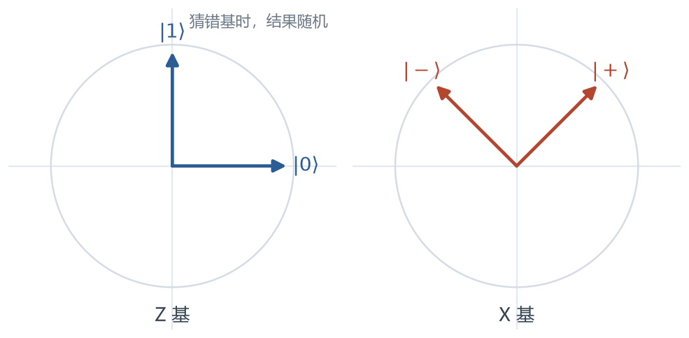
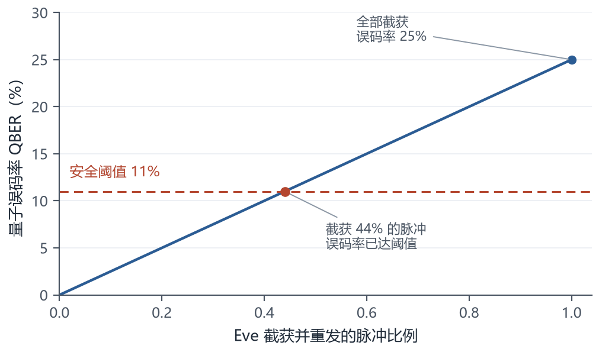

# 第 2 章　BB84 与它的安全性

1984 年，贝内特和布拉萨德在印度班加罗尔的一次会议上提出一个协议。当时量子信息还是一门很边缘的学问，会议录的印刷质量很差，文章排在很后面。四十年后，这个协议成了所有量子密钥分发系统的祖先。

它的想法出奇地朴素。不用任何复杂的数学，只用一件事，非正交的量子态没法被可靠地区分。

## 2.1 四个方向，两把尺子

偏振是最好用的载体。给光子定一个基准方向，偏振方向与它成 $0°$ 或 $90°$，这是一组；成 $45°$ 或 $135°$，这是另一组。前者习惯叫 Z 基，后者叫 X 基，两组各含两个正交状态。

关键在于，这两组之间不是正交的。Z 基的一个状态，在 X 基下测量，结果是一半一半，随机的。反过来也一样。所以只要不知道对方用的是哪把尺子，就没法把这个态认准。

图 2-1　BB84 使用的四个偏振态。同一组基内的两个态正交，可以完全区分；分属不同基的两个态夹角 45°，无法可靠区分

一个比特用哪个方向表示，取决于选哪组基。$0°$ 记作 0，$90°$ 记作 1，$45°$ 记作 0，$135°$ 记作 1。同一个数字 0，在 Z 基下是水平偏振，在 X 基下是 45 度偏振。这个约定看起来绕，实际含义很直接，比特值和基是两件事，各自由发送方随机选。

## 2.2 协议走一遍

流程分四步。

爱丽丝有 $N$ 个比特要发。对每一个比特，她随机选一个基，再按比特值选方向，把光子发给鲍勃。她记下每个比特用的基和值，这两列数据只存在她自己那里。

鲍勃对每个到达的光子也随机选一个基去测，得到一串结果。他同样记下自己用的基。

这一步做完，两人手里的数据是一条谁都能看的线路上传过来的，光子可能被截获过。接下来是关键的一步，两人在公开信道上宣布自己每个位置用的基。注意只说基，不说比特值。基对得上，也就是两人选得一样的位置，留下的结果一定相同。基对不上的位置，鲍勃的测量结果是随机的，与比特值无关，全部丢掉。

这一步叫筛选。大约一半的位置能对上，两人各自留下这一段，长度约为 $N/2$，内容完全一致，而且还没有别人知道。

剩下的是确认。两人公开抽取一小部分位置，比对比特值，算出错误比例，这个量叫量子误码率 QBER。如果它明显高于无窃听时的本底，说明线路上有问题，协议中止。如果正常，就用剩下的数据做后处理，得到最终的密钥。

整个过程的精妙之处在于，公布基不会泄露任何东西。知道别人用哪把尺子，并不能反推出测量结果，除非你自己也有那个光子。

## 2.3 窃听为什么必然留下痕迹

假设伊芙想在中间截获。她可以试三种办法。

第一种是分光。用一个分束器把光子分成两路，一路自己留，一路继续发给鲍勃。这条路走不通，因为单个光子不可分，分束器会让它要么走这边要么走那边，不会分成两半。真正的分光器在单光子层面就是一个随机开关。

第二种是复制。造一台克隆机，把光子复制一份。这条路被不可克隆定理彻底堵住，未知的量子态不能精确复制。

第三种是截获重发。把光子拦下来，自己测一下，再按测到的结果造一个新的发给鲍勃。这是唯一可行的攻击，也是所有安全性分析的基准。

问题出在她的尺子上。爱丽丝用的基她不知道，只能猜。猜对了，测到的结果与爱丽丝一致，重发出去的光子也是对的，不会引入错误。猜错了，也就是选错了基，她的测量结果完全随机，重发出去的光子也就有一半的概率跟爱丽丝的原意相反。猜错基的概率是一半，猜错之后又有一半概率引入错误，于是在鲍勃那边，被截获过的那些位置里有四分之一是错的。

伊芙也可以换个策略，不重发，只把光子扣下来不给鲍勃。这样不引入错误，可鲍勃收不到光子，探测端的计数就掉下去了，两人通过计数异常也能察觉。

## 2.4 误码率给出的判决

四分之一这个数字很重要。如果伊芙截获全部脉冲，误码率就是 25%。如果她只截获一部分以图蒙混，误码率随截获比例线性上升，截获四成四，误码率就到了一成上下。图 2-2 画的就是这条直线。

图 2-2　截获重发攻击下误码率随截获比例的变化，按 $e = f/4$ 计算。误码率达到 11% 时已被截获四成以上的脉冲

这条直线给了双方一把尺子。误码率越低，说明伊芙知道的信息越少，能提炼出的安全密钥就越多。误码率升到 11% 附近，安全密钥的长度降到零，协议再怎么跑也换不出有用的东西。这个 11% 不是随手定的门限，它来自下面的计算。

假设筛选后有 $n$ 个比特，误码率是 $e$。先纠错，把鲍勃手里的串改成和爱丽丝一致。这个动作要在公开信道上交换校验信息，等于向伊芙泄露一部分信息，泄露量下界约等于 $n$ 乘以二元熵

$$
h(e) = -e\log_2 e - (1-e)\log_2(1-e)
$$

纠错之后，两人手里有一串完全相同的比特，但伊芙对它有部分了解。下一步做隐私放大，用一个随机哈希函数把 $n$ 比特压成 $l$ 比特。压缩的比例够狠，伊芙的那点信息就被稀释成几乎为零，最终密钥与她的知识在统计上独立。剩余密钥率的下界是

$$
r \ge 1 - h(e) - h(e_{ph})
$$

其中 $e_{ph}$ 是相位误码率，描述伊芙可能掌握的相位信息。在最理想的情形下两项相等，$r = 1 - 2h(e)$。令它等于零，解出 $e \approx 11\%$。二元熵在 0.11 处正好是 0.5，这就是那个阈值的来历。

## 2.5 后处理的两道工序

纠错和隐私放大是协议的后半程，工程上各有一整套办法。

纠错常用的是级联协议，把比特分成块，公开比对每块的奇偶校验，发现不一致就对半分块继续找，直到定位并翻转所有错误。它的效率不如现代编码，但实现简单，泄露的信息量可以精确计算。现在的系统多用低密度奇偶校验码，效率逼近香农限。

隐私放大用的是一族两两独立的哈希函数，比如托普利兹矩阵。取一个随机矩阵，与纠错后的串做模二乘法，输出的每一位都是输入的随机线性组合，输入里任何一点偏差都被摊平。这个做法的合法性来自剩余哈希引理，它在信息论里是标准结论。矩阵本身要通过认证的经典信道传送，用完即弃。

整条流水线的输出长度是可以算的。给定脉冲数、透过率、探测器暗计数，就能估出筛选密钥长度、误码率、纠错泄露量，最终得到安全密钥率。工程上还要留出有限码长的余量，因为统计涨落在短数据上不可忽略。

## 2.6 安全性怎么被证明

早期人们对 BB84 的信心来自物理直觉，直到 1990 年代末才有严格的证明。

1999 年，洛和周海峰给出一个等价的图像。把协议看成先制备纠缠态再测量，安全性问题于是变成纠缠提纯问题。2000 年，肖尔和普雷斯基尔把这个图像化简成一个纯经典的论证，只在收尾那一步用到量子力学。他们的结论是，只要误码率低于 11%，协议产生的密钥就与理想密钥不可区分。

这些证明假设光源是理想的单光子源。实际系统用的是衰减激光，每次发出来的是弱相干光，光子数服从泊松分布，有时一个脉冲里有两个甚至更多光子。这会打开新的攻击面，也让证明要重新走一遍。2004 年，戈特斯曼、洛、卢特肯豪斯、普雷斯基尔等人把证明推广到实际光源，用的正是第 3 章要讲的诱骗态方法。

## 2.7 实际跑起来是什么样

一套商用的光纤系统，几十公里的城域链路上，误码率通常在百分之一到三之间。这个本底来自探测器暗计数、光学器件的不完美、以及环境扰动。

成码率随距离下降得很快。五十公里的链路，每秒能出几十到几百千比特的密钥。一百公里，降到几千比特。再远，设备本身的噪声就盖过了信号。

这些数字放在密码学里已经够用，因为对称加密的密钥消耗极慢。一把 256 位的密钥可以加密海量数据，只要定期更新就行。可它也说明，一条链路能覆盖的范围是有限的。要把密钥送到几百公里以外，得换别的办法，这是第 4 章的主题。

协议本身也在演化。BB84 之后出现了用相位编码的版本，用时间编码的版本，用连续变量的版本。它们的共同点没有变，都是让窃听者在“获取信息”和“不留下痕迹”之间做选择，而这两件事在量子力学里不能同时做到。
