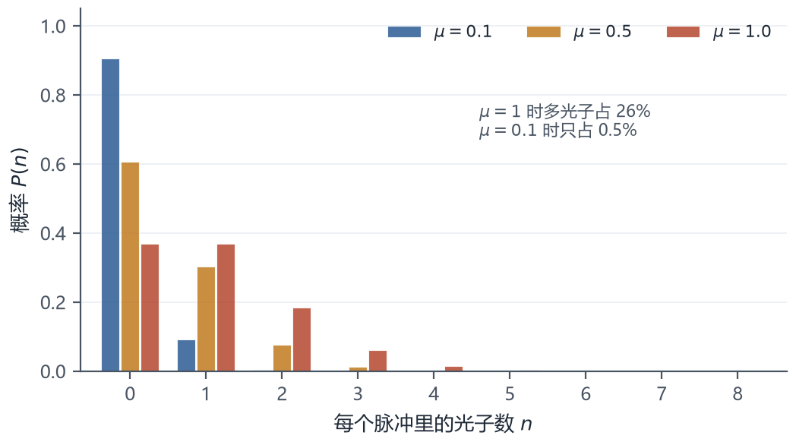
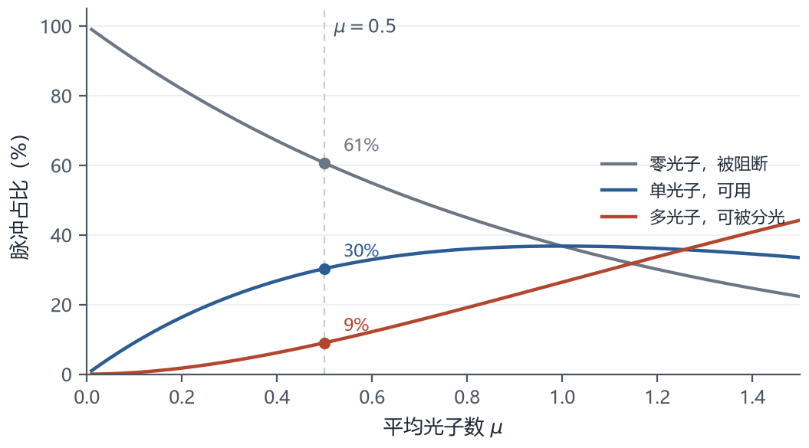

# 第 3 章　真实设备的漏洞

第 2 章的安全证明有一个前提，光子是一个一个发出来的。实验室里没有这种光源。工程师手上有的是一支衰减到极弱的激光器，它发出的每个脉冲里，光子数服从泊松分布。

这个差距看起来是技术细节，实际上是整个领域最长的一段弯路。从 2000 年前后开始，理论家和实验家花了十几年才把它补上，也顺手发现了更多同类问题。这一章讲这些漏洞，以及每一个漏洞是怎么被堵住的。

## 3.1 弱相干光不是单光子

激光器输出的相干态，光子数分布是

$$
P(n) = \frac{\mu^n e^{-\mu}}{n!}
$$

$\mu$ 是一个脉冲里的平均光子数。衰减到 $\mu = 0.1$ 时，九成的脉冲里一个光子都没有，将近一成是单光子，还有千分之五带着两个以上的光子。$\mu$ 升到 1，多光子的比例涨到百分之二十六。

图 3-1　弱相干光源的光子数分布，按泊松公式计算。平均光子数越大，多光子脉冲的比例越高

工程上希望 $\mu$ 大一些，脉冲多，成码率高。可 $\mu$ 一大，多光子脉冲就多了。这个问题在理想单光子源下不存在，在衰减激光下无法回避。

## 3.2 多出来的光子

2000 年，布拉萨德、吕特肯豪斯、莫尔和桑德斯指出一种攻击，后来被称作光子数分离攻击。

思路很直接。伊芙在光纤上做一个不破坏光子的分束，用光子数分辨探测器数清每个脉冲里有几个光子。零光子的脉冲她直接扔掉，让鲍勃的计数变少，但这对她没坏处。单光子的脉冲她原样放过去，不动。多光子的脉冲，她拿走一个，剩下的照原样发给鲍勃。

整个过程中她没有做任何测量，没有引入任何扰动。鲍勃收到的光子与爱丽丝发出的完全一样，误码率不升高。可她已经掌握了一个光子的完整信息，等到两人公布基之后，她就能算出那个位置上的比特值。协议跑完，爱丽丝和鲍勃以为密钥只有他们知道，实际上伊芙手里有一份。

这种攻击之所以成立，是因为多光子脉冲里的几个光子是全同的，拿走一个不影响剩下的。这是相干光的性质，不是设备的缺陷。

## 3.3 用诱骗态把账算清

对策来自一个统计学的想法。既然爱丽丝不知道每个脉冲里有几个光子，那就让伊芙也没法确定。

2003 年，黄（Won-Young Hwang）提出诱骗态的雏形，2005 年，洛、马雄峰和陈凯，以及王向斌，各自给出完整的方案。做法是让爱丽丝随机地在几种强度之间切换，大部分脉冲用较强的信号态 $\mu$，一部分用很弱的诱骗态 $\nu$，偶尔发真空。

关键在接收端。鲍勃统计每种强度下的探测计数和误码，得到各自的增益和误码率。伊芙要做光子数分离，就必须按光子数区别对待，于是不同强度的脉冲在她手里衰减的比例不同。这个差异会体现在增益上。用几组增益和误码联立，就能反推出单光子成分的增益下界，以及单光子成分的误码率上界。

拿到这两个数，第 2 章的密钥率公式就能用了，只不过 $Q_1$ 和 $e_1$ 是从实验数据估出来的，不再是理想值。这等于说，多光子脉冲仍然存在，伊芙仍然能从中偷信息，但爱丽丝和鲍勃知道她最多能偷多少，并在隐私放大时把这部分扣掉。

诱骗态把量子密钥分发的实用性往前推了一大步。2007 年，中国科学技术大学的研究组在光纤上做出了百公里量级的诱骗态实验，成码率比之前提高两个数量级。此后几乎所有实用系统都用三种强度。

图 3-2　弱相干脉冲中零光子、单光子和多光子成分的占比，按泊松分布计算。单光子成分在 $\mu = 1$ 附近达到最大，多光子成分则随 $\mu$ 单调上升

这张图解释了工程上的取舍。单光子占比在 $\mu = 1$ 处达到顶峰，只有 37%，可此时多光子已经占了 26%。$\mu = 0.5$ 时单光子降到 30%，多光子降到 9%，空脉冲升到 61%。实际系统多半把 $\mu$ 定在这附近，用大量的空脉冲换一个干净的单光子成分。

## 3.4 探测器那一端

光源的问题解决了，探测器又出问题。

2007 年，几位研究者在理论上提出时间位移攻击。单光子探测器有一个门控窗口，只在某个时间点附近开启。攻击者把光子到达的时间挪到这个窗口的边缘，让探测效率变低。效率一变，计数就变，而计数的变化可以被用来推断基的选择。这类攻击不需要知道光子的状态，只需要控制时间。

2010 年，吕德森等人在商用量子密钥分发系统上做成了更狠的一招，探测器致盲。用强光照射探测器，把它从单光子模式推到线性模式，然后自己用强光脉冲去“模拟”探测结果。完全控制了两个探测器，也就完全控制了鲍勃看到的数据。他们在那篇论文里把系统里的密钥完整地提取了出来。

这类攻击的共同点是，它们不碰量子力学的基本假设，只利用硬件的不完美。安全证明把探测器当成一个黑箱，假设它按量子力学的规律工作，可真实的探测器是雪崩二极管，有死时间，有后脉冲，有不同的响应曲线。黑箱里塞满了可以被利用的细节。

## 3.5 把探测器挪走

2012 年，洛、库尔蒂和祁提出测量设备无关的协议，习惯简称 MDI-QKD。

做法是把探测环节从两端挪到中间。爱丽丝和鲍勃各自制备一个编码好的光子，通过各自的链路送到一个中间节点，在那里做贝尔态测量。测量结果由中间节点公布，两人据此判断各自手里的比特是否相同。

安全性来自一个事实，贝尔态测量只告诉两人“两个比特是否相同”和“相位关系”，不泄露比特值本身。中间节点可以是伊芙控制的，她就算知道测量结果，也推不出密钥。于是所有针对探测器的攻击都失效了，剩下要防的只有光源和编码，而这两样已经在诱骗态那套框架里处理清楚了。

代价是成码率。贝尔态测量需要两个光子同时到达，成功率对两端链路的损耗各算一次，总效率按透过率的平方下降。工程上的补偿办法是把中间节点放在中点，让两段各承担一半损耗。2016 年，中科大的研究组把 MDI 协议做到 404 公里的光纤上，用上了低噪声超导探测器。

## 3.6 双场协议

MDI 解决了探测器，可它的成码率随距离下降得太快。2018 年，卢卡马里尼、袁之良、戴恩斯和希尔兹提出双场协议，思路再往前走一步。

爱丽丝和鲍勃不再各发一个光子去做两光子干涉，而是各自把同一个单光子态的一半发到中间节点，让两份波函数在中点干涉。这里用的不是两光子干涉，而是单光子干涉，干涉结果对相位的敏感度极高，也因此成码率随距离按透过率的一次方下降，而不是平方。

这个协议把无中继的成码距离推到了六百公里以上。2022 年，中科大的研究组在 833 公里的光纤上做成了双场密钥分发，成码率极低，每秒不到一个比特，但它证明了在这么长的距离上仍然存在一条量子信道。

同一时期还有别的思路，比如用连续变量、用压缩态、用多点干涉。它们的共同目标都是同一个，在不加中继的前提下把距离再推远一点。而这条路的极限，是由光纤损耗本身定的，跟协议怎么设计无关。

## 3.7 漏洞清单没有尽头

每一轮攻击之后，协议都会补上一块。诱骗态补了光源，MDI 补了探测器，双场补了距离。可补来补去，还有一类攻击始终在边缘游走，特洛伊木马。

伊芙可以向爱丽丝的设备里打进一束光，看反射回来的光里有没有编码信息。这不需要碰量子信道，只需要在设备上开一个窗口。防御的办法是在设备里加隔离器、加滤波器、监测入射光功率。这些是纯工程手段，没有理论上的完备性。

2010 年代后期，另一条路被认真对待，设备无关的量子密钥分发。它不假设设备的任何细节，只用贝尔不等式违反的程度来估计窃听信息。理论上最干净，实验上极难，因为要同时关上探测漏洞和定域性漏洞，成码率低到几乎不可用。

现实中的安全不是一个定理，而是一份清单。清单上有光源、有调制器、有探测器、有随机数发生器、有经典后处理、有身份认证。每一代系统都要重新审一遍这份清单，因为攻击者的想象力不会停。这也是为什么量子密钥分发的标准制定花了那么多年，比做实验慢得多。
