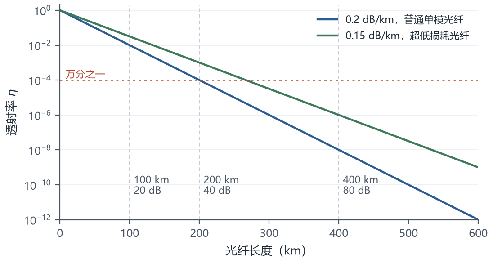
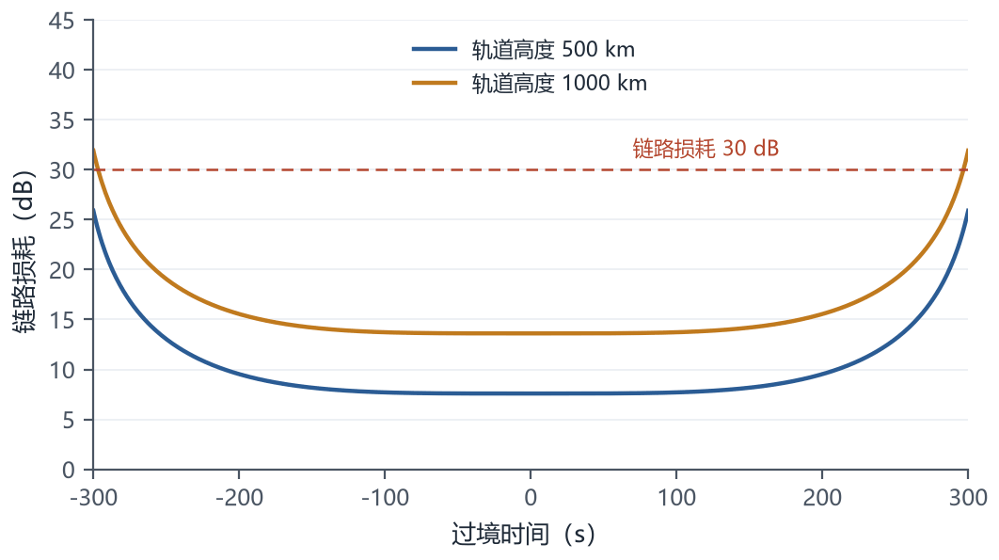

# 第 4 章　距离的墙

城域网里跑量子密钥，几十公里，一切顺利。想把链路拉到城与城之间，问题立刻出现，而且不是设备不够好，是光纤本身的性质。

这一章讲这堵墙有多高，以及人们用什么办法在墙上开口。

## 4.1 光纤吃光

光在玻璃里走，会被吸收和散射。通信波段选在 1550 纳米附近，因为这个窗口的损耗最低，普通单模光纤大约是每公里 0.2 分贝。这个数字听起来很小，可它是指数衰减。

损耗的分贝数和透射率的关系是

$$
\eta = 10^{-\alpha L/10}
$$

$\alpha$ 是每公里损耗，$L$ 是长度。0.2 分贝每公里意味着光走 50 公里只剩一成，走 100 公里剩百分之一，走 200 公里剩万分之一。换个说法，透射率掉到 $1/e$ 只需要 22 公里。北京到上海一千多公里，透射率只有 $10^{-20}$ 量级，等于每个脉冲平均只剩下万亿亿分之一个光子。

图 4-1　光纤透射率随长度的指数衰减，按 0.2 dB/km 与 0.15 dB/km 两种损耗计算。纵轴是对数刻度

把这条曲线换算成脉冲数更直观。一个每秒发射一亿个脉冲的光源，经过一百公里，还剩每秒一百万个。经过四百公里，每秒剩一个。再远一点，等一个脉冲的时间要按小时算。

## 4.2 成码率跟着掉

量子密钥分发的成码率与透射率直接挂钩。理想情况下，筛选密钥率大约是每秒脉冲数乘透射率再除以二。误码率也会随距离恶化，因为探测器暗计数是个常数，每秒几百到上千个，信号越弱，它在计数里的占比越高。到了某个距离，暗计数造成的误码就足以把密钥率压到零。

2017 年，皮兰多拉等人证明了一个上界，任何不使用中继的量子密钥分发协议，成码率都不超过

$$
R \le -\log_2(1-\eta) \approx 1.44\,\eta
$$

这就是所谓无中继界限。它说的是一件很悲观的事，无论协议怎么改进，只要链路中间不加东西，成码率就跟着 $\eta$ 走，也就是跟着长度的指数走。前面讲的那些协议改进，诱骗态、MDI、双场，都是在逼近这条线，没有一条能越过去。

双场协议之所以引人注目，正是因为它把这条线用到了极致，在 833 公里的光纤上还能挤出每秒不到一个比特。这个成绩听着寒酸，它已经是无中继方案的天花板。

## 4.3 可信中继

要越过这堵墙，最直接的办法是分段。

在链路中间放一个节点，两边各跑一段量子密钥分发。节点先跟左边协商出一把密钥，再跟右边协商出一把，然后收下左边的密文，用左边的密钥解开，用右边的密钥重新加密，发往右边。这个动作叫密钥中继，节点就像邮局，把信拆开再封上。

2017 年 9 月开通的京沪干线用的就是这个办法。全长两千多公里，沿途设了三十多个可信中继节点，分布在北京、天津、济南、合肥、上海等地的机房和数据中心。每一段控制在百公里以内，单段成码率在几十千比特每秒，整网能同时支撑大量终端。它是一条真实在运行的国家级骨干网，银行、政务、电力系统在里面跑过业务试验。

优点很实在。每一段的长度控制在百公里以内，损耗在可接受范围，成码率能满足实用。设备用的是成熟的诱骗态系统，稳定性经过多年检验。

缺点也很实在。每一个中继节点都必须被信任。节点上有明文，节点的主人能看到经过的一切。三十多个节点，三十多个可以被收买、被胁迫、被攻破的地方。整条链的安全强度，等于最弱那个节点。这不是量子力学的胜利，而是把安全问题从数学转成了管理问题。

## 4.4 量子中继

真正符合直觉的办法，是让中继节点不知道密钥。

1998 年，布里格尔、迪尔、西拉克和佐勒提出量子中继的架构。把长链路切成若干段，每一段上分发纠缠对。相邻两段各有一个纠缠对，在中间节点对两个光子做贝尔态测量，测量之后，两端的光子就纠缠起来了，尽管它们从未见过面。这个操作叫纠缠交换，第 5 章会详细讲。

一段一段往上做，两端之间的纠缠就建立起来了。整个过程中，中继节点只做测量和公布结果，它不知道最终的纠缠态用来做什么，也不知道从中提取的密钥是什么。安全性不再依赖节点的诚实。

代价是时间。每一段的纠缠产生是概率事件，透射率越低，等得越久；所有段都准备好，才能做交换；存储的量子态还会退相干，等太久就废了。光纤里光速大约是每秒二十万公里，一千公里单程五毫秒，存储器的寿命至少要长过这种往返等待，而现在的固态存储器做到毫秒到秒的量级，刚好卡在边缘。这几个约束凑在一起，使得量子中继对器件的要求高得离谱，需要高效率的纠缠源、长寿命的量子存储器、高保真度的贝尔态测量，三样都不容易。

到目前为止，实验室里做出来的量子中继还停留在几个节点、几十到上百公里的规模，离实用还有距离。这是整条技术路线上最难啃的一段。

## 4.5 上天

光纤损耗没法绕，那就换介质。

自由空间里没有玻璃，光只在真空里走，损耗只来自衍射和大气。一束光从地面射向卫星，走几百公里后光斑会散开到几百米甚至几公里，接收望远镜只能捞到其中一小块。这仍然是指数衰减，可它的底数比光纤好得多。大气层只占末端十几公里，垂直穿过整层大气的光学厚度，折合成均匀大气大约相当于 8 公里，还不到城域光纤的一小段。

2016 年 8 月，墨子号发射升空，轨道高度 500 公里。2017 年，研究组在星地之间完成了 1200 公里的诱骗态量子密钥分发，筛选后的密钥率在千比特每秒的量级。同年 9 月，北京和维也纳之间用卫星和地面光纤接力的方式，完成了 7600 公里的洲际密钥分发。这是人类第一次在洲际尺度上跑通这套流程。

卫星链路的麻烦在时间窗。低轨卫星绕地球一圈约九十分钟，地面站能看见它的时间只有几分钟，而且要在天顶角不太大的时候才能用。图 4-2 是一次过境的损耗曲线，卫星刚升起时链路损耗二十多分贝，到天顶时降到七八分贝，落下时又变差。密钥只能在这个窗口里生成。

图 4-2　一次低轨卫星过境的链路损耗，按 500 km 与 1000 km 两种轨道高度、高斯光束衍射和大气光学厚度估算。卫星可见的窗口只有几分钟

多数星地实验还只能在夜间做，白天的日光背景会把探测器淹没。窗口短，还意味着单次过境能生成的密钥量有限。解决办法是组网，多颗卫星、多个地面站，让密钥在网内流转。2022 年发射的济南一号是颗微纳卫星，重量轻，成本低，验证了小型化地面站和实时成码的可行性。这条路线和光纤路线是互补的，卫星管跨洲，光纤管城内。

## 4.6 三条腿走路

今天的现实是三条路并存。城域和骨干用可信中继，几百公里的点对点用双场或者 MDI，跨洲用卫星。没有哪一条能单独覆盖所有场景。

这也解释了为什么量子中继的研究一直没有停。可信中继的信任假设太强，卫星的时间窗太窄，无中继协议的距离上限太硬。只有把量子中继做出来，才能有一条既不需要信任节点、又不受距离限制的路。它现在还在实验室里，但它的目标很清楚，就是把第 5 章要讲的那张网络搭起来。
