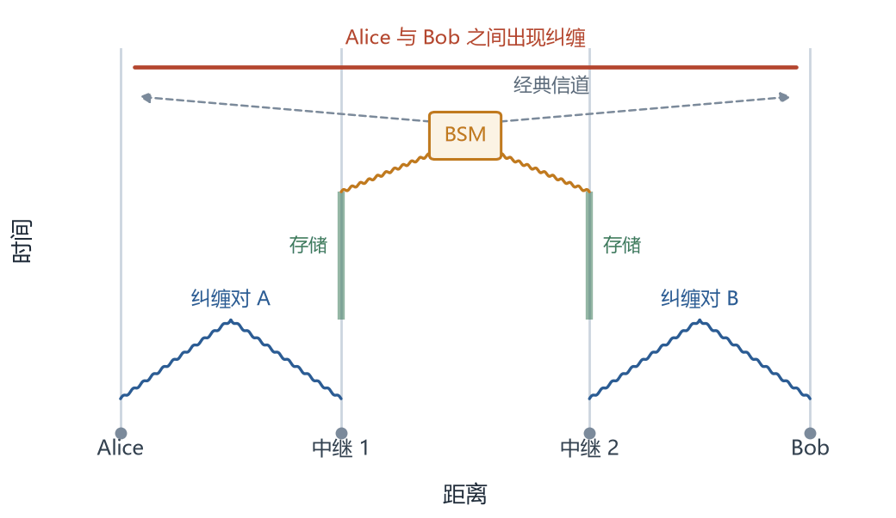
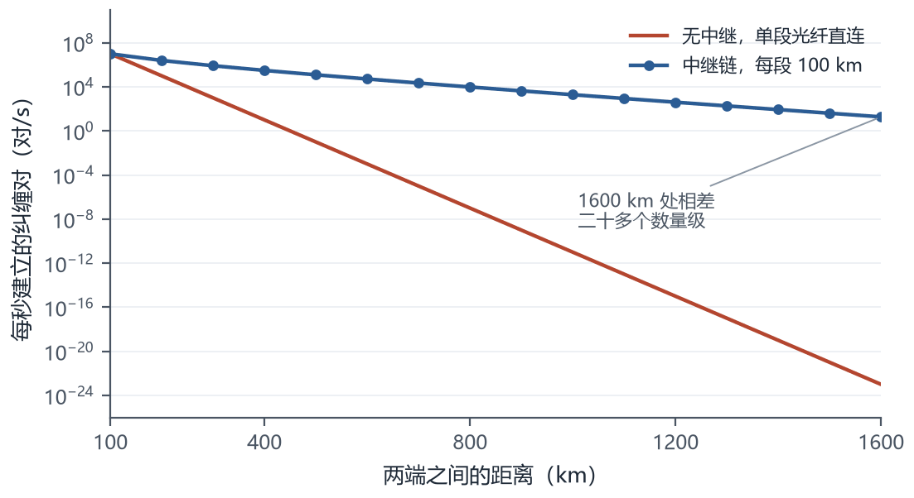

# 第 5 章　量子网络

一条点对点的密钥链路，解决的是两个人的问题。现实世界里需要连接的是一群人、一批设备、一座城市。把点连成网，问题会变了样子，因为网络里跑的不再只是比特，还有纠缠。

这一章讲纠缠怎么在网络上被分来分去，需要哪些器件，以及这张网能拿来做什么。

## 5.1 网络的单位是纠缠

量子网络和经典网络有一个根本差别，它分发的东西不能复制。经典网络里，一个文件可以从服务器复制到任意多台机器上，路由器缓存一份也不影响原件的完整性。量子网络不行，一个未知的量子态只有一份，送到哪里就只能在哪里，中间不能留副本。

这让网络的基本操作变了。两点之间建立一段纠缠，两端各持一个粒子，这两个粒子合起来的态无法写成各自的直积

$$
|\Phi^{+}\rangle = \frac{1}{\sqrt{2}}\left(|00\rangle + |11\rangle\right)
$$

测量其中任意一个，另一个的状态立刻确定，不管隔着多远。这个关联不能用来超光速通信，因为结果本身是随机的，要读出信息必须靠经典信道把测量结果送过去。纠缠加两条经典信道，能做的事情就很多了，最著名的是量子隐形传态，把一个未知的量子态搬到远处。

量子网络的功能可以概括成一句话，把纠缠送到需要它的地方，再用经典通信来消费它。密钥分发是消费方式之一，还有别的。

## 5.2 纠缠交换

纠缠不能像包裹一样越送越远。送到某个距离之后，光子丢了，纠缠也就没了。要在远处建立纠缠，只能一段一段接起来。

接的办法叫纠缠交换。想象四个节点，爱丽丝在最左，鲍勃在最右，中间两个是中继。先把爱丽丝和中继 1 的一个粒子做成纠缠对，再把中继 2 和鲍勃做成纠缠对。两组纠缠对彼此独立，四个粒子之间没有直接关系。

接下来让这两个节点各自持有的粒子发生干涉，做一次贝尔态测量。测量会得到四个可能结果之一，哪一个都是随机的。测完之后，爱丽丝和鲍勃手里的两个粒子就纠缠起来了，而且测量结果会告诉他们，这个纠缠态是四种贝尔态中的哪一种，需要时用一次单比特操作就能校正过来。

图 5-1　纠缠交换的时空图。两组独立的纠缠对在中点做贝尔态测量，测量结果经经典信道送到两端，Alice 与 Bob 之间随即出现纠缠

这个过程有一点反直觉。爱丽丝和鲍勃手里的粒子自始至终没有相互作用，它们之间的纠缠是被“拼接”出来的。中继节点参与了这个过程，却不知道这个纠缠态是怎么来的，也不知道两端会拿它做什么。

1993 年，祖科夫斯基等人从理论上提出这个方案。1998 年，潘建伟等人在实验室里把它做出来，用的是自发参量下转换的光子对和分束器干涉。

## 5.3 存储是必需品

纠缠交换要求两段纠缠同时准备好。可两段的建立都是概率事件，一段先成了，另一段可能还要等很久。等待期间，先成的那一段必须被存起来。

这就是量子存储器的用处。它要满足三个指标，效率、保真度、寿命，分别是光子取出来的概率、取出来的态有多接近原态、以及能存多久。

寿命这一项最要命。光纤里光速大约每秒二十万公里，两端相距一千公里单程就要五毫秒。存储器要长过这个时间，还要长过所有段都成功的等待时间，后者在段数多的时候会拖得更长。

现在的候选体系各有短长。冷原子系综的效率可以做到八成以上，寿命在毫秒到百毫秒。稀土掺杂晶体用原子频率梳协议，效率一成到五成，自旋相干时间可以做到秒甚至更长，最近还有把核自旋相干时间推到小时的实验。量子点能确定性发光，波长却在可见或近红外，需要频率转换才能接进 1550 纳米的光纤。

这后一点是工程上的硬约束。光纤的标准波长是 1550 纳米，大多数好的存储介质却工作在 800 纳米或者可见光波段。中间要加频率转换器，效率一低，整条链路的效率再打一次折扣。

## 5.4 中继链的算术

有了存储和交换，长链路的算术就变了。

不加中继时，端到端的透射率随长度指数下降。分成 $N$ 段之后，每一段只需要跨越总长的 $1/N$，损耗随之大幅降低。虽然交换环节有成功率和经典通信的延迟，总的趋势从指数变成了多项式。

图 5-2　端到端纠缠建立速率随距离的变化，按每段 100 km、0.2 dB/km、每秒十亿次尝试、每次交换成功率二分之一估算

这个估算的模型很粗，每段一百公里，每秒尝试十亿次，每次成功一半。曲线的形状已经足够说明问题。一千六百公里的直连链路，每秒能建立的纠缠对是 $10^{-23}$ 个，等于永远等不到。同样距离分成十六段，每秒还有几十个，虽然也不算多，但已经在可用范围内。

这个对比是量子中继的全部理由。它不提高单段的效率，只把指数换成了多项式，而有史以来所有的通信技术突破，归根到底都是在做这件事。

## 5.5 分层

要把不同厂商、不同物理体系的设备接在一起，网络必须分层。经典互联网的分层办法已经被验证了五十年，量子网络大体照抄，只是每层塞进新东西。

最底下是物理层，负责光子的产生、调制、传输和探测。往上是链路层，管一段链路上的纠缠产生、纠缠提纯、错误标记。再往上是网络层，负责路由，决定一条端到端的纠缠要经过哪几个中继，以及在什么时机做交换。传输层把有限的纠缠资源分配给不同任务。最上面是应用层，跑的是密钥分发、分布式计算、时钟同步这些具体功能。

2018 年，韦纳、埃尔库斯和汉森在《科学》上给出分阶段的路线图，把量子互联网的成熟度分成六级。第一级是可信中继的密钥网络，已经实现。第二级是制备测量型网络，用测量代替传输。第三级是纠缠分发，两端能拿到纠缠对。第四级才加上量子存储，能存住纠缠。第五级是小规模的容错计算，几个逻辑比特能跑无差错的门。第六级是全功能的量子互联网，任意两点之间都能做任意量子操作。今天全世界的位置大概在第二级和第三级之间，第四级在实验室里刚刚摸到。

## 5.6 能拿来做什么

密钥分发是最成熟的应用，也是目前唯一有商业收入的。

分布式量子计算是另一个方向。一台大机器受限于芯片尺寸和布线，可以拆成小模块，模块之间用纠缠连起来，跨模块的门通过门隐形传态实现。这样每个模块只需要做好自己那一小块，规模靠拼。代价是每个跨模块门都要消耗一个纠缠对，速度还受经典通信延迟限制。

时钟同步听起来不起眼，实际很金贵。现在的授时靠卫星和光纤双向比对，精度在百皮秒量级。用纠缠光子做比对，两端结果的关联可以精确到飞秒，理论上能再提高几个数量级。

还有望远镜干涉。两台相距很远的望远镜把光送到同一个探测器上，等效口径等于两者的距离。难点在两路光的相位必须稳定在波长的几分之一，距离一长就晃得厉害。纠缠方案的好处是，相位信息可以事后从测量结果的关联里提取，对现场的光程稳定度要求降低。

再远一点是盲量子计算，没有量子计算机的用户把任务交给服务器，服务器看不到输入也看不到算法。

## 5.7 现状

中国的量子网络是目前规模最大的。合肥建成了覆盖主城区的量子城域网，京沪干线连接沿线多个省市，两者在 2020 年前后打通，形成一张两千多公里的骨干网。

欧洲走的是另一条路，欧盟的量子通信基础设施计划要在 2027 年前后建成覆盖全欧的骨干，各国自己建城域网再互联。荷兰在代尔夫特做了几个节点的中继网络，重点不在距离而在可编程性。美国能源部的路线图把国家实验室串成一条试验床，芝加哥地区已经有几十英里的光纤环路在跑纠缠分发。

这些网络都是混合的，能用到哪一级就用哪一级。全功能的量子互联网还很远。比较靠谱的判断是，未来十年能看到纠缠分发网络的小规模示范，量子中继从实验室走向城际链路，真正的量子互联网要等存储和纠缠接口成熟到可以批量制造。
