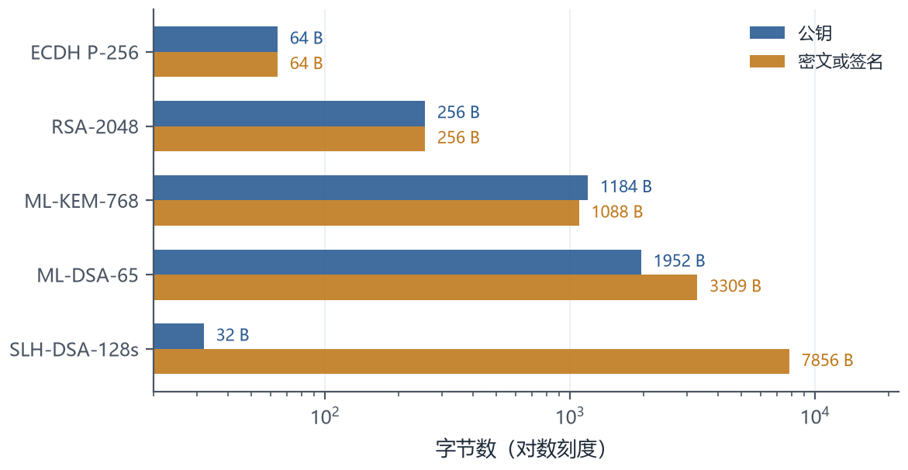
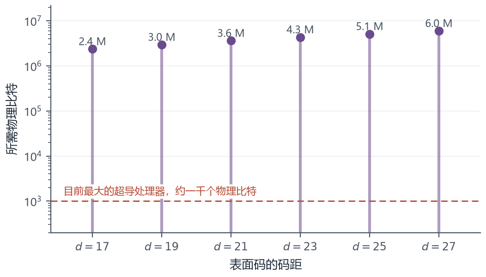

# 第 6 章　后量子密码与迁移

前面五章讲的都是量子技术怎么解决通信问题。这一章反过来，讲量子计算机会给现有的通信带来什么麻烦，以及怎么在它到来之前把锁换掉。

两件事看起来方向相反，其实是同一场变化的两个侧面。量子计算机能破掉公钥密码，于是有了量子密钥分发，也有了后量子密码。前者用量子力学保护密钥，后者用新的数学难题替换旧的。它们不是竞争关系，是两条并行推进的路。

## 6.1 换锁而不是换路

量子密钥分发的缺点在前几章已经露出来了，它需要专用的光纤、专用的设备、点对点的链路。要让全世界的服务器、手机、物联网设备都用上，代价高得无法想象。

后量子密码走的是另一条路。它仍然是数学，仍然跑在现有的软件和硬件上，只是把底层的难题换掉。证书、签名、握手，整套基础设施不用改，换掉算法就行。

这条路能走通，前提是存在一些量子计算机也解不动的数学问题。目前看，这样的问题不止一个，而且分布在几个完全不同的数学分支上。万一某个分支被攻破，还有别的可以顶上。

## 6.2 格

三条路里最年轻的是格。

把 $n$ 维空间里的整数坐标点拿出来，就得到一张格子。格上最基础的问题是，给定一组基向量，找出其中最短的非零向量。维数一高，这个问题就变得极难，目前最好的算法在最坏情况下的复杂度仍然是指数的。

密码学用的是它的平均情形版本。带错误学习问题，简称 LWE，是这样的：给定一个矩阵 $A$ 和一个向量 $b$，

$$
b = As + e \pmod q
$$

其中 $s$ 是秘密，$e$ 是一个很小的随机误差向量。要从 $A$ 和 $b$ 里恢复 $s$，就得在没有误差的情况下解线性方程组，可误差把每个方程都搅乱了，解法变成了在格上找一个离目标最近的向量。这个问题被证明和格上最坏情况的难题一样难，这个归约是它可信的基础。

ML-KEM 用的就是这个结构，只不过把矩阵换成了多项式环上的元素，叫做模块格，好处是密钥和运算量都小得多。格密码的历史可以追到 1996 年的 NTRU，那是一套基于多项式环的公钥方案，抗量子，速度快，只是没赶上标准化。2005 年，雷格夫给出 LWE 及其安全性归约，格密码才有了今天的理论地位。

## 6.3 编码

比格更老的是纠错码。1978 年，麦克艾利斯提出一套基于纠错码的公钥加密。

思路很巧。取一个线性纠错码，它能纠正 $t$ 个错误，但只有持有码的结构信息时才能高效译码。公钥是把这个码打乱、置换之后得到的生成矩阵，看上去像一个随机的线性码。加密时，把消息编成码字，再故意加上 $t$ 个随机错误。解密时，用私钥恢复原来的结构，把错误纠掉。

攻击者面对的是一般线性码的译码问题，这是 NP 难的问题。四十多年过去，原始的 McEliece 方案没有被真正攻破。

它的毛病是尺寸。公钥不是一个数，而是一个几千乘几千的二进制矩阵，压缩之后也有几十万字节，比椭圆曲线的六十四字节大了三个数量级。这在数据中心里还好，在一张智能卡或者一颗物联网芯片上就放不下。后来有人用准循环码压缩，但压缩引入的新结构又可能被攻击者利用。

2025 年被选为备用密钥封装的 HQC 走的也是编码这条路，公钥只有几千字节。

## 6.4 哈希签名

最老的一条路只用哈希函数，工具最少，假设也最少。

一次性签名早在 1979 年就有了。把私钥写成一串随机数，每个比特对应一对，公钥是这些随机数各自的哈希。签名的时候，按消息的比特值，每个比特挑一个对应的随机数交出去。验证的人算哈希，对得上就通过。安全性的依据只有一条，哈希函数不能反推。

问题是一把私钥只能签一次。签第二次，攻击者就能从两次签名里凑出别的消息的签名。Merkle 在同年给出了解决办法，把这些一次性公钥排成一片叶子，逐层哈希到根，只公布根。签名时附上从叶子到根的路径。这样一把根密钥可以签很多次，代价是签名长度随消息数量对数增长。

SPHINCS+ 是这条线上最新的成果，它用多层哈希树和少量一次性签名拼出一个无状态的方案。好处是签名者不需要记录自己签过什么，天然适合分布式系统。代价是签名大，最小的参数集也有七八千字节，比 ML-DSA 大一倍多。

## 6.5 标准化的十年

2016 年，美国国家标准与技术研究院发起一场公开征集，收到的完整提交有六十九份，来自二十多个国家。之后是几轮筛选，每一轮都有方案被攻击者打掉。

2022 年 7 月，首批四个算法被选中，Kyber 做密钥封装，Dilithium 和 FALCON 做签名，SPHINCS+ 做基于哈希的签名。2024 年 8 月 13 日，三个标准正式发布，编号 FIPS 203、204、205，分别对应改名之后的 ML-KEM、ML-DSA 和 SLH-DSA。这是后量子密码第一次有了可以采购和认证的正式标准。2025 年 3 月，HQC 被选为备用的密钥封装，主要考虑是让密钥封装这条线上有两个不同数学基础的方案，不至于把鸡蛋放在一个篮子里。

标准发布不等于事情结束。签名方案还在继续征集，因为现有的几个在大签名和小公钥之间没给出足够多的选择。参数也在调整，安全强度的分级、侧信道防护的要求、错误注入的测试方法，都要一条条写进标准。

## 6.6 代价

换了算法，代价立刻体现在尺寸和速度上。

图 6-1　常用密钥封装与签名方案的尺寸对比，数据取自 FIPS 203 至 205 及常用椭圆曲线参数

ML-KEM-768 的公钥是 1184 字节，密文 1088 字节，两头加起来两三千字节。一次 TLS 握手，这几个字段就要多传几 KB。在宽带上无所谓，在受限的物联网链路上可能是几秒钟的传输时间。

签名的代价更大。ML-DSA-65 的签名 3309 字节，SLH-DSA 的签名七八千字节。一张证书链上有好几级签名，握手时全要传，一个网页的首次连接可能多出几十 KB。工程上为此做了不少优化，比如证书压缩和会话恢复。

计算速度也有变化。格上的运算主要是多项式乘法，可以用数论变换加速，跑起来比 RSA 快，比椭圆曲线慢一点。密钥生成是弱项，ML-DSA 生成一对密钥要几十微秒到毫秒，比 ECDSA 慢一个量级。

## 6.7 迁移

迁移是这件事里最难的部分，难点不在技术，在资产。

一个组织里有多少地方在用公钥密码，往往没人说得清。服务器证书、代码签名、VPN、智能卡、车联网、工业控制器、医疗设备，凡是需要身份认证和数据加密的地方都有。其中很多设备的固件不能升级，设计寿命二十年，里面烧着 RSA。

时间表在收紧。美国国家安全局在 2022 年给出 CNSA 2.0 的要求，国家安全系统要在 2030 年前完成迁移，2033 年全面停用旧算法。欧洲的监管机构给出了类似的窗口。主流浏览器已经在默认握手流程里加入了混合密钥交换，把椭圆曲线和 ML-KEM 一起用，任何一个被攻破都不影响安全。

混合部署是过渡期的标准做法。两个算法并行，密钥由两者共同派生，攻击者必须同时破掉两个。这样即使新算法出了问题，安全性也不低于原来。代价是握手包更大，兼容性要仔细处理。

还有一件容易被忽略的事，密码敏捷性。系统在设计时就要假设算法会被替换，把算法标识、参数、证书格式都做成可配置，不要在代码里写死。下次换算法时，才不用再花十年。

## 6.8 为什么要现在动手

破解 2048 位的 RSA，需要多少资源，学界有一个比较一致的估算。它需要大约四千个逻辑比特，每个逻辑比特用表面码编码，物理比特数随码距的平方增长。

图 6-2　破解 RSA-2048 所需物理比特的估算，按 4096 个逻辑比特、每个逻辑比特占 $2d^2$ 个物理比特计算，不含制备魔态所需的额外开销

按这个估算，码距取 27 时要六百万个物理比特。加上魔态工厂和线路排布的额外开销，比较激进的估计在两千万个物理比特、八小时运算。今天最大的超导处理器是一千多个物理比特，中间差四个数量级。

所以短期内不用恐慌，能破 RSA 的机器还没有影子。要紧张的是那些需要长期保密的数据，病历、身份证信息、商业合同，十五年后可能仍需保密，而那时机器可能已经有了。先存后解的计时从数据被截获那天就开始了。

迁移一个大型组织要五到十年，标准落地要三年，设备更换周期要十年。把所有时间加起来，现在动手已经不算早。
