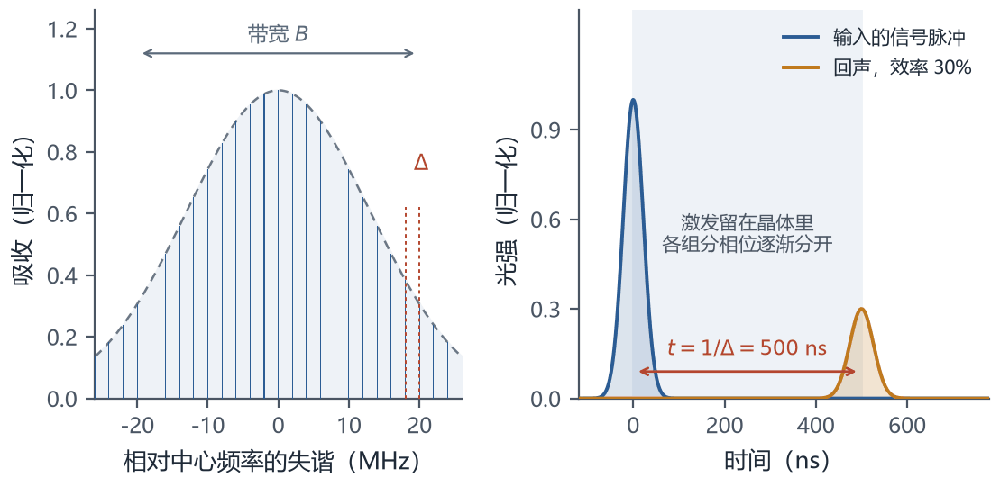
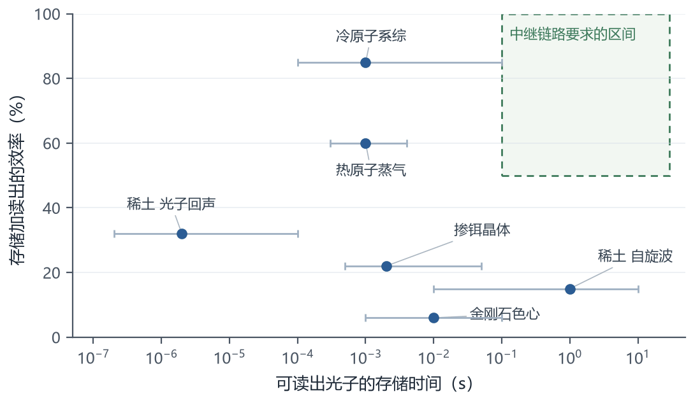

# 第 7 章　量子存储与中继器件

第 5 章算过一笔账，把一条长链路切成若干段，端到端的纠缠建立速率就从指数下降变成多项式下降。这笔账里藏着一个前提，两段纠缠不会同时准备好。一段先成了，另一段可能还要等几毫秒，先成的那一段必须被留住。留住它的东西叫量子存储器。

存储器是量子中继里最不像通信设备的部件。它不发光，不调制，只做一件事，把飞行中的光子变成静止的激发，需要的时候再变回来。这一章讲这个转换怎么做，为什么几个指标总是此消彼长，以及今天的器件离要求还有多远。

## 7.1 存的是态，不是光子

最直接的想法是把光子关进两面高反射镜组成的腔，它确实能存活几十微秒。可这个办法在中继里没用，光子最终要按需取出，而它什么时候漏出去是随机的。

真正的存储器走另一条路，把光子携带的量子态转移到物质内部的自旋上。光子消失了，态还在。需要的时候用一束读出激光把态变回光子，让它带着原来的偏振或者相位飞出去。

这个过程要满足三个指标。效率是一个光子进去，有多大比例作为一个光子出来。保真度是出来的态有多接近进去的态。寿命是能等多久，超过这个时间，态就被环境搅乱。还有第四个指标，多模式数，也就是能同时存几个不同时刻到达的光子，它等于带宽乘以存储时间

$$
M = B\,T
$$

这个数字决定中继节点每秒能做多少次尝试，也就直接决定了链路的成码率。

## 7.2 原子系综里的集体激发

最早的方案用冷原子云。2001 年，段路明、卢金、西拉克和佐勒提出这个协议，后来按四人姓氏首字母叫 DLCZ。

一团微开尔文的铷原子先用写激光照射。写光与能级失谐，通过拉曼过程把原子从基态搬到另一个自旋态，同时放出一个光子。这个光子叫反斯托克斯光子，它一出现就意味着原子云里留下了一个自旋激发。探测器收到它，等于收到通知，激发写好了。

读出时再用激光照过去，激发被搬回基态，同时放出一个带着相位信息的光子。

奇妙的地方在于参与的不是一个原子，而是整团原子。激发由 N 个原子共享，发射时的振幅按 $\sqrt{N}$ 相加，强度按 $N$ 增长，光被定向送进一个很窄的空间模式，正好对上光纤芯径，所以系综的效率高。光学厚度一百左右的冷原子云，读出效率可以到八成以上。

缺点也在同一处，原子在动。即使冷却到微开尔文，几十微秒里原子也会飞出激光束的截面，集体激发随之散掉。要延长寿命，得把原子装进光晶格，或者放进光学腔里反复经过光束。装置因此复杂，真空、冷却、稳频都不能少。

## 7.3 晶体里的梳齿

另一条路用固体。把镨或者铕掺进硅酸钇这样的晶体，稀土离子的 4f 电子被外层的 5s 和 5p 屏蔽着，跟晶格振动的耦合很弱，光学相干时间在百微秒量级，超精细能级之间的自旋相干时间能到秒，个别体系甚至到小时。

麻烦在于每个离子感受到的局域场略有不同，同一根吸收线被拉成几十吉赫兹宽的一条带。这条带叫非均匀展宽，它把离子分成许多共振频率不同的小组，而我们分不清哪一组在哪里。

原子频率梳协议把这个麻烦变成了资源。用一串间隔严格相等的窄带光去泵浦，把宽吸收带烧出一排等间距的窗口，剩下的部分仍然吸收。整条谱线像一把梳子，梳齿间距记作 $\Delta$，齿宽记作 $\gamma$，两者之比叫精细度 $F$，梳子覆盖的范围就是带宽 $B$。

图 7-1　原子频率梳的存储原理。(a) 非均匀展宽的吸收带被烧成一排等间距梳齿，间距 $\Delta = 2$ MHz，带宽 40 MHz；(b) 输入脉冲被吸收，激发在 $1/\Delta = 500$ ns 后重新同相，形成效率 30% 的回声

信号光子进来时被所有梳齿同时吸收。每一组离子开始以各自的频率演化，相位逐渐拉开。这个分离是可逆的。经过时间

$$
T = \frac{1}{\Delta}
$$

之后，相邻梳齿之间正好差一个整周期，所有组的相位重新对齐，集体极化恢复，光子被重新发射出来。这个延迟的发射叫光子回声，间距取 2 兆赫兹，回声出现在 500 纳秒之后。

这里的算术很干净，也很残酷。存储时间可以写成

$$
T = \frac{F}{B}
$$

想存得久，要么把带宽做窄，要么把精细度做高。带宽窄了，能接住的光子就少，光源和滤波器跟着变苛刻。精细度高了，每根梳齿分担的光学厚度就薄，因为单齿的峰值吸收是总光学厚度除以精细度

$$
d_{\text{齿}} = \frac{d}{F}
$$

吸收一薄，效率就掉。这条连线来自协议本身，不是工艺不够好。

要突破它，得把激发从光学跃迁挪到自旋上去。在回声发出之前用两个射频脉冲把光学激发搬到基态的另一个超精细能级，等需要时再搬回来。存储时间从此由自旋相干决定，可以从微秒跳到秒。代价是两次转移各有损耗，效率通常掉一半。

## 7.4 三个指标互相拉扯

效率要高，需要有足够多的离子参与吸收，也就是大的光学厚度，或者把晶体放进腔里增加有效光程。可掺杂浓度一高，离子间相互作用就强，自旋相干被压短；腔里的耦合强，通向环境的退相干通道也打开了。寿命要长，需要把激发与环境隔开，低温、屏蔽磁场、动态去耦都是为了这个。可隔离得越好，读写越慢，带宽越窄。

带宽要宽，才能接住短脉冲和高速率信号。可按 $T = F/B$，同样的精细度下带宽一宽，存储时间就短。

现实中的器件只能在三者之间选一个工作点。冷原子系综选了效率和带宽，代价是寿命和装置复杂度。稀土晶体的光子回声选了寿命和带宽，代价是效率。自旋波方案把寿命做到秒，效率只剩一成。图 7-2 把几个体系摆在一起，没有哪个点落在所有要求都满足的区域内。

图 7-2　几种量子存储体系的可读出存储时间与总效率，按各体系已发表代表性实验的量级绘制。虚线框标出中继链路大致需要的区间

那个虚线框不是凭空画的。一千公里分成十段，光在光纤里走一趟要半毫秒，加上交换的经典通信往返，一轮操作在毫秒量级。要让所有段同时就绪，存储时间至少要比单段往返长一个数量级，也就是几十毫秒。一条链路上要串十次存储和十次交换，每次七成，乘十次只剩百分之三，所以单点效率得做到八成以上才谈得上实用。带宽要匹配光子谱宽，几个到几十兆赫兹，多模式数要大于十。

这几个数字放在一起，解释了为什么中继实验一直停在几个节点。

## 7.5 波长不对，就得转换

还有一个约束来自波长。光纤的最低损耗窗口在 1550 纳米，长距离传输非用它不可，可大多数好的存储介质不工作在这个波长。铷在 780 纳米，铯在 852 纳米，镨的可见跃迁在 606 纳米，金刚石色心在 637 纳米。只有掺铒材料的 1536 纳米跟光纤窗口几乎重合。

波长不匹配就得加一个频率转换器。做法是把光子送进周期极化的铌酸锂波导，同时打进一束强泵浦光，通过差频或者和频把光子搬到目标波长。效率对泵浦功率的依赖是

$$
\eta = \eta_{\max}\sin^2\left(\kappa\sqrt{P}\right)
$$

泵浦弱时效率随功率平方增长，强到一定程度就饱和。实验室的波导能做到六成到八成。

效率不是唯一的问题，噪声才是。泵浦光在波导里会产生拉曼散射，也会通过自发参量过程产生成对光子，其中一部分落在信号波段混进输出。这些光子不携带信息，却会被探测器记成信号，直接变成误码。窄带滤波、冷却波导、把泵浦选在噪声较小的位置，可以把每脉冲的噪声压到千分之一以下。可乘以每秒一亿个脉冲，仍然是每秒十万个假计数。

所以掺铒材料可贵，它不用转换，噪声问题就不存在。困难在另一头，铒离子的光学相干只有微秒量级，效率也低，目前报到一两成。

## 7.6 固态和气态

气态方案的物理图像干净，耦合强度可以精确计算，效率是几个体系里最高的。缺点是装置。冷原子需要超高真空和激光冷却，一套设备占满一张光学平台，开机准备要几个小时。热原子蒸气简单些，加一点缓冲气体或者给池壁镀石蜡，原子在两次碰撞之间能保持自旋几十毫秒，可多普勒展宽让带宽和保真度都受影响。

固态方案反过来。稀土晶体装在四开尔文的恒温器里，用闭循环制冷机就能维持，整台设备可以做成机架上的一个盒子。晶体一旦长好，离子位置固定，没有原子飞走的问题。缺点在制备，同位素纯度、晶体光学质量、磁场屏蔽、电极布线，每一项都影响最终指标，不同批次的晶体表现可能差一倍。

中继节点最终要装进机房，要能连续运行一年，要能远程重启。按这个标准，固态方案的优势比实验室指标更重要，近十年的中继实验也确实越来越多转向稀土晶体和色心。

## 7.7 一个节点里还有什么

存储器只是节点的一部分。节点还要有纠缠源，通常是自发参量下转换，用泵浦光打一块非线性晶体产生一对光子。要有贝尔态测量装置，分束器加两个单光子探测器。要有频率转换器，把波长搬到 1550 纳米。要有锁相和同步，让两个节点的激光相位稳在波长的几分之一。还要有低温、真空和控制软件。

每一样都有损失，而这些损失是相乘的。制备效率八成，链路透射率若干，存储五成，贝尔态测量一半，频率转换六成，乘起来一次尝试的贡献可能只有百分之一。

线性光学的贝尔态测量还有理论天花板。用分束器和符合计数，最多只能分辨四个贝尔态中的两个，成功率不超过二分之一。

2020 年，两个冷原子系综隔着几十公里光纤建立了纠缠，保真度接近九成，这是第一次让两个存储器之间的纠缠穿过城际距离。2021 年，代尔夫特的研究组把三个金刚石色心节点串成一条链，中间节点做交换，两端第一次通过中继拿到纠缠。原理走通了，规模还停在三个节点。

真正的中继要几十个节点、上千公里。中间隔着的正是这一章讲的拉扯。效率、寿命、带宽、模式数、波长，五样同时达标，才有下一代网络。
