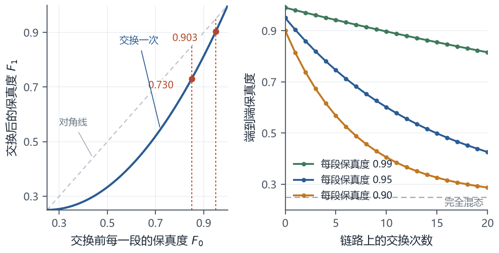
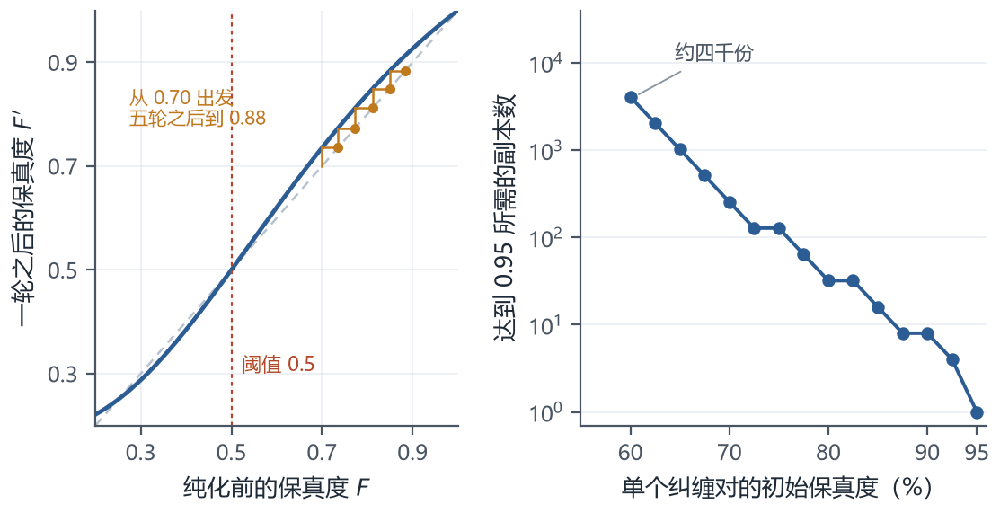

# 第 8 章　纠缠分发与纯化

上一章讲的是器件，做完之后手里有两样东西，一段光纤，两端各一个存储器，中间隔着几十公里，两边存着的两个光子纠缠在一起。这就算成功了。

可用的时候才发现，这个纠缠是脏的。保真度九成，也就是说拿到的那一对里，有一成根本不是想要的那个贝尔态。抽检几对还行，做密钥也能容忍，可要在它上面再叠一层交换，脏就被放大，链路越长越难看。这一章讲纠缠在分发过程中怎么变脏，以及一个专门的工序怎么把它擦干净。

## 8.1 用一个数说清楚有多好

两比特的态有无穷多种，描述它需要十五个实数。工程上不需要这么多，常用的做法是把它压成一个数，保真度

$$
F = \langle \Phi^{+} | \rho | \Phi^{+} \rangle
$$

理想情况下 $F=1$，完全随机的噪声下 $F=1/4$。实际链路里，有用的部分和噪声混在一起，最坏情况下可以写成

$$
\rho = w\,|\Phi^{+}\rangle\langle\Phi^{+}| + \frac{1-w}{4}I
$$

这叫 Werner 态，$w$ 叫可见度。两种写法可以互换，$F=(1+3w)/4$。Werner 态不是最一般的态，但它是“噪声最不讲道理”的那种，用它算出来的结论偏保守，所以标准分析都用它。

保真度和误码率是同一件事的两种说法。测量基选对之后，两个比特不一致的概率是

$$
e = \frac{1-w}{2}
$$

$F=0.9$ 对应 $w=0.867$，误码率百分之六点七。这个数字比量子密钥分发里常见的百分之二三高不少，说明纠缠分发对器件的要求比点对点成码更严。

## 8.2 交换一次，脏一次

第 5 章讲过交换的机制，两段独立的纠缠在中间做贝尔态测量，两端就纠缠上了。那一次的推导假设两段都是理想的。放开这个假设，结论会变得很难看。

设两段的可见度分别是 $w_1$ 和 $w_2$，贝尔态测量的可见度是 $V$。交换之后，两端那一对的可见度是三者相乘

$$
w_{\text{out}} = V\,w_1 w_2
$$

换成保真度就是

$$
F_{\text{out}} = \frac{1+3V w_1 w_2}{4}
$$

乘积这个结构很要命。两段都是 0.95，乘出来是 0.90，看着还行。可这个操作要重复，链路有几段就要乘几次。图 8-1 的右图画了这条曲线，一段 0.99 的链路撑到二十次交换还有 0.82，一段 0.95 的链路到第十次就掉到 0.60，一段 0.90 的到第十次只剩 0.41。

图 8-1　纠缠交换对保真度的影响。(a) 一次交换之后的保真度与交换前的关系，灰虚线是对角线，红点标出 0.95 和 0.85 两个起点；(b) 端到端保真度随交换次数的变化，按可见度相乘、贝尔态测量理想的模型计算

曲线有一个共同的终点，0.25。交换次数足够多，不管起点多高，剩下的都是完全混态。这跟直觉一致，每次交换都在丢信息，丢干净了什么都不剩。

左图还有一个细节。曲线整个在对角线下方，只在 0.25 和 1 两个端点与对角线相交。这说明交换是一次不可逆的操作，除了理想情况，它只会让态变差。想要靠“把每一段做得更好”来对抗，代价是指数级的，一段要从 0.95 提到 0.99，光纤、光源、探测器的要求全要上一个台阶。

所以多跳链路必须有另一个手段。

## 8.3 纯化，两份换一份

1996 年，贝内特和同事提出纠缠纯化，同一时期多伊奇等人也给出类似方案。思路是牺牲数量换质量。

手上有两份纠缠对，它们来自同一个源，噪声是独立还是关联不重要，只要不是完全一样就行。在两端各做一个受控非门，把第一对的比特当作控制，第二对的比特当作目标。做完之后，两端各测量第二对的两个比特，通过经典信道比较结果。

结果相同，就保留第一对。结果不同，两对都丢掉。这个筛选动作会挑出那些“两个比特配合得好”的情况，而这些情况里，第一对的纯度更高。

对 Werner 态，一轮纯化之后的保真度是

$$
F' = \frac{F^2 + \frac{1}{9}(1-F)^2}{F^2 + \frac{2}{3}F(1-F) + \frac{5}{9}(1-F)^2}
$$

这个式子里有两件事要说。

它有一个不动点，$F=1/2$。初始保真度高于一半，迭代就往上走，越来越接近 1；低于一半，迭代往下走。一半这条线是纯化的门槛，跨不过去就没有意义。这也解释了为什么纯化之前要先做初步筛选，把明显坏掉的对比扔掉。

收得很快。从 0.90 出发，一轮到 0.926，两轮到 0.947，三轮到 0.963。从 0.70 出发要八轮才到 0.955，从 0.60 出发要十二轮。

代价是副本。每一轮消耗两个副本换一个，成功的概率又只有一半左右，所以 n 轮之后需要的初始对数是 $2^n$ 的量级。图 8-2 的右图把这件事画成了对数坐标，从 0.60 起步要达到 0.95，需要四千份。

图 8-2　纠缠纯化的迭代。(a) 一轮纯化把保真度映射到更高的值，橙线是从 0.70 出发的迭代轨迹；(b) 把保真度抬到 0.95 所需的副本数，按每轮都成功的理想情形估算，实际还要再乘以成功率的倒数

四千份这个数字，把纯化从“一个好主意”变成了“一个昂贵的工序”。在光纤上，一份纠缠的建立本身就要几毫秒甚至更久，四千份意味着几分钟才能产出一对好纠缠。这就是多跳链路速率的真正瓶颈，不是光纤损耗，是纯化的账。

## 8.4 两笔账合起来算

把交换和纯化放在一条链路上，工序可以有两种安排。

一种是在每一级交换之前纯化。每段的纠缠先擦干净，再做交换。这样每一级都要备好若干份，交换后的保真度是 $w_{\text{纯}}^2 V$ 的量级。好处是每级的纯度可控，坏处是副本数随级数指数增长。

另一种是先交换出一对端到端的纠缠，再拿多份端到端的对去纯化。这样纯化的次数少了，可每一份都要跨越整条链路，单份的成本高得多，而且总副本数一样是指数。

两种安排的速率都可以写成同一个形式

$$
R = \frac{R_{\text{段}}}{k}\left(\frac{1}{2}\right)^{n-1}
$$

$R_{\text{段}}$ 是单段的纠缠产生速率，$k$ 是每级纯化消耗的副本份数，纯化两轮就是四份，$n$ 是段数。后面那个因子是交换的成功率，线性光学的贝尔态测量只有一半的机会给出可用结果。

代入几个数。一段一百公里，每秒产生一千对，保真度 0.95。要让十段之后的端到端保真度到 0.85，每级得把保真度纯到 0.98 以上，那要三轮，八份副本。九次交换的成功率再打一次折，端到端速率落在每秒零点二对。这个速率做密钥分发勉强够用，做分布式计算差得远。

实际系统还多一层麻烦。纯化要两端同时做受控非门，还要把测量结果通过经典信道对比，这意味着一次纯化要消耗一个经典往返，几十毫秒。存储器的寿命如果只有几十毫秒，纯化做两轮就把态等死了。器件和协议在这里是互相卡着的。

## 8.5 纠缠怎么变成密钥

纠缠分发网络最直接的用途还是密钥。

1991 年，埃克特提出一个方案，两端各测量自己手里的粒子，选择不同的基，记录结果，然后公开一部分结果做贝尔不等式检验。如果检验通过，说明两端的关联不是预先安排好的经典关联，窃听者手里的信息就有上界，剩下的结果可以提炼成密钥。

密钥率有一个常用的估计

$$
R \ge 1 - 2h(e)
$$

$h$ 是二元熵函数，$e$ 是误码率。$e=2\%$ 时每对比特能出 0.72 比特密钥，$e=5\%$ 时 0.43，$e=8\%$ 时 0.20，到 $11\%$ 就归零。这道零点跟前面纯化门槛是同一个道理的两副面孔，误码太高时，两端手里的关联已经不足以压倒窃听者的信息。

这个式子也解释了两个指标的等价性。保真度 0.90 对应误码 6.7%，密钥率 0.28。保真度提到 0.95，误码降到 3.3%，密钥率升到 0.58。所以前面那些昂贵的纯化，换来的不只是好看的数字，是翻倍还多的成码率。

设备无关的密钥分发把这件事推到极端。它不假设设备任何细节，只用贝尔不等式的违反量来估安全界，理论上最干净。代价是效率，要同时关上探测漏洞和定域性漏洞，成码率低到几乎不可用。它是这条线的天花板，不是这条线的主力。

## 8.6 实验走到哪一步

纯化的实验比理论晚了七年。2003 年，潘建伟和蔡林格的研究组用四光子干涉演示了任意未知态的纠缠纯化，两对光子进去，一对更纯的光子出来，保真度明显提升。这个实验用的是自发参量下转换和线性光学，受控非门靠干涉和符合计数实现。

线性光学的受控非门是概率性的，成功率只有几分之一，而且要求两个光子同时到达、不可分辨。这让纯化的级数很难堆高。要在一条链路上做三级纯化，光路复杂度和符合计数的代价会迅速失控。

存储器之间的纠缠到 2020 年才做成。中国的研究组把两个冷原子系综用几十公里光纤连起来，两边各存一个激发，通过中间站做单光子干涉，建立起的纠缠保真度接近九成。2021 年，代尔夫特的三个色心节点做了第一次多节点中继，中间节点把两段纠缠接起来。

这两件事合在一起，离“带纯化的多级中继”还有一段距离。缺的不是想法，是可以批量制造的高保真受控非门，以及寿命足够长的存储器。前者决定了纯化能做几轮，后者决定了纯化能不能等。

如果这两样在十年内到位，链路的样子大致是这样，每段几十公里，每级先把几对纠缠纯化到 0.98，再做交换，端到端几百公里能拿到保真度 0.9 以上、每秒几十对的纠缠。这个指标已经能支撑城际的密钥分发和简单的分布式任务。
