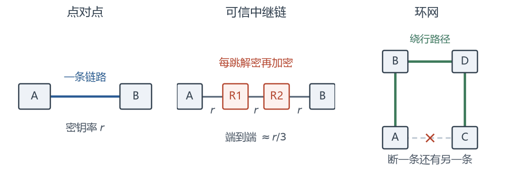
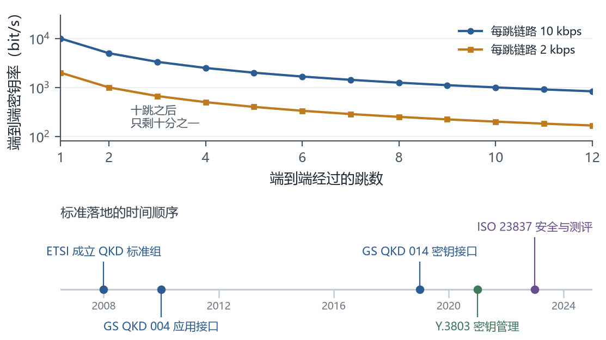

# 第 9 章　网络协议与标准化

一台量子密钥分发设备给出的东西很单纯，两个端口之间一条密钥流，每秒几千比特，两端一致，别人不知道。就这些。

可网络要的不是这个。网络要任意两个用户之间按需取密钥，要能扩容，要能在链路断掉时绕行，要让不同厂商的设备接在一起。从一台设备到一张网，中间差的不是光纤，是协议。这一章讲这张网怎么搭，密钥怎么周转，接口怎么写进标准，以及更远的量子互联网在分层上还缺什么。

## 9.1 设备给的是链路密钥

设备产生的是链路密钥，属于某一条光纤的两个端点。用户要的是端到端密钥，属于两个可能隔着十个节点的终端。这两者之间要有人做转换。

转换要做三件事，把密钥从一条链路搬到另一条，让应用按编号取到密钥，让运维知道网里发生了什么。三件事对应三类协议，中继与拓扑、密钥管理、控制与管理，标准化的进度也大致顺着这个顺序走。

## 9.2 拓扑的算术

最简单的组网是点对点。两个节点，一条光纤，一段密钥。成码率是常数，时延是光走一趟的时间。缺点是一对一，用户多了就得拉更多光纤，城域里铺纤比买设备贵得多。

要连接多个用户，最直接的办法是串成一条链，中间放可信中继，节点把左边的密文解开，用右边的密钥重新加密。这里补上它的算术。

设每一跳的链路密钥率都是 $r$，链路上有 $k$ 跳。端到端传一个比特的密钥，中间每一个节点都要消耗一个比特的链路密钥来保护它，所以端到端速率大致是

$$
R_{\text{端}} \approx \frac{r}{k}
$$

这个除法是可信中继最容易被忽略的代价。一条十跳的链路，每跳十千比特每秒，端到端只剩一千比特每秒，而这还是理想情况，没算密钥池的调度损耗。

时延不随跳数累加，密钥是提前生成、存在池子里的，转发只是查表和异或。

再往上是环网。节点连成一个圈，任意两点之间有两条路径，一条断了走另一条。合肥、济南这些城市的量子城域网都是环加支线的形状。环的代价是信任集变大，为了绕行，密钥可能经过本来不参与这条业务的节点，那条链路上任何一跳坏了，整条链都受影响，而环上要同时坏两处。工程上常见的是在环上挂几个汇聚节点，做成双环。

全网状就不要想了。$n$ 个节点两两相连要 $n(n-1)/2$ 条链路，二十个节点的城区要一百九十条光纤。实际网络于是都分层，骨干用链和环，接入用星型。

图 9-1　三种组网拓扑。点对点只有一条链路，可信中继链每一跳都要解密再加密，环网在一条链路中断时可以走另一边

## 9.3 密钥怎么周转

密钥管理服务器是整张网的中枢，职责听起来平淡，做起来琐碎。它要从设备收密钥，按来源和目的打标签，存进缓冲区。要响应应用请求，切一段密钥出来记下编号，保证同样的编号在两端的服务器上对应同一段比特。还要定期清理过期密钥，在链路中断时把请求导向别的路径。

密钥是分层用的。底层是链路密钥，每秒更新。中间是节点之间传密钥用的传输密钥，也是从链路密钥里取的。上层是给业务用的会话密钥。分层的理由是效率，一次一密要求密钥和消息等长，一段视频就能吃掉几百兆比特的量子密钥，没有哪条链路供得起。

实际做法是用量子密钥去加密一条 AES 会话密钥，再用它加密数据。安全性从信息论安全退回到计算安全加密钥新鲜，但密钥每隔几十秒换一次，泄露窗口很小。这是工程上普遍接受的折中。

还有一件容易被忽略的事，认证。量子密钥分发只保证密钥不被窃听，不保证对面是谁。经典信道如果没有认证，中间人可以两头冒充，各自协商出密钥，再转发业务数据，从时延上根本看不出来。所以经典信道必须用预共享密钥或者后量子签名来认证，而这个环节的安全性又依赖于计算困难问题或者人工分发的初始密钥。这条链上最弱的一环，往往不在量子那一侧。

## 9.4 接口写进标准

欧洲电信标准化协会在 2008 年成立了专门小组，编号 ISG QKD，这是把量子密钥分发推向采购目录的起点。

头几年出的文件偏器件，怎么定义平均光子数，怎么测成码率。2010 年前后出了应用接口的规范，这一版用得不多，因为各家实现差异太大。

真正被广泛实现的是 2019 年的密钥交付接口。它用 REST 风格的调用加 JSON 数据，动作很简单，一端申请密钥，另一端按编号取走同一段。返回的内容是一串编号和对应的比特串，两端的服务器各自持有同一批编号。应用只认编号，不关心密钥是怎么来的。这个设计把量子层藏在接口后面，应用开发商不用懂物理。

国际电信联盟的做法不一样，它写的是网级架构。Y.3800 系列从概览开始，依次给出功能要求、功能架构、密钥管理、控制与管理。这套文件不规定接口字段长什么样，只规定一张网该有哪些功能块，块与块之间传什么。前者管插头，后者管电路图。

国际标准化组织走的是第三条路，管安全。2023 年发布的 23837 系列分成两部分，一部分写安全要求，一部分写测试和评估方法。它不问协议怎么跑，只问这台设备在已知的一批攻击面前守不守得住。这类文件写得慢，但一旦写成就很难绕开。

图 9-2　端到端密钥率随跳数的变化，以及主要标准的发布时间。速率按每多一跳就多消耗一份链路密钥估算

## 9.5 安全标准为什么写得慢

拿探测器致盲攻击举例。攻击者用强光把探测器打成线性模式，再从响应里读出单光子信息。标准里不能只写“设备应抵抗致盲”，得写清楚用什么波长、多大功率、照射多久，然后看误码率是否升高、密钥是否泄露，重复多少次，允许多大偏差。这些参数要跟厂家和测评实验室商量，还要留出不同实现的空间。一份设备标准通常要覆盖几十项这样的攻击，每一项都要给出测试方法和判定准则，标准文件因此动辄几百页。

认证是另一个坎。设备要通过通用准则的评估，得先有保护轮廓，把安全目标、威胁模型、评估保证级写清楚。评估要几个月，费用以十万计。小厂做不起，大厂做完了也要看市场够不够大。

互认比认证更难。A 国的证书到了 B 国要重新测一遍，因为两国的参数要求不完全一致。业内期待 ISO 那一套成为共同底座，各国在它上面加本地要求，测试方法至少能共用。

## 9.6 分层还缺什么

第 5 章的六级路线图按功能成熟度分级。协议分层是另一个轴，问的是每层接口长什么样，这个轴上的进展慢得多。

最底下是物理层，产生、调制、传输、探测，这一层已经有产业。往上一层的链路层就没有共识了，它到底该提供一对纠缠比特，还是一个可以直接调用的远程门。前者通用，应用能自己搭。后者高效，但把硬件绑死了。

链路层也有麻烦。经典网络丢了包可以重传，量子链路不行，未知态不能复制，重传等于重新生成一份。所以链路层处理的是超时、失败标记、资源回收，这些机制目前各写各的。

网络层的核心问题是寻址。纠缠本身不携带地址，它不会告诉路由器自己从哪来、要到哪去。路由决定都得先在经典信道上做，协商出一条路径，再让路径上的节点依次做交换。这就带来时序问题，谁先测、谁等谁、等多久算超时。现在的中继实验里，这些时序是人工写死的。

传输层管的是稀缺资源的分配。纠缠的产生速率低，一次只能服务一个任务，调度策略直接影响利用率。先来先服务在单一业务里没问题，在多种业务混跑的网络里会浪费大量纠缠。

## 9.7 软件定义与互操作

设备多了，异构就成了常态。同一张网里可能有不同厂商的诱骗态设备、不同协议的测量设备无关系统、不同物理体系的节点，要让它们协同，一个办法是加一层软件定义的控制面。

控制器把所有设备抽象成两种资源，链路和密钥池。业务请求进来，控制器算路径，下发配置，分配密钥。设备只需要实现一套被控制的接口，不需要知道全局。欧洲的标准组给这类控制接口出过文件，思路和经典网络的控制器一致。

互操作要分开看。接口互操作已经基本能做到，密钥交付接口被几家主流厂商实现，跨厂商对接在试验网里跑通过。安全互操作难得多，两台各自通过认证的设备放在一起，能不能互认对方的参数、能不能共同声明一个安全等级，目前没有共识。买家真正在意的是后者，安全等级不能靠加法拼出来。

试验网是推进这件事的现实手段。欧洲的 OpenQKD 把十几个国家的试验床连起来，验证跨域的密钥调度。美国能源部把国家实验室串成一条试验床。中国的骨干网加城域网规模最大，很多工程细节是先在实践中定下来，再写进标准的。

摩擦主要来自细节。密钥格式不统一，有的用十六进制字符串，有的用二进制块。时间同步精度不一致，导致密钥编号对不上。告警模型各家一套，运维平台要写一堆适配。

## 9.8 标准比实验慢

一个实验能跑通一次，一份标准要让一万台设备跑十年。

这个时间差在量子通信里格外明显，因为它的安全性依赖实现细节，而实现细节恰恰最难写成条文。一份协议可以三页纸写完，把它变成可测试、可认证、可采购的产品，要十年。

眼下的局面大致清楚。密钥交付这一类接口会成为事实标准，因为应用开发商只愿意对接一套接口。网级架构会跟着国际电信联盟的文件走，因为运营商需要共同语言。安全认证会以 ISO 那套为底座，因为采购部门要一个能写进合同的依据。

再往上的纠缠网络，标准还早。现在连“一张纠缠网应该向应用暴露什么”都没吵清楚。协议定型太早，容易把还没成熟的技术路线锁死。等存储器和交换器件的指标稳定下来，接口自然会收敛。
