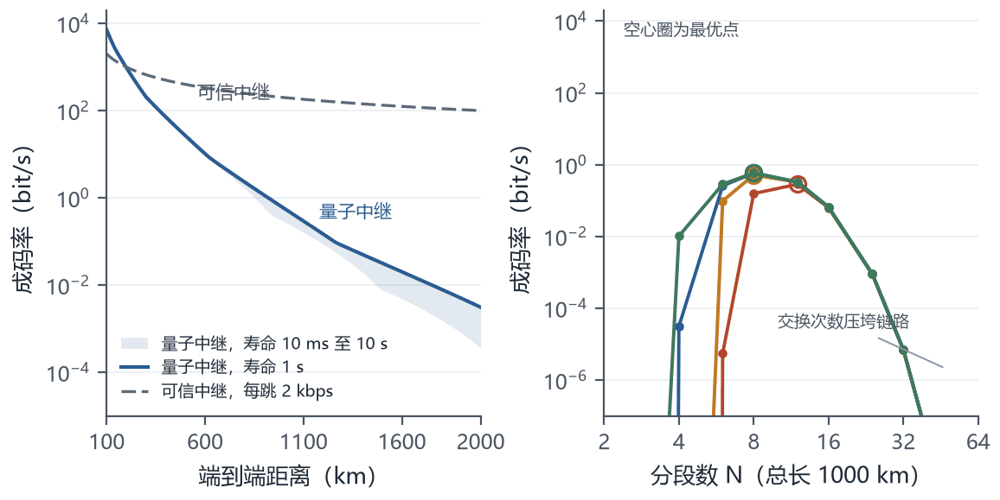
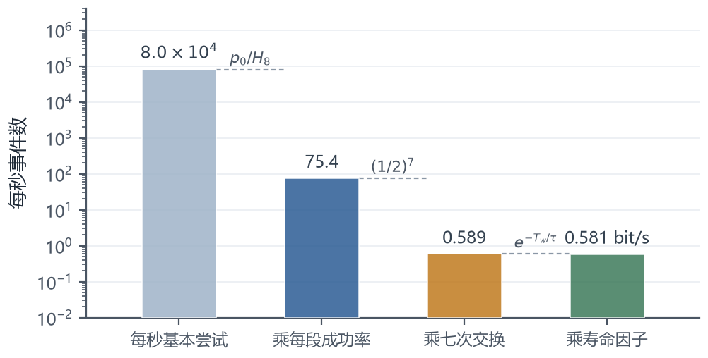

# 第 11 章　中继链路的速率方程

前面几章拆开讲过几件事。光纤每公里吃掉零点二分贝，一百公里之后只剩百分之一。存储器有三个互相拉扯的指标，效率、寿命、多模式数。交换一次保真度乘一次，纯化一轮副本数翻一倍。每条结论单独看都成立，合起来是什么样子，还没有人算过。

这一章做这件事。把源、光纤、存储器、贝尔态测量、纯化、经典信道放回一条链路上，写成一个能代数的式子，然后看一千公里之外每秒到底能出多少比特。这个数字会解释一件事，为什么中继实验在二十年里一直停在三个节点。

## 11.1 一条链路上有五个乘法

端到端的速率不是一个器件决定的，是一串概率相乘的结果。

每建起一段纠缠，要成功一次。整条链路有 $N$ 段，最慢的那一段决定一切。交换要成功 $N-1$ 次，线性光学的贝尔态测量每次只有一半机会。纯化如果要三轮，每份好纠缠要用掉几十份原料。中间所有等待都要落在存储器的寿命之内。最后提取密钥时，误码还要再打一次折。

这五个因子在概率上是独立的，所以可以直接乘。写成一句话就是，端到端速率等于每秒能做多少次尝试，乘以每次尝试把整条链打通的可能性。麻烦在于，第二项里的每一个因子都随分段数变化，方向还不一样。段分得多，单段短，损耗小，可交换次数多，等待也长。真正的工程问题就是在这条曲线上找那个不太高也不太矮的点。

## 11.2 一段的账

先算一段。

纠缠源放在段的中点，一对光子分别朝两头跑，各走 $L_0/2$。两个光子合起来穿过的是整个 $L_0$ 的损耗，所以一段的透射率就是

$$
\eta_{\text{段}} = 10^{-\alpha L_0/10}
$$

不用平方。这一点常被写错，因为直觉上“两个光子各损耗一次”听起来该乘两遍，其实每个光子只走了一半路，损耗的分贝数正好分掉。

两个光子到达端点后都要被存进存储器，存进去再取出来，各有一次效率 $\eta_m$。所以一段在一次尝试里成功的概率是

$$
p_0 = \eta_m^2 \cdot 10^{-\alpha L_0/10}
$$

取 $\alpha = 0.2$ 分贝每公里，段长 125 公里，透射率是 $10^{-2.5}$，也就是千分之三。存储器效率按九成算，两次是 0.81，乘起来 $p_0 = 2.6\times10^{-3}$。一千次尝试里成功两次半。

这个数字很低，但它不是速率的全部。低概率可以用多次尝试来补，前提是尝试得快。

## 11.3 等一次成功要多久

一次尝试要多久，由光在光纤里跑一趟的时间定。段长 125 公里，一个来回 250 公里，除以每秒二十万公里，是 1.25 毫秒。这 1.25 毫秒里，链路上什么都做不了，只能等信号回来。

如果存储器一次只能存一个光子，每秒就只有八百次尝试，按 $p_0$ 算，平均要一秒多才成功一次。这个速率没法用。

救星是多模式。第 7 章讲过，存储器能同时存住 $M = B\tau$ 个不同时刻到达的光子，$M$ 叫多模式数。带宽十兆赫兹、寿命十毫秒，就是一百个模式。一百个模式意味着同一个 1.25 毫秒的往返里，有 100 次独立的尝试在并行进行。

于是每秒钟的基本尝试次数是

$$
\nu = \frac{M c}{2 L_0}
$$

$c$ 取光纤中的光速，每秒二十万公里。代入刚才的数，八万次每秒。平均等到一次成功的时间是 $1/(\nu p_0)$，也就是 4.9 毫秒。

这还只是一段。整条链路要求 $N$ 段同时就绪，而各段独立地成功、独立地失败。最慢的那一段拖着所有人，平均等待时间要乘一个因子

$$
T_w \approx \frac{1}{\nu p_0} H_N, \qquad H_N = \sum_{k=1}^{N} \frac{1}{k}
$$

$H_N$ 是调和数，八段是 2.72，十六段是 3.38。它增长得很慢，这是好消息。分段数从八加到十六，等待时间只多四分之一。

八段、每段 125 公里，$T_w$ 算出来 13 毫秒。这个数字比很多人想象的小，原因是多模式数把并行度提了一百倍。没有多模式，同样的链路要等一秒多，什么都做不成。

## 11.4 交换的乘法

$N$ 段之间要做 $N-1$ 次交换，每次成功一半。这个因子是指数的

$$
P_{\text{交换}} = \left(\frac{1}{2}\right)^{N-1}
$$

八段是七次交换，一百二十八分之一。十六段是十五次，三万二千分之一。这个因子比等待时间狠得多，等待只是线性的调和数，交换是二的负幂。

两条相反的力就这样对上了。段分得多，单段短，$p_0$ 上升，等待下降，可交换次数上升。段分得少，交换少，可单段太长，$p_0$ 指数下降，等待时间长到存储器扛不住。

中间有一个最优点。图 11-1 的右图把它画了出来，横轴是分段数，纵轴是成码率，每条曲线对应一种存储寿命。曲线先升后降，峰很尖。总长一千公里时，寿命一秒的器件在八段上取到最大值，每段 125 公里。

图 11-1　中继链路的成码率。(a) 最优分段下的成码率随距离的变化，阴影是存储寿命从 10 ms 到 10 s 的范围，虚线是每跳 2 kbps 的可信中继链；(b) 总长 1000 km 时成码率随分段数的变化，空心圈标出各寿命下的最优点。按每段两端各一次存储、存取效率 0.9、贝尔态测量成功率 0.5、多模式数 100 计算

最优点随距离移动，移动的方向有规律。五百公里时最优是六段，每段八十三公里。一千公里时八段，一百二十五公里。两千公里时十二段，一百六十七公里。总长翻了四倍，段长反而变长了。

这个反直觉的结果说明在这个模型里，交换的代价比损耗的代价更硬。链路一长，宁可让每段多走几十公里，也要把交换次数压下来。当然这有个限度，段长再长下去，$p_0$ 掉到万分之一，等待时间就撑不住了。两千公里、十二段已经接近这个边缘。

## 11.5 纯化的副本从哪来

第 8 章算过纯化，从保真度 0.90 出发，三轮到 0.96，每轮两份换一份。真正要记账的是副本数，三轮要 $2^3 = 8$ 份，每轮还有一半的失败率，实际要备十几份。

换算成时间是这么算的。一份端到端纠缠的建立要 $T_w$ 加上各级交换的重试，十几份就要十几倍。一千公里、八段、寿命一秒的链路，不纯化时每 1.7 秒出一份，纯化三轮就变成半分钟一份。速率掉到百分之一以下。

所以纯化不是免费的清洗工序，它是用时间换纯度。只有当误码高到不纯化就提不出密钥时，这笔交易才划算。误码 11% 是硬门槛，超过它，纯化多少轮都没用，因为纯化的不动点在 50% 保真度，跨不过去就是跨不过去。

反过来说，如果单段器件好到端到端误码只有 3%，直接提取密钥比纯化划算得多。这也是为什么近年的方案把力气花在提高单段保真度上，而不是靠纯化硬顶。器件上一分改进，胜过协议上十分折腾。

## 11.6 一条千公里链路的预算

把一千公里、八段、寿命一秒这条链路的账按顺序列出来，就是图 11-2。

起点是每秒八万次基本尝试。第一次相乘是每段的成功率除以等待的调和数，$p_0/H_8$，八万次变成七十五次。第二次相乘是七次交换，七十五变成零点五九。第三次相乘是寿命因子，13 毫秒的等待对一秒的寿命几乎无损，只有百分之二的折扣。

图 11-2　一千公里、八段链路的速率预算，从每秒基本尝试数逐项相乘到端到端成码率。段长 125 km，0.2 dB/km，存取效率 0.9，贝尔态测量成功率 0.5，多模式数 100，存储寿命 1 s

从八万到零点五八，落了五个数量级。图上看得很清楚，主要的两刀分别砍在单段成功率和交换次数上，各砍掉三个和两个数量级。寿命因子在这条链路上几乎没出力。

这个预算表可以当诊断工具用。想让速率提高十倍，砍哪一刀最省事，一目了然。提高存储器效率从 0.9 到 0.99，$p_0$ 上升两成，速率跟着上升两成。把贝尔态测量从线性光学换成带辅助光子的方案，成功率从一半提到四分之三，七次交换下来是 5.6 倍的收益。把段数从八减到六，交换少两次，四倍收益，可单段变长，$p_0$ 掉下去，两笔账要一起算。

## 11.7 三条曲线说明的事

图 11-1 的左图放了三条线，值得逐条看。

一千公里处，量子中继的成码率是每秒零点五八比特，可信中继是每秒两百比特。差了三个数量级。这个对比很不好看，也是真实情况。今天所有在跑的城际量子链路，用的都是可信中继，没有一条用量子中继。不是工程师不知道量子中继更好，是它现在慢得多。

五百公里处差距小一些，量子中继二十七比特每秒，可信中继四百比特每秒，差一个数量级。距离越短，差距越小，因为可信中继的 1/L 衰减比量子中继的幂律更陡，只是它的起点高太多。两条线在四百公里附近交叉，再往短走，量子中继占优，可那个距离上谁都不需要中继。

第三条是存储寿命的影响。一千公里以内，四条寿命曲线几乎重合，10 毫秒和 10 秒只差四倍。一千五百公里差十倍，两千公里差三十倍。原因在等待时间随段长的指数上升，一旦 $T_w$ 顶到 $\tau$，寿命因子就像刀切一样下去。

流行说法是存储寿命卡住了量子中继。按这个模型，在千公里量级上不是。真正卡住的是贝尔态测量的一半成功率和单段的 $p_0$，两样都在交换那一刀上。寿命要等到一千五百公里以上才变成主角。当然这个结论依赖多模式数做到一百，如果器件只有十个模式，等待时间长十倍，寿命立刻变成瓶颈。

## 11.8 为什么实验停在三个节点

实验室里的中继演示，2021 年做到三个节点，两端拿到纠缠，速率是分钟量级一对。按上面的预算，三个节点、两段、几百米，本该轻松到千赫兹。差这么远，原因不在公式，在每个因子的实际值。

公式里假设存储器效率 0.9、贝尔态测量一半、多模式一百。实验里这三样同时达到的次数，到今天还是零。金刚石色心的存储效率两成到六成，多模式数几个，贝尔态测量要两个探测器同时响应，还有频率转换、锁相、低温，每一环都在掉。

这些因子是相乘的，所以短板效应比加法严重得多。一样掉到十分之一，整条链就掉到十分之一，不管别的一样做得多好。三个节点的实验之所以能成，是靠反复重试和长时间积分，把低概率硬堆出来。

这就是这一章想给出的判断。量子中继的原理在二十年前就清楚了，速率方程也不难写，难的是让五个因子同时到位。哪一天五个数字凑齐了，曲线上的那个点会突然从每秒零点几跳到每秒几千，因为它是指数式的乘法，不是线性的累加。

在那一天到来之前，能用的还是可信中继和卫星。而这两样是真装在机房和地面站里的东西，接下来两章讲它们怎么落地。
