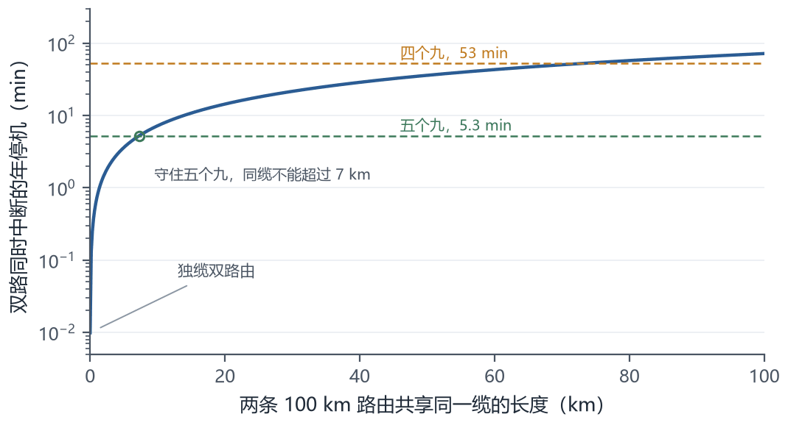
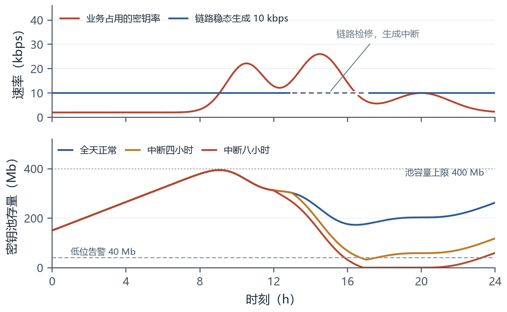

# 第 12 章　城域网与骨干网的工程实践

实验室里搭一套量子密钥分发，一张光学平台，两个人守着，跑一个下午，出一组漂亮的数据，这就算成功。城域网的要求完全是另一回事。设备要装进十九英寸机柜，连续跑三年，机房没人值守，夏天停电要能自己恢复，出了问题运维人员第二天早上才知道。

这一章讲从实验室到机房这段路。物理在前面几章已经讲完了，这里剩下的都是工程，而工程里最难的部分往往跟量子没什么关系。

## 12.1 先看一张网的清单

一个覆盖主城区的量子城域网，规模大概是几十个节点、几十条链路。节点放在电信机房里，链路走地下的管道。

清单拆开来是这样几样东西。光纤，每条链路一对芯，中间不能有放大器。设备，每条链路两端各一台，成对采购，型号必须一致。密钥管理服务器，每个节点一台，负责收密钥、存密钥、发密钥。剩下的就是人和流程。

真正花时间的不是买设备，是把这几样东西对齐。光纤的衰减要测，接头要洗，设备要跟对端匹配波长和同步，密钥管理服务器要跟上层业务系统对接，接口按哪一版标准实现，字段怎么填，都要一条条定。这些事没有物理，只有细节。

## 12.2 光纤是最贵的资源

在城里，铺一公里光缆的成本远高于买一台量子设备。运营商手里的管道资源早就不够用，新挖一条要批规划、破路面、协调十几家单位，工期以年计。所以量子网络几乎都用现成的光纤，租裸纤或者租波长。

租裸纤最省事，两端之间一根玻璃，中间不经过任何有源设备，量子信号可以原样通过。麻烦在于裸纤稀缺，城域里从一个机房到另一个机房，中间要经过好几个接头盒和配线架，每一处都是一次熔接，每次熔接有零点几分贝的损耗，还有被误操作拔掉的风险。

租波长是另一条路。波分复用系统里一条光纤跑几十个波长，租一个给量子设备用。这要求这一路波长上不挂光放大器，因为放大器是受激辐射，噪声会把单光子信号淹没，而且它本身就是一个完美的窃听入口。工程上的做法是给量子信号留一条不带放大的波长，或者干脆用独立的暗光纤。

有一件事经常被忽略，偏振。光纤不是完美的圆，应力、弯曲、温度都会让两个偏振态的速度不一样，跑几十公里之后，出来时的偏振方向已经转了不知道多少圈。设备要么用偏振无关的方案，要么在接收端加自动偏振补偿，靠一段导频光实时跟踪。补偿器的响应速度跟不上车辆的震动，所以城域链路的成码率经常在白天掉一截。

图 12-1　两条各 100 km 的路由共享同一段缆时的年停机时间。按每百公里每年 0.15 次中断、平均修复 8 小时计算，横轴为共享长度

图 12-1 说的是另一件事，备份路由。金融和政务客户要求双路由，一条断了走另一条。可城市里的管道就那么几条，两条“不同”的路由经常在同一段管道里并排走几百米，甚至用同一根光缆的不同芯。这一段一断，两条路一起断，备份等于没有。

按每年每百公里 0.15 次中断、平均修复 8 小时算，全独立的两条路由年停机不到一秒，可用性高得没有实际意义。同缆七公里，年停机就到五分钟，刚够五个九。同缆五十公里，一小时。所以在合同里写“双路由”是不够的，得写清楚两条路由的物理分离距离，以及怎么核查。核查的办法很土，派人沿着两条路由走一遍，看它们在哪些井里碰面。

## 12.3 机房里的事

量子设备通常做成二到四U的机箱，功耗一两百瓦，比一台服务器还省。听上去装进机柜就没别的事了，实际不是。

第一件是光纤进机房的路由。量子链路要求两端设备之间光纤尽量短、接头尽量少，最好从光缆终端盒直接跳到底座。可机房的走线架按经典网络的规矩布，量子设备经常被塞在最远的机柜，中间多出三段跳线和两个配线架。每多一段，就多零点几分损耗和一次被碰掉的机会。

第二件是供电。量子设备不难伺候，可它旁边还有密钥服务器、交换机、监控主机。要求跟可信中继一样，双路市电加 UPS 加柴油机，切换时间不能超过设备的容忍范围。单光子探测器要制冷，断电重启后得等半小时温度才稳，UPS 撑不住就得靠柴油机。

第三件是环境。单光子探测器对温度敏感，机柜里热点位置差两度，暗计数就变。机房空调是按整体热负荷设计的，不会为了一台设备单独调风。工程上的土办法是在机柜里加装盲板和导流罩，把冷风逼到设备前面。

第四件是远程操作。几十台设备散在城里，坏一台就要有人跑一趟。设备必须支持带外管理，能远程看状态、重启、升级。这听起来是软件问题，实际决定了运维成本的一半。

## 12.4 密钥管理层

设备给的是一条链路上每秒几千比特的密钥流，业务要的是“给我一段密钥，编号是多少”。中间那层就是密钥管理。

它的职责有四项。从设备收密钥，按链路和对端打标签。存进池子，等业务来取。取的时候切一段，记下编号，保证两端的服务器对同一编号给出同一段比特。定期清理过期密钥，避免用三年前生成的密钥去保护今天的会话。

这四件事听起来简单，实现起来处处是坑。

编号必须两端一致。有的实现用自增序号，链路一断重连，两端的计数器就错位了。有的用时间戳，两端的时钟差几毫秒就取不到同一个位置。行业里最后收敛到一种做法，密钥 ID 由供应方生成并显式传给消费方，两端只认编号不认时间。这也是标准化文件里那一版接口能被广泛实现的原因。

主备必须做。密钥服务器本身是个单点，它挂了整条链路就废了。常见做法是三节点集群加共享存储，任一节点故障另外两个接管。切换时要不丢密钥，就得写两遍以上，写放大的开销又拖慢了流程。

密钥要分层。链路密钥一层，节点之间的传输密钥一层，业务会话密钥一层。上层用下层保护，一层一层套下去。这个设计的好处是业务系统不需要知道密钥从哪来，坏处是每多一层，密钥消耗就多一份，池子里的水位要按层算。

## 12.5 一天里的水位

图 12-2 是一天的账。上图画两条线，业务占用的密钥率和链路稳态生成的密钥率。下班时间业务几乎不动，凌晨到早上池子一路涨，八点前装满。白天两波高峰，上午十点半和下午两点半，峰值是稳态生成率的两倍多，缺口从池子里出。

下图画池子的存量。全天正常那条线在两百到四百兆比特之间晃，够用。曲线中间有一段台阶，那是池子装满之后停止采集，多出来的密钥没地方放，只能浪费。

检修那条线不一样。十三点到十七点，链路停四个小时做维护，生成归零。缺口全靠池子顶，四小时之后水位掉到三十多兆比特，擦着低位告警线过去。八小时的话就见底了，业务被迫降级，视频会议自动退到低码率或者直接拒绝新连接。

图 12-2　密钥池的日循环。上图是业务占用的密钥率与链路生成率，检修窗口内生成中断；下图是三种情形下的池内存量，按需求曲线积分计算，池容量 400 Mb

这张图解释了两件事。

检修要有窗口。维护、升级、改迁都要安排在业务低谷，否则池子撑不住。凌晨最安全，可凌晨干活人手少，出了问题没人接，于是重要链路的窗口放在周末凌晨，一般的放在工作日白天，靠余量顶。

池子的大小要算。池子越小越省存储，越大越贵，可太小了顶不住一次检修。日需求七百五十兆比特，生成八百六十兆比特，每天盈余一百多，池子装四百兆，能顶住两天异常。这个冗余度是按故障统计拍出来的，不是物理决定的。

## 12.6 运维看什么

成码率是第一个指标，但只看它不够。设备正常、链路正常、业务正常，三件事要分开看。

常看的指标有这些。成码率，每秒多少比特，掉一半就要查。误码率，正常在两三个百分点，升到六个点说明链路或探测器有问题。探测器暗计数和温度，暗计数突然升高通常是光纤进灰或者制冷失效。激光器电流和功率，老化的第一个征兆。同步状态，收发两端的时钟是否还锁着。后处理失败率，基比对不上的比例，接口或缓存出了问题。密钥池水位，前面讲过。

告警要分级。设备离线、密钥率归零、误码超阈值算致命，立刻处理。成码率掉一半、池水位过低、温度接近上限算警告，可以等上班。单次后处理失败、光功率轻微漂移算提示，记下来看趋势。

故障排查有固定的顺序，先看两端是否都活着，再看光纤有没有断，再看同步是否锁住，最后才怀疑设备内部。这个顺序是按照故障概率排的，光纤和电源占了七八成，设备本身的故障反而少。很多现场事故的最后结论是一根跳线被碰松了，或者一个光模块的接头没拧紧。

无人值守是最终目标。几十个节点的网，每个都要人盯，运维成本会超过设备成本。所以设备要能自动重启，链路要能自动倒换，密钥服务器失联时靠存量顶一阵。这些能力在采购文件里叫可运维性，比几项物理指标更能决定项目能不能验收。

## 12.7 跟经典网络怎么接

量子网络不会自己成为一张独立的网，它必须挂在现有的传输网上。

接入的方式有三种。第一种是把量子密钥当成一个密钥源，交给 IPsec 或者 MACsec 用。加密流量的算法不变，还是 AES，只是密钥不再由 Diffie-Hellman 协商，而是从密钥管理服务器取。这样做的改动最小，安全性从“计算困难”变成“信息论”，代价是需要一个取密钥的接口。第二种是在光传输设备里做，把量子密钥送到 OTN 的加密板卡上，加密在物理层完成，业务侧无感。第三种在应用层直接对接，文件传输、数据库备份、视频会议自己调接口取密钥。

三种方式里，第二种最受运营商欢迎，因为它对业务透明，不需要改应用。第一种最受设备商欢迎，因为它通用。第三种最容易被高安全行业采用，因为可以端到端控制。

还有一件必须做的事，混合。量子密钥分发的安全性依赖量子力学的假设，可它依赖经典信道做认证，而认证又依赖预共享密钥或者后量子签名。所以实际系统里，量子密钥和后量子密码经常一起用，两条腿走路，任何一条被攻破，业务还有另一条保护。这个组合在标准文件里叫混合密钥交换，在工程里叫兜底。

## 12.8 差距在工程

把这几节合起来说，量子通信从实验室到机房，缺的从来不是物理。

物理在 1984 年就清楚了，协议在 2000 年前后基本定型，器件在 2010 年之后开始商用。真正拖时间的是共缆怎么核查、密钥编号怎么对齐、检修窗口怎么排、告警怎么分级、设备怎么在无人值守的机房里活过三年。这些事情做完了，一项技术才算落地。

京沪干线的价值也在这里。它证明一条两千多公里的量子链路能在真实机房里连续跑，能在银行和政务系统里跑业务，能在设备换代时不停机。这个证明比任何一篇论文都难。

下一章换个场地。地下的光纤有管道、接头、共缆这些麻烦，天上的链路有另一套麻烦，几何、大气、阳光和抖动。
