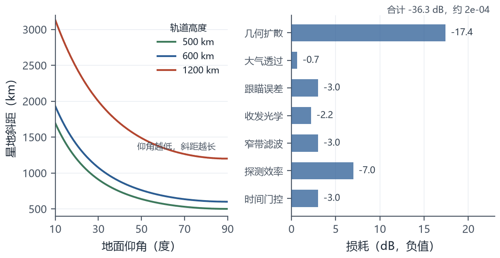
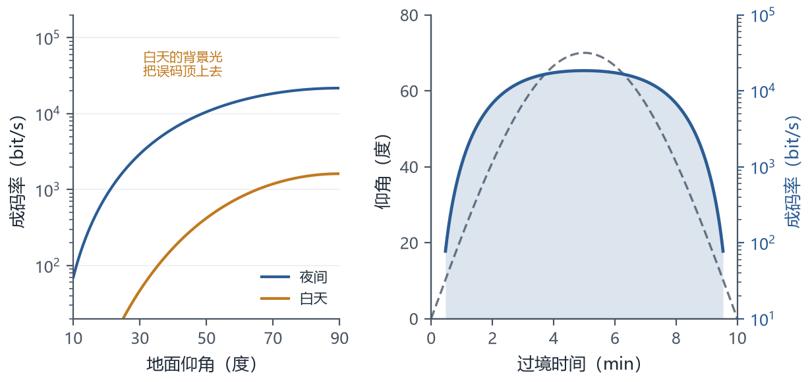

# 第 13 章　卫星与自由空间链路预算

第 4 章讲过那堵墙。光纤每公里吃零点二分贝，一千公里之后一个光子也剩不下，这是玻璃的性质，不是工艺问题。要跨过洲际距离，一条路是把链路切成很多段，中间放中继，另一条路是干脆不从地下走。

从天上走有一个漂亮的物理事实。大气层的厚度只有几十公里，光子出了大气就是真空，真空不吸收。地面到卫星的一千公里里，真正被吸收的只有最后那几十公里。这段损耗比同样长度的光纤小三个数量级。

代价在别处。卫星在动，一次只有几分钟能看见，几何、大气、阳光和抖动，每一样都在账本上。

## 13.1 几何先算清楚

星地链路的长度不是卫星高度。卫星在天顶时距离等于高度，斜着看就变长，低仰角时拉得很厉害。

把地球当半径 $R$ 的球，卫星高度 $h$，地面仰角 $\theta$，斜距是

$$
z = \sqrt{(R+h)^2 - (R\cos\theta)^2} - R\sin\theta
$$

高度 600 公里，天顶方向是 600 公里，仰角 30 度时 1075 公里，仰角 10 度时 1932 公里。仰角每往下降一点，路径就长一截，同时穿过的大气也厚一截。两个因素叠加，低仰角是效率最低的工作区间。

仰角 10 度以下基本不用。除了路径长，还有两个原因，一是大气质量到了五以上，云和湍流的概率大增，二是地面站周围的建筑和树木会遮挡。工程上把 10 度定为可见门限，有的站定 15 度。

图 13-1　星地几何与损耗。(a) 三种轨道高度下斜距随仰角的变化；(b) 600 km 轨道、30 度仰角下的损耗分解，波长 850 nm，发射口径 0.15 m、接收 1 m

卫星飞得快。600 公里高度的圆轨道，速度大约每秒 7.6 公里，绕地球一圈 95 分钟。一次过境从升起到落下，可见时间在十分钟上下，仰角能上到 60 度以上的高质量时段只有四五分钟。

一天有几次过境，取决于轨道倾角和地面站纬度。赤道附近的站，一颗倾角 97 度的太阳同步卫星每天能给四到六次。往极区走次数会多，但高仰角的少。这个账要提前算，因为它决定一颗星能服务几个站，以及要不要组网。

## 13.2 大气和背景光

大气对光的处理分两种，一种是把光吃掉，一种是把它搅乱。

吃掉的部分主要是水汽和气溶胶的吸收与散射，晴天时整层大气的透过率在 0.7 到 0.9 之间，阴天就是零。所以星地链路的第一条硬约束是天气，云层厚度超过几百米，什么都别谈。选站的第一原则不是纬度，是晴天率，智利、加那利、西藏阿里这些地方贵在云少。

搅乱的部分是湍流。大气折射率随温度起伏，波前被拧得坑坑洼洼，落到地面的光斑从理论上的一点散成一团抖动的光斑，尺寸由相干长度决定。在可见光波段，这个长度只有十厘米量级。接收望远镜口径大于它时，聚不到衍射极限，只能聚到相干长度那么大。这一项损失用自适应光学的变形镜可以补一部分，星地量子通信里通常不做，因为单光子信标太弱，波前传感器没有足够的信号。

背景光是另一件事。白天天空是亮的，散射的太阳光从各个方向进来，接收视场里全是光子。夜间没有这一层，剩下的只有月光、城市灯光和大气辉光。

对付背景光靠滤波。空间上把视场压到几十微弧度，只覆盖卫星可能出现的范围。频谱上用窄带滤光片，带宽做到零点一纳米，能压掉三四个数量级。时间上靠门控，知道光子该在哪一纳秒到，就在那一纳秒开门。

三项加起来，夜间背景计数能压到每脉冲百万分之一以下，白天压到千分之一左右。差三个数量级，这就是为什么早期星地实验都挑夜里做。

## 13.3 跟瞄是另一个死结

一千公里外打一个一米大的靶子，需要多少精度。

先看衍射。发射口径 0.15 米，波长 850 纳米，衍射角是 $1.22\lambda/D$，约 6.9 微弧度。跑一千公里，光斑直径 7 米。这个尺寸由物理定，口径越大光斑越小，可卫星上的望远镜受重量和体积限制，做到 0.3 米已经不容易。

再看指向。指向误差 1 微弧度，在 1000 公里外就是 1 米。相对于 7 米的光斑，1 米的偏差损失大约百分之八，还可接受。3 微弧度就损失一半。

所以跟瞄精度要到亚微弧度。这个数字听着玄，工程上有办法做到。卫星先发一束信标光下来，地面站用四象限探测器测偏差，闭环控制望远镜的指向，带宽做到一百赫兹以上，能压住卫星运动造成的角度变化。卫星那边同样用地面发上去的信标做闭环。

还有一个不能忘的东西，提前量。光跑一千公里要 3.3 毫秒，这段时间卫星已经飞了 25 米。地面发信标要瞄准卫星 3.3 毫秒之后的位置，卫星发信号也要瞄地面站那时被照到的位置。算错这个量，光斑整个偏出视场。

## 13.4 把损耗一项项摆出来

图 13-1 的右图是 600 公里、30 度仰角的一份预算，每一项都是乘法，所以用分贝相加。

最大的一项是几何扩散，负十七点四分贝。这一项的来源是发射的光斑比接收口径大得多，绝大部分光根本没落到望远镜上。它不是损耗，是没打中。

第二项是大气透过，负零点七分贝，晴天。这一项最好时接近零，最坏时是无穷大。

跟瞄误差按一半算，负三分贝。收发望远镜的光学效率合起来 0.6，负二点二分贝。窄带滤光片透过率 0.5，负三分贝。单光子探测器在 850 纳米的效率 0.2，负七分贝。最后是时间同步门控，只有一半的脉冲落在开门窗口里，负三分贝。

加起来三十六点三分贝，透射率两万分之一。

这个数字放在光纤上是 180 公里的水平。也就是说，一次千公里的星地链路，等效于在光纤里跑不到两百公里。这就是卫星方案的全部秘密，它把一千公里的玻璃换成了几十公里的大气。

## 13.5 成码率跟着仰角走

把透射率代进成码率的式子，结果如图 13-2 的左图。

仰角 30 度，夜间三 kbps。天顶方向二十二 kbps。仰角 15 度掉到几百比特，10 度只剩几十。这条曲线的形状由两部分拼成，斜距缩短带来几何扩散的改善，大气变薄带来透过率的改善，两项都随仰角单调变好，所以曲线一路上翘。

白天那条线整体下移两个数量级。背景光把误码率从百分之一二顶到百分之四五，成码率按 $(1-h(e))$ 打折，再叠加背景计数本身带来的门控损失。仰角 30 度时白天只有几十比特每秒。

图 13-2　成码率随仰角与过境时间的变化。(a) 昼夜两种背景光水平下的成码率，600 km 轨道；(b) 一次最大仰角 70 度的过境，仰角与成码率随时间的变化，曲线下的面积即这一次过境的密钥量，约 5.7 Mbit

右图是一次过境。卫星从地平线升起，仰角一路升到 70 度再落下去，成码率跟着走一条钟形曲线。把曲线积分，这一次过境能拿到五兆比特左右的密钥。

五兆比特是什么概念。一条 AES-256 的会话，密钥两百五十六比特，五兆比特够换两万次。一次视频会议按每分钟换一次密钥算，够开两百小时。所以一颗星、一个站、一次过境，量级上是能干活的。

问题在连续性。一次过境十分钟，一天六次，也就是一小时。剩下的二十三小时里，这个站没有量子密钥可用。要补上这个空档，要么靠地面光纤，要么靠多颗星组网，要么靠密钥池提前囤。

## 13.6 天上已经有的东西

2016 年 8 月，墨子号发射。它的载荷里有一套诱骗态量子密钥分发系统，一套纠缠源。2017 年的报告给出了星地量子密钥分发的结果，链路距离 645 公里到 1200 公里，成码率在每秒一比特的量级，误码率百分之一二。这是第一次让量子密钥穿过整个大气层。

同一年，它还做了星地纠缠分发和地星隐形传态。地星链路更难，因为地面站发的信标要穿过大气湍流，落到卫星上的光斑抖动大，跟瞄精度要求更高。

2017 年下半年，兴隆站做成了白天的星地量子密钥分发。关键是把窄带滤波和视场压到了极限，同时给接收望远镜加了一套滤除太阳直射光的遮挡。白天成码率比夜间低一个数量级，可它意味着这件事不再只能在深夜里偷偷做。

2020 年，济南地面站和墨子号之间做了跨洲的密钥分发实验，两端相隔上千公里，通过卫星中转。这是卫星方案最实用的一次演示，因为它把两个不相邻的地面站连在了一起。

之后的几年，欧洲、加拿大、新加坡都发了小型的量子卫星或者载荷验证星，指标不高，都是在验证器件和流程。中国的下一步计划里有多颗低轨星的组网方案，目标是把单站的平均可用时间从每天一小时提到几小时。

## 13.7 卫星放在哪一格

卫星不是光纤的替代品，两者解决的问题不一样。

光纤适合固定两点之间的大容量、连续、稳定。它的成码率能到兆比特每秒，代价是铺设成本随距离线性增长，跨洲就要海缆，海缆不是谁都能布。

卫星适合三种场合。一是跨洲，两个大陆之间没有光纤可租，或者租不到。二是海岛、舰船、边远地区，铺纤不划算。三是应急，地震之后地面网络断了，一辆车加一台便携站就能恢复密钥分发。

它的短板也很清楚。间歇，一天几小时。成本高，一颗星加上发射和地面站，几个亿。天气敏感，云一厚就停。所以现实中的用法是混合，地面光纤做骨干，卫星做补充和备份，密钥在两边周转。

还有一条不那么显眼的好处。卫星链路的自由空间损耗对距离不敏感，一千公里和两千公里的差别只有几分贝，而光纤一千公里和两千公里差两百分贝。这意味着卫星方案在超远距离上不会继续恶化，它的天花板是天气和时间，不是损耗。这一点在规划洲际链路时很关键，因为光纤方案在三千公里以上基本已经没有可用性。

下一代的想法是提高单次过境的产出，办法有几个。把重复率从一百兆赫兹提到吉赫兹，单次能拿到的密钥量翻十倍。把望远镜口径做大，几何损耗能降几分贝。把探测器换成超导纳米线，效率从两成提到八成，直接换四分贝。这些改进单独看都不大，乘起来能把单次过境从五兆比特推到百兆比特量级，那时候卫星就能真的当骨干用了。
