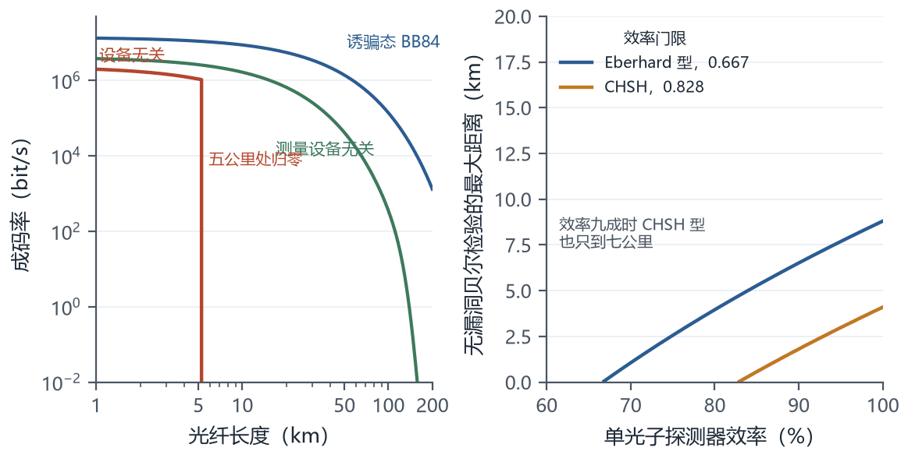
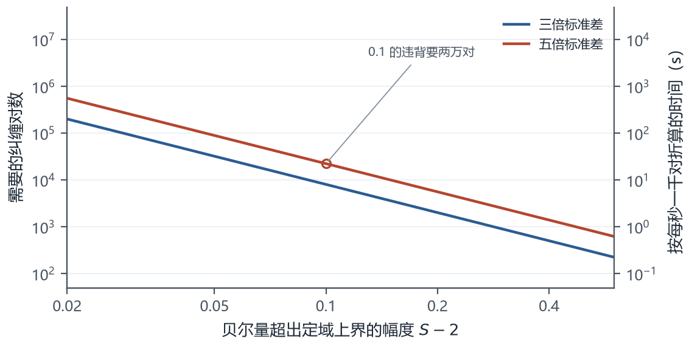

# 第 14 章　设备无关与半设备无关协议

前面几章讲的协议，安全性都建立在一句话上，设备按设计工作。可第 3 章已经说清楚，这句话靠不住。探测器可以被强光打成线性模式，光源可以被诱导多发光子，调制器可以被注入激光改变相位，这些手段不需要破解量子力学，只需要利用一个做粗了的电路。

设备无关的协议换了个思路。既然不能相信设备，那就不相信它。只把设备当成一个黑盒子，输入给它，看它输出什么，再从输入输出的统计里挤出安全性。这个思路把安全根基建在贝尔不等式上，理论上最干净，代价也最狠。

## 14.1 从“相信器件”到“只相信统计”

设想一个最极端的场景。设备是敌人给的，机箱里装了什么你一无所知，可能是一台正经的量子终端，也可能是一台带硬盘的经典录音机，事先录好了“应该给出”的应答。

所有基于器件标定的方案在这种场景下都失效，因为它们需要知道探测器的效率、光源的平均光子数、调制器的相位精度。这些参数一旦由敌人提供，安全证明就是一张空纸。

设备无关的方案不碰这些参数。它只做一件事，让两端各自随机选输入，记录输出，收集足够多的样本，然后检查这些样本之间的关联是否违反了某个贝尔不等式。

违反了，就说明这段关联不可能是任何预先安排好的经典机制产生的。既然不可能是经典的，它就必然是量子的，而量子的关联有一个可以精确计算的上界，窃听者能拿到多少信息也就有了上界。整条推理链上没有一处用到“设备到底是什么”。

## 14.2 贝尔量给的是数量

第 6 章讲设备无关随机数时提过 CHSH。两端各自在两个输入里选一个，输出是正负一，把四种输入组合的关联按 $E(a,b) = \langle A_a B_b\rangle$ 记下来，组合成

$$
S = E(0,0) + E(0,1) + E(1,0) - E(1,1)
$$

经典机制下 $|S| \le 2$，量子力学的上限是 $2\sqrt{2} \approx 2.83$。

这个量的用处不只是“过没过线”。它离 2 有多远，直接决定窃听者能拿到多少信息。$S$ 越接近 2，说明关联越像经典，窃听者可能的掌握就越多。设备无关的安全性证明就是把这个距离换成密钥率的下界，$S$ 刚好在 2 上时下界是零。

所以实验室里追求的不是“违背”，而是“违背得多”。可见度 0.95 的纠缠源给出的 $S$ 大约 2.69，可见度 0.9 给出 2.55，掉到 0.71 时 $S$ 就到 2，一点不剩。

## 14.3 效率是一道硬门

贝尔检验有一个绕不过去的漏洞，叫探测漏洞。

如果探测器效率只有一半，那另一半“没探测到”的事件去了哪里。一种解释是光子丢了，另一种解释是设备在挑选对自己有利的事件上报。只要丢的事件足够多，一个完全经典的设备也能伪造出违背。

要关上这个漏洞，效率必须高到一个门槛之上。用 CHSH 不等式，门槛是 $2\sqrt{2} - 2 \approx 0.828$，也就是说总效率要到百分之八十三。换用其他形式的不等式可以把这个门槛降下来，埃伯哈德不等式的门槛是三分之二，百分之六十七。

这个数字看起来不难，做起来极难。它要求的是“总效率”，包括光纤透射、光学元件、滤波、探测器，全部乘起来。而单光子探测器在通信波段的效率，最好的超导纳米线能到九成以上，配上其他环节的损耗，总效率就到六七成。卡在门槛上。

图 14-1　设备无关的代价。(a) 三种协议在相同器件条件下的成码率随距离的变化，设备无关一栏按探测器效率 0.85、只计入总效率高于 0.667 的部分计算；(b) 无漏洞贝尔检验能支撑的最大距离随探测器效率的变化，两条曲线对应两种不等式的效率门限

图 14-1 的右图把门槛换算成距离。探测器效率九成，CHSH 型只能做到一点八公里，埃伯哈德型六点五公里。效率九成五，分别是三公里和七点七公里。

这个换算只用了一个式子，光纤透射率等于效率门槛除以探测器效率。所以想做得远，只有两条路，把探测器效率推到接近一，或者把门槛往下压。前者是材料问题，后者是数学问题。

## 14.4 距离被压到几公里

图 14-1 的左图把三种方案放在同一张纸上。

诱骗态 BB84 那条线从十几兆比特每秒出发，到一百公里还有一百多千比特，两百公里剩下几千比特。测量设备无关那条线斜率更陡，因为它的成码率正比于两端透射率的乘积，一百公里还有几百比特，一百五十公里就掉了三个数量级。

设备无关那条线根本不像一条线，它在五公里处竖直掉到零。

原因就是上一节的算术。探测器效率 0.85 时，光纤只要吃掉百分之二十一的透射，总效率就跌破门槛，密钥率直接归零。五公里、零点二分贝每公里，正好是百分之二十一。再远一点，不管协议怎么改，先关掉漏洞再说。

这个对比说明一件事。设备无关不是“更安全的 BB84”，它是另一种东西，安全性换来的是可用距离的数量级损失。今天的设备无关演示，距离都在公里量级，而 BB84 的商用系统在百公里量级。两者不在同一个赛道上。

## 14.5 统计量也是成本

除了效率和距离，设备无关还有第三项开销，样本数。

要证明“关联不是经典的”，得让测出来的 $S$ 与 2 的差距大于统计误差。统计误差随样本数按 $1/\sqrt{N}$ 下降，所以需要的纠缠对数按差距的平方反比增长

$$
N \approx \left(\frac{k\,\sigma_0}{S-2}\right)^2
$$

$\sigma_0$ 是单次测量的标准差量级，取 3，$k$ 是要求几个标准差。

图 14-2　把贝尔量与定域上界的差距和 2 分开所需的纠缠对数，按统计误差随样本数的平方根下降估算，右轴折算为每秒一千对时的累计时间

$S-2$ 等于 0.1 时，五倍标准差要两万两千对，按每秒一千对算二十二秒。$S-2$ 只有 0.02 时，需要五十六万对，将近十分钟。

十分钟听着不长，但对一条距离五公里的链路，每秒一千对本身已经是乐观估计。真实系统的纠缠产生速率在几十到几百对每秒，十分钟要变成一个多小时，而这一个多小时里设备的漂移、温度的变化、偏振的慢漂都要稳在千分之几以内。

这就是设备无关的第三重代价。它不只要求器件近乎完美，还要求器件在很长时间里保持近乎完美。

## 14.6 半设备无关是一条中间路

完全的设备无关太难，于是有了折中。折中的办法是少假设一点，但不完全不假设。

最常用的一种叫测量设备无关。它的假设是这样，源可能不可信，但测量端是可信的，或者至少测量端的漏洞已知。这样就不需要对测量做贝尔检验，只需要保证源的维度或者光子数分布。第 3 章讲的 MDI-QKD 属于这一类，它不信任测量装置，但要求两端的源按协议发光。

另一种叫一维设备无关。它假设一端可信，另一端完全不可信。听起来奇怪，实际有用，因为网络里总有一端是自己机房里的设备，另一端在客户那里。

还有一类假设叫维度有界。不去管设备内部是什么，只假设它每次只产生一个量子比特，不产生更多。这个假设比“设备按 BB84 工作”弱得多，比“什么都不假设”强一点，落在中间。维度有界的方案在实验上比设备无关容易实现，效率门槛低得多，代价是安全性证明更复杂。

这三种折中有一个共同点。它们都在回答同一个问题，我到底愿意相信什么。相信得越少，安全性越强，代价越大。设备无关是把“相信”降到零，所以代价最大。

## 14.7 实验走到哪一步

2015 年是这条线的分水岭。三个组在半年内先后做出无漏洞的贝尔检验，代尔夫特那个组用的是相隔一点三公里的两个金刚石色心，另外两个组用的是参量下转换的光子。这三篇工作关上了探测漏洞和定域性漏洞，从此“贝尔不等式可以被无漏洞地违背”从理想实验变成了实验事实。

但无漏洞贝尔检验不等于设备无关的密钥分发。密钥分发还要求两端能持续产生关联、能提取密钥、能在有限样本下给出安全界。这中间隔着好几年的工作。

2018 年前后出现了第一批设备无关密钥分发的原理演示，速率极低，距离几百米。之后几年进展缓慢，主要卡在探测器效率上。超导纳米线探测器的效率从七成推到九成，是这一阶段最实质的进步。

2021 年，理论上有一次重要推进。几个组独立地改进了安全性分析，把可容忍的误码率从百分之一左右抬到百分之一点五，同时对统计量的要求也降低了。这一改动把实验的可行区间拓宽了一截，因为它允许链路有更多的噪声。

到 2026 年，公开报道的设备无关密钥分发演示还停在几公里的光纤上，速率在每秒几比特到几十比特。这个数字离实用很远，但它的意义不在速率。它证明了一件事，密码学可以只依赖量子力学的统计规律，不依赖任何关于器件的假设。

## 14.8 它在什么位置

设备无关的协议在整条技术路线上占一个奇怪的位置。它是最强的安全保证，也是最差的工程指标。

不能指望它取代现有的量子密钥分发。百公里的城际链路，设备无关连门槛都过不去。它的用武之地在于那些“设备必须不可信”的场合，比如用户从第三方买服务，或者两台设备分属不同国家、谁也不信谁的机箱。

更现实的路径是分层信任。骨干链路用自己的设备，可以标定，可以用诱骗态；接入段用别人的设备，就上测量设备无关；跨域交接的那一小段，如果距离短、要求高，可以上设备无关。这样每一段的信任假设与它的风险匹配，成本也不会失控。

这条路的尽头是一种“安全等级可以按段声明”的网络。哪一段用了什么假设，买家看得见，审计查得到。设备无关不是终点，它是这个等级表上最高的一格，平时用不上，需要的时候必须存在。

## 14.9 从协议到用处

到这里，这本册子讲的东西基本都是“怎么把密钥送到远处”。协议、器件、中继、卫星、标准、安全等级，都是围绕这一件事。

可一张网络建成之后，跑在上面的东西未必只是加密通信。下一章讲另外几种用法，时间同步、分布式传感、盲量子计算、跨域调度，看哪些已经在实验里跑通，哪些还只是纸上的算术。
