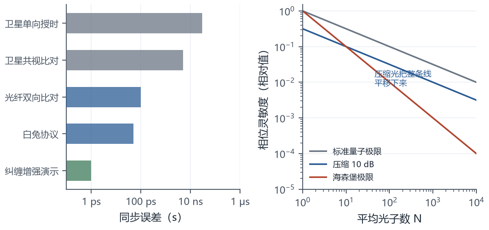
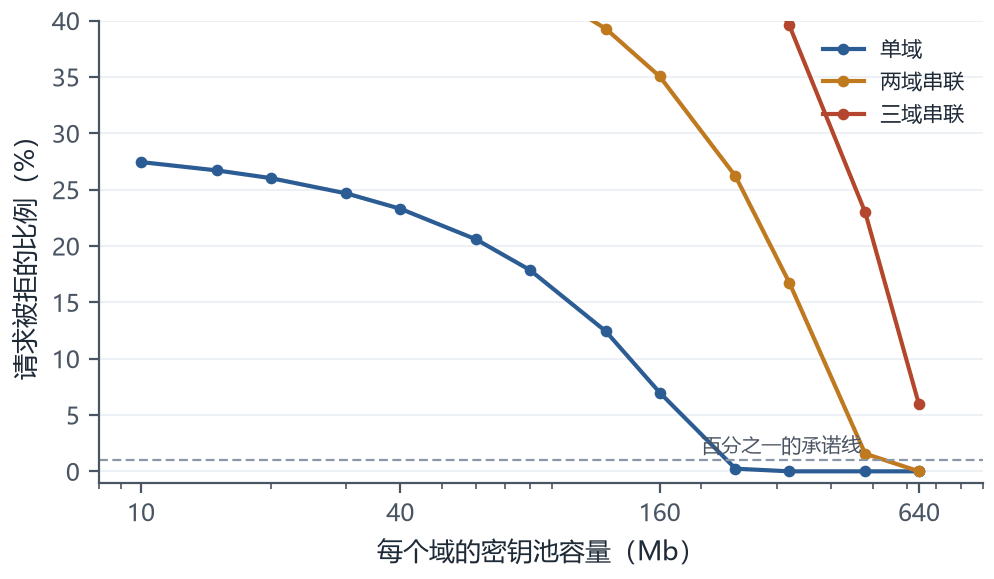

# 第 15 章　网络之上能跑什么

前面十四章讲的是怎么把量子态从一个点送到另一个点。这一章换一个角度，问一句，链路建好以后，用户拿它做什么。

答案比想象的多。密钥只是最成熟的一种，时间同步、分布式传感、盲量子计算都在实验里跑过。

## 15.1 网络的三类用途

按对纠缠的依赖程度，量子网络的用途可以分三层。

最浅的一层只用量子信道传密钥，不需要保存纠缠，点对点的量子密钥分发就属于这一层。

中间一层需要分发纠缠，但不要求实时。分布式传感、时钟同步、纠缠辅助的测量协议在这一层。

最深的一层需要长时间保存纠缠并做逻辑操作，分布式量子计算、盲量子计算在这一层，也是离实用最远的。

## 15.2 时间同步

高精度时间同步是量子网络最现实的一个副产品。

传统做法是卫星授时，单向精度在几十纳秒，共视比对能到几纳秒。光纤双向比对利用同一根光纤往返的对称性，可以做到一百皮秒以内。白兔协议在这条路上又推进了一步，几十皮秒的同步误差已经在大型科学装置里常规使用。

量子增强的做法是把纠缠态分给两个节点，用符合测量提取到达时间的关联。理论上精度可以再提高一到两个数量级，实验上已经演示到皮秒量级，但速率低，离工程化还有距离。

图 15-1　左图是几种同步手段的典型误差，数据取自公开的系统指标；右图是相位灵敏度随平均光子数的变化，压缩光与纠缠可以突破标准量子极限

这张图左边的跨度很大，从微秒到皮秒四个量级。工程上选哪一种，取决于要花多少钱、要多高精度、能接受多大的设备体积。

## 15.3 分布式量子传感

把纠缠分到两个相距很远的传感器上，可以突破单个传感器的灵敏度极限。

原理不复杂。两个传感器各自测量同一个物理量，然后做关联。如果它们之间是纠缠的，噪声中不相关的部分会在关联中被平均掉，相关部分保留，等效灵敏度按 $1/N$ 提升，而不是 $1/\sqrt{N}$。

这个想法在引力波探测、磁场测量、时钟比对里都有提案。真正的难点是损耗，纠缠经过长距离传输后保真度下降，提升的灵敏度会被吃掉一部分。所以目前的演示都在短距离、低损耗的条件下完成。

右图画的就是这笔账。标准量子极限按 $1/\sqrt{N}$ 下降，海森堡极限按 $1/N$ 下降，中间那条是压缩十贝分的实际水平。光子数越大，两条线的差距越大，但工程上能拿到的光子数和压缩度都有限。

## 15.4 盲量子计算

盲量子计算解决的问题是，客户端没有量子计算机，又不愿意让服务器知道自己在算什么。

协议让客户端只负责制备单量子比特态和测量，服务器负责所有的门操作。客户端的输入被编码进制备角里，服务器看到的是一个完全混态，什么也推不出来。

这需要双向的量子信道和经典的交互，对网络的要求是低延迟和稳定的相干性。实验上已经在几个节点之间演示过小规模的电路，离实用还很远。

## 15.5 跨域密钥调度

真实网络不是一个点对点链路，而是很多域连在一起。

每个域有自己的密钥池，跨域通信要在几个池之间周转。池子多大、周转多快，决定了能同时支撑多少业务。图 15-2 把这个关系画了出来，纵轴是被拒绝的请求比例，横轴是每个域的池容量。

图 15-2　请求被拒绝的比例随单域密钥池容量的变化，按泊松到达与固定消耗速率的排队模型模拟，三条线对应单域、两域串联、三域串联

单域时池子到一百六十兆比特，拒绝率就降到百分之一以下。两域串联要把容量翻一倍多，三域再翻一倍。这个放大关系解释了为什么跨域业务比城域内业务贵得多，也让密钥池的容量规划变成了一门实打实的运筹学。

## 15.6 演示与设想之间

把这一章的内容按成熟度排一下。

时间同步最成熟，光纤双向比对和白兔协议已经商用，量子增强还在实验阶段。

分布式传感在实验室里有明确的结果，工程化要看具体场景，重力、磁场、时钟各有各的难点。

盲量子计算和分布式量子计算还在原理演示阶段，需要容错机器和低损耗网络，短期内不会有产品。

密钥调度和网络管理看起来最不量子，实际上最影响用户体验。一条链路再好，如果密钥周转不过来，业务照样跑不动。
