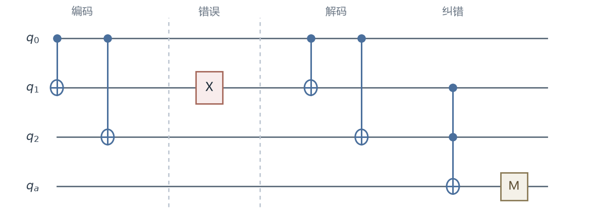
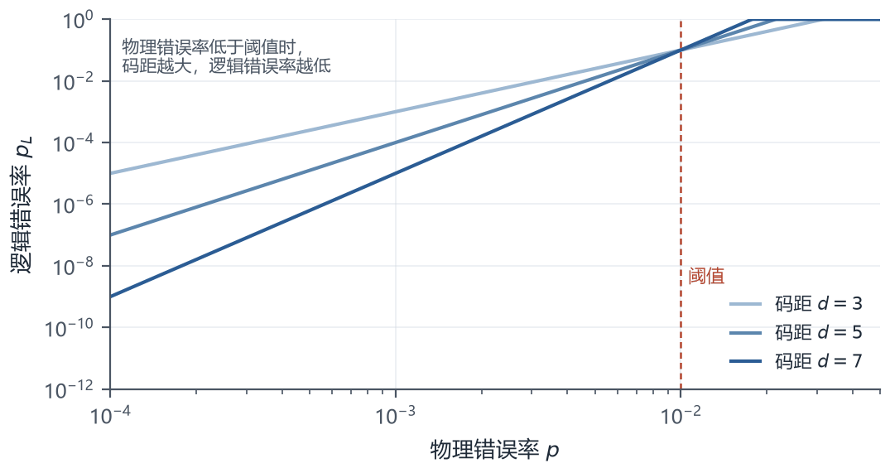

# 第 1 章　量子纠错

前面几章反复提到一个数字，错误率。超导比特的单比特门错误率在千分之一，两比特门差一些，读出更差。要运行 Shor 算法，需要几百万次门操作，任何一次出错都可能毁掉结果。

硬件做不到完美，能走的只有一条路，用冗余把错误容忍下来。这套方法叫量子纠错，它是容错量子计算的基础，也是最难的部分之一。

## 1.1 不能简单复制

经典纠错最简单的办法是复制。存一个比特，存三份，读的时候取多数。这个方法在量子世界行不通，因为不可克隆定理。

不可克隆定理说，不存在一个幺正操作，能把任意的未知量子态复制成两份。证明很短。假设存在这样的操作 $U$，满足

$$
U|\psi\rangle|0\rangle = |\psi\rangle|\psi\rangle
$$

对两个不同的态 $|\psi\rangle$ 和 $|\phi\rangle$ 都成立。取它们的内积，左边是 $\langle\phi|\psi\rangle$，右边是 $\langle\phi|\psi\rangle^2$。要相等，必须有 $\langle\phi|\psi\rangle = 0$ 或 $1$，也就是两个态要么正交，要么相同。对一般的态，这不可能。

所以量子纠错不能用复制，必须换一种思路，把信息分散到多个比特的纠缠里，而不是复制。

## 1.2 三比特码

最简单的量子纠错码是三比特比特翻转码。

编码把

$$
\alpha|0\rangle+\beta|1\rangle \to \alpha|000\rangle+\beta|111\rangle
$$

用一个 CNOT 加一个 CNOT 就能做到，线路如图。

这个编码能纠正一个比特翻转错误。如果某个比特被 $X$ 翻转，态变成 $\alpha|100\rangle+\beta|011\rangle$ 或者别的形式，通过比较三个比特是否一致，可以判断出哪个出了问题。

图 1-1　三比特比特翻转码，编码用两个 CNOT，中间人为加入一个错误，解码后再用 Toffoli 纠正

具体做法是测量两个比较算符

$$
Z_1Z_2,\qquad Z_2Z_3
$$

它们的本征值组合叫错误综合征。四种组合对应四种情况，没有错误、第一个翻转、第二个翻转、第三个翻转。根据综合征施加对应的 $X$，错误就被纠正了。

这个码只能纠正比特翻转，不能纠正相位翻转。这套思路能走多远，后面几章会一层层展开。要同时纠正两种，需要九个比特，叫 Shor 码。后来有更高效的方案，七个比特就够了，叫 Steane 码。

## 1.3 一套统一的语言

描述纠错码有一套更方便的语言，叫稳定子形式。

一个码定义为某个阿贝尔群的所有 $+1$ 本征态。这个群的生成元叫稳定子。比如三比特码的稳定子是 $Z_1Z_2$ 和 $Z_2Z_3$。

稳定子的好处是，测量它们不会扰动编码的信息。因为编码态是它们的本征态，测量结果是确定的 $+1$，不会引起坍缩。错误会把某些稳定子的本征值翻成 $-1$，测出来就知道出了什么错。

这套语言把纠错码的设计变成了找一组对易的泡利算符，使得它们的共同本征空间有足够的维度编码信息，同时不同的错误对应不同的综合征。表面码就是这样设计出来的。

## 1.4 目前最被看好的方案

表面码是当前最有希望的方案，1997 年由 Kitaev 提出。

它把物理比特排在一个二维方格上，数据比特放在格点上，测量比特放在格子的面上。每个面测量四个数据比特的乘积，交替使用 $X$ 型和 $Z$ 型。

这个结构的好处是，它只需要近邻相互作用，适合超导和半导体这类只有局部耦合的硬件。它的阈值也比较高，在理想的测量模型下约百分之一，考虑实际噪声后约千分之五到百分之一。

码距 $d$ 表示方格的边长。码距越大，能纠正的错误越多，需要的物理比特数按 $d^2$ 增长。一个码距 7 的表面码需要 49 个数据比特加 48 个测量比特，接近一百个物理比特编码一个逻辑比特。

## 1.5 阈值决定一切

阈值定理是量子纠错的基石。

它说，如果物理错误率低于某个阈值，那么通过增加码距，逻辑错误率可以指数压低，任意精度都能达到。这个定理在 1990 年代末被证明，它把“造一台容错量子计算机”从不可能变成了“只要把错误率降到阈值以下”。

图 1-2　不同码距下逻辑错误率随物理错误率的变化，按标准标度关系绘制的模型曲线

曲线在阈值处交叉。阈值左边，码距越大越好；阈值右边，码距越大越糟，因为增加的比特带来了更多错误。

## 1.6 实验走到了哪一步

2023 年以来，纠错从理论走向了实验。

谷歌在 2023 年用 Sycamore 处理器演示了码距 3、5 的表面码，逻辑错误率随码距增加而下降，说明已经越过了阈值。2024 年底，谷歌发布了 Willow 芯片，105 个比特，码距 7 的表面码，逻辑错误率比码距 5 低一半，逻辑比特的寿命超过了所有组成它的物理比特。

IBM、Quantinuum、Atom Computing 也发布了类似的结果。离子阱平台在 2022 年就演示了用 13 个离子编码一个逻辑比特，逻辑门错误率低于物理门。

这些结果的意义在于，容错量子计算第一次有了实验支撑。之前所有的演示都是“物理比特数量增加，但质量不够”，现在有了“增加比特能换来更低错误率”的证据。

## 1.7 代价有多大

不过，开销仍然巨大。

要运行一个有商业价值的算法，比如分解 2048 位的 RSA，估计需要几千个逻辑比特，运行几天。每个逻辑比特用一千个物理比特编码，就是几百万个物理比特。

几百万个物理比特，每根控制线都要从室温走到毫开尔文，这在工程上是不可能的。所以架构必须改变，要么用低温电子学把控制电路搬到冷端，要么用光子互联把多个模块连起来，要么用新的编码方式把开销降下来。

另一条路是改进硬件。如果物理错误率从千分之一降到万分之一，同样的码距就能换来更低的逻辑错误率，或者用更小的码距达到同样的效果。这需要在材料、工艺、屏蔽上继续投入。

量子纠错是量子计算从“能演示”到“能用”的门槛。跨过这道门槛的团队，才真正进入了容错时代。
