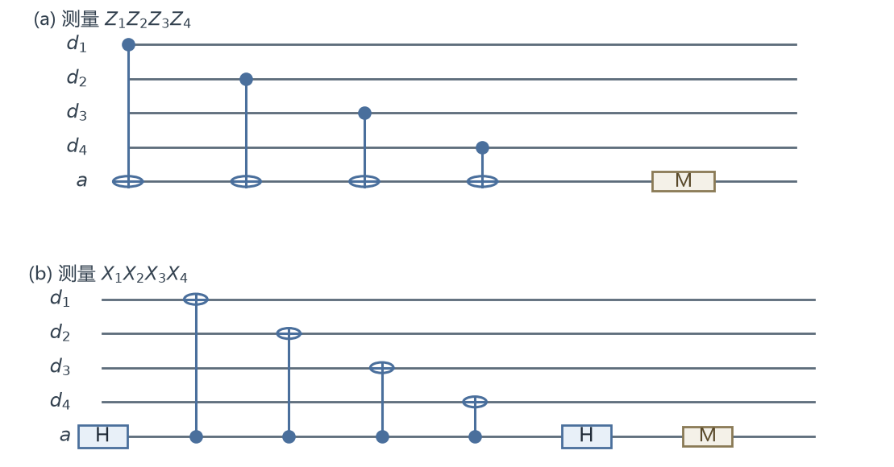
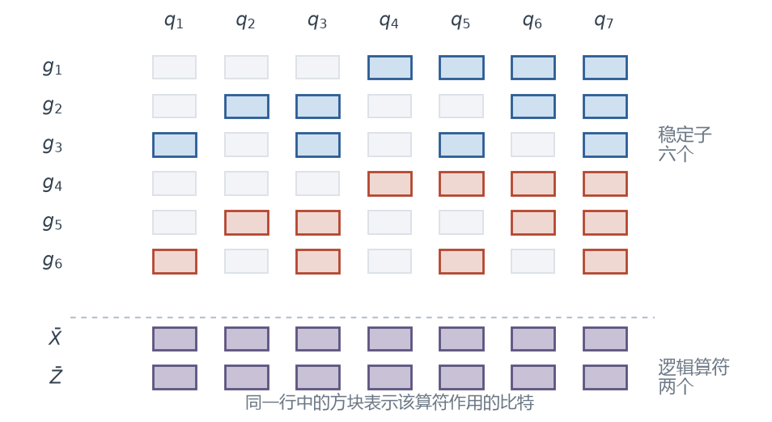

# 第 2 章　稳定子与 CSS 码

第 1 章的三比特码能解决一个小问题，却写不成一般理论。真去设计同时对付比特翻转和相位翻转的码，靠试错找线路，很快就迷路。

这一章补上那套语言。它叫稳定子形式，1990 年代由 Gottesman、Calderbank、Shor、Steane 等人建立。有了它，一个码可以用几个算符写清楚，纠错能力可以用一个整数说清楚。

## 2.1 读出来就毁了

这个问题第 1 章绕过去了，当时只说“比较三个比特是不是一致”，没解释为什么这么比不破坏态。

三比特码把 $\alpha|0\rangle+\beta|1\rangle$ 编成 $\alpha|000\rangle+\beta|111\rangle$。想知道有没有出错，最直接的办法是把三个比特读出来。一读就完了。测第一个比特，得到 0 或 1，态塌缩到 $|000\rangle$ 或 $|111\rangle$，两分量的相对关系消失。

毛病出在读出的量太大。我们不关心每个比特是 0 是 1，只关心三个比特一致不一致。能回答这个问题的测量是 $Z_1Z_2$，它问前两个比特相同还是相反，答案只有两种，而且对 $|000\rangle$ 和 $|111\rangle$ 都给 $+1$。不管系数取什么值，结果都确定，编码态一步也不动。

推广一步。凡是在码空间上本征值全为 $+1$ 的算符，测它都不伤信息，结果偏离 $+1$ 就说明出了错。一个码于是可以定义成“一组算符的共同 $+1$ 本征空间”，这组算符叫稳定子。

## 2.2 对易关系

单比特泡利算符有四个，$I,X,Y,Z$，任取两个相乘，去掉相位还是这四个之一。$n$ 个比特的张量积构成泡利群，忽略整体相位后共 $4^n$ 个元素。每个元素有一个权重，就是非恒等因子的个数，$X_1Z_2Z_3$ 的权重是 3。权重越轻的错误越容易发生，这个量后面一直要用。

泡利算符之间要么对易，要么反对易，没有中间状态。判据是逐比特看，若两个算符在奇数个比特上用了不同的非恒等算符，它们就反对易。最典型的一对是 $XZ=-ZX$。

反对易的后果是不能同时测量。若 $AB=-BA$，先测 $A$ 得 $a$，再测 $B$ 得 $b$，回头看 $A$，它已经翻成 $-a$。第二次测量把第一次的结果抹掉了。要构造能反复测而互不干扰的观测量，它们必须两两对易。

## 2.3 码是稳定子群

取 $n$ 个比特，选出 $r$ 个相互对易且独立的泡利算符 $g_1,\dots,g_r$，让它们生成阿贝尔群 $S$。码空间是所有满足

$$
g_i|\psi\rangle=|\psi\rangle,\quad i=1,\dots,r
$$

的态张成的子空间。每个对易条件砍掉一半维数，剩下 $2^{n-r}$ 维，装 $k=n-r$ 个逻辑比特。三比特码取 $n=3,r=2$，剩下 2 维，正好一个。

把 $|0\rangle_L$ 送到 $|1\rangle_L$ 的算符叫逻辑算符。它们与所有稳定子对易，本身却不在 $S$ 里。前者保证不破坏码空间，后者保证真的改变了信息。基本的两个记作 $\bar X$ 和 $\bar Z$，必须反对易，因为逻辑比特也得服从泡利代数。$\bar X$ 乘上任一稳定子仍是同一个逻辑操作，代表元因此有无穷多个。

错误也是泡利算符。测 $g_i$ 时，若 $E$ 与它反对易，$E$ 穿过去会多一个负号，结果变成 $-1$，对易则仍是 $+1$。把 $r$ 个结果排成向量 $s(E)=(s_1,\dots,s_r)$，这就是综合征。

这里有一层绕不过去的含糊。若两个错误只差一个稳定子，$E$ 与 $Eg$ 的综合征完全一样，因为 $g$ 给出的全是 $+1$。这叫简并，它不构成障碍，反倒说明要求可以放宽。不必把物理错误原样还原，把态送回码空间就够了。真正要区分的是错误类，也就是 $E$ 乘以整个 $S$ 得到的陪集。

## 2.4 把一个稳定子测出来

稳定子的定义很抽象，落到硬件上却很具体，就是一个辅助比特加几个受控门。

测 $Z_1Z_2Z_3Z_4$，准备一个处在 $|0\rangle$ 的辅助比特，让四个数据比特依次控制它做 $X$，再读辅助比特。乘积若是 $+1$，辅助比特保持 $|0\rangle$，若是 $-1$，它被翻了奇数次，读出来是 $|1\rangle$。测 $X$ 型只要加两个 $H$，把控制端和靶端对调。

图 2-1　测量四比特稳定子的线路。$Z$ 型由数据比特控制辅助比特，$X$ 型先对辅助比特做 $H$，再把控制与靶对调

整个过程是相位回踢。辅助比特带着叠加态去和数据比特打交道，数据比特不改它的幅度，只给它一个依赖本征值的相位，到头来这个相位被 $H$ 翻译成一个经典比特。线路从头到尾没有单独读任何一个数据比特，测完以后，数据比特要么还是原来的编码态，要么是错了一个比特的编码态。

硬件的限制在这里显出来。多比特联合测量做不了，只能一个比特一个比特地把信息搬到辅助比特上。一次 CNOT 几十纳秒，四个 CNOT 加读出，一个稳定子就接近一微秒。这个时间尺度决定了后面关于实时反馈的全部讨论。

## 2.5 CSS 构造与 Steane 码

最成功的一类构造叫 CSS 码，取自 Calderbank、Shor、Steane 三人 1996 年的工作。想法是把两种错误分开，$X$ 型稳定子只管抓 $Z$ 错误，$Z$ 型只管抓 $X$ 错误。

具体做法借两个经典线性码 $C_1$ 和 $C_2$，要求 $C_2$ 是 $C_1$ 的子码。把 $C_1$ 校验矩阵的每一行当作 $Z$ 型稳定子，$C_2$ 校验矩阵的每一行当作 $X$ 型稳定子。两组算符能共存的条件是重叠偶数个位置，写成矩阵是 $H_XH_Z^{T}=0$，而 $C_2\subset C_1$ 恰好保证了它。纠错于是分成两步，测一遍 $Z$ 型抓到比特翻转，再测一遍 $X$ 型抓到相位翻转，各自用经典方法解码。

Hamming 码套进这个框架就是 Steane 码。Hamming 码是 $[7,4,3]$，校验矩阵三行，每行四个 $1$，七列互不相同。三行作 $Z$ 型稳定子，得到 $Z_4Z_5Z_6Z_7$、$Z_2Z_3Z_6Z_7$、$Z_1Z_3Z_5Z_7$。Hamming 码的校验矩阵自正交，任意两行内积为偶数，把同样的三行换成 $X$ 型，得到的算符与前三个全部对易。七个物理比特，六个稳定子，一个逻辑比特，码距 3。

图 2-2　Steane 码的六个稳定子和两个逻辑算符，每个稳定子的权重都是 4

Steane 码的价值不在参数，$[\![7,1,3]\!]$ 的效率并不高，价值在门。它的对称性使得逻辑 $H$ 可以七个比特各做一次 $H$，逻辑 CNOT 可以逐对比特做七个 CNOT，逻辑 $S$ 也只是每比特做一次，最多差一个整体相位。这种每个比特上做同样事情的门叫横向门，第 4 章会说明它为什么是容错的关键。

表面码也是 CSS 码，只是把稳定子限制在邻近的几个比特上，这是下一章的内容。

## 2.6 码距决定纠几个错

码距 $d$ 是权重最小的逻辑算符的权重，能纠正的错误个数是

$$
t=\left\lfloor\frac{d-1}{2}\right\rfloor
$$

为什么是 $2t+1$ 而不是 $2t$。设两个权重不超过 $t$ 的错误 $E$ 和 $F$ 产生相同综合征，那么 $EF$ 与所有稳定子对易，要么是稳定子，要么是逻辑算符。权重上 $EF$ 最多 $2t$ 个非恒等因子，而 $2t<d$，够不上逻辑算符。既然也不是稳定子，矛盾。不同错误必有不同综合征，纠错有唯一解。这套判据后来被推广成一组条件，叫 Knill-Laflamme 条件，任何一个码能不能纠某个错误集合，都可以用它来检查。

反过来，$d=2t+1$ 时存在权重 $t+1$ 的错误，它与某个权重 $t$ 的错误只差一个逻辑算符，纠错会选错，把物理错误升级成逻辑错误。d=3 的码碰上两个比特同时翻转就可能被骗，d=5 要三个才出事。

要让码彻底失效，至少得有 $(d+1)/2$ 个错误恰好连成一条通到底的链，概率大致按 $p^{(d+1)/2}$ 衰减，指数压低的来由就在这里。代价是物理比特数。Steane 码用 7 个换 1 个，码距只有 3。更大的码距要么靠更长的码，要么把比特铺到平面上，让码距随边长长大。
