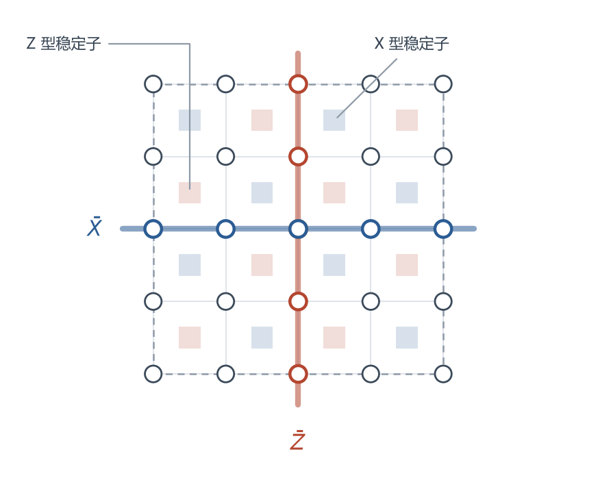
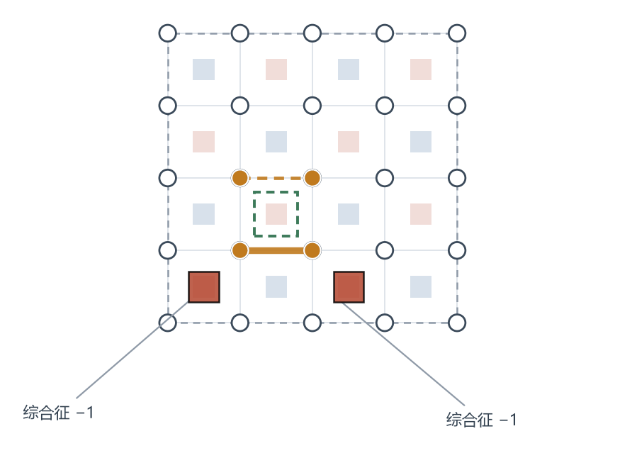

# 第 3 章　表面码

第 2 章的码都是把比特排成一排，稳定子横跨很远的距离。Steane 码的一个稳定子要碰四个比特，看起来不多，可这七个比特在芯片上不可能都挨着，中间总要绕线，绕线就带来串扰和额外的错误。

超导芯片的耦合是局部的，两个比特要相互作用，得先把它们放在相邻位置，用一个耦合器连起来。离子阱可以全连接，代价是门慢。硬件给了这个限制，码就得顺着它设计。表面码的全部聪明之处，就是把纠错需要的信息全部放在邻近的比特上。

## 3.1 方格

想象一张方格纸。每个格点放一个数据比特，每个小方格的中心放一个测量比特。数据比特是白色的圆圈，测量比特是浅色的方块，两者交替铺满平面。

每个测量比特只和它周围那四个数据比特耦合。它测的量是这四个比特的乘积，如果它是 $X$ 型，就测 $X_1X_2X_3X_4$，如果是 $Z$ 型，就测 $Z_1Z_2Z_3Z_4$。方格上相邻的两个面一个测 $X$ 一个测 $Z$，像国际象棋盘那样交替排开。

图 3-1　表面码的一个片段。白圈是数据比特，方块是测量比特，蓝色测 $X$ 型乘积，红色测 $Z$ 型乘积。粗线是两条逻辑算符，各穿过五个数据比特，在中心相交

这个排布有个必须成立的条件，相邻的 $X$ 面和 $Z$ 面要共享偶数个数据比特。两个相邻的面正好共用一条边上的两个比特，所以它们对易。同一类型的面之间更容易，它们要么不接触，要么共用两个比特。整张方格上的稳定子两两对易，这一点不靠巧合，靠几何。

## 3.2 一个周期怎么跑

表面码把时间切成均匀的周期，每个周期测一遍所有稳定子，得到一整轮综合征。

棘手的地方在顺序。一个数据比特同时属于两个 $X$ 面和两个 $Z$ 面。如果同时去测相邻的一个 $X$ 面和一个 $Z$ 面，两个测量比特会通过共享的数据比特间接耦合，测出来的结果不再是各自算符的本征值。所以同一时刻只能测互不接触的那一批。

标准做法把一轮测量拆成四个时钟步。按固定的次序，每一步让每个测量比特去碰它周围的一个数据比特，四个步走完，四个 CNOT 都做完。这个次序经过设计，保证任何时刻没有两个测量比特同时碰同一个数据比特。

一个周期的时间就是四个双比特门加一次读出的时间。在超导器件上，双比特门几十纳秒，读出几百纳秒，一个周期落在一微秒左右。后面的解码和反馈必须在这个时间窗里完成，这是整条工程链条上最硬的一个约束。

## 3.3 逻辑算符与边界

方格不能无限大。一块有限的区域有边界，边界决定逻辑比特住在哪里。

$X$ 型的逻辑算符是一串横穿方格的 $X$。它从左边的一个数据比特出发，一个挨一个地往右走，穿到右边界。这一串上的每个数据比特都被翻转，中间的面各自收到两个翻转，综合征相互抵消，只有两端会露出来。如果边界处没有对应的稳定子，两端就什么也不露，整串操作对综合征完全隐形。

$Z$ 型的逻辑算符是竖着穿过去的一串 $Z$。它和横穿的那一串必然相交于一个数据比特，两者共享奇数个比特，于是反对易。这就是逻辑比特的两个基本算符。

最短的逻辑算符有多长，码距就是多少。边长 $d$ 的方格，横穿要经过 $d$ 个数据比特，码距就是 $d$。要 $d=5$，就把方格做成五乘五。

## 3.4 错误留下成对的缺陷

现在让一个 $X$ 错误落在某个数据比特上。它所在的两个 $Z$ 面各收到一个翻转，测出来是 $-1$。两个 $-1$ 就是一对缺陷。

如果错误落在一串相邻的数据比特上，中间的面上有两个翻转，相互抵消，只有这条链的两个端点留下 $-1$。这条链有多长，缺陷就有多远，链的形状完全看不出来，因为综合征只告诉你端点在哪里。

图 3-2　一条两比特的 $X$ 错误链在两端留下两个综合征。虚线是另一种修补，它与实线只差中间那个绿色框标出的稳定子，权重相同，效果也相同

解码要做的就是从端点反推链。最省事的猜测是端点之间最短的那条路，因为错误率低的时候长链比短链罕见得多。可这里有个松动，两条路径只要相差一个稳定子，效果就完全一样。图 3-2 里实线和虚线都是两个比特，补哪一条都对。

这种不唯一正是表面码解码的核心结构。要处理的不是单点错误，而是一堆散在时空里的端点，把端点两两配对，配对线就是猜测的错误链。讲解码器的那一章会把算法展开，它是表面码能实时运行的关键。

值得说一句为什么叫拓扑。一个局部错误无论多重，只要没连成贯穿的链，就只会留下一对或多对缺陷，可以被抓回去。真正致命的是那些从一边穿到另一边的链，它们改变的是全局性质，靠任何局部观察都看不出来。码的信息存在这种全局结构里，这叫拓扑保护。

## 3.5 开销与边界类型

数一下资源。边长 $d$ 的方格有 $d^2$ 个数据比特，有 $(d-1)^2$ 个内部测量比特，加上边界上的一圈，总数是 $2d^2-1$。$d=3$ 要 17 个，$d=5$ 要 49 个，$d=7$ 要 97 个。一个逻辑比特的物理代价随码距平方增长。

边界还有类型。逻辑 $X$ 的串能悄悄终止的那种边界，和逻辑 $Z$ 的串能终止的那种，必须在方格的四周交替出现。一条边全是同一种类型，逻辑算符就没法定义。这也是为什么表面码的版图看起来总是一圈深色一圈浅色地交错。

工程上常用的版本叫旋转表面码。把方格斜过来切，四个角各切掉一块，边界上的稳定子从四个比特变成两个比特，比特总数从 $4d^2$ 量级降到 $2d^2-1$，省了一半还多。版图上少了一圈，控制线也好排得多。现在实验里跑的几乎都是这个版本，谷歌 2023 年和 2024 年的实验用的都是它。

代价是边界上的稳定子权重只有 2，比内部更容易被单个错误骗过。$d=5$ 的码，最短的逻辑算符仍然要穿过 5 个数据比特，但边界附近的有效距离会短一些，实际码距要靠版图仔细安排才能保住。这些细节不出现在教科书示意图里，却决定了芯片做出来能到几个九。

## 3.6 为什么值得

表面码的阈值在电路级噪声模型下大约是 0.6% 到 1%，具体数值取决于噪声的形式。今天最好的超导器件，双比特门错误率在千分之几，读出在百分之一上下，合起来的电路级错误率刚好压在这条线下面。

只要在阈值以下，加大 $d$ 就能指数压低逻辑错误率。这条曲线不陡，每增加 2 个码距，错误率降一个因子，实测的因子在 2 到 3 之间。按 2.5 算，把逻辑错误率从百分之一压到十亿分之一要跨七个数量级，也就是十七个因子，码距得从 3 走到 37，物理比特从 17 个涨到两千七百个。

这就是表面码的处境。原理干净，容错的门槛也能摸到，代价是比特数。后面几章要讲的逻辑门、解码器和实验，全都在回答同一个问题，这些比特能不能真的凑齐，凑齐了能不能跑得动。
