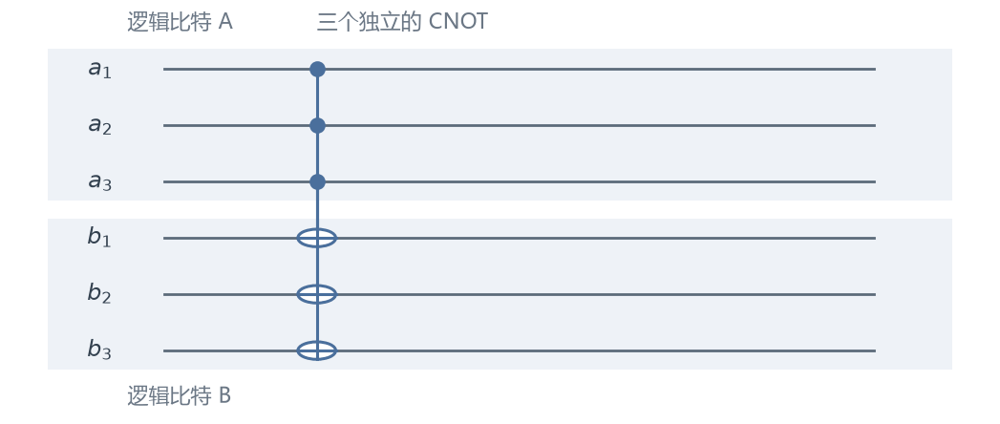
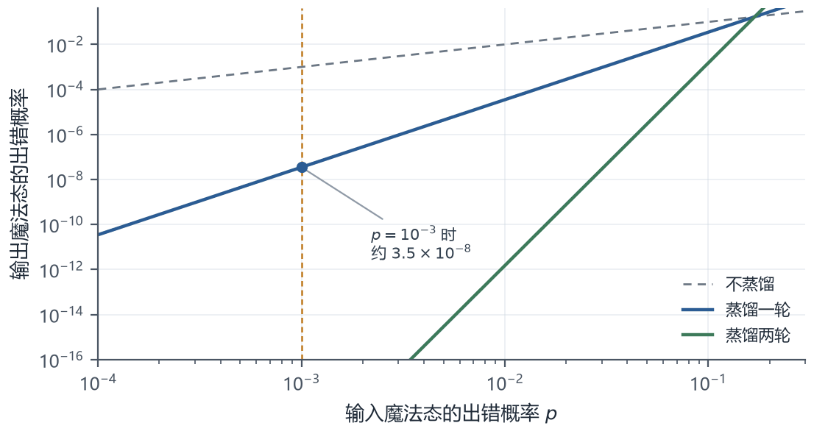

# 第 4 章　逻辑门与魔法态

前三章把记忆问题解决了。信息存进码空间，错误被稳定子抓出来，码距足够大时逻辑错误率可以压到很低。可一台计算机不只要存，还要算。逻辑比特之间要做 CNOT，单个逻辑比特要做 $H$、要做相位旋转，这些操作还得在纠错开着的情况下完成。

难处在于，门一开，错误就趁机进来。一个逻辑门由许多物理门拼成，每个物理门都可能出错，而这些错误在门结束以后必须以某种方式仍然是可纠正的。容错的定义就在这里，门的失败方式不能比存储更糟。

## 4.1 横向门

最干净的做法是横向门。把逻辑门拆成一批物理门，每个物理比特上做一个，互不交叉，也不在同一个比特上做两次。

横向 CNOT 最容易看清。两个逻辑比特各用三个物理比特编码，编号一一对应。做逻辑 CNOT 时，在每一对上做一个物理 CNOT。第一个比特控制第四个，第二个控制第五个，第三个控制第六个。三个 CNOT 在同一时刻执行，彼此没有依赖。

图 4-1　横向 CNOT。两个编码块逐比特配对，三个 CNOT 同时执行，任何一对出错都只影响一个物理比特

为什么这等价于逻辑 CNOT。编码块 A 的逻辑 $X$ 是三个物理 $X$ 的乘积，逻辑 $Z$ 是三个 $Z$ 的乘积。物理 CNOT 把控制块的 $X$ 传给靶块，三个 $X$ 各传一次，传过去以后在靶块上仍然凑成一个完整的 $\bar X$，中间不会残留半个算符。这类关系在 CSS 码里普遍成立，因为它们的逻辑算符本来就是同一类泡利串。

容错性也来自这个结构。假设某一对 CNOT 出了一个错，这个错落在一个物理比特上，它产生的综合征和存储期间的一个物理错误没有区别，下一轮测量照样能抓到。如果是普通的、需要多比特相互作用才能实现的门，一个物理错误可能扩散成两个、三个比特上的错，那就超出码的纠正能力了。

## 4.2 Clifford 门的天花板

$H$、$S$、CNOT 这三个门生成一个群，叫 Clifford 群。它们有个共同特点，把泡利算符映成泡利算符，最多带个负号。表面码和 Steane 码的稳定子在这类门下面还是稳定子，所以这类门和纠错码配合得很好。

这个特点也带来一个坏消息。1998 年 Gottesman 和 Knill 证明，只用 Clifford 门、制备计算基态、做泡利测量的电路，可以在经典计算机上高效模拟。办法是跟踪稳定子的变换，算符的个数随比特数多项式增长，不需要存整个态矢量。

换句话说，一台只会 Clifford 门的量子计算机，跑不出经典计算机算不出来的结果。要体现量子优势，必须有至少一个不在 Clifford 群里的门，最常用的是 $T$ 门，

$$
T=\begin{pmatrix}1&0\\0&e^{i\pi/4}\end{pmatrix}
$$

有了 $T$，Clifford 加 $T$ 就构成通用门集，可以逼近任何幺正操作。问题在于，$T$ 恰恰是最难容错实现的那类门。

## 4.3 T 门不能横向

把横向 $T$ 直接试一下。七个比特各做一个 $T$，得到的算符把 $\bar X$ 映成什么。

单个比特上，$TXT^{\dagger}$ 等于 $(X+Y)/\sqrt{2}$，是 $X$ 和 $Y$ 的叠加。七个比特各做一次，逻辑 $\bar X$ 就变成七个这种叠加的直积，展开以后是 $2^7$ 项的求和。这个算符既不是 $\bar X$ 乘以一个相位，也不是任何稳定子，它把码空间里的态送出码空间。

送出去以后，再测稳定子就得到一堆 $-1$，纠错机制会把它当成错误去修，结果把信息彻底毁掉。横向 $T$ 在 CSS 码上不可用，这不是技巧问题。

2009 年 Eastin 和 Knill 给出了一个更一般的结论。任何量子纠错码，只要它能纠正一定数量的错误，就不可能有一套横向的通用门集，总有一个门没法横着做。这条定理把“找一个横向实现所有门的码”这条路彻底封死了。

## 4.4 魔法态蒸馏

既然 $T$ 不能直接做，就得换个办法。$T$ 门可以借一个特殊态，用门隐形传态的方式做出来。这个态是

$$
|T\rangle=\frac{1}{\sqrt{2}}\left(|0\rangle+e^{i\pi/4}|1\rangle\right)
$$

有了它和一个 Clifford 电路，就能实现 $T$。具体做法是把待处理的数据比特和一个辅助比特做 CNOT，测辅助比特，根据测量结果决定要不要补一个 $S$ 门。整个过程只用 Clifford 门和测量，$T$ 的全部“非 Clifford 性”都装在 $|T\rangle$ 里。

剩下的问题是 $|T\rangle$ 从哪来。硬件制备它时会带错误，错误率与普通门相当，千分之一左右。直接注入，逻辑 $T$ 门就带着千分之一的错误，比逻辑存储的错误率高出好几个数量级。

蒸馏是解决办法。拿十五个带噪声的 $|T\rangle$，用 Clifford 电路把它们纠缠起来，测其中十四个，剩下一个的错误率降到

$$
p_{\text{out}}\approx 35p^{3}
$$

这个协议叫 15 比 1 蒸馏，2005 年由 Bravyi 和 Kitaev 提出。三次方是关键，$p=10^{-3}$ 时输出约 $3.5\times10^{-8}$，一次就够用了。不够就再来一轮，误差掉到三次方的三次方。

图 4-2　15 比 1 蒸馏的输入输出关系，按 $p_{\text{out}}=35p^{3}$ 的一阶公式计算。虚线是原始错误率，蓝线是蒸馏一轮，绿线是两轮

代价是数量。一个 $T$ 门要十五个魔法态，每个魔法态自己做一遍蒸馏又要十五个，一个逻辑 $T$ 门可能吃掉几百次态制备。所以实际架构里会专门划出一块区域叫蒸馏工厂，让它不停地生产高保真的 $|T\rangle$，供主电路取用。工厂占的物理比特往往比计算区还多。很多架构研究干脆把 $T$ 门的数量当作衡量算法成本的单位。

## 4.5 格点手术

表面码连横向 CNOT 都做不了。两个逻辑比特的方格在芯片上各占一块，比特之间不是一一对应的，没法逐对做 CNOT。

实际用的是格点手术。把两个方格在边界上并排贴在一起，中间那段边界上的稳定子被打开，两块合成一块，逻辑算符也跟着合并。合并的方式决定了做的是哪种操作，测完一段时间的联合稳定子，再把它们切开，逻辑 CNOT 就完成了。

这个过程要花时间，一个逻辑 CNOT 通常需要两个码距那么多个测量周期。$d=7$ 时是十几个周期，每个周期一微秒，一个 CNOT 就十几微秒，比物理门慢三个数量级。

$H$ 门更麻烦。表面码在 $H$ 下面会把 $X$ 型和 $Z$ 型稳定子互换，方格的版图对不上。实现办法是换一种版图布局，或者用一个辅助方格做中转，代价是更多的周期和面积。

## 4.6 资源账

把这些加起来，一个能算东西的逻辑比特需要三样东西，一块足够大的数据方格，一个魔法态工厂，一套能做格点手术的版图。

粗算一下。$d=21$ 的方格约 880 个物理比特，管一个逻辑比特的存储。每个逻辑比特还要分摊工厂的开销，按每十个周期用一个 $T$ 门、每轮蒸馏十五个态估算，工厂要比数据区大几倍。在 Shor 算法里，$T$ 门比 Clifford 门高出一个量级，工厂因此成了瓶颈。再算上格点手术需要的辅助区域和布线空隙，一个逻辑比特落到两三千物理比特是常态。

这就是容错量子计算的现实门槛。算法层面看，几千个逻辑比特就够跑有意思的问题；工程层面看，那是几百万个物理比特，以及与之匹配的低温布线、控制电子学和实时解码。后面两章分别讲解码器怎么跟上这个速度，以及实验走到了哪一步。
