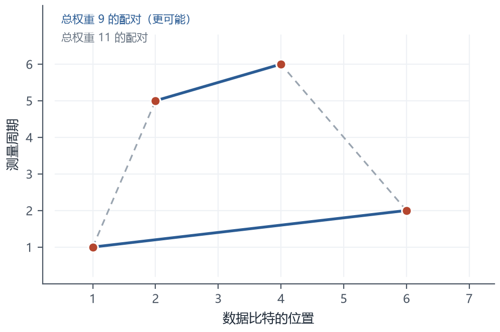
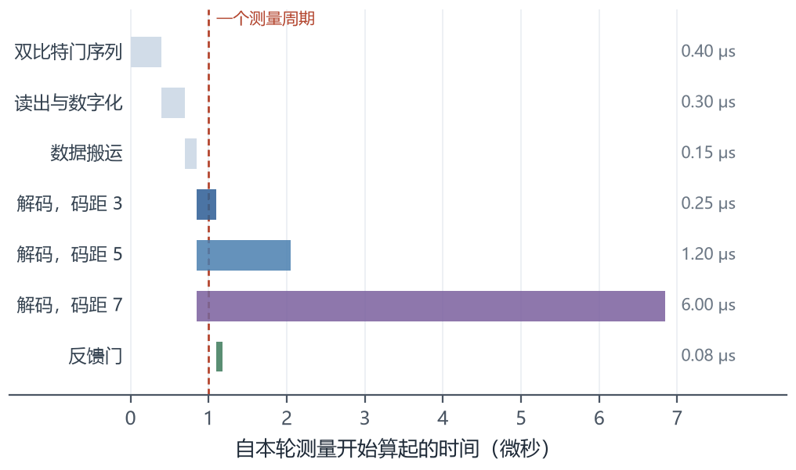

# 第 5 章　解码器与实时反馈

前面几章一直默认一件事，测出一堆综合征以后，有人能把它翻译成该翻哪些比特。这件事说起来轻巧，做起来是整条链条上最不像物理、最像工程的一环。

一轮测量给出几百个 $\pm1$，下一轮又给出几百个，错误在时空里连成线，解码器要在下一个测量周期结束前，把这堆数字变成一张纠错清单。慢一步，错误就积累两轮，慢十步，纠错就形同虚设。

## 5.1 解码要回答什么

理想答案是最大似然：在所有与综合征一致的错误模式里，挑出概率最大的那个。写成式子，要找的是

$$
\hat E=\arg\max_{E\,:\,S(E)=s} P(E)
$$

这个优化一般做不了。错误模式的数目随比特数指数增长，$d=7$ 的方格有将近一百个比特，跑几百个周期，可能的模式多到不可能枚举。

退一步，假设每个比特独立地以概率 $p$ 出错，那么一个权重为 $w$ 的错误模式概率是 $p^{w}(1-p)^{n-w}$，$p$ 远小于一半时，这个量随 $w$ 单调下降。最大化概率就变成最小化权重。这个简化叫最小权重假设，它不严格等价于最大似然，但在阈值以下足够好。

于是问题变成，给定综合征，找权重最小的、能解释它的错误。表面码的特殊结构让这个问题有一个漂亮的图论形式。

## 5.2 把错误画进时空

表面码的综合征是成对的缺陷。上一章说过，一条 $X$ 错误链的两个端点各留下一个 $-1$。如果这条链横跨了好几个测量周期，说明错误持续存在或者发生在两次测量之间，端点也会分散在不同时刻。

把时间当成第三维，每个缺陷就是时空里的一个点。要猜的是一条连接它们的路径，路径的长度就是错误链的权重。

测量本身也会出错。某一次读出翻了个号，会在那一轮凭空造出一对缺陷，看起来就像发生了一个物理错误。这件事可以统一处理，把测量错误看成发生在时间方向上的错误链，它连接的是同一个数据比特在相邻两轮里的缺陷。

图 5-1　时空中的四个缺陷和两种配对方式。配对线越长，对应的错误链越不可能，权重按曼哈顿距离计算

这样整个纠错过程就变成一张图上的问题。顶点是缺陷，边连接任意两个缺陷，边长是它们之间的曼哈顿距离，也就是把两点连通所需的最少比特翻转次数。顶点数随码距的平方增长，随周期数线性增长。解码要在所有“把顶点两两配完”的方案里挑总长最短的那一个。这叫最小权重完美匹配。

## 5.3 匹配算法

完美匹配是经典算法里的老问题，存在多项式时间的精确解，用的方法叫 Blossom，1965 年由 Jack Edmonds 提出。它的复杂度在 $O(V^3)$ 量级，$V$ 是顶点数。

麻烦在于 $V$ 会涨。一个逻辑比特跑一整段算法，缺陷数目可以到几千，$V^3$ 就是上百亿次操作，一微秒的预算里根本跑不完。

实际用的办法是截断。解码只看一个滑动窗口里的缺陷，比如最近二十个周期，窗口外的老缺陷按已定案处理。窗口的宽度要大于码距，否则一条横穿窗口的错误链会被误判。窗口一截，$V$ 变成几百，问题就落在可解的范围里。

2020 年前后有了更快的实现。Higgott 的 PyMatching 用稀疏图和专门的 blossom 变体，把 $d=5$ 的表面码解码压到一微秒以内，$d=7$ 也能在几微秒里完成。这些数字不是理论下限，而是用 C++ 精细实现换来的。

## 5.4 并查集解码

另一条路干脆不追求最优。Union-Find 解码器把缺陷当成一个个簇，让簇在图上生长，两个簇碰到就合并，一直长到所有簇都成对为止。

它几乎不用花时间做全局优化，每个顶点分摊到的操作是常数，复杂度近似线性。代价是答案有时比最优解长，逻辑错误率会高一些，阈值也会低一些。换来的是每个簇的生长只依赖邻近信息，天然适合在流水线硬件上跑。

在阈值附近，这个差距要命。离阈值远一些，两者几乎没有区别，因为此时错误稀疏，最优解和次优解的概率差得很远。工程上因此常把两者混用，平时的周期交给 Union-Find，遇到判断不了的复杂图案再升级到精确匹配。

## 5.5 延迟预算

把所有环节的时间加起来，就能看出约束有多硬。

一个测量周期大约一微秒，其中四个双比特门占去将近一半，读出和数字化又占三成。剩下不到半个微秒，要完成数据搬运、解码和反馈。

图 5-2　一个测量周期里的时间分配。码距 3 的解码能塞进周期内，码距 7 的解码要六微秒，必须靠流水线掩盖

$d=3$ 的方格只有八个测量比特，解码两百纳秒就够。$d=7$ 的方格有近五十个测量比特，一轮的缺陷更多，图更大，解码时间涨到好几微秒，超过一个周期的长度。

三个时间尺度放在一起看更清楚。物理门几十纳秒，测量周期一微秒，逻辑门十几微秒，每往上一层就差一个量级。

超了不等于不能用。解码可以流水线化，这一轮的数据在后台解，结果晚几轮才生效。代价是逻辑操作的时间被拉长，一个逻辑 CNOT 从十几微秒变成几十微秒。对需要长时间相干存储的算法，这个代价可以接受；对相干时间本来就只有几百微秒的硬件，就未必。延迟一旦超过相干时间，整个容错方案就作废，它不是优化项，是硬指标。

## 5.6 实时反馈对控制电子学的要求

真正的难点是反馈。有些操作必须根据测量结果当场决定下一步做什么，比如魔法态注入里的条件 $S$ 门，比如格点手术里根据合并结果决定用哪种分离方式。

这类操作不能在软件层排队。从读出到施加反馈门，整条链路要在一微秒到几微秒里走完，中间包括模数转换、数据打包、送到解码器、回传指令、触发微波脉冲。

现在的做法是把解码器做成专用硬件，FPGA 或者定制 ASIC，放在离量子芯片尽可能近的地方。谷歌在 2024 年的实验里把解码器接到了稀释制冷机的边上，实测的端到端延迟在几十微秒量级，够跑码距 7 的实验，离通用容错还差一截。

再往下走是低温 CMOS。把放大、数字化和一部分解码搬到毫开尔文或者四开的温区，省掉室温到冷端的同轴电缆。线缆是目前最稀缺的资源，一台百万比特的机器如果还用现在的布线方式，光冷端接头就要几万个，热负载也扛不住。

这些都不属于量子物理，却决定了量子纠错能不能真的跑起来。解码器的好坏有两个指标，正确率和速度，两者互相拉扯。一个码的阈值是百分之一，一个解码器慢十倍，合起来的效果可能还不如一个阈值略低但能实时运行的方案。
