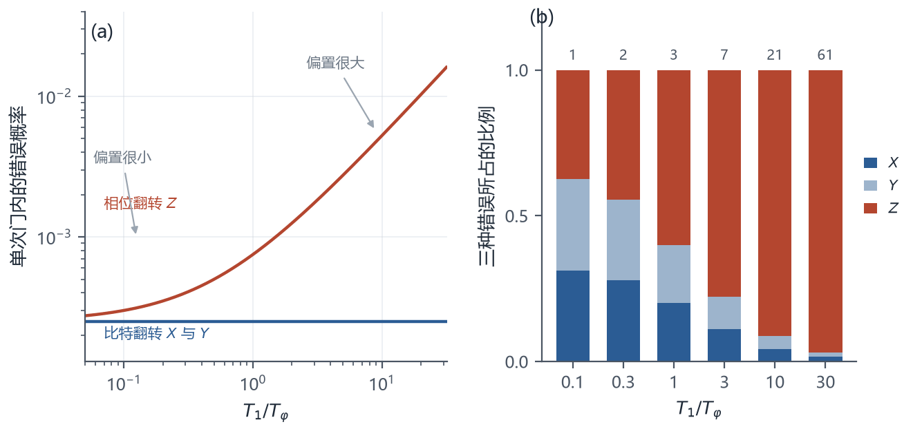
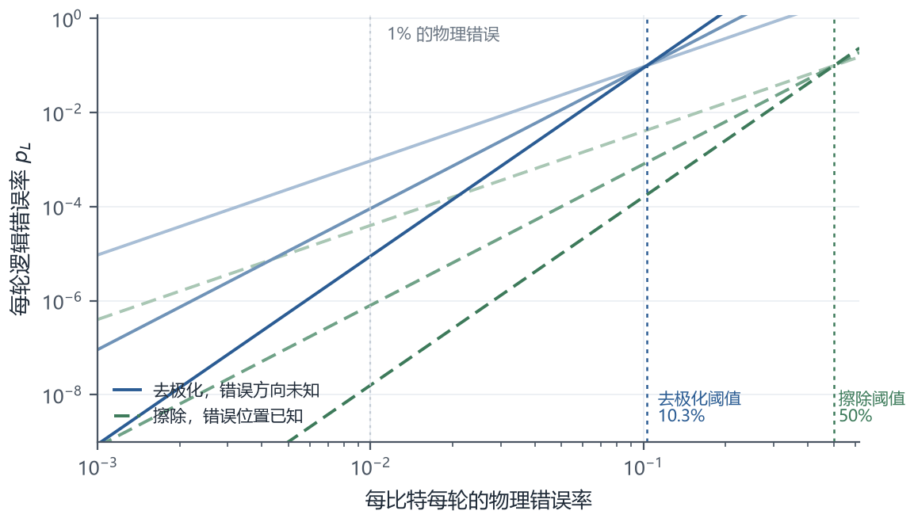

# 第 6 章　真实噪声长什么样

前面几章的噪声一直很干净，每个比特每个周期以同一个概率出错，出错的方向在三个泡利算符之间均匀分配。有了这个假设，阈值可以算，解码器可以假设长链比短链罕见，前半本的结论都站在它上面。

可器件不长这样。同一个比特对不同方向的错误敏感程度相差十倍，有些错误根本不落在计算用的那两个能级里，还有些错误一次就掀翻一片比特。这一章把噪声拆开看，看清楚它到底长什么样。

## 6.1 均匀去极化是哪里来的

均匀去极化是一个数学上的方便选择。它说一个比特出错时，$X$、$Y$、$Z$ 三种错误各占三分之一，

$$
\rho\longrightarrow(1-p)\rho+\frac{p}{3}\left(X\rho X+Y\rho Y+Z\rho Z\right)
$$

这个通道有很好的对称性，各向同性，算起来简单，阈值定理的证明也需要它。但它并不是从物理里长出来的，而是被“转”出来的。

转的过程叫泡利化。给定任何一个单比特噪声通道，把它和随机的泡利算符做平均，就得到去极化通道，而平均前后的平均保真度不变。所以用随机基准测出一个“平均错误率”，再用去极化通道去解释它，是自洽的。麻烦在于去极化只有一个参数，真实噪声有三个以上的自由度，平均掉以后，纠错码最关心的那个方向可能恰好被平均没了。

## 6.2 从主方程到一个离散的通道

描述开放系统的标准工具是主方程，

$$
\frac{d\rho}{dt}=-i[H,\rho]+\sum_k\left(L_k\rho L_k^{\dagger}-\frac{1}{2}\{L_k^{\dagger}L_k,\rho\}\right)
$$

超导比特最主要的两条通道是能量弛豫和纯退相位。能量弛豫用 $L=\sqrt{\Gamma_1}\,\sigma_-$ 描述，布居从 $|1\rangle$ 掉到 $|0\rangle$，速率是 $1/T_1$。纯退相位用 $L=\sqrt{\Gamma_\varphi/2}\,\sigma_z$ 描述，它不改布居，只让叠加态的相位随机化，速率是 $1/T_\varphi$。

在一个门的时间里，把这两个通道泡利化，就得到三个方向的错误概率。振幅阻尼贡献的 $X$、$Y$、$Z$ 各占 $\Gamma_1 t/4$，纯退相位只贡献 $Z$，大小是 $\Gamma_\varphi t/2$。加起来是

$$
p_X=p_Y=\frac{\Gamma_1 t}{4},\qquad p_Z=\frac{\Gamma_1 t}{4}+\frac{\Gamma_\varphi t}{2}
$$

从连续时间到三个数字，这个跳跃能成立，靠的是四个条件。错误要小，小到只保留时间的一阶项。噪声在门的时间里要近似平稳，不能一边做门一边变。布居不能跑出二维子空间。不同比特的错误之间不能有相关性。这四条每一条在真实器件上都会打折扣，而每一条被打折的方式都不一样，所以“一个比特一个概率”的描述迟早不够用。

## 6.3 相位翻转吃掉大头

拿上面两个式子相除，就得到偏置的定义。取 $p_Z$ 与 $p_X$ 之比，

$$
\eta=\frac{p_Z}{p_X}=1+2\,\frac{T_1}{T_\varphi}
$$

这个式子说明，只要退相位比弛豫快，噪声就天然偏向 $Z$。$T_\varphi$ 比 $T_1$ 小一个数量级，$\eta$ 就是二十几，比特翻转几乎可以忽略，只剩相位在翻。

超导比特的实际情况要看数。最好的 transmon，$T_1$ 在三百到五百微秒，$T_2$ 和 $T_1$ 差不多长。由 $1/T_2=1/(2T_1)+1/T_\varphi$ 反推，$T_2=T_1$ 时 $T_\varphi=2T_1$，代进上式得到 $\eta=2$。也就是说，做得最好的器件反而偏置很弱，三种错误大致均分，去极化的描述还算靠谱。

偏置是可以造的。可调谐比特靠磁通偏置工作，磁通噪声直接进频率，$T_\varphi$ 可以掉到几十微秒，$\eta$ 上到十几。另外一些方案干脆改编码，把损耗映射成相位翻转，比如第 8 章的猫态码，等效的 $\eta$ 能做到几十甚至上百。

图 6-1　偏置噪声的构成。（a）固定 $T_1$ 只改变 $T_\varphi$ 时，三种错误随 $T_1/T_\varphi$ 的变化。（b）同样几档取值下三种错误所占的比例，柱顶数字是按 $\eta=1+2T_1/T_\varphi$ 算出的偏置。曲线按 $p_X=p_Y=\Gamma_1 t/4$、$p_Z=\Gamma_1 t/4+\Gamma_\varphi t/2$ 计算，取 $\Gamma_1 t=10^{-3}$

偏置带来的好处很直接。一类错误占绝对主导时，码可以把力气集中在一个方向上。代价是另一类错误被弱化保护，一旦 $\eta$ 估计错了，或者器件里藏着一条把 $Z$ 错误转成 $X$ 错误的通道，收益就没了。

## 6.4 泄漏，第三种状态

transmon 不是二能级系统。非谐性两百兆赫兹，门脉冲的带宽几十兆赫兹，频谱的尾巴总会碰到 $|2\rangle$。一次门操作把布居送到 $|2\rangle$ 的概率在 $10^{-4}$ 到 $10^{-3}$ 之间，比门本身的错误率小，但它造成的麻烦比一个大。

原因有三个。$|2\rangle$ 不在计算子空间里，稳定子测量对它没有定义，测出来的结果近似随机。它的寿命比 $|1\rangle$ 长，因为要从 $|2\rangle$ 一路掉回 $|0\rangle$，中间还得经过 $|1\rangle$，所以一次泄漏会持续几十到几百微秒，跨过几十个测量周期。它还会传染，两比特门把 $|2\rangle$ 和一个 $|1\rangle$ 放在一起，可能变成两个 $|1\rangle$，于是一个比特的泄漏变成了两个比特的错误。

对付泄漏的标准做法是泄漏减少单元。用一个辅助比特，把 $|2\rangle$ 的布居通过 $|2\rangle\leftrightarrow|3\rangle$ 或 $|2\rangle\leftrightarrow|e\rangle$ 的跃迁搬走，再让它衰减回 $|0\rangle$。这个操作每轮做一次，能把稳态泄漏压到 $10^{-5}$ 以下。这件事在纸面上是“可选优化”，在实验里是必需项，不做的话逻辑错误率根本不会随码距下降。

## 6.5 一次事件影响一片

前面几节讲的错误都还是“一个比特的事”。真实芯片上还有一类错误，一次就影响一大片。

串扰是最常见的一种。两个比特之间有残余的 $ZZ$ 耦合，一个比特翻状态，邻居的频率跟着挪。读出也有串扰，同一根线上挂着几个谐振器，频率挨得近时，读一个会把另一个的相位带偏。还有驱动串扰，微波脉冲从目标比特漏到邻居。

参数漂移是另一种。芯片上总有一些两能级系统，它们随机地切换状态，让附近的比特频率跳一下。跳变持续几毫秒到几秒，标定好的脉冲在这段时间里就不准。这类噪声的功率谱在低频端很陡，长跑的时候表现为“错误率忽高忽低”。

最剧烈的是宇宙射线。一个高能粒子穿过芯片，在衬底里激发出大量的准粒子，一片比特同时失超，恢复要几毫秒到几十毫秒。在厘米见方的芯片上，这种事件每隔几秒到几十秒就来一次，具体速率跟面积、屏蔽和封装都有关系。

关联错误对纠错是致命的。阈值定理要求错误彼此独立，如果一次事件能同时打翻码距范围内的多个比特，那么加大码距并不能继续压低逻辑错误率。曲线上会出现一个平台，平台的高度由“一次事件造成一个逻辑错误的概率”决定，与码距无关。工程上的应对是分区，把芯片切成若干块，让一次事件只落在其中一块里；再加上时间戳和重复读出，把可疑的事件标出来，交给解码器当擦除处理。

## 6.6 别的平台怎么坏

换一个平台，噪声的脸就换了一副。

离子阱的错误率很低，两比特门在千分之一到万分之一，相干时间以秒计。它的麻烦在别处。激光的相位和强度会漂，漂得慢，但一直在漂，所以“平均错误率”在长时间运行里不准。离子的集体运动模式会被加热，加热速率决定了一个模式能用多久。离子还会丢，丢了一个，整条链上的门都得重排。

中性原子最典型的错误是原子丢失。光镊关掉或者碰撞都会让原子跑掉，跑掉以后那个位置就是空的。这件事听起来糟糕，其实是好消息，因为丢失可以被探测到，位置是已知的。用荧光收集判断某个位置上还有没有原子，就能把“丢失”标记成擦除，而不是一个方向未知的泡利错误。有的方案更进一步，把泄漏到其他能级的状态也设计成可探测的，让大部分错误都变成擦除。

光子的错误几乎全是损耗。光纤和波导每过一个器件丢百分之几，探测器效率也不是百分之百，剩下的部分还会被暗计数污染。光子平台的门本身常常是概率性的，靠后选择把失败的事件扔掉，这等于把错误转换成了“这次不算”，代价是时间。

这三种噪声的差别，最后都落到同一个问题上，错误发生时我们知不知道它在哪里。

## 6.7 怎么把一个噪声描述清楚

实验室里最常用的工具是随机基准。随机挑一串 Clifford 门，让它们的乘积等于恒等，看实际执行后回到初态的概率。把序列长度从几个拉到几百个，拟合指数衰减，就得到平均错误率。这个方法快、稳、对初态制备和测量的错误不敏感，是表征门质量的标准手段。

随机基准的问题在于它只给一个数。它把相干错误和非相干错误平均在一起，把泄漏混进衰减曲线，也看不见比特之间的关联。交错随机基准能分离出单个门的贡献，但分离不出错误的类型。

门集层析走的是另一条路，直接估计整个过程矩阵。它能看到相干错误，能看到偏置，代价是测量次数随比特数指数增长，三比特以上就很难做。循环基准介于两者之间，把一个完整的纠错周期当成一个“门”来测，测出来的数字直接对应解码器看到的东西，这是做容错时最该关心的量。

还有一个常被忽略的差别，随机基准给的是平均保真度，容错需要的是最坏情况的界。平均错误率千分之一，最坏情况的错误可能是它的几倍，也可能出现平均很小但特定输入上完全失效的通道。用平均数字去外推阈值，总会乐观一点。

## 6.8 噪声形状如何改变码的选择

把这一章的观察收拢，结论是阈值不是码的固有属性，而是码和噪声模型的匹配度。

偏置噪声适合偏置保持的码。把稳定子的形状斜过来，让一个方向上的错误更容易被抓住，代价是另一个方向的保护变弱，只要噪声真的偏，这笔交易就赚。第 8 章会提到这种斜着摆的方格码，思路就是把码的几何和噪声的方向对齐。

擦除适合擦除码。错误位置已知，解码器不用猜距离，只需在图上把“断掉的边”找出来，阈值因此高得多。图 6-2 把两种信道放在同一张图上，同样的物理错误率，擦除那一族的逻辑错误率低好几个数量级。

泄漏和关联错误没有这么优雅的对策。前者只能靠工程手段压住，泄漏减少单元成了流水线的一部分；后者要靠架构躲开，比如分区、标志比特、关联感知的解码器。这两件事的共同点是，它们都不改变阈值本身，而是给逻辑错误率加了一个下限，让曲线在码距变大时不再往下走。

图 6-2　同一批码距在两种信道下的逻辑错误率。实线是去极化，错误方向未知，阈值 10.3%；虚线是擦除，错误位置已知，阈值 50%。两条阈值都是码容量模型下的值，前者是表面码的经典结果，后者来自渗流对偶。曲线按 $p_L=0.1\,(p/p_{th})^{(d+1)/2}$ 计算，同色由浅到深依次是 $d=3$、$5$、$7$

下一章回到码的几何。既然噪声有明显的形状，码的形状就应该跟着变。
