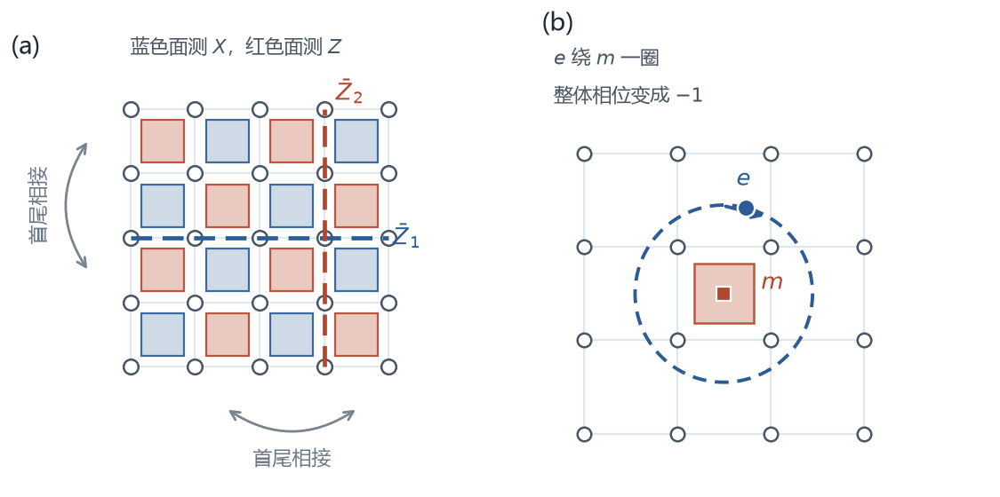
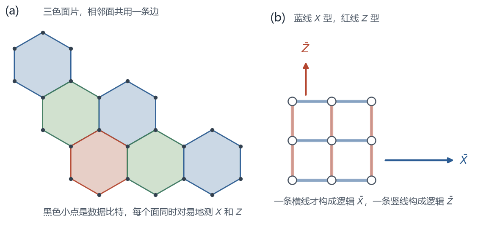

# 第 7 章　拓扑码与色彩码

第 3 章的方格画在平面上，四周有一圈边界，逻辑算符从一条边穿到对面。这只是拓扑码里最朴素的一种。把方格卷起来，边界就没了；把方格换成六边形，稳定子的形状就变了；把“稳定子两两对易”放松成“中心对易”，又得到另一类码。

这一章看这几种变体。它们共享同一个思想，把错误的信息摊在全局结构上，局部测量只能看到局部。差别在于几何，几何决定了阈值、开销和做门的方便程度。

## 7.1 把方格卷成环面

想象一张方格纸，把左右边缘粘起来，再把上下边缘粘起来。粘完以后任何一条线都能连续滑动，只要不撕开就滑不出这张面。这个形状叫环面。

粘好的方格上，规则和平面版一样。每条边放一个数据比特，每个小方格中心放一个测量比特，测四条边比特的乘积，每个格点也放一个测四条边的算符。方格有 $n$ 乘 $n$ 个，数据比特就有 $2n^2$ 个。

麻烦在于这张面上有两种本质不同的闭合路径，一种绕经线，一种绕纬线，都没法缩成一个点。每条这样的路径对应一个算符，路径上的比特全翻一次，中间所有的面都收到两个翻转，综合征互相抵消，什么也留不下。这些路径算符与所有稳定子对易，却不属于稳定子群，它们是逻辑算符。

两种路径各给出一个逻辑比特。一个逻辑比特需要一对反对易的算符，$X$ 走一条路，$Z$ 走另一条，两条路必定相交于一个比特，所以反对易。于是环面码编码两个逻辑比特，基态四重简并，码距是 $n$，因为最短的绕行路径要穿过 $n$ 个比特。

图 7-1　环面码与编织。左边把方格首尾粘起来，两条虚线是绕不过去的逻辑环，各带一个逻辑比特。右边是 $e$ 任意子绕 $m$ 一周的路径，绕完以后整个态多出一个 $-1$ 的相位

Kitaev 在 1997 年提出这个模型。它的价值不在实用，而在证明了一件事，只由近邻四比特测量构成的码可以有宏观码距和拓扑简并的基态。这套结构后来被切掉边界、压扁，才变成芯片上的平面码。

## 7.2 缺陷、任意子与编织

第 3 章说过，一条错误链只在两端留下综合征。在环面上，这两个端点没有边界可以倒掉，只能成对留在面上，像两个粒子。

落在格点上的是 $X$ 型错误的端点，叫电任意子，记作 $e$；落在小方格上的是 $Z$ 型错误的端点，叫磁任意子，记作 $m$。它们不是真的粒子，但可以移动，可以成对产生，也可以相遇后湮灭。

湮灭的规则叫融合。两个 $e$ 碰在一起，翻转抵消，什么都不剩，写成

$$
e\times e=\mathbf{1}
$$

同样有 $m\times m=\mathbf{1}$。一个 $e$ 和一个 $m$ 相遇，剩下的东西既不是 $e$ 也不是 $m$，记作 $\psi$，它是一个费米型的激发。

更有意思的是缠绕。把 $e$ 沿一条闭合路径挪一圈，路径围住了 $m$，绕完以后整个态多出一个 $-1$ 的相位，图 7-1 右边画的就是这件事。这个相位来自一个简单的事实，$e$ 的路径和 $m$ 所在面的边界有奇数个交点，每交一次就带来一个反对易的符号。

于是有人想到另一种造计算机的办法。既然绕一圈能产生相位，不同路线就给出不同相位，把门编码在路径的拓扑类里，局部扰动挪不出这个类。这套想法叫拓扑量子计算。可惜环面码的任意子太简单，$e$ 和 $m$ 绕来绕去只能给出 $\pm 1$，凑不出通用门集。真要通用得找非阿贝尔任意子，两个粒子交换以后态做矩阵变换而不是乘相位，$5/2$ 分数量子霍尔态和马约拉纳零模是候选，这些体系至今没做出一台能算东西的机器。今天说的表面码容错用的是拓扑纠错的稳健性，不是拓扑量子计算的门。要做 $T$ 门，还得回到魔法态。

## 7.3 拓扑保护保的是什么

这个词容易被误解成“错误完全进不来”。不是这样，一个比特上的 $X$ 错误照样发生，照样留下两个缺陷。

保护的是逻辑信息。要改变逻辑态，必须施加一个绕环的逻辑算符，或者施加一条长到能连起两个边界的错误链。码距为 $d$ 的环面上，任何作用在少于 $d$ 个比特上的算符都无法区分四个简并基态，它在基态子空间里只能是单位矩阵乘常数，

$$
\langle \psi_i |\,O\,|\psi_j\rangle = c\,\delta_{ij},\qquad \text{只要 } O \text{ 的支撑小于 } d
$$

这就是拓扑保护的数学内容。不是错误被挡住，而是错误在简并子空间里看不见。只要错误链没有贯穿整个面，它做的只是给基态加一个整体相位。

于是码距是唯一的硬指标。码距越大，能骗过码的错误链越长，长链的概率随长度指数下降。换一个说法，把链从零拉到长度 $d$ 的代价随 $d$ 线性增长，隧穿概率就指数小。

有限温度是个例外。热运动可以直接产生一对 $e$ 和 $m$，不需要任何错误链，它们会在面上游走，一旦有一对走到相对的两条边界，逻辑态就翻了。严格说来，环面码在有限温度下没有真正的阈值，寿命只随时间指数增长而不是无限。实验上这不是问题，制冷机的温度比能隙低好几个数量级，做理论的人却必须把这件事说清楚。

## 7.4 边界与孔

环面在芯片上做不出来。你不能让一块平面电路的左右真的接起来，中间还穿过别的布线。实际用的都是带边界的版本，也就是第 3 章的平面码。边界把任意子倒掉，一条错误链撞到边界就终止，不再需要另一端。代价是逻辑比特从两个变成一个，面积还要多留一圈。

一块大平面上想放多个逻辑比特，有两种办法。最直接的是复制，一块一块独立并排，每块管一个比特。另一种是挖孔，绕孔的闭合路径成为逻辑算符，面积能省一些，但任何操作都要挪孔，版图很不规整。

工程上选了复制。一块方格的行为可以在小尺寸上测清楚，然后原样复制，版图规则，布线流水化。可复制的模块比精巧的结构更容易做大，这条经验在讲架构时还会遇到。

## 7.5 色彩码

把方格换成六边形，就得到另一种码。六个六边形围着一个顶点，整个平面铺满正六边形，这个格子记作 6.6.6，每个顶点被三个面共用，每个面有六条边。

色彩码的规则和表面码有一处根本不同。表面码里一个面只测 $X$ 或只测 $Z$，两类面像棋盘一样交替。色彩码里每个面同时测两个量，$X_1X_2\cdots X_6$ 和 $Z_1Z_2\cdots Z_6$，支撑是同样那六个比特。相邻的面共用一条边，正好两个比特，偶数个，两类算符自动对易。三个面交于一个顶点时要给面染色，让相邻面的颜色不同，三种颜色够用，色彩码的名字由此而来。

好处在门。每个面的 $X$ 稳定子和 $Z$ 稳定子支撑完全相同，把 $H$ 作用在每个比特上，$X$ 和 $Z$ 互换，稳定子群整体不变，横向 $H$ 是合法的逻辑门。横向 $S$ 同理，CNOT 逐比特作用也行。整套 Clifford 门都能横着做，不需要格点手术，不必为一个 CNOT 等十几个周期。

代价有两处。一是稳定子的权重，六个比特的乘积要拆成五个双比特门加一个辅助比特，测量电路比表面码深一倍多，每一步都可能出错，电路级噪声下的阈值掉到千分之一到千分之三。二是码距不直观。色彩码里有些逻辑算符沿折线走，绕开某些面，实际能纠的错误数比边界长度暗示的少，版图设计时必须逐个验证有效距离，这一条坑过不少人。

面积上色彩码是省的。距离 $d$ 的三角色彩码需要

$$
n=\frac{3d^2+1}{4}
$$

个比特。$d=3$ 时是七个，正好是第 2 章的 Steane 码，七比特码其实就是最小的三角色彩码。$d=5$ 时要十九个，$d=7$ 时要三十七个，比表面码的 $2d^2-1$ 少将近一半。

适合什么场合就比较清楚了。Clifford 门多、$T$ 门少的算法，色彩码能省下大量手术时间，面积又小一半。$T$ 门密集的算法里优势就不明显，因为工厂的面积一点不省。

## 7.6 子系统码

还有一条思路，放松对稳定子的要求。表面码要求所有稳定子两两对易，因为它们要同时有确定的本征值。如果只要求这些算符生成的群有一个足够大的中心，中心元素与所有生成元对易，那么中心元素仍然能当稳定子用，剩下的部分不再携带信息，成了规范自由度。

Bacon-Shor 码是最简单的例子。$d^2$ 个比特排成 $d$ 乘 $d$ 的方格，只测相邻配对，同一行里相邻两个比特测 $XX$，同一列里相邻两个比特测 $ZZ$。这些算符彼此不对易，一行的 $XX$ 和一列的 $ZZ$ 在交叉处共享一个比特，反对易。

图 7-2　左边是 6.6.6 色彩码的一小块，三种颜色区分相邻的面，黑点是数据比特，每个面同时测 $X$ 和 $Z$。右边是 Bacon-Shor 码的规范算符，横向配对测 $XX$，纵向配对测 $ZZ$，一整行才构成逻辑 $\bar X$

逻辑算符还是整行的 $X$ 和整列的 $Z$。一整行的 $X$ 与一整列的 $Z$ 只在一个比特上相交，所以反对易；整行的 $X$ 与竖直方向的 $ZZ$ 配对共享两个比特，整列的 $Z$ 与水平方向的 $XX$ 配对也共享两个比特，都和规范算符对易。这样一来，整行整列就名正言顺地成了逻辑算符，码距是 $d$。

好处全在硬件上。要测的算符权重只有 2，一对相邻比特而已，任何有近邻耦合的芯片都能直接做。这也是 2006 年 Bacon 和 Shor 提出它的动机，那时候的实验连三比特联合测量都做不稳。

代价是纠错效率。规范自由度的存在意味着有些错误模式不会被发现，只是让规范空间转了个方向，结果逻辑错误率随码距下降得更慢，指数上的因子大约是 $d/2$ 而不是 $(d+1)/2$。另外规范算符的测量本身会出错，测出的 $XX$ 和 $ZZ$ 要拼成一个自洽的图景，这一步比表面码的综合征复杂。

子系统码今天更多是设计工具。它把“只能测低权重近邻算符”这个硬件约束和“要有好的码距”这个理论要求放在一起折中，最近几年用计算机搜索出来的许多新码都长在这个框架里。

## 7.7 怎么选

阈值最高的还是表面码。四比特稳定子，规整方格，成熟解码器，实测已越过阈值。短板是没有横向 Clifford 门，全部靠格点手术，慢且占面积。

色彩码用更高的门效率和小一半的面积，换来更低的阈值和更麻烦的版图验证。Clifford 密集的场合有优势，$T$ 密集的场合没有。子系统码牺牲码距效率换取测量上的简单，今天更像一个可以借用的构造思路。

这些码不是彼此竞争的方案，是同一组约束下的不同折中。决定选型的不是哪个码更漂亮，而是硬件的噪声形状和布线能力。下一章换一个方向看。前面所有码都把信息摊在很多比特上，其实还有另一种办法，把信息塞进一个谐振子里。
