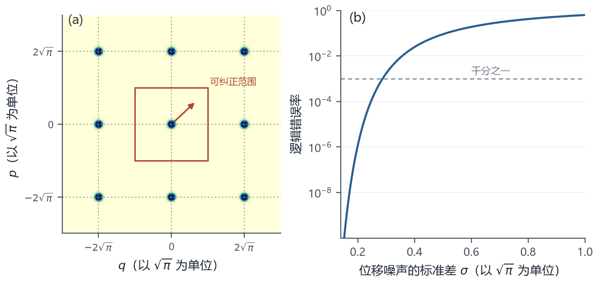
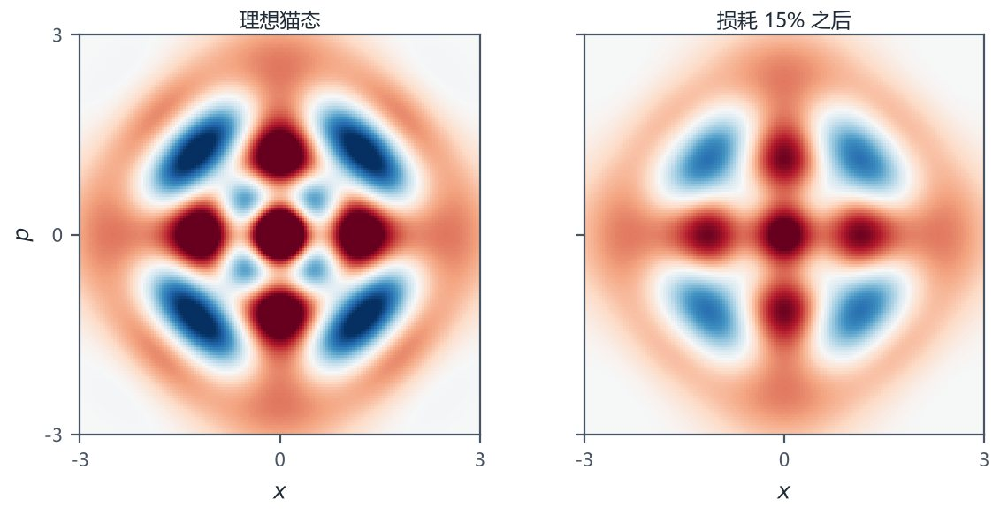

# 第 8 章　玻色码与猫态

前面几个码都在做同一件事，把信息摊到很多个比特上。码距越大，错误率压得越低，代价是面积和布线。这条路走到几百万比特的规模，线缆和低温制冷先撑不住。

还有一条路走的是另一个方向。一个超导腔或者一个光学谐振腔，本身就有无穷多个能级，一个模里能装下的东西远不止两态。如果把冗余放进一个模的相空间里，一个模就能当一个逻辑比特用，布线少一个量级，面积也少一个量级。

代价是控制的复杂度。用连续变量编码，错误也变成连续的，没法一个个数。玻色码要解决的问题就是让连续的错误在某个意义上变成可数的。

## 8.1 一个模里有多少空间

一个 LC 电路就是一个谐振子。能量一份一份地排着，$E_n=\hbar\omega(n+1/2)$，相邻两级的间隔处处相等。正因为间隔相等，驱动 $|0\rangle\to|1\rangle$ 的脉冲会同时驱动 $|1\rangle\to|2\rangle$，这是谐振子不好当比特用的原因。但玻色码不在乎，它的编码方式不靠限制能级数。

谐振子的状态可以用相空间里的分布描述。两个正交分量 $x$ 和 $p$ 对应无量纲的位置和动量，不确定性让任何态都占一块面积，最小的是真空态。

相干态是最像经典的态。它在相空间里是一个圆斑，中心可以放在任何地方，半径等于真空涨落。光子损耗只是让圆斑按 $\sqrt{\eta}$ 缩小，形状不变。一个相干态丢掉一半光子还是相干态，只是幅度小了。

这个稳定性的另一面是坏消息。信息没法藏在相干态里，因为损耗不改变它的种类，两个相干态之间的区分度随损耗连续下降。要保护信息，得让编码用的态彼此隔着拓扑或者奇偶这种不连续的性质。

## 8.2 GKP 码

2001 年，Gottesman、Kitaev 和 Preskill 提出一个想法。既然谐振子的相空间是连续的，那就自己画一张格子，把相空间切成一个个方格，让码字只占格点，错误就是把态从格点推开一段位移。

具体的做法是让态在 $x$ 和 $p$ 两个方向上都呈周期性的梳状，梳齿间距是 $2\sqrt{\pi}$。这样的态平移 $2\sqrt{\pi}$ 以后和自己完全重合，对应的位移算符就是稳定子，

$$
e^{2i\sqrt{\pi}\,\hat p}\,|\psi\rangle=|\psi\rangle,\qquad e^{-2i\sqrt{\pi}\,\hat x}\,|\psi\rangle=|\psi\rangle
$$

也就是说，把态在 $x$ 方向平移 $2\sqrt{\pi}$，或者把动量平移同样的量，态不变。这两个位移算符就是稳定子。

逻辑算符是半格位移，$e^{i\sqrt{\pi}\hat x}$ 把梳子整体挪半格，挪完以后梳齿落在两组梳齿之间，态变成正交的另一个码字。这就是逻辑 $X$。逻辑 $Z$ 是动量方向的半格位移。

错误怎么纠正，看图 8-1 就明白了。任何错误都可以写成一次位移，位移小的时候落点还在同一个格子里，测出 $x$ 和 $p$ 对 $2\sqrt{\pi}$ 取余的结果就知道偏了多少，反方向推回去就行。只有当位移大到跨过半格边界，落点进了隔壁格子，才会被判成错误的方向反了，这时候逻辑错误就发生了。

图 8-1　（a）GKP 态在相空间里的梳状结构，梳齿间距是 $2\sqrt{\pi}$，红框是半格范围，位移落在框里可以被纠正。（b）逻辑错误率随位移噪声标准差的变化，按半格判据 $p=2\,\mathrm{erfc}\big(1/(\sqrt{2}\sigma)\big)$ 估算，$\sigma$ 以 $\sqrt{\pi}$ 为单位，曲线不包括制备误差带来的下限

这个判据把容错变成了几何问题。可纠正的范围是每个梳齿周围的一个方格，半宽 $\sqrt{\pi}$，只要位移还在自己那格里，测出来的余数就能把它指回去。格距放大，容错范围跟着放大，可是齿宽不变，更容易糊在一起，两者互相牵制。

理想的 GKP 态需要无穷大的能量，因为梳齿是无限细的。实际做出来的是有限挤压的高斯尖峰，齿宽 $\sigma$ 不为零。错误率由齿宽决定，齿越宽，尾巴越容易越过半格边界。图 8-1 右边那条曲线就是这件事。噪声 $\sigma$ 在半个格子以下时错误率压得很低，$\sigma$ 接近格子的一半时错误率迅速升到百分之几，转折很陡。

制备 GKP 态是个硬骨头。它需要非线性，线性器件做不出来，因为线性变换只能把高斯态映成高斯态。实验上有两条路，一条是让两个挤压真空态在分束器上干涉，测一路，用结果修正另一路，这叫 breeding；另一条是让辅助比特和腔耦合，反复测腔的奇偶性并反馈位移，2020 年耶鲁的实验走的是后一条。两条路做出的态挤压量都只有几个分贝，离容错需要的十五分贝差得远。

门操作倒是方便。位移、挤压、分束这些高斯操作把 GKP 态映成 GKP 态，逻辑上等价于 Clifford 门。$T$ 门同样需要魔法态，只是这里的魔法态是一个特殊的 GKP 态，制备和蒸馏都在连续变量里做。

## 8.3 猫态码

另一条思路从相干态出发。

一个相干态 $|\alpha\rangle$ 的相位是经典的，测不出量子叠加。把两个相干态叠起来，就是“薛定谔的猫”，

$$
|\mathcal{C}_\alpha^{\pm}\rangle=\frac{1}{\sqrt{2(1\pm e^{-2|\alpha|^2})}}\left(|\alpha\rangle\pm|-\alpha\rangle\right)
$$

这个态在相空间里是两个圆斑，中间一串干涉条纹。$\alpha$ 大时两个分量几乎正交，$e^{-2|\alpha|^2}$ 可以忽略。

关键是它对损耗的反应。丢掉一个光子，态不是塌掉，而是幅度略缩，$|\alpha\rangle\to|\alpha\sqrt{\eta}\rangle$，两个分量的相对相位可能翻转。丢一个和丢零个在奇偶性上有区别，这个区别可以被测出来，于是连续的光子损耗被映射成“奇偶性翻转”这种离散事件，可以纠正。

单个两分量猫只给出一个比特的保护方向，而且它怕退相位。四分量猫更进一步，把 $|\alpha\rangle$、$|-\alpha\rangle$、$|i\alpha\rangle$、$|-i\alpha\rangle$ 四个相干态叠在一起。四个分量在相空间里排成一个十字，绕中心转 90 度就换一个分量。这个对称性让码同时抗光子损耗和抗退相位，因为两个方向的位移都被“分量结构”抓住了。

图 8-2　四分量猫态（$\alpha=1.6$）的 Wigner 函数，按 Fock 空间截断到 54 个光子数计算。左边是理想态，四块红色是相空间里的四个相干态分量，中间那块是四条分量相互干涉留下的条纹。右边是损耗 15% 之后，分量向内收缩，干涉条纹明显变浅

图 8-2 里能看出损耗干了什么。分量之间的距离缩短了，条纹的对比度下降了，而十字形的整体结构没有变。这就是猫态编码的韧性所在，态的形状比态的幅度更重要。

错误率随 $|\alpha|^2$ 指数下降，$\alpha$ 越大越好。麻烦在于产生大 $\alpha$ 的猫态需要很强的非线性，超导腔的自克尔效应太弱，直接做连 $\alpha=1$ 都难。实验上用的是另一招，加一个双光子驱动，让它和腔自身的损耗竞争，稳态自动收敛到猫态。这个办法叫耗散稳定化，妙处在于纠错连续进行，不需要测量和解码，只要驱动和损耗都在，态就自己回到码空间。

## 8.4 二项式码

猫态用的是无穷维空间的“大尺度”结构，还有一种码用的是“小尺度”结构。

二项式码的想法很朴素，用有限几个光子数态搭出码字，让错误算符把码字送到正交的子空间里。最简单的版本是

$$
|0_L\rangle=\frac{|0\rangle+|4\rangle}{\sqrt{2}},\qquad |1_L\rangle=|2\rangle
$$

光子损耗一次，$|0\rangle$ 变成空态，$|4\rangle$ 变成 $|3\rangle$，$|2\rangle$ 变成 $|1\rangle$。三种结果落在三个不同的光子数上，测一下光子数就知道发生了几个损耗，然后补回去。$|0_L\rangle$ 的两个分量相差 4 个光子，$|1_L\rangle$ 在中间，这个结构让一次损耗不会把 $|0_L\rangle$ 变成 $|1_L\rangle$。

一般的二项式码用两个整数 $(N,S)$ 标记，能纠正 $S$ 个光子损耗和 $S$ 个光子增益，同时抗一定量的退相位。

二项式码的好处是不需要挤压和非线性驱动，只要能数光子、加光子。坏处是它依赖精确的光子数控制，而数光子本身就要靠一个强的非线性辅助比特，而且损耗一旦超过设计值，保护就完全失效，不像猫态那样是渐变的。

## 8.5 腔里的实现

玻色码的实验平台主要是电路 QED。

一个三维铝腔或者一个平面超导腔，里面放一个 transmon 比特。腔的寿命在毫秒量级，比 transmon 的几百微秒长一个数量级，这是玻色码的物理基础。比特和腔通过色散耦合连起来，耦合强度 $\chi$ 让腔的频率随比特的状态平移，也让比特的频率随腔里的光子数平移。这两个方向的依赖都是测量和控制的手段。

用这个耦合可以做几件事。腔里的光子数可以非破坏地测出来，让比特和腔作用一段时间，比特累积的相位与光子数成正比，再读比特。也可以做选择性相位门，让恰好 $n$ 个光子的分量乘上 $e^{i\theta_n}$，只要把比特暂时调谐到与 $|n\rangle\leftrightarrow|n+1\rangle$ 共振的位置。加上位移驱动，这套工具足以对腔做任意幺正操作。

猫态的耗散稳定化在 2016 年以后被几个组做出来，稳态的 $\alpha$ 能到 2 左右，比特翻转时间比同样条件下的物理比特长两三个数量级。这些数字还不能算容错，相位翻转没有同步改善，但对错误偏置这件事来说已经够用。

## 8.6 错误偏置

超导比特的噪声是偏的。能量弛豫 $T_1$ 会把 $|1\rangle$ 变成 $|0\rangle$，这是一个比特翻转；纯退相位只改变叠加态的相位，不改布居数。在 transmon 上，退相位时间往往比弛豫时间短不了太多，所以噪声的偏向不明显。但经过猫态编码以后，弛豫被映射成相位翻转，比特翻转被指数压制，噪声就变得极度偏向一侧。

这件事本身就可以拿来用。有一种叫 XZZX 的表面码，把稳定子斜着摆，让偏置方向的错误更容易被抓住，在强烈偏置的噪声下阈值比普通表面码高出一截，偏置越强提升越明显。

于是出现了分层架构。内层是玻色码，把损耗和退相位压成单一方向的错误，外层是偏置的表面码，专门对付这个方向。两层各管一件事，噪声特性被利用而不是被对抗。

## 8.7 优势与代价

把账算一下。优势有三条。一是密度，一个模就是一个逻辑比特，同样的面积能装下比表面码多一两个数量级的逻辑比特，布线也少得多，一个模只要一根驱动线和一根读出线。二是连续纠错，猫态的耗散稳定化在时间里自动进行，不需要测量周期，也就没有解码延迟这个瓶颈。三是错误偏置，把硬件的噪声形状变成码的优势。

代价也有三条。一是非线性，无论 GKP 的挤压还是猫态的克尔效应，都要一个辅助比特提供非线性，它的噪声又会漏进腔里。二是反馈速度，GKP 的纠错要在微秒量级完成测量和位移修正，对电子学的要求不比表面码低。三是成熟度，GKP 的实验还停在制备和单次纠错的演示，猫态虽然已经把比特翻转寿命拉长到秒的量级，相位翻转这一半还没解决。

所以玻色码现在的位置，和表面码在 2015 年前后的位置有点像。原理清楚，关键操作都演示过，缺的是把一堆指标同时做上去。它不太可能单独撑起一台通用量子计算机，更可能的角色是作为高密度、低开销的模块，外面再套一层拓扑码处理残余错误。这种内外分工怎么排，就是下一章的问题。
