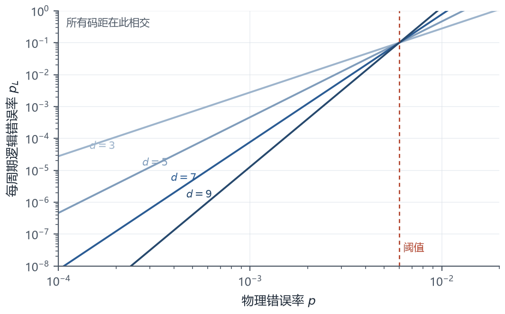
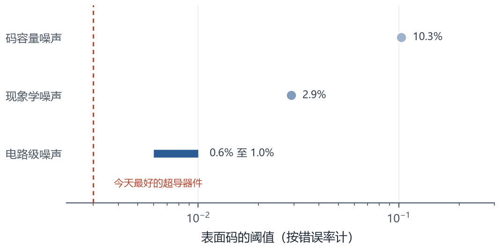

# 第 9 章　阈值、资源与架构

前面几章拆开讲了码、门、解码和器件。把零件拼成机器的时候，有三个数字不肯让步。阈值决定这条路走不走得通，比特数决定造不造得起，时间决定算法跑不跑得完。三者互相牵制，动一个另外两个就跟着变。

## 9.1 阈值定理说了什么

1997 年前后，几组人几乎同时给出同一个结论。存在一个正的常数 $p_{th}$，只要每个物理位置的错误率低于它，就能用级联的办法把逻辑错误率压到任意低，而开销只随目标精度的对数多项式增长。

证明的思路不复杂。把码嵌套起来，第一层把 $p$ 压成 $p^{(d+1)/2}$ 量级，第二层再压一次。只要每层的输入都在阈值以下，递归就能一直进行，而每层增加的比特数是常数倍，总开销只随 $\log(1/\varepsilon)$ 的幂增长。

前提比结论更值得琢磨。错误要在时空上局域，一个门出错不能立刻影响远处的比特；错误之间要足够独立，不能一处出错带动一片；纠错电路本身必须容错，综合征提取时辅助比特的错误不能顺着 CNOT 扩散出去；经典计算部分要可靠，解码器算错和量子比特出错一样致命。

容错因此不是“用一个好码”就完事，整条链路都得按同样的标准来做。一个码的阈值再高，测量电路把错误放大三倍，实际阈值也会掉下来。

定理也给不出 $p_{th}$ 的数值。它只说这个数存在且为正，具体是多少得针对码和噪声模型去算。不同的论文给出差得很远的阈值，它们算的根本不是同一件事。

## 9.2 噪声模型决定阈值

算阈值先要定噪声模型。模型越接近真实器件，阈值越低，文献里常用三个档次。

最乐观的是码容量噪声。它假设只有数据比特会出错，每个周期开始时每个比特独立地以概率 $p$ 翻转，测量完全准确。表面码在这个模型下的阈值是 10.3%，但它描述的器件不存在。

中间一档是现象学噪声。数据会错，测量也会给出错误结果，但测量错误只当作独立的经典翻转。阈值降到 2.9%。

最严格的是电路级噪声。每个物理门、每次制备、每次测量、每次空闲都以各自的概率出错，而且错误沿电路结构传播。阈值只有 0.6% 到 1%。

从 10.3% 掉到 0.6%，差了十几倍，超过一个数量级。原因数一下就清楚。一个四比特稳定子的测量要拆成四个 CNOT，加一次辅助比特制备和一次读出，六七个操作换一个比特的信息，任何一个出错，综合征就是错的。电路级模型把这些全算进去，码容量模型只算了一个。

图 9-1　不同码距的逻辑错误率随物理错误率的变化，按 $p_L=0.1\,(p/p_{th})^{(d+1)/2}$、$p_{th}=0.6\%$ 计算。所有曲线在阈值处相交，交点右侧码距越大错得越厉害

图 9-1 画的是这件事的骨架。每条曲线对应一个码距，斜率是 $(d+1)/2$，码距越大越陡。所有曲线在 $p=p_{th}$ 处交于一点，交点左边码距大的更低，交点右边码距大的更高，多出来的比特带来的噪声超过了纠错省下的。

这张图解释了一个常见的误解。码距越大越好只在阈值以下成立。实验上曾经有很长一段时间，加大码距以后逻辑错误率不降反升，那不是码的问题，是器件还在阈值上面。2023 年之后局面翻转，物理错误率终于压到了交点左边。

## 9.3 关联噪声与擦除

电路级模型仍然假设错误彼此独立。真实器件的噪声不是这样，第 6 章讲过它的画像，这里只挑对资源估算有影响的三件事。

泄漏会让稳定子测量失效，因为布居跑到了计算子空间外面，必须用泄漏减少操作定期清理，这笔开销要算进资源账。宇宙射线一类的事件会让一片比特同时出错，解码器要能处理这种关联错误，否则阈值会往下掉。擦除反而带来好消息，位置已知时阈值高得多，同样的码能承受百分之十以上的噪声。

图 9-2　表面码在三种噪声模型下的阈值，以及今天最好的超导器件所处的错误率水平。数值取自文献中广泛引用的量级，换一套解码器或版图会差一个因子

图 9-2 把这些数字放在一条对数轴上，右边是乐观的模型，左边是严格的模型。红线标出今天最好的超导器件，电路级错误率在千分之三上下。它确实落在电路级阈值左边，但只靠一倍多的余量，这个余量决定了码距不能太小，也说明读出错误率再降一半就能省下大量比特。

## 9.4 资源估算怎么做

有了阈值和噪声模型，就能估算一台机器要多少比特。

估算是三个输入一个输出。输入是物理错误率 $p$、目标逻辑错误率 $\varepsilon$、算法需要多少逻辑比特和多少次 $T$ 门，输出是码距、总比特数和运行时间。码距由那条幂律反解出来，

$$
\varepsilon \approx A\left(\frac{p}{p_{th}}\right)^{(d+1)/2}
\quad\Longrightarrow\quad
d\approx \frac{2\ln(A/\varepsilon)}{\ln(p_{th}/p)}-1
$$

取 $p=10^{-3}$、$p_{th}=6\times10^{-3}$、$A=0.1$、$\varepsilon=10^{-12}$，算出来 $d$ 在 27 附近，和文献里对同类问题的估计一致。

一个距离 27 的方格占 $2d^2-1$ 个物理比特，也就是 1457 个。要 100 个逻辑比特，光数据区就 14.6 万，加上辅助区、布线和工厂，总量通常翻倍，落到三十万这个量级。错误率降到万分之一，同样的目标只要 $d=13$ 上下，一个逻辑比特三百多，总量降一个数量级。硬件每一点改进都被纠错开销放大，工艺和材料的工作因此一直没停。

时间这笔账容易被忽略。一个逻辑门要 $d$ 个测量周期，$d=27$ 时是 27 微秒，比物理门慢三个数量级。$T$ 门常在 $10^8$ 到 $10^{10}$ 之间，全部串行就要跑好几天。真正卡住速度的往往不是门，是魔法态的产量。

## 9.5 布局与模块化

接下来要决定这些比特怎么摆。

实用的版图大致分三块。中间是数据区，逻辑比特在这里做手术；边上一圈是魔法态工厂；两者之间靠路由隔开，路由既用来搬运逻辑比特，也用来隔离工厂的噪声。

路由占的面积不小。手术要求两个逻辑比特的边界贴在一起，贴不上就得先把其中一个搬过去，搬运要花时间和面积。经验数字是路由和空隙占三到五成，并行度高的算法要留更多空地，利用率反而低。

大芯片还有良率问题。晶圆上总有些比特参数不合格，码距越大越容易碰上，一个坏比特就毁掉整个逻辑比特。

模块化是另一条路。每个模块几十到几百个逻辑比特，模块之间用光子互联。微波在低温下传不远，线缆占地方，光子频率高，可以用光纤。难点在转换，把微波量子态转成光量子态，效率目前只有百分之几到几十。传过去的必须是编码后的逻辑态，让码去吸收转换损失，这时候玻色码的优势就显出来了。

另一条路线是把多个小芯片装在同一台制冷机里，用超导电缆连，省掉光电转换。距离短，损耗可控，代价是制冷机的空间和冷量。

## 9.6 工厂的排布与产率

魔法态工厂是整台机器里最像工厂的部分，它也确实按产率设计。

15 比 1 蒸馏的输入输出关系在第 4 章算过。$p=10^{-3}$ 输入，一轮输出 $3.5\times10^{-8}$，已经够用。问题是每产出一个高保真魔法态要消耗十五个低质量的态，每个都要由物理线路制备，要占面积、花时间。

工厂的节奏由码距决定。蒸馏电路里每个逻辑操作都要 $d$ 个测量周期，一轮大致要六七个 $d$。$d=27$ 时一轮一百六十多微秒，输出一个魔法态。

拿这个数字去对算法。$10^9$ 个 $T$ 门需要 $10^9$ 个魔法态，一个工厂串行生产要四十多个小时，想在一小时里跑完就得四十多个工厂同时开工。每个工厂占地和几十个逻辑比特相当，加起来可能超过数据区本身。

这就是所谓的 $T$ 门瓶颈。一层是面积，工厂占的地方比计算区还多；另一层是调度，工厂得提前生产，而魔法态存着会退化，产多了浪费，产少了卡住。工程上通常让工厂略微超产，用缓冲吸收波动。

排布上有取舍。工厂离使用点近，搬运少，噪声却会污染数据区；放得远，隔离好，逻辑比特又要长途搬运。常见的折中是分簇，每簇几个逻辑比特配一个工厂，中间留隔离带。

## 9.7 编译与实时解码的协同

最后一层是软件。

编译器要把算法变成一张时空图，每个点是一个物理操作，每条边是一个依赖。图要满足硬件约束，手术只能发生在相邻的逻辑比特之间，并行的手术数受版图限制，$T$ 门的节奏要跟工厂的产出对齐。这件事比经典指令调度难，因为量子态不能复制，想并行就得占额外空间，还要额外的纠缠操作。

解码器必须跟着这张图走。格点手术会改变稳定子的排布，合并时旧的边界稳定子被打开，切开时新的被建立，解码器不知道当前版图就会把正常变化当成错误。所以编译输出不只是一串门，还有一张随时间变化的版图。

延迟在这里是设计参数，不是事后补丁。解码一轮要几微秒，手术要等结果才能决定下一步，编译时若没把等待算进去，实际执行会比预估长一截。成熟的做法是把延迟写进时序模型，在等待处安排别的操作，用并行掩盖它。

再往下是反馈。条件门要求经典控制在一微秒内完成判断并触发射频脉冲，链条上任何一环慢了，电路就得停下来等。这也是解码器要贴近芯片的原因，它不是性能优化，而是时序约束的一部分。

把这些拼起来，可以画出一台纸上的机器。三十万物理比特，码距 27，一百个逻辑比特，四十个魔法态工厂，光子互联分成若干模块，解码器贴着芯片，编译器按版图调度。

这台机器不存在，也不必存在。它的用处是让每一步改进都能换算成少多少比特或者快多少倍。错误率降一半，总比特数省四成；读出错误率降到千分之一，码距可以少两三格；工厂产率提高一倍，运行时间减半。有了这些换算，工程上的取舍才不是凭感觉。

纸上的数字终究要落到器件上。下一章看实验走到了哪一步，以及从千分之一到万分之一这条路，实际走得有多慢。
