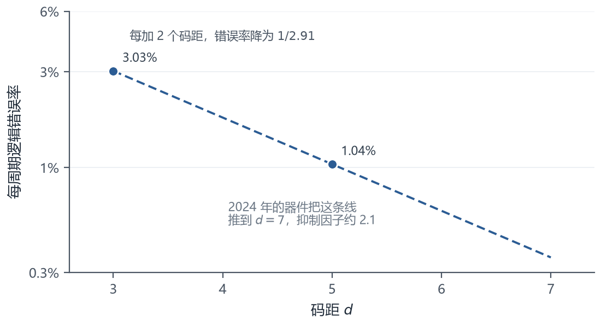
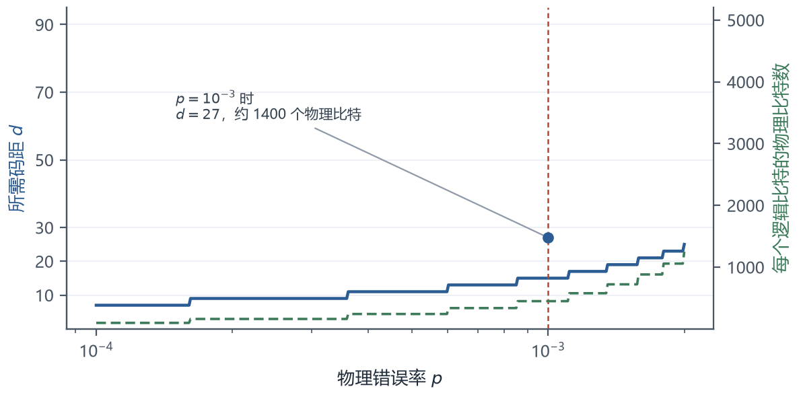

# 第 10 章　实验现状与开销

从 1997 年 Kitaev 写下表面码的模型，到 2023 年第一次在实验里看见“码距变大，逻辑错误率变小”，中间隔了二十六年。这二十六年里，理论文章把阈值算得越来越准，实验文章把物理比特做得越来越好，两条线一直没有交点。

交点出现在 2023 年。这一章讲最近几年发生了什么，代价有多大，离真正有用还差多远。

## 10.1 越过阈值

2023 年，谷歌在 Nature 上发表了一组数据。他们在同一块 Sycamore 芯片上做了两个表面码，码距 3 用 17 个物理比特，码距 5 用 49 个。

关键结果是一个比值。码距从 3 加到 5，每周期逻辑错误率从 $3.03\%$ 降到 $1.04\%$，抑制因子

$$
\Lambda=\frac{3.03}{1.04}\approx 2.9
$$

大于 1 意味着在阈值以下。之前所有的纠错演示都停在“逻辑比特存在”这一步，码距加大错误率反而升高，因为更多的比特带来了更多的噪声源。这一次曲线终于往下走了。

两块方格做在同一块芯片上，物理比特的质量一致，比较才有意义。实验跑了几十万个测量周期，统计量足够把百分之一和百分之三的差别定死。当时的物理错误率在千分之三上下，离阈值不到一个数量级，能越过去已经不容易。

图 10-1　谷歌 2023 年公布的两个数据点，以及按抑制因子 2.91 外推的曲线。2024 年的器件把这条线推到了码距 7

$2.9$ 这个数字离理论预期还有距离。理想的表面码在千分之一的物理错误率下，抑制因子可以到 5 以上。差的部分主要来自读出，读出错误率在百分之一量级，比双比特门差一个数量级，而表面码每一轮都要读出所有测量比特。

## 10.2 Willow

2024 年底，谷歌发布了 Willow 芯片，105 个物理比特，做出了码距 7 的表面码。

结果要分两层看。尺度上，码距从 5 到 7，逻辑错误率降了一半左右，抑制因子约 $2.1$。这个数比 2023 年的 2.9 小，说明更大的方格并没有带来更好的抑制，读出和泄漏带来的关联错误在大方格上更明显。

真正要紧的是另一件事。$d=7$ 的方格要 97 个物理比特，105 个比特的芯片刚够跑一个逻辑比特，没有余量做算法，可它证明了这条路能往上走。Willow 的改进是全链条的，相干时间、门保真度、读出分辨都提高了一个档次，单靠某一项不够。Willow 的逻辑比特寿命超过了组成它的任何一个物理比特。这句话的意思是，把信息编进码里，比放在单个比特上活得更久。以前做不到这一点，编码带来的额外噪声总是盖过纠错带来的好处。做到这一点，才算真正“赚了”。

所谓逻辑比特寿命，说的是把逻辑态制备出来、放着不管，看它多久退相干。这件事听起来简单，做起来要在几十个比特上同时保持低错误率。

同一年还有一件工程上的事。Willow 的解码器被搬到稀释制冷机的边上，端到端延迟降到了公开报道的六十微秒量级。这个速度还追不上一个测量周期，但比把数据传回室温机房再传回来快了两个数量级。

## 10.3 离子阱的路线

超导不是唯一的路。Quantinuum 用离子阱做了一组更早、更精细的实验。

2022 年，他们用 13 个离子编码一个 Steane 码的逻辑比特，逻辑门做完以后测出的错误率比任何单个物理门都低。这个演示的意义在于“容错”两个字，门操作过程中出现的错误被码纠正了，逻辑层面的保真度反而高于物理层面。

离子阱的优势是全连通。任意两个离子都能通过 collective 运动模式耦合，不需要把比特排成方格，也就不需要表面码那种近邻约束。他们的码用的是 $[\![7,1,3]\!]$ 这样的短码，而不是大面积的表面码。

代价是速度。离子阱的光学系统也麻烦，每个离子要单独对准一束激光，比特数一多，光路就成了瓶颈。离子阱的双比特门在毫秒量级，比超导慢三到四个数量级。同样跑一天，超导能做十亿个测量周期，离子阱只能做几百万个。容错需要的是错误率乘以时间，两边各有各的难处。

## 10.4 开销有多大

把图 10-1 的曲线往下延，就能算出代价。

要跑一个有商业意义的算法，逻辑错误率得压到 $10^{-12}$ 以下，因为算法要执行上亿次门操作，任何一次失败都会毁掉结果。按 $p_L\propto(p/p_{th})^{(d+1)/2}$ 估算，物理错误率千分之一、阈值千分之六时，需要的码距是 27。

图 10-2　把逻辑错误率压到 $10^{-12}$ 所需的码距与物理比特数，按 $p_L=0.1(p/p_{th})^{(d+1)/2}$、阈值 $0.6\%$ 估算

另一个维度是时间。逻辑门慢十倍，同样一个算法就要多花十倍的相干时间，而相干时间本身是有限的。

码距 27 的方格要 1457 个物理比特，管一个逻辑比特。这还只是存储，魔法态工厂、格点手术的辅助区域、布线空隙加起来，通常要再翻一倍。分解 2048 位 RSA 需要几千个逻辑比特，简单相乘就是几百万。这个量级和二十年前的估计一致，中间所有的硬件进步，主要被用来抵消算法规模的膨胀。

物理错误率每降一个数量级，需要的码距会明显变小。图 10-2 里 $p$ 从 $10^{-3}$ 降到 $10^{-4}$，码距从 27 掉到 13，比特数从一千四掉到三百多。这就是为什么硬件团队还在死磕材料、屏蔽和工艺，每一次错误率的改善都会被纠错的开销放大好几倍。这些数字都是估算，换一套噪声模型差一个因子很正常，它们的作用不是给准确答案，而是说明量级。

## 10.5 差在哪里

剩下的差距不在原理，在细节。

读出是最短的一块板。改进它比改进门更难，因为读出时间不能拉长，拉长就会和比特的退相干抢时间。超导比特的读出靠谐振腔的色散，信号要在几百纳秒里分辨出 $|0\rangle$ 和 $|1\rangle$，错误率很难压到千分之一以下。表面码每一轮都要读一遍所有测量比特，读出错误直接变成测量错误，在时空图里制造假的缺陷对。

泄漏是第二块。超导比特是高激发态的谐振子，门操作偶尔会把比特打到 $|2\rangle$。泄漏的错误率不高，但它不在计算子空间里，稳定子测量对它无效，还会通过耦合扩散到邻近比特。

第三块是关联错误。宇宙射线穿过芯片会在短时间内让一片比特同时失超，这种事件在单个比特的测试里看不到，在大方格上却成了主要的天花板。Willow 的抑制因子掉到 2.1，一部分原因就在这里。

还有布线。一台百万比特的机器，每个比特要几根控制线，冷端接头数量会到几万，热负载和空间都撑不住。解决办法是把多路复用和部分控制电路搬进低温区，或者把大芯片拆成若干模块用光子互联接起来。

这些问题都在被一点一点解决。2023 年到 2024 年，逻辑比特从“能活”走到了“活得比物理比特久”，下一步是“活得足够久”，再下一步才是“多到能用”。容错量子计算的门槛已经被跨过，剩下的是一段很长的工程路。
