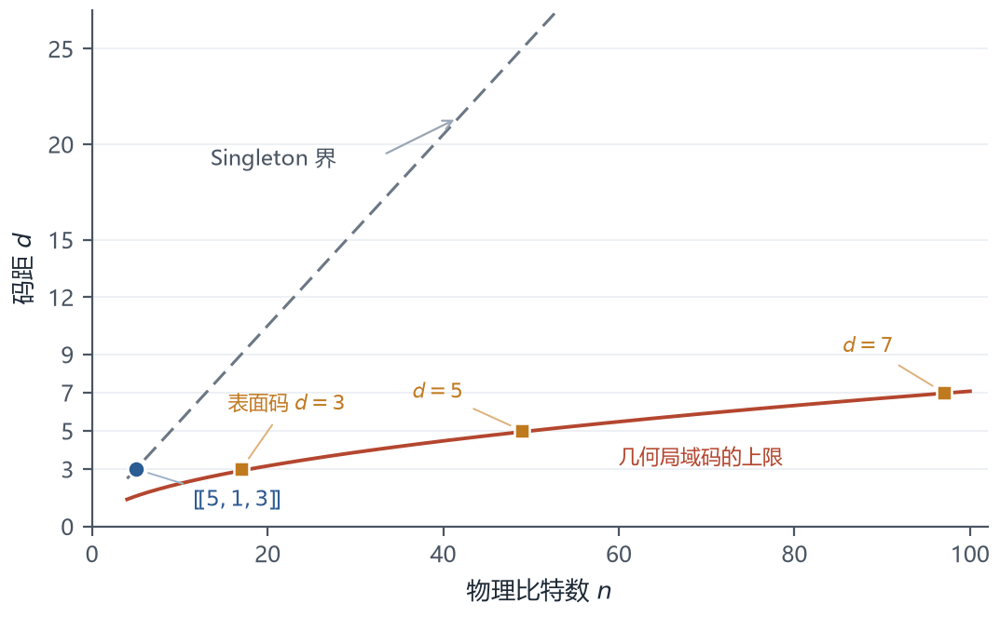
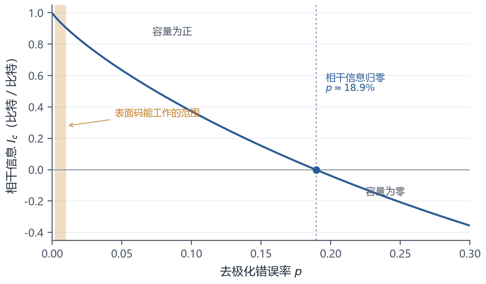

# 第 11 章　纠错码的边界

前十章摆出了很多码。表面码、色彩码、环面码、玻色码，还有后面要讲的 LDPC。每一个都有具体的线路、具体的版图、具体的解码器。做设计的人把它们摆在一起看，迟早会冒出一个更早的问题，这些参数到底能推到多远。

一个码用三个数就能概括。$n$ 是物理比特数，$k$ 是逻辑比特数，$d$ 是码距。能纠正的错误个数是 $t=\lfloor (d-1)/2\rfloor$。工程师想要的点在一个角落里，$n$ 尽量小，$k$ 尽量大，$d$ 尽量大。三个愿望互相拉扯，拉扯的强度不是玄学，可以用不等式写下来。这一章讲的就是这些不等式，它们划出一条线，线外面不存在任何码，再聪明的人也想不出来。

## 11.1 球不能重叠

最古老的计数来自经典编码。$n$ 个比特的整个空间有 $2^n$ 个字符串。一个码挑出其中 $2^k$ 个作为码字，每个码字周围半径 $t$ 的球里装着所有与它相差不超过 $t$ 个比特的串。这些球必须互不重叠，否则一个收到的串会落在两个球里，收端无法判断该往哪儿修。球的体积是 $\sum_{j=0}^{t}\binom{n}{j}$，于是

$$
2^k\sum_{j=0}^{t}\binom{n}{j}\le 2^n
$$

量子版本长得差不多，只有一处改动。错误不再只有一种，一个比特上可以落 $X$、$Y$、$Z$ 三种，重量 $j$ 的错误算符因此有 $3^j\binom{n}{j}$ 个。要让这些错误给出互不相同的综合征，需要

$$
\sum_{j=0}^{t}3^j\binom{n}{j}\le 2^{n-k}
$$

右边是综合征的总数。$n-k$ 个独立稳定子，每个给出一个正负号，一共 $2^{n-k}$ 种组合。

把 $[\![5,1,3]\!]$ 代进去，左边是 $1+3\times5=16$，右边是 $2^{4}=16$，等号成立。这种码叫完美码，它把综合征空间用得一个不剩。经典里完美码有一族，Hamming 码都是。量子里的完美码少得可怜，$[\![5,1,3]\!]$ 是最出名的一个，参数被卡得很死，往上再找一个都难。

再看 $[\![7,1,3]\!]$，左边是 $1+21=22$，右边是 $64$。差了将近三倍。这三十年的余量说明 Hamming 界在这里不紧，七个比特装一个逻辑比特还带三个码距，其实用不着这么多综合征。余量不是浪费，它换来了别的东西，更低的稳定子权重、更容易做的容错测量线路，以及更大的设计自由度。

## 11.2 擦除给出的界

第二条界从擦除出发。假设不是翻转，而是整个比特丢了，连它原来是什么都不知道。纠错码对擦除的能力总是比对翻转强，因为擦除告诉你错误在哪里，只需要补上值。

设码距是 $d$，擦掉 $d-1$ 个比特，剩下的 $n-d+1$ 个比特里必须还留着足够的信息，把原来的逻辑态认出来。量子情形下这个要求可以说得更精确。取 $k$ 个逻辑比特的一个最大纠缠态，把它和参考系统纠缠起来，再把 $n$ 个比特中的 $d-1$ 个扔掉。剩下的部分必须仍然与参考系统保持完整的纠缠，否则逻辑信息就丢了。保得住这份纠缠，需要剩下的比特数不少于 $k+d-1$，整理一下就是

$$
n-k\ge 2(d-1)
$$

这叫量子 Singleton 界。它比 Hamming 界更"看得懂"，也更常用，因为它直接告诉你编码率的上限，

$$
\frac{k}{n}\le 1-\frac{2(d-1)}{n}
$$

码距占的比例越大，能装的逻辑比特越少，还带一个 $2$ 的系数，因为量子码要同时防比特翻转和相位翻转，等于付两份保险费。

代几个数进去。$d=3$ 要求 $n-k\ge4$，$k=1$ 时 $n\ge5$，正好被 $[\![5,1,3]\!]$ 顶住。$d=5$ 要求 $n\ge9$，可到目前为止没人造出 $[\![9,1,5]\!]$，已知最好的是十一个比特的 $[\![11,1,5]\!]$。界说九，实现要十一，中间这两个比特就是"界不紧"的具体形状。

这两条界有个共同点，它们对码的内部结构一无所知。比特之间怎么连、稳定子有几个、怎么测，全都不管。它们只数错，数完给一个上限。正因为假设这么少，结论才这么硬，任何码都逃不掉。也正因为假设这么少，它们离工程很远。真实的芯片上，比特只能跟邻居说话。

## 11.3 退化，量子码的额外空间

Hamming 界数的是错误算符，一个比特上三种，两个比特上九种，老老实实往上加。量子码有一条经典码没有的捷径，叫退化。

拿 Shor 码看。它的逻辑零态是

$$
|0\rangle_L=\frac{1}{\sqrt{8}}\left(|000\rangle+|111\rangle\right)^{\otimes3}
$$

三个块，每块三个比特，块内是全零和全一的叠加。现在让一个 $Z$ 错误落在第一个块里。$Z$ 作用在 $|0\rangle$ 上给 $+1$，作用在 $|1\rangle$ 上给 $-1$，所以

$$
Z_1|0\rangle_L=\frac{1}{\sqrt{8}}\left(|000\rangle-|111\rangle\right)\otimes(\cdots)
$$

这个结果和 $Z_2$ 作用、$Z_3$ 作用完全一样。三比特 GHZ 态里，任何一个比特翻相位，翻的都是整个块，效果分不出来。三个不同的错误算符，落在码空间上是同一个变换，就是逻辑 $\bar Z$。

纠错不需要知道是块里哪一个比特出了错。它只需要知道哪个块出了错，然后把整个块的相位翻回来。九比特码里重量一的 $Z$ 错误有九个，退化把它们压成三类，一块一类。

数一下总量。重量一的错误算符二十七个，$X$ 型九个、$Y$ 型九个、$Z$ 型九个，退化以后需要区分的只有 $9+9+3=21$ 类，加上无错一共二十二。而八个稳定子给了 $256$ 个综合征，富余得不像话。

这个富余是 Hamming 界松掉的根源。界数的是算子，实际要分辨的是算子模掉稳定子以后的等价类，类数比算子数少得多。等价类的说法值得停一下。两个错误 $E$ 和 $E'$ 若满足 $E'=Eg$，$g$ 是某个稳定子，它们给出的综合征完全相同，落在码空间上的效果也完全相同，因为 $g$ 在码空间上就是恒等。所以从纠错的角度，它们根本是同一件事。

退化的代价在解码器上。同一个综合征对应好几个错误算子，解码器挑一个去修，如果挑错了，只要挑的还在同一类里就没事，挑到别的类里就会引入逻辑错误。码距以内的保证是"同一综合征的所有可能错误逻辑效果相同"，这条保证依赖错误足够轻，超出纠错能力就不成立了。所以解码器宁可保守，也不能随便挑。

## 11.4 局域性要价

前面两条界允许任意两个比特直接耦合。芯片做不到。超导比特只能跟近邻耦合，离子阱虽然全连通，门慢得让人心疼，一秒钟做不了几个。这个限制不是工艺粗糙，是物理，任何想扩到百万比特的方案都得顺着它设计。

2010 年，Bravyi、Poulin 和 Terhal 给这条限制写了一个不等式。对于铺在二维平面上、只允许近邻耦合的码，逻辑比特数与码距的平方之积不能超过物理比特数的常数倍，

$$
kd^{2}\le c\,n
$$

常数 $c$ 依赖版图和边界的具体安排，量级在 1 附近。表面码 $k=1$，$n\approx 2d^{2}$，正好把这个不等式顶满。也就是说，在所有二维局域码里，表面码的比特效率已经到顶了，差只差那个常数。

这条界解释了第 3 章末尾那个让人不舒服的数字。$d=7$ 要用九十七个比特，看着浪费。可要是只守 Singleton 界，十三个比特就够了。中间的八十四个比特，全是付给"只能近邻耦合"这笔账。

图 11-1　码距与物理比特数的关系，取 $k=1$。虚线是 Singleton 界 $d\le(n+1)/2$，红线是二维局域码的上限 $d\le\sqrt{n/2}$，方块是表面码的三个码距。表面码紧贴红线，说明它在局域码里已接近最优

图上三层结构很清楚。最上面那条虚线是任意码的极限，码距可以随比特数线性长。中间那条红线是局域码的极限，码距只能随比特数的平方根长。最下面是表面码实际所在的点，几乎压在红线上。三层之间的落差，一层来自几何，一层来自版图的常数。

平方根这个指数很伤人。要把码距翻一倍，比特数得翻四倍。第 10 章算过，把逻辑错误率从百分之一压到十亿分之一，码距要从 3 走到 27，比特数从 17 涨到 1457，涨了八十六倍。这八十六倍里，绝大部分是平方根律收的税。

想绕开这笔税，只有一条路，放弃二维局域。让比特之间有一些长程连接，哪怕数量不多，$kd^{2}\le cn$ 的前提就没了。第 13 章讲的量子 LDPC 码走的就是这条路，代价是布线、串扰和解码器复杂度。天下没有白拿的码距。

## 11.5 相干信息与量子容量

前面几条界都是组合的，回答"一个码能纠几个错"。还有一条更细的量，回答"一个噪声信道一次能送多少量子比特"。这个量叫量子容量，它的定义要用到相干信息。

取一个信道 $\mathcal N$，输入端一半的纠缠态 $|\psi\rangle_{RA}$，$A$ 送进信道，$R$ 留在手里。信道输出记作 $B$。相干信息定义为

$$
I_c=S(\rho_R)-S(\rho_{RB})
$$

$S$ 是冯诺依曼熵。第一项是参考系统还牵着多少纠缠，第二项是输出和参考合起来有多混。两者相减，剩下的就是"穿过信道之后还活着的量子关联"。若信道把一切都搅乱，输出与参考的联合态变成完全混合，两项相等，相干信息为零。

去极化信道可以算出解析式。它以概率 $p$ 施加 $X$、$Y$、$Z$ 中的一个，三个等可能，以 $1-p$ 什么也不做。代入定义得到

$$
I_c(p)=1-h_2(p)-p\log_2 3
$$

其中 $h_2(p)=-p\log_2 p-(1-p)\log_2(1-p)$ 是二元熵。$p=0$ 时 $I_c=1$，一个完美的量子比特。$p$ 增大，两项惩罚同时上来，曲线在 $p\approx0.189$ 处穿过零。

图 11-2　去极化信道的相干信息随错误率的变化，按 $I_c=1-h_2(p)-p\log_2 3$ 计算。曲线在 $p\approx18.9\%$ 处过零，这个值就是哈希界。橙色窄带是表面码目前能工作的错误率范围

这个 $18.9\%$ 在文献里叫哈希界。它的意思是，只要错误率低于这个值，就存在某种编码方式，让量子信息以正的速率通过。注意"存在"两个字，它不保证码是局域的，不保证解码器能在多项式时间里跑完，更不保证能在一微秒的测量周期里跑完。

把哈希界和表面码的阈值放在一张图上，落差有点刺眼。信息论说 18.9% 还有救，工程上 1% 就已经是硬顶。中间这十九倍的差距，一部分来自局域性，一部分来自解码，一部分来自"必须实时"。理论给的是一个遥远的天花板，工程关心的是脚下这块地板。

量子容量 $Q$ 的定义还要再走一步。单次使用的相干信息不足以刻画容量，因为编码可以跨多次使用分摊纠缠。严格的定义要在 $n$ 次使用上取最大再除以 $n$，然后让 $n$ 趋于无穷，

$$
Q(\mathcal N)=\lim_{n\to\infty}\frac{1}{n}\max_{\rho}I_c\left(\rho,\mathcal N^{\otimes n}\right)
$$

这个极限一般算不出来。只有一类信道能一步到位，叫可退化信道，它的环境可以从输出再经过一个信道得到，噪声"层层往下漏"，不会回流。对这种信道，正则化不改变数值，单字母公式就给答案。去极化信道不属于这一类，所以它的容量至今没有闭合表达式，只有上下界。

## 11.6 容量不可加

量子容量的历史里有一个让所有人意外的结果。

经典信道的容量是可加的。两个信道并排用，容量相加，因为可以各自编码再拼起来。长期以来人们默认量子容量也是这样。1998 年，DiVincenzo、Shor 和 Smolin 构造了两个信道，各自单独用时量子容量都是零，可合在一起用，容量大于零。

原因在于编码可以跨越两个信道的张量积。单看每一个，噪声把信息全毁了。合起来看，两个信道产生的噪声之间存在关联，编码可以利用这种关联把信息"藏"进联合空间的一个角落里，任何一边单独看都是噪声，两边一起看就露出结构。这种现象叫超激活。

这条结果把"容量的算法"彻底改了。不能算一个信道的容量再乘以信道数，因为上界本身就不是可加的。工程上的含义更朴素，资源不能简单地按信道数摊派，架构层面的资源分配得看整体。

## 11.7 界落到设计上

把这一章的东西收在一处，看它们怎么约束设计。

想要码距 $d=27$，Singleton 界说至少五十三个比特。这条线是所有码共享的地板。

想要局域，BPT 界说比特数按 $d^{2}$ 长，$d=27$ 要七百多个。地板抬高了十四倍。

想要每一轮都能测出所有稳定子，还要有边界、有逻辑算符、有手术的空间，表面码的实际数字是一千四百五十七。再翻一倍多。

这条链上的每一环都在说同一件事。想省比特，就必须放弃某一条前提。放弃局域，得到 LDPC，代价是长程布线和难解的非局域综合征。放弃"比特"这个载体，把信息编进谐振子的无穷维空间，得到玻色码，代价是操控精度。放弃"每轮都测所有稳定子"，用更聪明的测量调度和解码，代价是延迟和复杂度。

第 12 章从这条链的末端一环接着往下走。手术怎么排时序，产线怎么排产，那些数字不再是界，而是墙上的一张时刻表。
