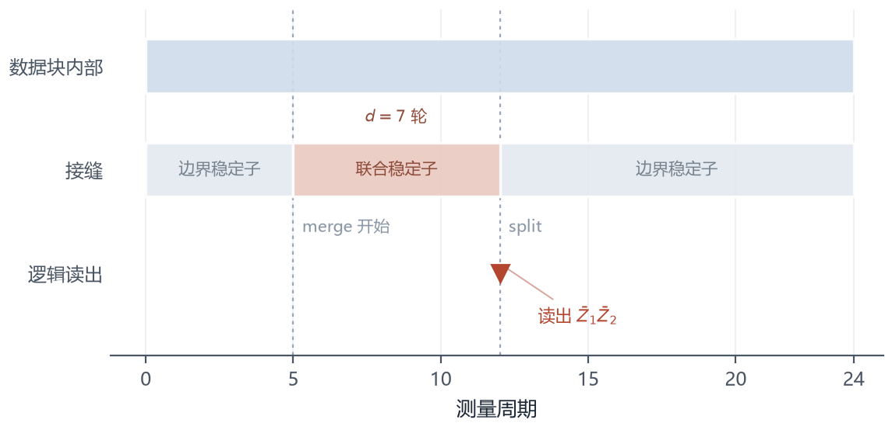
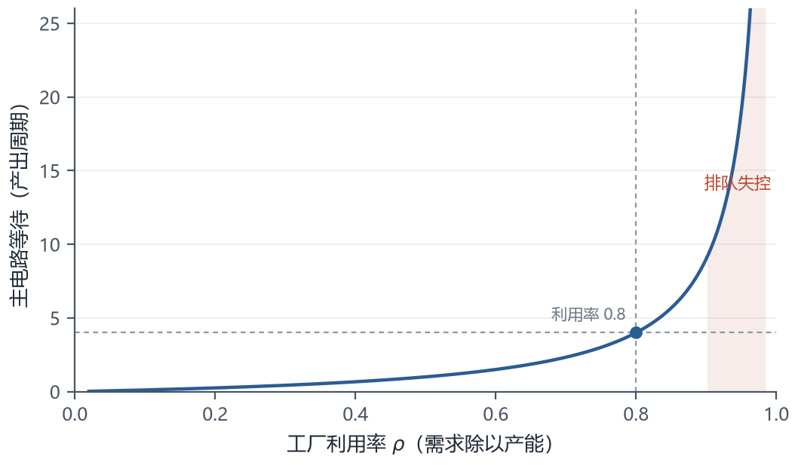

# 第 12 章　手术台前的时刻表

第 4 章把格点手术讲成了一个动作，两块方格贴在一起，稳定子换一批，逻辑 CNOT 就做完了。真到排时序的时候，这个动作要拆成十几个步骤，每一步占几个测量周期，每一步都可能出错，每一步的错误都要能在后面被抓住。手术不是一个瞬间，是一段有头有尾的时间。

这一章把镜头推近。看一条接缝怎么打开又怎么合上，看一次逻辑测量比一次逻辑门便宜在哪里，看一个魔法态从注入到可用要经过几道手续，再看这些零件怎么排成一张产线表。

## 12.1 接缝是一条有价的边

一个逻辑比特占一块方格。方格的四周不是同一种边，在旋转表面码里，四条边交替属于 $X$ 型和 $Z$ 型。这个交替不是为了好看，它是逻辑算符定义的前提，少了它，横穿方格的算符找不到可以停下的地方。

两块方格要合并，接触的那条边必须配对。$Z$ 型边对 $Z$ 型边，合并以后才能测联合的 $Z_1Z_2$。$X$ 型边对 $X$ 型边，才能测 $X_1X_2$。配错了，接缝上的稳定子会与要测的算符反对易，测量结果没有意义。

配对成功以后，接缝这一列上的稳定子要做一次交接。原本属于左边那块的两个半稳定子，属于右边那块的两个半稳定子，全部关掉，换成横跨接缝的四体稳定子。这一列叫手术区，宽度只有一个稳定子，长度等于码距。它的面积是 $d$，不是 $d^{2}$，这点常被记错。

## 12.2 merge 的五个时刻

把一次 merge 摊在时间轴上，能看到五个时刻。

第一个时刻是关闭。接缝两侧的边界稳定子停止测量。这一步必须走在打开联合稳定子之前，两类稳定子不能同时存在，它们反对易。

第二个时刻是打开。横跨接缝的四体稳定子开始逐拍测量。从这一刻起，两块方格在逻辑上是一块，它们的逻辑算符合成了一个。

第三段是等待，也是整个手术里最长的一段。联合稳定子要连续测 $d$ 轮。理由不在空间在时间。解码器看的是时空图，时间方向上的错误链如果长到 $d$，就能把两个相距很远的缺陷连起来，骗过匹配算法。测 $d$ 轮，等于在时间方向上也铺开了一个码距的厚度。

第四段是读出。如果需要知道合并后的逻辑值，就在这时候读。读法是把整块的奇偶性算出来，也就是测 $\bar Z_1\bar Z_2$。这个测量本身不需要额外的周期，它用的就是这 $d$ 轮的数据。

第五个时刻是分离。联合稳定子关掉，边界稳定子重新打开，再测 $d$ 轮，两块各自恢复成一个独立的逻辑比特。

图 12-1　一次 merge 与 split 的时序。接缝上的边界稳定子在合并期间关闭，由横跨接缝的联合稳定子接管，连续测 $d$ 轮后读出逻辑算符，再恢复边界稳定子

图上那一段红色是最贵的部分。$d=7$ 时它占七个周期，加上前后的准备和恢复，一次完整的合并分离要二十个周期上下。一个测量周期一微秒，一次逻辑 CNOT 就是二十微秒。物理 CNOT 是几十纳秒，两者差三个数量级。这道鸿沟就是容错的价格。

## 12.3 接缝上的钩子

合并期间有一个特殊的错误源，值得单独说。

两块方格并成一块以后，一个落在接缝附近的数据错误，会同时影响两块的逻辑值。它不像普通错误那样只在一个 patch 里留下两个缺陷，它可能在合并的空间里留下一个缺陷，而这个缺陷的修补方式有两种，选错一种，两块的逻辑值同时翻。

这种错误叫钩子错误。它不是某个具体门坏了，而是"合并"这个操作本身打开的一条新通道。钩子错误的概率与接缝的长度成正比，接缝越长，落进去的错误越多。手术区的长度等于码距，所以钩子错误率本身也随 $d$ 增长，只是每个位置的概率不变。

$d$ 轮的重复测量对付不了钩子错误。它对付的是测量错误和数据的随机翻转。钩子错误要靠解码器在时空图里把它当成一个普通缺陷处理，靠码距把它压到 $p^{(d+1)/2}$ 的量级。这也是为什么合并期间的解码必须把整块时空间一起解，不能一块一块解。

## 12.4 逻辑测量比逻辑门便宜

同样是用手术，测一个逻辑算符和做一个逻辑门，成本差一倍。

测 $\bar Z_1\bar Z_2$ 只需要 merge，不需要 split。合并以后读一次，读到的结果就是两个逻辑比特的联合奇偶性，然后整块可以扔掉。花掉的是 $d$ 个周期加上一点准备时间。

做 CNOT 不行。CNOT 要保住两个比特的信息，中间那个辅助块用完要能干净地退出，所以必须有 split。一次 CNOT 至少包含一次 $M_{ZZ}$、一次 $M_{XX}$、一次辅助块的测量，加上收尾的泡利修正，账算下来是 $2d$ 到 $3d$ 个周期。

$M_{XX}$ 还多一层麻烦。合并要 $X$ 边对 $X$ 边，而一个 patch 的四条边交替排列，想找到一对合适的 $X$ 边，往往要把其中一个 patch 转个方向。转向在版图上意味着移动，移动意味着又要 $d$ 个周期。所以实际编译出来的线路里，$M_{XX}$ 比 $M_{ZZ}$ 贵，编译器会尽量把需要 $M_{XX}$ 的操作聚在一起，减少来回挪动。

这条不对称在后面的编译一章会反复出现。同一个逻辑门，放在版图的不同位置，成本能差一倍。手术没有"门"这个概念，只有"哪块区域在什么时间做什么"，成本由几何决定。

## 12.5 把一个 T 态送进方格

魔术态是另一条产线。第 4 章算过蒸馏的账，这里看态是怎么进到方格里的。

最直接的做法叫注入。把一个物理比特制备成 $|T\rangle$，让它和一个小方格（$d=3$）的角落耦合，通过几次 CNOT 把它的状态"写"进这个方格的编码里。这一步只有几个门，快，但错误率是物理级的，千分之一上下。

接下来是扩格。小方格往外推一圈，新加入的比特制备成合适的态，稳定子重新定义，整个 patch 从 $d=3$ 长到 $d=5$，再长到 $d=7$。扩格的过程要 $d$ 轮，期间逻辑信息一直在码里，错误一直在被纠正。

扩格能不能把千分之一的注入错误压低，答案是能，但压得有限。理想情况下，一个错误落在更大的码里，就变成重量一的错误，被压到 $p^{(d+1)/2}$。可注入的错误不是随机的。它来自一个特定角度的旋转偏差，是相干的，相干错误会在码距里"共振"，几个比特上的小偏差叠成一个逻辑错误。要让它变成随机错误，得先做随机化，把相干性打散。

另一条路叫培养。不去直接制备 $|T\rangle$，而是制备一个小码的一个逻辑态，然后用稳定子反复检验它。检验通过就接受，不通过就扔掉重来。听起来浪费，实际上很划算，因为检验用的是码自己的结构，一次检验能同时排除掉一大类错误。培养几轮以后，剩下的态的错误率比物理注入低一到两个数量级，而每次成功消耗的物理资源只有几个态。

2024 年到 2025 年，几家实验室在超导芯片上演示了这条路。培养的关键指标不是错误率，是"每次成功要花多少个物理态"，这个数直接决定工厂的产能。

## 12.6 工厂的排产

工厂不是一个抽象概念，它占面积，占时间，占控制线路。

一个蒸馏单元由若干个逻辑比特组成。十五比一的协议要十五个输入态和一个输出态，输入态的制备、CNOT 链、测量，全部要在逻辑层完成，所以一个单元本身就占十几块方格。两级蒸馏，面积再乘十五。

产出率是另一个维度。一个单元从投料到出货要经过若干轮操作，每轮 $d$ 个周期，加起来几百个周期。这段时间里它不产出任何东西。

主电路的需求是另一条曲线。一个算法有几千个 T 门，摊在几百万个周期里，平均需求不高，可它是阵发的，某一段可能几十个 T 门挤在一起。工厂按平均需求设计，遇上阵发就会排队。

排队这件事有个不好看的性质。设工厂产能是 $\mu$，需求是 $\lambda$，利用率 $\rho=\lambda/\mu$。稳态下平均等待时间正比于 $\rho/(1-\rho)$。$\rho=0.5$ 时等待等于一个产出周期，$\rho=0.8$ 时等于四个，$\rho=0.9$ 时等于九个，再往上就发散。

图 12-2　按 M/M/1 排队模型估算的主电路等待时间。横轴是工厂利用率，纵轴是以产出周期为单位的平均等待。利用率超过 0.9 以后，等待时间迅速失控

所以工厂不能按满载设计。工程上常把利用率留在 0.7 以下，多出来的产能就是保险。这笔保险很贵，一个工厂的面积往往比计算区还大，可它买的是"主电路不用等"。

等待为什么这么要命。量子比特有相干时间，一台机器的总运行时间受限于最慢的那条链。主电路在等 T 态的时候，其他逻辑比特要么在存储（每周期都在积累错误），要么在空转。等待不会让错误消失，只会让错误累积。所以一个 T 态晚到一百个周期，等于整台机器多跑了一百个周期的噪声。

## 12.7 饥饿与堵死

产线的两端都可能出问题。

主电路 T 门密集，工厂供不上，主电路停在那儿等，这叫饥饿。饥饿的代价是时间，时间换算成错误率，到头来变成"这个算法跑不完"。

主电路 T 门稀疏，工厂产出的态堆在缓冲区里，这叫堵死。堵死看起来无害，其实也花钱，因为缓冲区里的每个 T 态都在退相干，存久了就坏了，只能扔掉。扔掉等于白干。

两端之间要有一个缓冲区，容量几个到几十个态。缓冲区的存在让工厂和主电路解耦，各自按自己的节奏跑。可缓冲区本身占地，也占错误预算，设计时要在"等"和"扔"之间找一个平衡点。

调度上的一个常用手段是把 T 门在时间上摊平。编译器看到一段密集的 T 门，如果这些门作用在不同的逻辑比特上、彼此没有依赖，就可以把它们的时间顺序打散，插到后面的空闲段里去。代价是这些逻辑比特要多活一段时间，也多积累一点错误。这是一笔明确的交易，编译器要用错误模型来算这笔账。

第 14 章会把这件事讲成一个编译问题。在这里只需记住一个量级，T 态的生产周期是几百个测量周期，逻辑 CNOT 是二十个，物理门是零点零几微秒。三个尺度差了四五个数量级，工程设计的所有别扭，都来自这个跨度。
