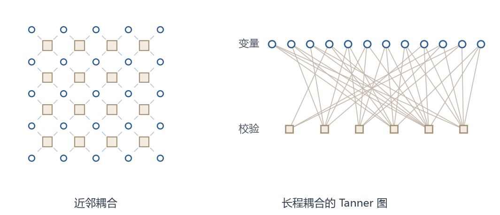
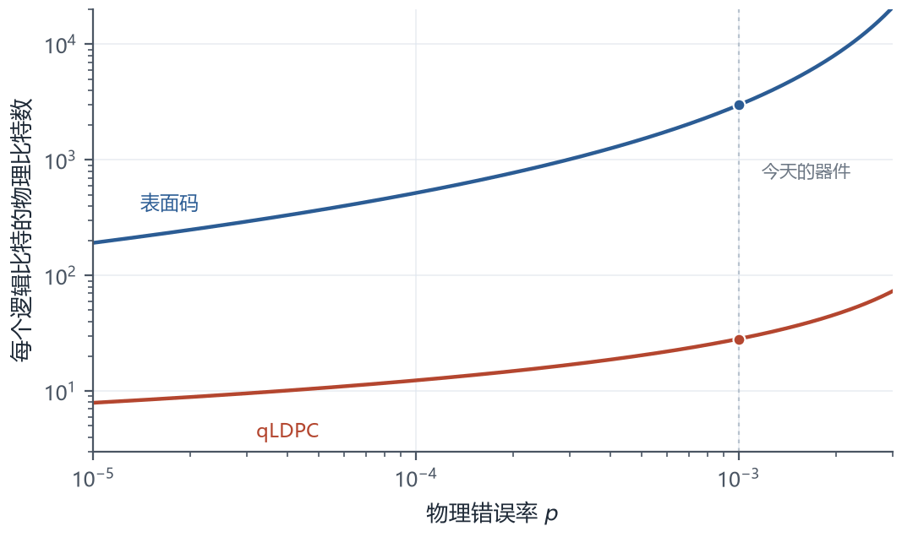

# 第 13 章　量子 LDPC 码

第 11 章末尾留了一条缝。二维局域码的码距只能随比特数的平方根长，这条限制把表面码的开销顶到了天花板。想要一千个逻辑比特，就得准备好上百万个物理比特。这个数字让很多人不舒服，因为它意味着容错量子计算的第一台机器，体积会大到难以想象。

有没有可能绕过去。有，代价是放弃"只能跟邻居说话"。这一章讲的就是这条路，以及它在工程上撞到的墙。

## 13.1 表面码的账算不过来

先把账摆清楚。表面码的编码率随码距趋零，$k=1$，$n\approx2d^{2}$，所以每逻辑比特的物理代价是 $2d^{2}$。$d=27$ 是一千五百个，加上手术区、工厂、布线，翻一倍。

一台能跑有商业价值算法的机器要几千个逻辑比特。按这个比例，物理比特数在千万量级。这个量级不是"再努力一点"能到的，它要求芯片面积、控制线路、低温制冷功率同时提高三个数量级，任何一个环节跟不上都不行。

理想中的码应该有三个性质。编码率是常数，$k/n$ 不随 $n$ 变小。距离与 $n$ 成正比，$d=\Theta(n)$。校验算符的权重有上界，每个稳定子只碰常数个比特。第三条是为了测量，权重一百的稳定子没法在一个周期里测完。

同时满足这三条的码，叫渐进好码。经典编码里这样的码多得是，LDPC 就是一大类。量子这边，找了二十多年。

## 13.2 稀疏校验与 Tanner 图

经典 LDPC 码的做法很朴素。取一个稀疏的校验矩阵，每行只有少数几个 1，每列也只有少数几个 1。稀疏带来两个好处。解码可以做成线性的消息传递，每个校验节点只跟几个变量节点说话。错误的传播被限制在局部，一个坏比特不会立刻污染全体。

把矩阵画成图更直观。变量节点排一排代表比特，校验节点排一排代表校验方程，某个比特参与某个校验就在两点之间连一条边。这张二分图叫 Tanner 图。码的性质几乎都写在图里，度数分布决定阈值，环的长度决定解码器会不会打转。

量子码也有 Tanner 图。变量节点是物理比特，校验节点是稳定子，边表示某个比特参与某个稳定子的测量。表面码的图是二维网格，每个变量节点度数是 3 或 4，边长只有一格。这张图的局部性好得过分，也正是它编码率上不去的原因。

图的环长也是要紧的量。环越短，信念传播的消息越容易在原地打转，解码器收敛不了。经典码在设计时会刻意把环拉长。量子码做不到这么自由，对易条件逼着每一对 $X$ 校验和 $Z$ 校验在偶数个比特上重合，两两重合就凑出一个四环，想避也避不开。这层约束后面还会再提。

## 13.3 量子版的图不好画

把经典 LDPC 的构造直接搬到量子，第一步就失败。

量子码有两组校验，$X$ 型和 $Z$ 型，每一对都必须对易。对易的条件写在比特上，两个稳定子共享的比特数必须是偶数。用矩阵写就是

$$
H_X H_Z^{T}=0 \pmod 2
$$

随机生成的稀疏矩阵几乎必然违反这一条。两个稀疏的行，各自有几个 1，它们的位置随机撒开，重叠的个数是奇数的概率接近一半。改一个位置去修，另一处又坏了，修来修去没有尽头。

从图上看，这个条件说的是 $X$ 校验和 $Z$ 校验不能在奇数个变量节点上撞车。经典 LDPC 里最有效的构造，随机正则图，恰好最喜欢撞车。这是一个结构性障碍，不是技巧问题。

## 13.4 用两个经典码搭一座桥

1998 年，Tillich 和 Zémor 给了一个系统性的解法，叫超图乘积。

拿两个经典码，一个的校验矩阵是 $H_1$，尺寸 $m_1\times n_1$，另一个是 $H_2$，$m_2\times n_2$。把它们按分块的方式拼起来，

$$
H_X=\begin{pmatrix}H_1\otimes I_{n_2} & I_{m_1}\otimes H_2\end{pmatrix},
\qquad
H_Z=\begin{pmatrix}I_{n_1}\otimes H_2^{T} & H_1^{T}\otimes I_{m_2}\end{pmatrix}
$$

这个构造的妙处在于对易条件是自动满足的，两条分块矩阵乘起来，交叉项互相抵消，剩下 $H_1H_1^{T}$ 和 $H_2H_2^{T}$ 这样的自乘，模 2 恒为零。不用调，不用试。

参数也能算出来。总比特数是 $n_1n_2+m_1m_2$，逻辑比特数是 $k_1k_2+k_1^{T}k_2^{T}$，码距是 $\min(d_1,d_2)$。若两个输入码都是好的 LDPC，输出也是 LDPC，度数是常数。

问题是距离。取两个长度都是 $\sqrt{N}$ 的经典码，输出码的长度是 $N$ 量级，距离是 $\sqrt{N}$ 量级。平方根又回来了。超图乘积把局域性换成了"允许任意连接"，可距离的增长仍然慢。原因是乘积的两个方向在距离上取最小值，短的那个拖了后腿。

补救的办法叫提升。不直接用两个码的笛卡尔积，而是给每一条边加一个"标签"（一个置换），让图在保持度数不变的前提下变得"更随机"。这个操作叫 lifted product，2019 到 2020 年间，Panteleev 和 Kalachev 用它构造出了编码率为常数、距离与长度成正比的量子 LDPC 码。悬了二十年的问题，就这样被一张更聪明的图解决了。

## 13.5 好码存在之后

存在性定理离能用还差很远。定理里的常数不知道多大，图的结构复杂到画不出来，解码器更没有影子。所以接下来几年，一批人做的是"把好码造小"，找参数漂亮、结构规整、能在芯片上布线的具体码。

2024 年，IBM 的一组人给出了一个很实用的例子，参数是 $[\![144,12,12]\!]$，通常叫 gross code。一百四十四个数据比特加一百四十四个测量比特，一共二百八十八个物理比特，装十二个逻辑比特，码距十二。

这个数字值得对比。距离十二的表面码要 $2\times12^{2}=288$ 个物理比特，只能装一个逻辑比特。同样的硅面积，一边给一个，一边给十二个。编码率一个是百分之零点三五，一个是百分之四点二，差十二倍。

它属于一类叫双变量自行车的构造，结构相当规整。比特按两个周期排布，每个比特只和六个邻居相连，其中三个在行方向、三个在列方向。规整的好处是布线可以做得很漂亮，坏处是它不是随机图，阈值会打折扣。文献报告它在电路级噪声下的阈值在百分之零点七上下，和表面码同一档。

图 13-1　左边是表面码的耦合，每个比特只与四个近邻相连，边长一格；右边是 qLDPC 的 Tanner 图，变量节点与校验节点之间是长程连接，边长可以跨越整块芯片

图上的对比就是这个码的全部代价。表面码的每一条边都很短，短到可以画在版图上，短到串扰可控。qLDPC 的边长度没有上限，一个比特可能要和芯片另一头的比特做 CNOT。超导芯片上这件事做不到直接耦合，只能靠"移动"或者"远距离纠缠"，两者都要额外的辅助比特和时间。

## 13.6 开销的账

把两种码放在同一张图上比开销，需要先定一个共同的目标，比如逻辑错误率 $10^{-12}$。

表面码的账在第十章算过，$d$ 由幂律反解，比特数是 $2d^{2}$，再加上手术和工厂的冗余。qLDPC 的账不一样，它的码距不能像表面码那样"随手加大"，得换一个更大的码，而更大码的编码率大体保持不变，所以每逻辑比特的比特数与 $d$ 同阶。按 $[\![144,12,12]\!]$ 的比例外推，大约是 $d$ 个物理比特管一个逻辑比特。

图 13-2　把逻辑错误率压到 $10^{-12}$ 时，每逻辑比特所需的物理比特数随器件错误率的变化。表面码按 $p_L=0.1(p/p_{th})^{(d+1)/2}$、$p_{th}=0.6\%$、含两倍冗余估算；qLDPC 按 $p_L=0.1(p/p_{th})^{d/2}$、每逻辑比特 $d$ 个物理比特估算，比例取自 $[\![144,12,12]\!]$

图上的两条线都是估算，绝对值不能当真，但形状可信。今天的器件水平下，两者差两个数量级。器件进步到 $10^{-5}$，差距缩到一个数量级多一点，因为表面码的 $d$ 掉得很快，比特数按平方掉得更快。

这张图还说明另一件事。qLDPC 的优势在低错误率时并没有消失，只是变得没那么要紧，因为那时候表面码的开销已经降到一两百个比特，谁都能接受。真正需要 qLDPC 的场景，是需要成千上万个逻辑比特、而器件错误率又上不去的时候。

## 13.7 解码器的麻烦

表面码的解码器有一个让工程团队睡得着觉的性质，它是局部的。一个缺陷只影响附近几百个缺陷的匹配，解码可以切成小块并行，延迟可控。

qLDPC 把这一切打破了。Tanner 图是长程的，一个校验节点连着六个分散在芯片各处的比特。解码器做信念传播，消息必须沿边跑，一条边可能横跨整个芯片。解码窗口没法切小，缓存要装下全局的软信息。一块二百八十八比特的码，软信息是每个比特一个对数似然比，量不大；可要外推到几千比特，内存带宽就成了瓶颈。

更要紧的是延迟的分布。信念传播在遇到短环时会来回震荡，迭代次数到了上限还没收敛，只能交给后处理。后处理通常是"有序统计解码"，把一个线性规划或者高斯消元塞进实时路径里，最坏情况的耗时可能是平均值的十倍。实时控制最怕的就是这种长尾，它不吃平均值，只吃最坏值。

还有一层麻烦在测量端。qLDPC 的稳定子权重是 6，而且六个比特不挨着。测这样一个算符，要么用六个辅助比特做一个小猫态，把猫态送到六个位置逐个 CNOT，要么造一个专门的"算符工厂"。前者要额外的猫态制备和验证，后者要占面积。表面码测一个四体稳定子只要四个近邻 CNOT，中间不需要任何搬运。

## 13.8 分工而不是替代

这些麻烦加起来，让很多架构团队得出一个保守的结论。qLDPC 短期内不会替代表面码，它会做表面码做不好的那件事，存储。

存储只需要保住信息，不需要做门。一块 qLDPC 码可以在很低的错误率下存很久，面积比表面码省一个数量级。计算区的逻辑比特需要做手术、做测量、做注入，这些操作依赖局域性，表面码更顺手。

两边要连起来。2022 年有人提出"钩子"的做法，在 qLDPC 码的边界上留一块小的表面码区域，用几次手术把逻辑信息搬进搬出。搬运本身的开销不小，可它发生的次数远少于计算次数，摊下来可以接受。

混合架构目前还停留在论文和早期演示阶段。它的可行性依赖三件事，qLDPC 的解码器能不能做到实时，长程耦合能不能在硬件上实现，两套码之间的接口能不能做得足够便宜。三件事没有一件是确定的。这一章给的是一张地图，不是一条已经修好的路。

第 14 章从另一头接着讲。不管用哪种码，终究要落到一个编译器和一套控制流上，那里有一堆更琐碎、更贴近实现的问题。
