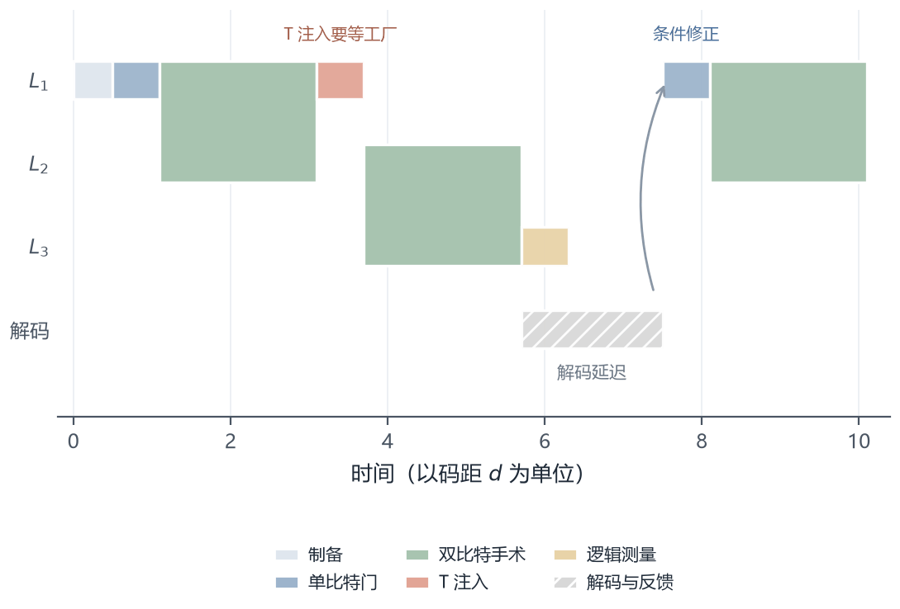
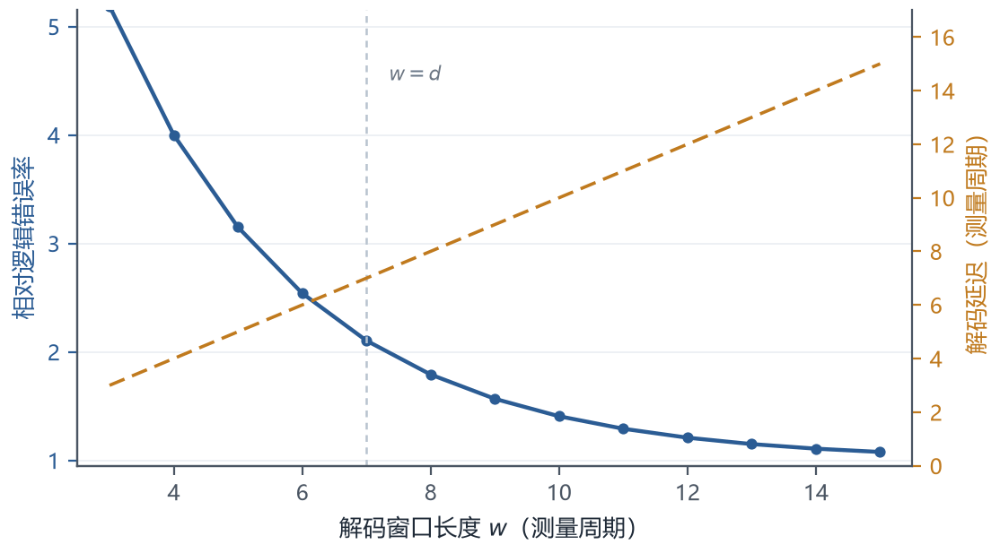

# 第 14 章　编译与解码的握手

一个算法写成量子线路，只是一串逻辑门。要把它跑在机器上，中间还缺一层翻译。它要把逻辑比特安排到版图上的位置，把每个门换成手术序列，把测量结果送进解码器，再把解码器的回答变成下一拍的指令。这一层叫编译器，它产出的不是二进制代码，是一张时刻表。

时刻表难排的地方在于，它要同时满足两类约束。一类来自量子线路，门之间有先后。另一类来自硬件，解码要花时间，反馈要绕一圈。前者是组合问题，后者是时序问题，两者纠缠在一起。

## 14.1 翻译分三层

编译的第一层是布局。逻辑比特数有几个到几千个，每个要占一块方格。方格之间要留出走廊，走廊的宽度至少一个稳定子，好让手术能进行。布局决定了哪些比特挨着，哪些离得远。

第二层是门分解。一个逻辑 CNOT 不是一条指令，是一串手术。一次 $M_{ZZ}$，一次 $M_{XX}$，一次辅助块的制备和测量，再按结果补泡利。这一串的每一步都占时间，都有明确的前后关系。

第三层是时序。把每个步骤放到时间轴上的某一格，保证没有两块方格在同一时刻抢同一段接缝，也要保证解码结果在该用的时候已经到齐。

第三层最容易被低估。教科书画线路图时，门是一个方块，方块之间的空白随便留。真实的时刻表上，空白是有价的，因为它对应相干时间，也对应错误累积。

## 14.2 布局决定成本

手术的成本与距离成正比。两块方格相邻，接缝就是现成的一条边，merge 立刻可以做。两块隔了三块方格，就得先把其中一个挪过去，或者用一个中间的辅助块做传送。

挪动的代价不小。一个 patch 平移一格，要重新定义边界上的稳定子，测 $d$ 轮才稳。挪三格就是 $3d$ 轮。这还没算挪动期间那块方格不能做别的事。

所以布局算法的目标和经典芯片的布局布线几乎一样，把通信频繁的逻辑比特放在一起，让需要交换的 pair 尽量相邻。区别在于度量的单位。经典芯片算的是连线长度和拥塞，量子版算的是 patch 之间的曼哈顿距离乘上 $d$，再加上走廊占用的面积。

有一条经验规则在实践中很好用。一个算法里，如果两个逻辑比特之间的 CNOT 数量占到总门数的很大一部分，它们就应该成为邻居，哪怕为此要挪动别的比特。反过来，只打一两次交道的比特，宁可让它们远一点，用传送解决。

## 14.3 时空体积

把一块方格在版图上的位置记作 $(x,y)$，时间记作 $t$，一个逻辑操作就占了三维空间里的一块体积。这块体积叫时空体积，单位是比特乘周期。

时空体积是个好用的指标，因为它把面积和时间合成一个数。同样的算法，可以让它跑得快但占芯片大，也可以让它跑得慢但省面积。两者的时空体积可能差不多。

这个取舍在编译时是显式的。并行度高，说明同一时刻有很多手术在跑，需要很多 patch 和很多走廊，但总时间短。并行度低，芯片小，但每个逻辑比特活得更久，积累的错误更多。

走廊是一个容易被纸面设计忽略的量。两块方格之间至少要留一格空隙，手术的连接线要从这里过。方格排得越密，走廊越少，能同时进行的手术就越少。有的编译方案为了省面积把走廊压到极限，结果并行度掉下来，总时间涨上去，时空体积反而更大。

图 14-1　三个逻辑比特加一个解码通道的时空占用。双比特手术跨两条通道，测量之后的解码延迟在时间轴上占一段，条件修正必须等它返回

图上那段斜线填充的等待，是容错编译特有的东西。经典编译器里没有它，因为经典门是瞬时的。这里它必须被显式排进去，否则时刻表就是错的。

## 14.4 解码器的时间模型

要排这段等待，编译器必须知道解码器的时间模型。这个模型不是一个数。

一个解码器有三个时间参数。吞吐是每周期能处理多少缺陷或多少比特。延迟是从拿到数据到给出结果的平均时间。尾部是同一件事的最坏情况。

表面码的解码是流水线的。第 $t$ 轮的综合征进来，解码器要等后面几轮的数据，才能判断第 $t$ 轮的一个缺陷该跟谁配对。所以输出天然滞后。滞后的长度取决于窗口大小。

编译器把这几个参数变成约束。如果一次测量的结果要用来决定下一个门的参数，那么这两个操作之间至少要隔一个延迟。如果只是记录一个修正，不急着施加，那就可以先欠着，攒到收尾时一起算。

前一种叫实时反馈，后一种叫延迟修正。分清这两类，是容错编译的核心技巧。大部分泡利修正是可以延迟的，少数几个必须实时。

## 14.5 窗口的宽度

滑动窗口解码是最常用的方案。解码器每次拿最近 $w$ 轮的数据，解一次，输出中间那几轮的结果，然后窗口往后滑。

$w$ 越大，边界效应越小。紧挨窗口边缘的缺陷，可用的邻域信息少，容易被配错。$w$ 接近码距 $d$ 时，边界效应基本消失。$w$ 远小于 $d$ 时，错误率会明显升高。

代价是延迟。窗口 $w$ 轮，输出至少滞后 $w$ 轮。$w=7$ 时滞后七个周期，七个微秒。对于需要实时反馈的操作，七微秒已经超过了整个测量周期的好几倍。

图 14-2　窗口长度对逻辑错误率与解码延迟的影响。错误率按 $p_L(w)=p_L(\infty)\left[1+3e^{-(w-4)/3}\right]$ 的示意模型计算，延迟按每周期一轮计

两条线交叉在 $w=d$ 附近，这就是常被选作默认值的原因。再短，错误率涨得快。再长，延迟白付。

工程上还有一个折中，把窗口做成两层。内层窗口短，用来产生快速的初步判断，供反馈使用。外层窗口长，用来产生最终判断，缓慢但准确。两者不一致时以外层为准，内层的判断只当参考。这种结构在文献里叫"两级解码"，实现复杂，但能把延迟和准确率同时照顾到。

## 14.6 反馈与控制流

量子线路里有条件操作。测一个比特，根据结果是 0 还是 1，决定下一个门做不做。这种结构在容错下变得很贵。

贵在链路。测量完成要读出，读出要数字化，数据要送到解码器，解码器要判断，判断要送回控制器，控制器要触发脉冲。这一圈走下来，几微秒到几十微秒。而一个逻辑门本身才十几微秒。

省时间的办法是把条件操作尽量推后。泡利修正不用真的施加，只要在经典寄存器里记一笔。比如某个门应该补一个 $X$，编译器不真做 $X$，只在后续所有测量结果上翻一个符号。这叫泡利框架追踪。整个线路跑完，只在前馈真正必要的少数几个位置施加修正。

不是所有条件都能推迟。魔术态注入里的条件 $S$ 门就不能推，因为它改变的是量子态本身，不是经典记录。T 态培养里的接受判定也不能推，因为不接受的态要当场丢弃。

于是控制流分成两段。一段是可以在经典侧自由重排的，一段是钉死在硬件时序上的。编译器的任务是把前者尽量做大，把后者尽量做少，并且把后者集中在几个时间点上，让硬件只需要在那些时刻保证低延迟。

这个思路有个副作用。集中以后，那几个点的延迟要求更苛刻，因为它们串在临界路径上。有些架构干脆为它们准备一条"快车道"，专用的解码器和专用的反馈线路，只处理这几个操作。慢车道处理其余的。

## 14.7 用什么衡量一个编译器

再说指标。一个容错编译器好不好，不能只看线路深度。

第一个指标是时空体积，前面说过。它决定芯片要多大、跑多久。

第二个指标是 T 态消耗。T 门是瓶颈资源，编译器有没有把 T 门用得更少，直接决定总时间。有些优化在逻辑层看是省了门，换成手术以后反而更贵，因为引入了额外的移动。

第三个指标是峰值并行度。它决定了需要多少 patch 同时存在，也就决定了芯片的最小面积。峰值太高，芯片装不下。峰值太低，时间拉长。

第四个指标是解码器负载。编译出来的时刻表，缺陷的产生速率不能超过解码器的吞吐。这个约束在纸面上很容易被忘掉，因为它不属于量子线路，属于经典硬件。

第五个指标是错误预算。不同的排法，逻辑比特活的时间不同，积累的错误不同。一个跑得快的方案可能错误率更高，因为它让更多比特同时活跃。

还有一个常被忽略的指标，编译本身要花多久。一个几千逻辑比特、上百万个手术的线路，搜索空间大到没法穷举，实用的编译器都靠启发式。跑一次几分钟到几小时不等，迭代一轮的周期被拉得很长。做架构研究的人常常花一半时间在等编译器出结果，这不是笑话，是真实的瓶颈。

这些指标互相牵制，没有单一最优。实际的做法是给定硬件参数，先算一个可行解，再在这个解附近做局部优化。优化器往往不是找最优，是找"不违反约束且不太浪费"。

## 14.8 一个具体的账

举一个小例子，把前面的东西串起来。一个三比特的 Toffoli，标准分解要七个 T 门和一些 Clifford 门。假设码距 $d=7$，一次逻辑 CNOT 二十个周期，一次 T 注入加工厂等待三百个周期。

七个 T 门，如果串行，两千一百个周期。加上 Clifford 部分，两千五百个周期左右。如果工厂能并行供应，七个 T 门可以同时准备，时间压到三百加一点。差别是七倍。

这个差别说明什么。说明编译的瓶颈不在量子线路的深度，在资源的供给。一个只会排门顺序的编译器，做不出好结果。它必须知道工厂在哪、产能多少、缓冲区多深，才能把 T 门的等待藏到别的操作后面去。

第 15 章换一个方向，从器件参数出发，把这些时间换算成错误率，看一台机器的错误预算应该怎么记。
